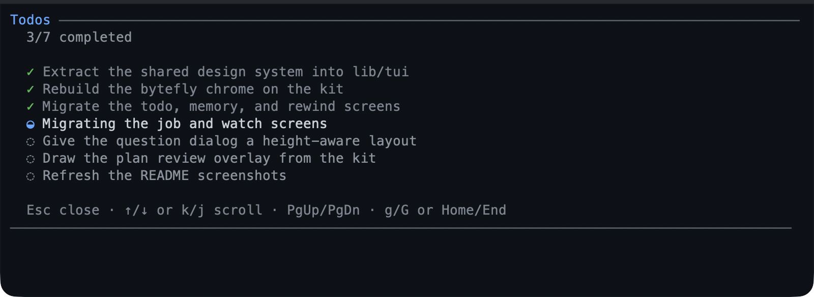
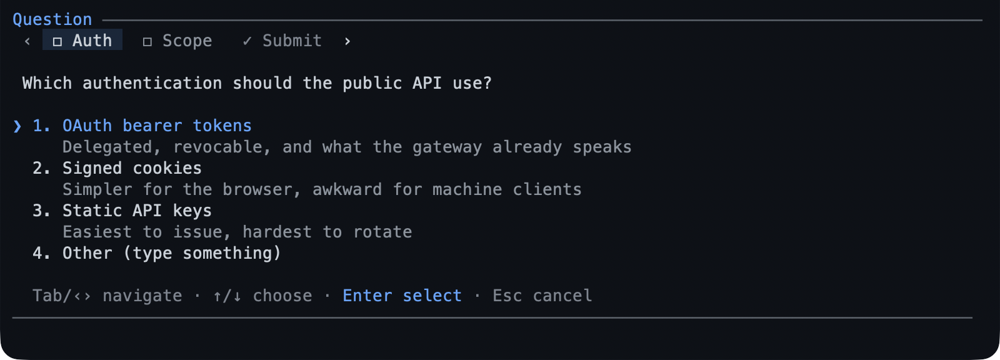
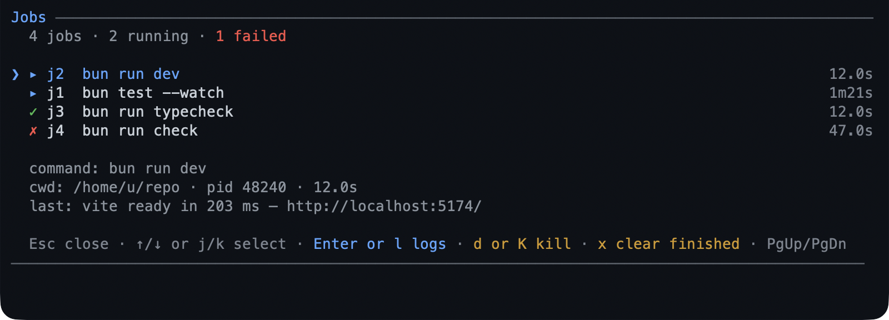
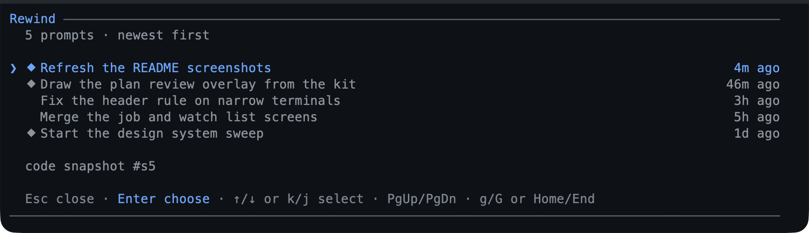
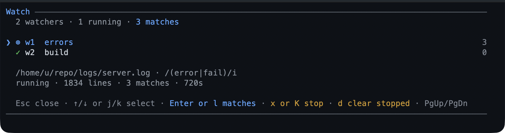

# my-pi-agent

**English** · [简体中文](./README.zh-CN.md)

[](https://github.com/gavin-hu/my-pi-agent/actions/workflows/ci.yml)
[](https://www.npmjs.com/package/@gavin-hu/my-pi-agent)
[](./LICENSE)
[](https://pi.dev)

`my-pi-agent` is a single [Pi](https://pi.dev) package that adds a curated set
of extensions, skills, and themes to the agent you already use — install the pack, turn
off what you do not want, and keep using Pi unchanged.

This page is the catalog and the setup instructions. For how to use a feature —
the keys, the commands, and what you should see — start with the
[user guide](./docs/user-guide/).

![A terminal window running the Pi TUI: the bytefly header naming Pi and bytefly's versions, three key-hint rows, a nameplated message with its answer and an edit diff behind the rail, a notice that two background jobs finished, naming the test run that passed and the build that failed, the turn rule, the goal and todo rails, the input editor with a half-typed request between its two rules, and the two-line footer — the plan chip and the branch above, the context gauge, the priced cost against its $5 budget, and the model below](assets/screens/chrome.png)

## Contents

- [Why this pack](#why-this-pack)
- [Quick start](#quick-start)
- [What you get](#what-you-get)
- [Configuration](#configuration)
- [Documentation](#documentation)
- [Contributing](#contributing)
- [License](#license)

## Why this pack

Pi ships a small, sharp core. This package is the layer on top for people who
want the agent to *think first and work safely*:

- **Plan, then execute.** A read-only planning mode turns a task into a reviewed
  plan file that the agent then follows step by step.
- **Delegate and parallelize.** Run specialist subagents in their own Pi
  processes, push a long build into a background job, and let a watcher tail a
  log until it matters — then run several sessions on one repository through a
  shared bus, each owning its slice, all while you keep the thread.
- **Never wreck the checkout.** Isolation is one command: the task moves onto its
  own branch in a `git worktree`, and each prompt's first change is snapshotted,
  so a bad turn is one `/rewind` away.
- **Remember across sessions.** Durable notes live in plain markdown that you
  can read, edit, and version.
- **Reach the web and your files.** Search, fetch, browse, open, and read
  documents and spreadsheets from inside the session, and answer a WeChat chat
  through a bridge to the live session.

Everything is optional and independently toggleable. Nothing is forked, and no
installed Pi file is written to: Pi discovers the resources through the `pi`
manifest in [`package.json`](./package.json), so the package upgrades with Pi
like any other.

## Quick start

Requires a working [Pi](https://pi.dev) installation.

```bash
pi install npm:@gavin-hu/my-pi-agent
```

[User guide](./docs/user-guide/) has the other sources — git, a
pinned release, a project-local install, and a trial that writes nothing — plus
the fit decision, the first workflows, and how to remove the pack.

`git` on `PATH` is needed by [`worktree`](./docs/extensions/worktree.md) and
[`rewind`](./docs/extensions/rewind.md); everything else degrades or disables cleanly,
and `/bytefly doctor` names what is missing, including optional runtime pieces.
Windows, macOS, and Linux all work, and the full check suite runs on each in CI.

Then, from inside Pi:

- `/bytefly [extension] [refresh]` opens the control center on Extensions, lists
  every loaded extension with its runtime health, enables or disables one, and
  clears a project override with `x`.
- `/bytefly settings` opens the control center's Settings section: one flat list
  of the twelve preferences a session changes, each with its value beside the
  label, `Space`/`Enter` to change one and `Tab` for Global/Project scope. Every
  other key is a `bytefly.json` edit, listed in the configuration reference.
- `/bytefly skills` opens the control center's Skills section: one row per Pi
  skill with its enable checkbox, its declared description underneath, and
  `Space` to switch it on or off for the active scope.
- `/bytefly doctor [extension] [refresh]` prints the doctor report —
  `run_doctor`'s text — and checks that each enabled extension has what it needs
  at runtime.
- `/bytefly update` re-runs the package update check now and reports the
  updateable packages, this package's version and release URL, or a skip.
- `/plan <task>` starts a task in read-only planning mode.
- `/skill:init` creates or updates the instruction file Pi reads through a short
  built-in interview and a plan you review first.

One thing the pack does on its own: once per interactive session, `bytefly`
asks Pi's package manager which configured packages are behind, suppresses Pi's
own startup update blocks, and posts one themed notice naming
`pi update --extensions`, plus one for a newer Pi that names `pi update` and the
changelog; a new version also marks the header — this package's, and Pi's own.
Nothing about the session is sent: Pi's own release request is re-rendered, and
this package's newest version comes from one fixed `GET` of npm's `latest`
document. `PI_OFFLINE` skips the check;
[`docs/security.md`](./docs/security.md) covers the trust boundaries.

## What you get

21 extensions, 4 packaged skills, and 2 themes, grouped by the promises the
[roadmap](./ROADMAP.md) tracks; the [guide](./docs/user-guide/) covers the same
ground chapter by chapter. Each extension's own page in `docs/extensions/` has
the full tool and command surface, opening with its capabilities.

### Plan and delegate

| Extension | Tools and commands | What it does |
|---|---|---|
| [`plan`](./docs/extensions/plan.md) | `enter_plan_mode`, `write_plan`, `exit_plan_mode`, `cancel_plan_mode`, `set_plan_steps`, `/plan`, `--plan` | Read-only planning: the model investigates, saves a plan under `~/.pi/agent/plans/<repo-key>` — one store per repository, shared by its worktrees — and you approve it before anything is written. Review in the TUI, or open it in a browser to leave inline comments: the page follows the plan file live, and you can hand one reviewer link per teammate so each comments under their own name. The `init` skill uses the same review to create or update a project's `AGENTS.md`. |
| [`check`](./docs/extensions/check.md) | `run_check`, `/check` | Detect the project's test, lint, or typecheck command (or take `check.command`), run it in a supervised process, and turn failures into a navigable `file:line` list. |
| [`subagent`](./docs/extensions/subagent.md) | `subagent`, `/agents` | Delegate a task to a specialist agent (`explorer`, `planner`, `reviewer`, `worker`, `researcher`, `tester`, `debugger`, `documenter`) in its own Pi process — single, parallel, chained, or in the background, with a footer chip while it runs and a finish notice. |
| [`todo`](./docs/extensions/todo.md) | `todo`, `/todos` | A persistent task list (`pending` / `in_progress` / `completed`) with a one-line widget. |
| [`goal`](./docs/extensions/goal.md) | `goal`, `/goal` | A persistent session objective, kept in a widget and restated before each turn. |
| [`question`](./docs/extensions/question.md) | `ask_user_question` | Ask you one or more structured questions (labelled options plus free-form "Other") and wait. |
| [`job`](./docs/extensions/job.md) | `job`, `/jobs` | Run long-lived shell commands in the background; inspect logs, wait, or kill them. |
| [`watch`](./docs/extensions/watch.md) | `watch`, `/watch` | Tail a file or command output, match lines against patterns, and alert you or hand matching lines to the agent. |
| [`session-bus`](./docs/extensions/session-bus.md) | `session`, `/sessions` (screen) | Coordinate parallel Pi sessions on one repository: discover peers, exchange short messages/events, consume an inbox, or claim paths before editing, with `/sessions` as a live board of peers, unread mail, and claims. Local, pull-based by default, with an opt-in inbox watch that raises this session's turn once it is idle; it never spawns an agent. |
| [`board`](./docs/extensions/board.md) | `board`, `/board` | One shared feature board per repository: a card per feature, which any session claims, moves, edits, notes, finishes, and archives — a finished card leaves the board for an `archive/` pile with its notes and landed commit still readable, so a long history stops costing every read — and one loopback page that shows the same cards live in a **Board** and a **Team** tab. The page is a read view — the tools are the only writers — served as the seat `team-lead`, so a second session opens the same page instead of starting a rival one, and handing a card to a teammate is `team`'s job because only it can message them. A card can carry a priority and name the cards it waits on. Steps stay in the owner's plan and `todo`; a card is the feature, its owner, and the history that explains it. `board.port` in `bytefly.json` pins the page's port, so a bookmarked URL survives a restart. |
| [`team`](./docs/extensions/team.md) | `team`, `/team` | The lead's round over the same board. `/team join <label>` puts a session on the team, and `/board` does it for the lead as `team-lead`; then `assign` hands a feature to a running session, `offer` hands one to whoever is free — a broadcast that writes nothing, claimed by the first taker — and `reclaim` takes a card back to To do. A result says who will be woken for it and who will read it at their next turn, `/team` prints the round in the terminal without a browser, and nothing is spawned. |
| [`context`](./docs/extensions/context.md) | `/context` | Show where the context window goes — system prompt, tool definitions, conversation by role, injected notes — and compact from the report with the before and after numbers. |

### Keep your work safe

| Extension | Tools and commands | What it does |
|---|---|---|
| [`worktree`](./docs/extensions/worktree.md) | `enter_worktree`, `exit_worktree`, `prune_worktrees`, `list_worktrees`, `/worktree` (screen), `/worktree enter\|exit\|prune`, `--worktree` | Work inside an isolated `git worktree` on its own branch; the built-in read/write/edit/bash tools follow, and cleanup refuses to throw work away. |
| [`rewind`](./docs/extensions/rewind.md) | `/rewind`, `/review`, `↺ N` status chip | Snapshot the repo before each prompt's first change, under `refs/pi/rewind`, restore code, conversation, or both, and review the latest turn's changes before reverting a file. |
| [`memory`](./docs/extensions/memory.md) | `memory`, `/memory` | Durable cross-session notes as human-editable markdown, injected into each run and managed through the `/memory` picker. |

### Reach the world

| Extension | Tools and commands | What it does |
|---|---|---|
| [`web-access`](./docs/extensions/web-access.md) | `web_search`, `web_fetch` | Search the web (keyless DuckDuckGo by default, optional SearXNG or Brave) and fetch a page as readable text, with paging, `find`, per-hop SSRF checks, a JSON/CSV/XML body rendered as a table or a tree, and optional PDF support. |
| [`file-browse`](./docs/extensions/file-browse.md) | `/browse` | Start a loopback, read-only file browser rooted at the working directory, with Markdown preview, a fuzzy quick-open palette, a `path:12-30` reference copied from a selection, live status for a page left open, and a reload hint when the folder it lists changes. |
| [`file-read`](./docs/extensions/file-read.md) | `read_doc` | Extract text from a local PDF, DOCX, DOC, ODT, RTF, or XLSX in process, paged. |
| [`file-open`](./docs/extensions/file-open.md) | `/open`, `open_path` | Open or reveal a file or directory in the OS-native application. |
| [`wechat`](./docs/extensions/wechat.md) | `/wechat`, `send_wechat` | Bridge a WeChat chat to the live session over the Weixin iLink bot API; inbound text, images, and files become turns. |

### Chrome and upkeep

| Extension | Tools and commands | What it does |
|---|---|---|
| [`bytefly`](./docs/extensions/bytefly.md) | `/bytefly` (with the `doctor`, `settings`, `skills`, `update`, and `upgrade` subcommands), `run_doctor` | The visible layer: a themed header with a width-adaptive footer, a live run line on Pi's working row (tool, tool count, and elapsed time), and a transcript where every tool block leads with its call line and rails its result under it. `/bytefly` switches extensions and skills and holds the curated settings, and `/bytefly upgrade` installs a pending update through Pi's own package manager behind a confirmation; opt-in `notify` raises OS notifications when a run, a job, or a question needs you, and Pi's own startup update blocks become themed notices and header markers. `bytefly.json` is the config document every extension reads. |

### Skills

Packaged workflows loaded on demand: each skill's name and description are
advertised to the model, and its instructions load only when the task matches
(`/skill:<name>` forces one).

| Skill | What it does |
|---|---|
| [`init`](./skills/init/SKILL.md) | Creates or updates the instruction file Pi actually reads (`AGENTS.md`, or `AGENTS.override.md` when it shadows it) through a built-in interactive interview and plan review, deriving commands, generated paths, packages, and purpose from repository evidence. |
| [`refactor`](./skills/refactor/SKILL.md) | Audits a project or path for refactoring opportunities: duplication, oversized modules, coupling, drift, and high-churn code with weak tests. A bundled `scripts/inventory.ts` measures sizes, fan-in, churn, and test proximity so a finding is a number with a source, and the ranked shortlist has evidence and verification commands; it then carries the candidate you choose through a behaviour-preserving refactor, and the audit itself is read-only. |
| [`project-docs`](./skills/project-docs/SKILL.md) | Keeps a project's documents telling the truth about the code: a read-only audit of the front door, the roadmap, the contributor path, and the changelog against the tree and against each other, then one mode per act that writes — a changelog bullet in the same commit as the change, a release section curated from the project's own rules, a shipped roadmap item deleted with the rest renumbered, and the front door's catalog, counts, and examples synced. Discovers each project's category names, scope spelling, item form, and guards rather than assuming a template, and a bundled `scripts/state.ts` prints the changelog's tag, window, and unreleased categories. |
| [`next`](./skills/next/SKILL.md) | Suggests the next todos by priority — loose work, a broken or unfinished promise — from this conversation once it has done work, and from the tree only when it is empty, with the words and a path after the command saying what to ask and where to look. Read-only, and capped at a short numbered list with evidence and the command that starts each. |

### Themes

[`bytefly-dark`](./themes/bytefly-dark.json) is a GitHub-inspired dark palette
and [`bytefly-light`](./themes/bytefly-light.json) its light companion, with
optional automatic light/dark switching. Installing the pack does not change
your theme: pick one through `/settings` → **Theme** (or `/bytefly settings` →
**Theme**), or set
`"theme": "bytefly-light/bytefly-dark"` for switching. The screenshots in this
README use `bytefly-dark`.

### Screens

<table>
<tr>
<td width="50%"></td>
<td width="50%"></td>
</tr>
<tr>
<td width="50%"></td>
<td width="50%"></td>
</tr>
<tr>
<td width="50%"></td>
<td width="50%"></td>
</tr>
</table>

### Tool renderings

Every tool block as the transcript draws it — the tool's own call line as the
headline, then the result body two columns under it behind the transcript rail —
each tool's own renderer (or bytefly's generic fallback): the user nameplate and
a notice, Pi's built-ins, and every tool this package registers. The rail glyph
is the `chrome.rail` setting.


`bun run screenshot:tools` regenerates it; `bun run screenshot:tool-pngs` writes
one image per tool under [`assets/tools/`](./assets/tools).

Ready to use one? The [user guide](./docs/user-guide/) has a walkthrough for
each: the first run, the keys that matter, and what to expect on screen.

## Configuration

Most extensions need no configuration. Every extension setting lives in one
shared document, `bytefly.json`, read from `<agent-dir>/bytefly.json` and
merged with `<cwd>/.pi/bytefly.json` (project wins), under a top-level section
named for the extension. Each extension's page under `docs/extensions/` covers
the behaviour
around its keys, and
[`docs/configuration.md`](./docs/configuration.md) has the resolution rules, the
settings screen walkthrough, and every section's keys with their type, default,
and bounds.

Every extension is on by default. To load the pack without some of them, set
`PI_DISABLED_EXTENSIONS` to a comma- or whitespace-separated list of extension
names (the directory names under [`extensions/`](./extensions/)):

```bash
PI_DISABLED_EXTENSIONS=todo,job pi -e .
```

Names are compared case-insensitively and unknown names are ignored. This only
stops the factories from registering; to drop the whole package, use Pi's
`--no-extensions` or remove the package from your settings.

## Documentation

| Guide | What it covers |
|---|---|
| [User guide](./docs/user-guide/) | A chaptered manual: install, every feature, settings, troubleshooting, and a command reference. |
| [Configuration](./docs/configuration.md) | Resolution, the settings screen, and every `bytefly.json` key with its default and bounds. |
| [Architecture](./docs/architecture.md) | The target shape: the load path, the extension contract, the turn, state, layers, lifetimes, and where a change belongs. |
| [Extension docs](./docs/extensions/) | One page per extension, opening with its capabilities: the tool and command surface, the integration contract, and the design notes. |
| [Development](./docs/development.md) | Local setup, checks, tests, cross-platform notes, and the release process. |
| [Security](./docs/security.md) | Trust boundaries for the loopback and remote surfaces. |
| [Roadmap](./ROADMAP.md) | Where the pack is going, grouped by the README's promises, with the evidence behind each item. |
| [Documentation index](./docs/README.md) | The map of everything: the guides, and the deep contracts behind them, by audience. |

## Contributing

Contributions are welcome. Start with [`CONTRIBUTING.md`](./CONTRIBUTING.md) for
the setup, the worktree branch flow, and the checks a change must pass. AI
coding agents should read [`AGENTS.md`](./AGENTS.md).

## License

MIT
