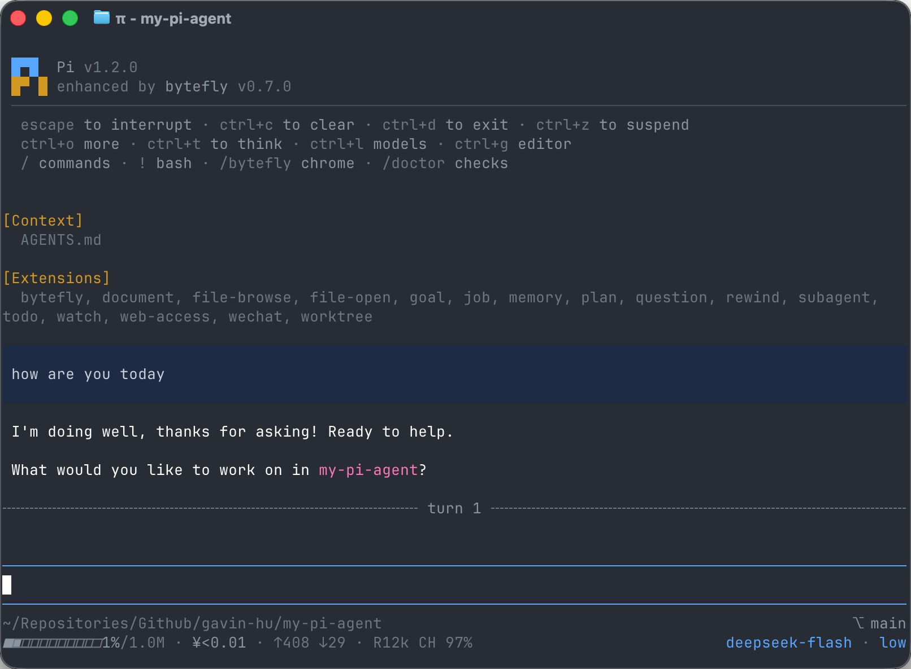

# my-pi-agent

**English** · [简体中文](./README.zh-CN.md)

[](https://github.com/gavin-hu/my-pi-agent/actions/workflows/ci.yml)
[](./LICENSE)
[](https://pi.dev)

Plan before you act, delegate the work, keep the main checkout clean, and carry
context across sessions. `my-pi-agent` is a single [Pi](https://pi.dev) package
that adds sixteen extensions and two themes — install the pack, turn off what
you do not want, and keep using Pi unchanged.



## Contents

- [Why this pack](#why-this-pack)
- [Quick start](#quick-start)
- [What you get](#what-you-get)
- [Configuration](#configuration)
- [Documentation](#documentation)
- [Requirements](#requirements)
- [Contributing](#contributing)
- [License](#license)

## Why this pack

Pi ships a small, sharp core. This package is the layer on top for people who
want the agent to *think first and work safely*:

- **Plan, then execute.** A read-only planning mode turns a task into a reviewed
  plan file that the agent then follows step by step.
- **Delegate and parallelize.** Run specialist subagents in their own Pi
  processes to explore, review, test, or implement while you keep the thread.
- **Never wreck the checkout.** Work happens in an isolated `git worktree`, and
  every prompt is snapshotted so a bad turn is one `/rewind` away.
- **Remember across sessions.** Durable notes live in plain markdown that you
  can read, edit, and version.
- **Reach the web and your files.** Search, fetch, browse, open, and read
  documents — all from inside the session.

Everything is optional and independently toggleable. Nothing is patched or
forked: Pi discovers the resources through the `pi` manifest in
[`package.json`](./package.json), so the package upgrades with Pi like any
other.

## Quick start

Requires a working [Pi](https://pi.dev) installation.

```bash
pi install npm:@gavin-hu/my-pi-agent                       # install from npm
pi install git:github.com/gavin-hu/my-pi-agent             # install from git
pi install git:github.com/gavin-hu/my-pi-agent@v0.8.0      # pin a release
pi install ./ -l                                           # project-local (.pi/settings.json)
pi -e .                                                    # try it for one run
```

Then, from inside Pi:

- `/bytefly [extension] [refresh]` opens the extension screen, lists every loaded
  extension with its runtime health, and enables or disables one.
- `/bytefly doctor [extension] [refresh]` prints the doctor report —
  `run_doctor`'s text — and checks that each enabled extension has what it needs
  at runtime.
- `/settings` → **Theme** selects a theme.
- `/plan <task>` starts a task in read-only planning mode.

## What you get

Sixteen extensions and two themes, grouped by what you are trying to do. Each
extension's own `README.md` has the full tool and command surface.

### Plan and delegate

| Extension | Tools and commands | What it does |
|---|---|---|
| [`plan`](./extensions/plan/) | `enter_plan_mode`, `write_plan`, `exit_plan_mode`, `set_plan_steps`, `/plan`, `--plan` | Read-only planning: the model investigates, saves a plan under `.pi/plans`, and you approve it before anything is written. Review in the TUI, or open it in a browser to leave inline comments. |
| [`subagent`](./extensions/subagent/) | `subagent` | Delegate a task to a specialist agent (`explorer`, `planner`, `reviewer`, `worker`, `researcher`, `tester`, `debugger`, `documenter`) in its own Pi process — single, parallel, or chained. |
| [`todo`](./extensions/todo/) | `todo`, `/todos` | A persistent task list (`pending` / `in_progress` / `completed`) with a one-line widget. |
| [`goal`](./extensions/goal/) | `goal`, `/goal` | A persistent session objective, kept in a widget and restated before each turn. |
| [`question`](./extensions/question/) | `ask_user_question` | Ask you one or more structured questions (labelled options plus free-form "Other") and wait. |
| [`job`](./extensions/job/) | `job`, `/jobs` | Run long-lived shell commands in the background; inspect logs, wait, or kill them. |
| [`watch`](./extensions/watch/) | `watch`, `/watch` | Tail a file or command output, match lines against patterns, and alert you or hand matching lines to the agent. |

### Keep your work safe

| Extension | Tools and commands | What it does |
|---|---|---|
| [`worktree`](./extensions/worktree/) | `enter_worktree`, `exit_worktree`, `prune_worktrees`, `list_worktrees`, `/worktree*`, `--worktree` | Work inside an isolated `git worktree` on its own branch; the built-in read/write/edit/bash tools follow, and cleanup refuses to throw work away. |
| [`rewind`](./extensions/rewind/) | `/rewind`, `↺ N` status chip | Snapshot the repo on every prompt under `refs/pi/rewind` and restore code, conversation, or both. |
| [`memory`](./extensions/memory/) | `memory`, `/memory` | Durable cross-session notes as human-editable markdown, injected into each run and managed through the `/memory` picker. |

### Reach the world

| Extension | Tools and commands | What it does |
|---|---|---|
| [`web-access`](./extensions/web-access/) | `web_search`, `web_fetch` | Search the web (keyless DuckDuckGo by default, optional SearXNG or Brave) and fetch a page as readable text, with paging, `find`, per-hop SSRF checks, and optional PDF support. |
| [`file-browse`](./extensions/file-browse/) | `/browse` | Start a loopback, read-only file browser rooted at the working directory, with Markdown preview and a fuzzy quick-open palette. |
| [`document`](./extensions/document/) | `read_doc` | Extract text from a local PDF, DOCX, DOC, ODT, RTF, or XLSX in process, paged. |
| [`file-open`](./extensions/file-open/) | `/open`, `open_path` | Open or reveal a file or directory in the OS-native application. |
| [`wechat`](./extensions/wechat/) | `/wechat`, `send_wechat` | Bridge a WeChat chat to the live session over the Weixin iLink bot API; inbound text, images, and files become turns. |

### Chrome and upkeep

| Extension | Tools and commands | What it does |
|---|---|---|
| [`bytefly`](./extensions/bytefly/) | `/bytefly` (with the `doctor` subcommand), `run_doctor` | A themed header and width-adaptive footer, a rule between completed turns, the `/bytefly` extension screen that lists every extension with its health and enables or disables one (`/bytefly doctor` prints the doctor report), and an opt-in `notify` capability that raises OS notifications when a run or a background job finishes or the agent asks for input. DeepSeek is priced out of the box, and `bytefly.json` is the shared config document every extension reads. |
| [`bytefly-dark`](./themes/bytefly-dark.json) / [`bytefly-light`](./themes/bytefly-light.json) | `/settings` → **Theme** | A GitHub-inspired dark palette and its light companion, with optional automatic light/dark switching. |

### Screens

<table>
<tr>
<td width="50%"></td>
<td width="50%"></td>
</tr>
<tr>
<td width="50%"></td>
<td width="50%"></td>
</tr>
</table>

## Configuration

Most extensions need no configuration. Every setting lives in one shared
document, `bytefly.json`, read from `<agent-dir>/bytefly.json` and merged with
`<cwd>/.pi/bytefly.json` (project wins), under a top-level section named for the
extension. Each extension's `README.md` lists its keys,
[`docs/configuration.md`](./docs/configuration.md) indexes them, and
[`assets/bytefly.schema.json`](./assets/bytefly.schema.json) validates the file.

Every extension is on by default. To load the pack without some of them, set
`PI_DISABLED_EXTENSIONS` to a comma- or whitespace-separated list of extension
names (the directory names under [`extensions/`](./extensions/)):

```bash
PI_DISABLED_EXTENSIONS=todo,job pi -e .
```

Names are compared case-insensitively and unknown names are ignored. This only
stops the factories from registering; to drop the whole package, use Pi's
`--no-extensions` or remove the package from your settings.

## Documentation

| Guide | What it covers |
|---|---|
| [Getting started](./docs/getting-started.md) | Requirements, install options, verifying the load, themes. |
| [Extensions](./docs/extensions.md) | The full catalog of every extension and theme. |
| [Configuration](./docs/configuration.md) | Config-file resolution, the per-extension index, environment variables. |
| [Architecture](./docs/architecture.md) | How the package, its extensions, and `lib/` fit together. |
| [Development](./docs/development.md) | Local setup, checks, tests, cross-platform notes, and the release process. |
| [Security](./docs/security.md) | Trust boundaries for the loopback and remote surfaces. |

## Requirements

- **Pi** — a working installation; `my-pi-agent` is a package, not a fork.
- **OS** — Windows, macOS, and Linux; the full check suite runs on all three in
  CI.
- **git** on `PATH` for the `worktree` and `rewind` extensions; everything else
  degrades or disables cleanly, and `/bytefly doctor` tells you what is missing.
- Optional runtime pieces (for example a browser for HTML exports) are reported
  per extension by `/bytefly doctor`.

## Contributing

Contributions are welcome. Start with [`CONTRIBUTING.md`](./CONTRIBUTING.md) for
the setup, the worktree branch flow, and the checks a change must pass. AI
coding agents should read [`AGENTS.md`](./AGENTS.md).

## License

MIT
