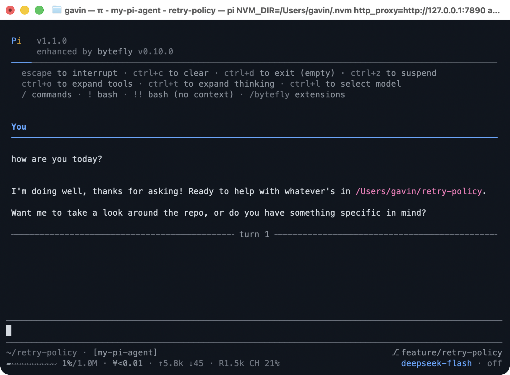

# my-pi-agent

[English](./README.md) · **简体中文**

[](https://github.com/gavin-hu/my-pi-agent/actions/workflows/ci.yml)
[](https://www.npmjs.com/package/@gavin-hu/my-pi-agent)
[](./LICENSE)
[](https://pi.dev)

`my-pi-agent` 是一个 [Pi](https://pi.dev) 包，在你已经使用的智能体之上新增一组精选
扩展、技能和主题 —— 安装整个包，关掉你不需要的部分，其余照常使用 Pi。

本页是目录与安装说明。要了解某个功能怎么用 —— 按键、命令以及应有的效果 ——
请先看[用户指南](./docs/user-guide/)。



## 目录

- [为什么选择这个包](#为什么选择这个包)
- [快速开始](#快速开始)
- [包含内容](#包含内容)
- [配置](#配置)
- [文档](#文档)
- [参与贡献](#参与贡献)
- [许可证](#许可证)

## 为什么选择这个包

Pi 提供一个精简而锐利的内核。这个包是在其之上的一层，面向希望智能体*先思考、
再安全行动*的人：

- **先规划，再执行。** 只读的规划模式把一次任务变成一份可审阅的计划文件，智能体
  随后按步骤执行。
- **委派与并行。** 在各自的 Pi 进程中运行专职子智能体，把耗时构建交给后台任务，
  让 watcher 盯住日志直到出现关键行 —— 你继续把握主线。
- **绝不搞乱检出区。** 隔离只需一条命令：任务切到自己分支的 `git worktree` 中，
  每次提示还会生成快照，因此一次糟糕的回合只需一个 `/rewind` 就能回退。
- **跨会话记忆。** 持久笔记以纯 Markdown 保存，可读、可改、可纳入版本控制。
- **连通网络与文件。** 在会话内搜索、抓取、浏览、打开和读取文档与表格，还可通过桥接
  在微信里直接回答当前会话。

一切都是可选的，且可独立开关。没有任何东西被分叉，也没有修改已安装的 Pi 文件：
Pi 通过 [`package.json`](./package.json) 里的 `pi` manifest 发现这些资源，因此
该包能像其他包一样随 Pi 一起升级。

## 快速开始

需要一个可用的 [Pi](https://pi.dev) 安装。

```bash
pi install npm:@gavin-hu/my-pi-agent
```

[用户指南](./docs/user-guide/) 介绍其余安装方式——git、固定版本、
仅项目本地安装，以及不写入任何内容的试用——还有适用性判断、首个工作流和移除方式。

`git` 需在 `PATH` 上，供 [`worktree`](./extensions/worktree/) 与
[`rewind`](./extensions/rewind/) 使用；其余部分会优雅降级或禁用，
`/bytefly doctor` 会指出缺少什么，包括可选的运行时组件。
Windows、macOS 和 Linux 均可运行，完整检查套件在每个平台上都会执行。

然后在 Pi 中：

- `/bytefly [extension] [refresh]` 打开控制中心的 Extensions 区，列出每个已加载扩展
  及其运行时健康状况，启用或禁用一个扩展，并用 `x` 清除项目级覆盖。
- `/bytefly settings` 打开控制中心的 Settings 区：一次会话会改动的十四项设置排成
  一列，值紧跟在名称之后；用 `Space`/`Enter` 修改，用 `Tab` 切换 Global/Project
  作用域。其余键都是 `bytefly.json` 编辑，见配置参考。
- `/bytefly doctor [extension] [refresh]` 打印 doctor 报告（`run_doctor` 的文本），
  检查每个已启用扩展在运行时是否具备所需条件。
- `/bytefly update` 立即重跑包更新检查，报告可更新的包、本包版本与 release URL，
  或跳过原因。
- `/plan <任务>` 以只读规划模式开始一个任务。
- `/skill:init` 通过内置的简短访谈和先审阅的计划创建或更新 `AGENTS.md`。

还有一件包会自行做的事：每次交互式会话启动时，`bytefly` 询问 Pi 的包管理器
哪些已配置的包有更新，抑制 Pi 自己的启动更新块，并用一个主题化 notice 列出它们
和 `pi update --extensions`；本包的新版本还会标在头部。不会发送任何会话内容，
`PI_OFFLINE` 可跳过检查；信任边界见 [`docs/security.md`](./docs/security.md)。

## 包含内容

18 个扩展、3 个随包技能，以及 2 个主题，按你想达成的目标分组。每个扩展自己的 `README.md`
提供完整的工具与命令说明。

### 规划与委派

| 扩展 | 工具与命令 | 说明 |
|---|---|---|
| [`plan`](./extensions/plan/) | `enter_plan_mode`, `write_plan`, `exit_plan_mode`, `set_plan_steps`, `/plan`, `--plan` | 只读规划：模型先调研，把计划保存到 `.pi/plans` 下，你在写入任何内容前先批准。可在 TUI 中审阅，或在浏览器中打开以留下行内评论。`init` 技能复用同一审阅流程来创建或更新项目的 `AGENTS.md`。 |
| [`check`](./extensions/check/) | `run_check`, `/check` | 检测项目的测试、lint 或类型检查命令（或使用 `check.command`），在受监管的进程中运行，并把失败整理成可导航的 `file:line` 列表。 |
| [`subagent`](./extensions/subagent/) | `subagent`, `/agents` | 把任务委派给专职智能体（`explorer`、`planner`、`reviewer`、`worker`、`researcher`、`tester`、`debugger`、`documenter`），运行在它自己的 Pi 进程中 —— 单个、并行、链式或在后台运行；后台运行时在页脚显示数量，完成后发出提示。 |
| [`todo`](./extensions/todo/) | `todo`, `/todos` | 持久任务列表（`pending` / `in_progress` / `completed`），配一行式 widget。 |
| [`goal`](./extensions/goal/) | `goal`, `/goal` | 持久会话目标，保存在 widget 中，并在每个回合前重述。 |
| [`question`](./extensions/question/) | `ask_user_question` | 向你提出一个或多个结构化问题（带标签的选项外加自由填写的“其他”）并等待回答。 |
| [`job`](./extensions/job/) | `job`, `/jobs` | 在后台运行长时 shell 命令；查看日志、等待或结束它们。 |
| [`watch`](./extensions/watch/) | `watch`, `/watch` | 跟踪文件或命令输出，按模式匹配行，并提醒你或把匹配的行交给智能体。 |
| [`context`](./extensions/context/) | `/context` | 显示上下文窗口的去向 —— 系统提示、工具定义、按角色拆分的对话、注入的笔记 —— 并从报告中触发压缩，给出压缩前后的数字。 |

### 保护你的工作

| 扩展 | 工具与命令 | 说明 |
|---|---|---|
| [`worktree`](./extensions/worktree/) | `enter_worktree`, `exit_worktree`, `prune_worktrees`, `list_worktrees`, `/worktree status|enter|exit|prune`, `--worktree` | 在隔离的 `git worktree` 里、在独立分支上工作；内置的 read/write/edit/bash 工具会跟随，清理时也不会丢弃工作。 |
| [`rewind`](./extensions/rewind/) | `/rewind`, `/review`, `↺ N` 状态标记 | 每次提示时在 `refs/pi/rewind` 下对仓库生成快照，可恢复代码、对话或两者，并在还原文件前审阅本轮改动。 |
| [`memory`](./extensions/memory/) | `memory`, `/memory` | 跨会话的持久笔记，以可人工编辑的 Markdown 保存，注入每次运行，并通过 `/memory` 选择器管理。 |

### 连通外部世界

| 扩展 | 工具与命令 | 说明 |
|---|---|---|
| [`web-access`](./extensions/web-access/) | `web_search`, `web_fetch` | 搜索网络（默认无密钥的 DuckDuckGo，可选 SearXNG 或 Brave），并把页面抓取为可读文本，支持分页、`find`、逐跳 SSRF 检查以及可选的 PDF 支持。 |
| [`file-browse`](./extensions/file-browse/) | `/browse` | 启动一个以工作目录为根的本地回环、只读文件浏览器，带 Markdown 预览、模糊快速打开面板，以及为常开页面提供的实时状态。 |
| [`file-read`](./extensions/file-read/) | `read_doc` | 在进程内从本地 PDF、DOCX、DOC、ODT、RTF 或 XLSX 提取文本，支持分页。 |
| [`file-open`](./extensions/file-open/) | `/open`, `open_path` | 用操作系统原生应用打开或定位文件/目录。 |
| [`wechat`](./extensions/wechat/) | `/wechat`, `send_wechat` | 通过微信 iLink 机器人 API 把微信聊天桥接到实时会话；入站文本、图片和文件会变成回合。 |

### 界面与维护

| 扩展 | 工具与命令 | 说明 |
|---|---|---|
| [`bytefly`](./extensions/bytefly/) | `/bytefly`（`doctor`、`settings`、`update` 子命令）、`run_doctor` | 可见的那一层：主题化头部配宽度自适应页脚，Pi 工作行上实时显示工具、调用次数与计时，转录中每个工具块以调用行为标题、结果正文挂在其下方。`/bytefly` 可开关扩展并集中存放精选设置；可选的 `notify` 会在一次运行、后台任务或待回答的问题需要你时发出系统通知。`bytefly.json` 是每个扩展都会读取的配置文档。 |

### 技能

按需加载的随包工作流：每个技能的名称和描述会提供给模型，只有任务匹配时才加载完整说明（`/skill:<name>` 可强制加载）。

| 技能 | 说明 |
|---|---|
| [`init`](./skills/init/SKILL.md) | 基于仓库证据，通过内置的交互式访谈和计划审阅创建或更新项目的 `AGENTS.md`。 |
| [`refactor`](./skills/refactor/SKILL.md) | 审计项目或路径中的重构机会：重复代码、过大的模块、耦合、结构漂移，以及测试薄弱且改动频繁的代码。返回带证据和验证命令的排序清单；发现阶段只读。 |
| [`changelog`](./skills/changelog/SKILL.md) | 实现前先起草候选条目，实施后在同一次提交中记录一条用户可见的变更，审计上一个 tag 以来缺失或薄弱的条目，并按项目自己的规则整理发布段落。 |

### 主题

[`bytefly-dark`](./themes/bytefly-dark.json) 是 GitHub 风格的深色调色板，
[`bytefly-light`](./themes/bytefly-light.json) 是其浅色搭档，并支持可选的自动
浅色/深色切换。安装本包不会改变你的主题：通过 `/settings` → **Theme**（或
`/bytefly settings` → **Theme**）选择，
或设置 `"theme": "bytefly-light/bytefly-dark"` 以自动切换。本 README 的截图
使用 `bytefly-dark`。

### 截图

<table>
<tr>
<td width="50%"></td>
<td width="50%"></td>
</tr>
<tr>
<td width="50%"></td>
<td width="50%"></td>
</tr>
</table>

### 工具渲染

每个工具块都按转录中的样子绘制：工具自身的调用行作为标题，结果正文在其下方两列、
由转录侧栏（rail）引出
（每个工具自身的渲染器或 bytefly 的通用回退）——用户铭牌与通知、Pi 内置工具，以及本包注册的每个工具。
侧栏字形由 `chrome.rail` 设置。


`bun run screenshot:tools` 重新生成它；`bun run screenshot:tool-pngs` 在
[`assets/tools/`](./assets/tools) 下为每个工具输出一张图。

准备上手了？[用户指南](./docs/user-guide/) 为每个扩展都准备了分步讲解：
第一次运行、关键按键，以及屏幕上会出现什么。

## 配置

大多数扩展无需配置。所有设置都在一个共享文档 `bytefly.json` 中，从
`<agent-dir>/bytefly.json` 读取，并与 `<cwd>/.pi/bytefly.json` 合并（项目优先），
位于一个以扩展名命名的顶层 section 下。每个扩展的 `README.md` 说明其键位的行为，
[`docs/configuration.md`](./docs/configuration.md) 则给出解析规则、设置界面操作方式，
以及每个 section 的键、类型、默认值和取值范围。

每个扩展默认都开启。若要在加载整包时排除其中一些，把 `PI_DISABLED_EXTENSIONS`
设为一个以逗号或空白分隔的扩展名列表（即 [`extensions/`](./extensions/) 下的目录
名）：

```bash
PI_DISABLED_EXTENSIONS=todo,job pi -e .
```

名称比较不区分大小写，未知名称会被忽略。这只会阻止工厂注册；若要移除整包，请使用
Pi 的 `--no-extensions`，或从你的设置中删除该包。

## 文档

| 指南 | 内容 |
|---|---|
| [用户指南](./docs/user-guide/) | 分章手册：安装、每项功能、设置、故障排查与命令参考。 |
| [配置](./docs/configuration.md) | 解析规则、设置界面，以及 `bytefly.json` 每个键的默认值与取值范围。 |
| [架构](./docs/architecture.md) | 加载路径、运行时模型、状态、进程形态，以及新代码应放在哪里。 |
| [开发](./docs/development.md) | 本地设置、检查、测试、跨平台注意事项与发布流程。 |
| [安全](./docs/security.md) | 回环与远程界面的信任边界。 |
| [路线图](./ROADMAP.md) | 包的下一步方向，按 README 的承诺分组，并列出每条事项的依据。 |

## 参与贡献

欢迎贡献。请先阅读 [`CONTRIBUTING.md`](./CONTRIBUTING.md)，了解设置、worktree
分支流程以及改动必须通过的检查。AI 编码智能体应阅读
[`AGENTS.md`](./AGENTS.md)。

## 许可证

MIT
