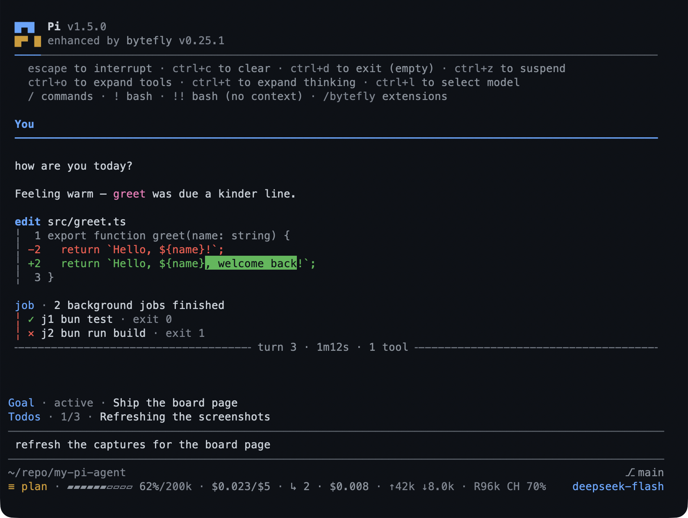

# my-pi-agent

[English](./README.md) · **简体中文**

[](https://github.com/gavin-hu/my-pi-agent/actions/workflows/ci.yml)
[](https://www.npmjs.com/package/@gavin-hu/my-pi-agent)
[](./LICENSE)
[](https://pi.dev)

`my-pi-agent` 是一个 [Pi](https://pi.dev) 包，在你已经使用的智能体之上新增一组精选
扩展、技能和主题 —— 安装整个包，关掉你不需要的部分，其余照常使用 Pi。

本页是目录与安装说明。每个功能在 [`docs/extensions/`](./docs/extensions/) 下都有自己的页面，
写清按键、命令以及应有的效果。



## 目录

- [为什么选择这个包](#为什么选择这个包)
- [安装](#安装)
- [包含内容](#包含内容)
- [包会自行做的事](#包会自行做的事)
- [配置](#配置)
- [文档](#文档)
- [参与贡献](#参与贡献)
- [许可证](#许可证)

## 为什么选择这个包

Pi 提供一个精简而锐利的内核。这个包是在其之上的一层，面向希望智能体*先思考、
再安全行动*的人：

- **先规划，再执行。** 只读模式把一次任务变成一份可审阅的计划文件，智能体随后
  按步骤执行。
- **委派与并行。** 专职子智能体运行在各自的 Pi 进程里，耗时构建交给后台任务，
  同一仓库上的多个会话通过共享总线协作。
- **绝不搞乱检出区。** 隔离只需一条命令：任务切到自己分支的 `git worktree` 中，
  每次提示的首次改动都会生成快照，因此一次糟糕的回合只需一个 `/rewind` 就能回退。
- **跨会话记忆。** 持久笔记以纯 Markdown 保存，可读、可改、可纳入版本控制。
- **连通网络与文件。** 在会话内搜索、抓取、浏览、打开和读取文档与表格，还可通过桥接
  在微信里直接回答当前会话。

## 安装

需要一个可用的 [Pi](https://pi.dev) 安装。

```bash
pi install npm:@gavin-hu/my-pi-agent                        # 最新发布版
pi install git:github.com/gavin-hu/my-pi-agent@v0.26.0      # 固定版本
```

`git` 需在 `PATH` 上，供 [`worktree`](./docs/extensions/worktree.md) 与
[`rewind`](./docs/extensions/rewind.md) 使用；其余部分会优雅降级或禁用，
`/bytefly doctor` 会指出缺少什么，包括可选的运行时组件。
Windows、macOS 和 Linux 均可运行，完整检查套件在每个平台上都会执行。

一切都是可选的，且可独立开关。没有任何东西被分叉，也没有写入任何已安装的 Pi 文件：
Pi 通过 [`package.json`](./package.json) 里的 `pi` manifest 发现这些资源，因此
该包能像其他包一样随 Pi 一起升级。

然后在 Pi 中：

- `/bytefly` 打开控制中心：一次会话会改动的十五项设置、每个已加载的扩展与技能及其
  复选框，以及指出运行时缺项的 doctor 报告。
- `/plan <任务>` 以只读规划模式开始一个任务。
- `/skill:init` 通过内置的简短访谈和先审阅的计划，创建或更新 Pi 实际读取的指令文件。

## 包含内容

21 个扩展、3 个随包技能，以及 2 个主题，按它们所服务的工作分组。
每个扩展在 `docs/extensions/` 下的页面提供完整的工具与命令说明，并以能力表开头。

### 规划与委派

| 扩展 | 工具与命令 | 说明 |
|---|---|---|
| [`plan`](./docs/extensions/plan.md) | `plan`, `/plan`, `--plan` | 只读规划：模型先调研，计划经你批准后才写入任何内容。 |
| [`subagent`](./docs/extensions/subagent.md) | `subagent`, `/agents` | 把任务委派给运行在自己 Pi 进程中的专职智能体 —— 单个、并行、链式或在后台。 |
| [`todo`](./docs/extensions/todo.md) | `todo`, `/todos` | 持久任务列表，同一时刻一项进行中，以一行式 widget 显示。 |
| [`goal`](./docs/extensions/goal.md) | `goal`, `/goal` | 持久会话目标，保存在 widget 中，并在每个回合前重述。 |
| [`question`](./docs/extensions/question.md) | `question` | 向你提出带标签选项的结构化问题，并等待回答。 |
| [`job`](./docs/extensions/job.md) | `job`, `/jobs` | 在后台运行长时 shell 命令；查看日志、等待或结束它们。 |
| [`watch`](./docs/extensions/watch.md) | `watch`, `/watch` | 跟踪文件或命令输出，匹配到行时提醒你，或把该行交给智能体。 |
| [`session-bus`](./docs/extensions/session-bus.md) | `session`, `/sessions`（屏幕） | 协调同一仓库上的并行会话：对等会话、简短消息、收件箱与路径声明。 |
| [`serve`](./docs/extensions/serve.md) | — | 本会话唯一的 loopback 服务，`/board`、`/browse` 与 plan review 共用一个端口。 |
| [`board`](./docs/extensions/board.md) | `board`、`/board` | 每个仓库一块共享看板，卡片发运前需要两次签名。 |
| [`team`](./docs/extensions/team.md) | `team`、`/team` | 看板上的 lead 轮次：assign、offer、reclaim、claim、ask —— 不启动任何进程。 |
| [`context`](./docs/extensions/context.md) | `/context` | 显示上下文窗口的去向，并从报告中触发压缩。 |

### 保护你的工作

| 扩展 | 工具与命令 | 说明 |
|---|---|---|
| [`worktree`](./docs/extensions/worktree.md) | `worktree`, `/worktree` (screen), `/worktree enter\|exit\|prune`, `--worktree` | 在隔离的 `git worktree` 里、在独立分支上工作；内置工具会跟随。 |
| [`rewind`](./docs/extensions/rewind.md) | `/rewind`, `↺ N` 状态标记 | 在每次提示的首次改动前生成快照，可恢复代码、对话或两者。 |
| [`memory`](./docs/extensions/memory.md) | `memory`, `/memory` | 跨会话的持久笔记，以可读、可改、可纳入版本控制的 Markdown 保存。 |

### 连通外部世界

| 扩展 | 工具与命令 | 说明 |
|---|---|---|
| [`web-access`](./docs/extensions/web-access.md) | `web_search`, `web_fetch` | 搜索网络并把页面抓取为可读文本，支持分页、`find` 与 SSRF 检查。 |
| [`file-browse`](./docs/extensions/file-browse.md) | `/browse` | 以工作目录为根的回环只读浏览器，带 Markdown 预览与快速打开。 |
| [`file-read`](./docs/extensions/file-read.md) | `read_doc` | 在进程内从本地 PDF、DOCX、DOC、ODT、RTF 或 XLSX 提取文本，支持分页。 |
| [`file-open`](./docs/extensions/file-open.md) | `/open`, `open_path` | 用操作系统原生应用打开或定位文件/目录。 |
| [`wechat`](./docs/extensions/wechat.md) | `/wechat`, `send_wechat` | 把一段微信聊天桥接到实时会话：入站消息进入，回答流式返回。 |

### 界面与维护

| 扩展 | 工具与命令 | 说明 |
|---|---|---|
| [`bytefly`](./docs/extensions/bytefly.md) | `/bytefly`（`doctor`、`settings`、`skills`、`update`、`upgrade` 子命令）、`run_doctor` | 可见的那一层：头部、页脚、转录块、设置界面、通知 —— 以及每个扩展都会读取的配置 `bytefly.json`。 |

### 技能

按需加载的随包工作流：每个技能的名称和描述会提供给模型，只有任务匹配时才加载完整说明（`/skill:<name>` 可强制加载）。

| 技能 | 说明 |
|---|---|
| [`init`](./skills/init/SKILL.md) | 通过交互式访谈与先审阅的计划，创建或更新 Pi 实际读取的指令文件。 |
| [`refactor`](./skills/refactor/SKILL.md) | 审计重复代码、过大模块、耦合与结构漂移，并把你选定的重构带到完成。 |
| [`next`](./skills/next/SKILL.md) | 从本次会话建议接下来做什么；会话为空时则基于代码树。 |

### 主题

[`bytefly-dark`](./themes/bytefly-dark.json) 是 GitHub 风格的深色调色板，
[`bytefly-light`](./themes/bytefly-light.json) 是其浅色搭档，并支持可选的自动
浅色/深色切换。安装本包不会改变你的主题：通过 `/settings` → **Theme**（或
`/bytefly settings` → **Theme**）选择，
或在 Pi 的 `settings.json` 中把 `"theme"` 设为 `"bytefly-light/bytefly-dark"`
以自动切换。上方的截图
使用 `bytefly-dark`。

截图来自 [`assets/screens/`](./assets/screens/)，各扩展位于
[`docs/extensions/`](./docs/extensions/) 下的页面在需要展示其效果时使用它们。
工具是一张画廊图
[`assets/screens/tool-renderings.png`](./assets/screens/tool-renderings.png)：
`bun run capture:tools` 重新生成它，`bun run capture:tool-pngs` 则把每个工具一张的
PNG 写入 [`assets/tools/`](./assets/tools)。

## 包会自行做的事

每次交互式会话启动时，`bytefly` 询问 Pi 的包管理器哪些已配置的包有更新，并用主题化
notice 提示 `pi update --extensions`；Pi 自身的新版本则提示 `pi update`。不会发送
任何会话内容，`PI_OFFLINE` 可跳过检查 ——
[`bytefly` 页面](./docs/extensions/bytefly.md) 说明头部的版本标记与缓存，
[`docs/security.md`](./docs/security.md) 说明信任边界。

## 配置

大多数扩展无需配置。所有扩展设置都在一个共享文档 `bytefly.json` 中，从
`<agent-dir>/bytefly.json` 读取，并与 `<cwd>/.pi/bytefly.json` 合并（项目优先），
位于一个以扩展名命名的顶层 section 下。每个扩展在 `docs/extensions/` 下的页面说明其键位的行为，
[`docs/configuration.md`](./docs/configuration.md) 则给出解析规则、设置界面操作方式，
以及每个 section 的键、类型、默认值和取值范围。

所有扩展默认都开启。若要在加载整包时排除一些扩展，在 `PI_DISABLED_EXTENSIONS`
中列出它们的名字（即 [`extensions/`](./extensions/) 下的目录名）：

```bash
PI_DISABLED_EXTENSIONS=todo,job pi -e .
```

该变量只会阻止这些工厂注册，具体规则见
[配置](./docs/configuration.md#environment-variables)；若要移除整包，请使用 Pi 的
`--no-extensions`，或从你的设置中删除该包。

## 文档

| 指南 | 内容 |
|---|---|
| [文档站点](https://gavin-hu.github.io/my-pi-agent/) | 浏览器版本：首页、安装与配置，以及覆盖每个扩展页面的侧边栏。 |
| [安装](./docs/install.md) | 添加本包、固定版本、升级与移除。 |
| [配置](./docs/configuration.md) | 解析规则与设置界面；[`configuration-reference.md`](./docs/configuration-reference.md) 列出 `bytefly.json` 每个键的默认值与取值范围。 |
| [扩展文档](./docs/extensions/) | 每个扩展一页：它做什么、如何上手，以及参考部分；每个工作流各配一篇教程。 |
| [工具与命令](./docs/tools-and-commands.md) | 本包注册的每个工具、斜杠命令与界面，按名称列出，并指向拥有它的页面。 |
| [安全](./docs/security.md) | 回环与远程界面的信任边界。 |
| [参与贡献](./CONTRIBUTING.md) | 本地设置、分支流程、检查项与发布流程。 |

## 参与贡献

欢迎贡献。请先阅读 [`CONTRIBUTING.md`](./CONTRIBUTING.md)，了解设置、worktree
分支流程以及改动必须通过的检查。AI 编码智能体应阅读
[`AGENTS.md`](./AGENTS.md)。

## 许可证

MIT
