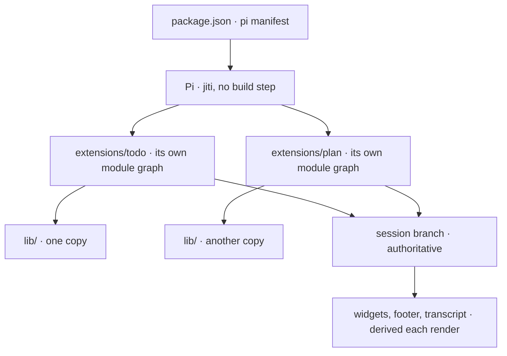
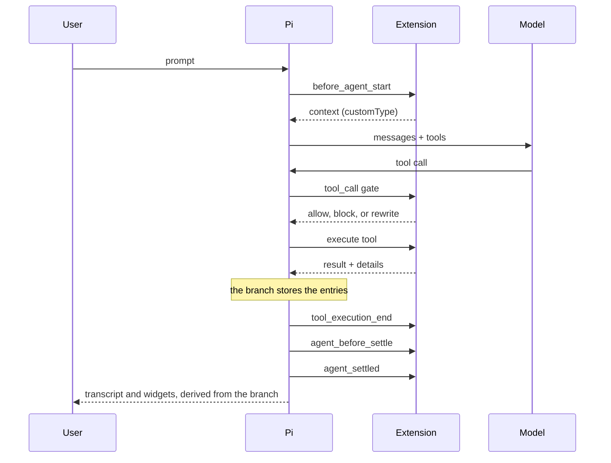
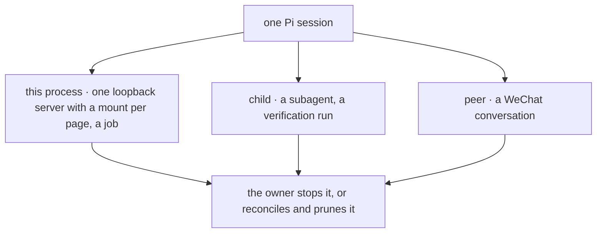
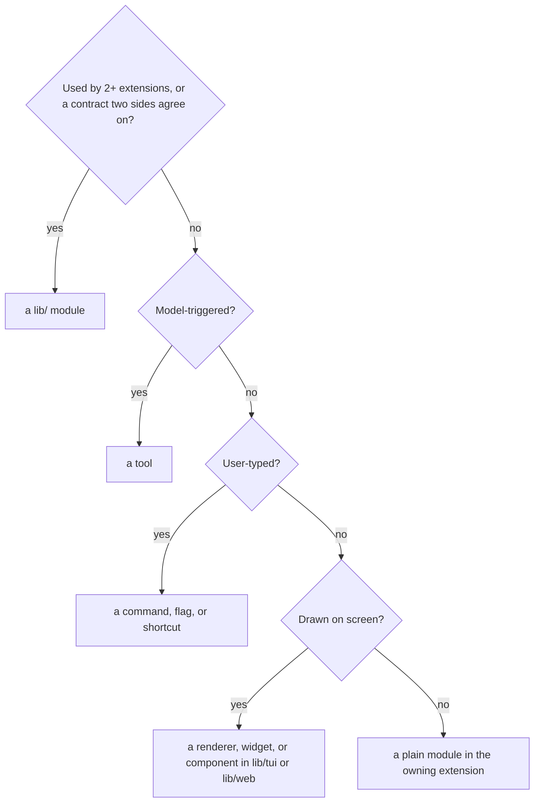

# Architecture

This page is the map a contributor holds while changing the package: what Pi
loads, what an extension is made of, what a turn does, where state lives, how
extensions cooperate without importing each other, and which shape new code
takes.

It describes the shape this package commits to, not a snapshot of the tree. A
rule is written in the present tense because it is meant to hold; every rule here
holds today, and where work is queued it is a card on the repository's board that
carries it. The rulebook that is *enforced today* — the invariants, the
code-quality bar, the workflow — is [`../AGENTS.md`](../AGENTS.md).

It is not a second rulebook. Every rule has one owner and its reasoning sits next
to it: invariants in [`../AGENTS.md`](../AGENTS.md), the shared module table in
[`../lib/README.md`](../lib/README.md), the terminal design system in
[`../lib/tui/README.md`](../lib/tui/README.md), the browser design system in
[`../lib/web/README.md`](../lib/web/README.md), the threat model in
[`./security.md`](./security.md), the test tiers in [`../test/README.md`](../test/README.md),
and one extension's full surface on its page under
[`./extensions/`](./extensions/).

## Contents

- [Vocabulary](#vocabulary)
- [The shape in one picture](#the-shape-in-one-picture)
- [What the host loads](#what-the-host-loads)
- [The extension contract](#the-extension-contract)
- [One turn](#one-turn)
- [State: authoritative and derived](#state-authoritative-and-derived)
- [Cooperation without imports](#cooperation-without-imports)
- [The layers](#the-layers)
- [Long-lived work](#long-lived-work)
- [Trust boundaries](#trust-boundaries)
- [Where a change belongs](#where-a-change-belongs)
- [Reading the code](#reading-the-code)
- [Documented limits with no planned card](#documented-limits-with-no-planned-card)
- [Explicit non-goals](#explicit-non-goals)
- [1.0 readiness](#10-readiness)
- [Related docs](#related-docs)

## Vocabulary

The words below are Pi's, and the rest of this page uses them in exactly this
sense.

| Term | What it means here |
|---|---|
| Extension factory | The default export of an `index.ts`. It receives the host API and **registers**; it does not start work. |
| Host | Pi itself: the agent loop, the session, the terminal UI, the tool registry. |
| Session branch | The ordered entries of the current conversation. It is the authoritative state store. |
| Session entry | One record on the branch: a message, a tool result, or a custom entry an extension wrote. |
| Tool result `details` | Structured data attached to a tool result, persisted with it on the branch. |
| `customType` | A string an extension puts on injected context or a custom entry so it can recognise its own records later. |
| Renderer | The component that draws one tool call or result in the transcript. |
| Widget | A line above the editor, derived on each render from branch state. |
| Rail | A widget that shares the above-editor stack with another and therefore needs a stable order. |

## The shape in one picture

Six facts about that picture carry the rest of this page.

1. **Pi loads the manifest, not a directory.** The `pi` section of
   [`../package.json`](../package.json) is the complete load list; there is no
   scanning and no build output.
2. **Every extension gets its own module graph**, `lib/` included. A module-level
   value in shared code is therefore one value *per extension*, which is why
   shared code stays value-only. See [The layers](#the-layers).
3. **Registering and running are separate.** The factory declares; the session
   starts, restores, and releases.
4. **The branch is the store.** State that survives `/resume` and `/tree` is a
   session entry; nothing else qualifies.
5. **Everything on screen is derived.** A widget or footer segment is computed
   from state on each render and never becomes the memory of it.
6. **Extensions never import each other.** They agree through `lib/`, an event
   channel, or a shared name — [Cooperation without imports](#cooperation-without-imports).

## What the host loads

One npm package, no build step. Loading an extension entrypoint is `jiti`
compiling TypeScript on demand, so there is no bundle, no transpiled tree, and no
artefact that can lag the source. The manifest also names the skills directory,
the theme glob, and the header image; a file that is not in the manifest is not
loaded, however correct it is.

Dependencies split by who supplies them. Pi and its UI packages are
`peerDependencies` with a `"*"` range, because the host provides them and a
second pinned copy of the agent loop would be a second host. Real `dependencies`
exist only where this package does the work itself — the document parsers behind
`read_doc`, the QR encoder behind the WeChat login — and each is imported lazily
by the module that needs it, so loading an unrelated extension costs nothing.

## The extension contract

One wiring point, six code roles, one lifetime.

**Four moments, one owner each.** An extension is not a process; it is a
participation in a session's lifetime, and each moment permits exactly one kind
of work.

| Moment | Where | Its one job | It may not |
|---|---|---|---|
| Register | the factory | Declare tools, commands, flags, shortcuts, renderers, and handlers. | Open a server, spawn a process, start a timer, read the branch. |
| Restore | `session_start`, `session_tree` | Rebuild this extension's view from the branch, then start what outlives a turn. | Assume another extension is loaded, or keep state the branch cannot rebuild. |
| Participate | the current turn's hooks | Gate a call, observe a result, extend a run, settle a turn. | Mutate another extension's state, or write a branch record it does not own. |
| Release | `session_shutdown` | Release everything Restore started, idempotently. | Throw on a second call, or depend on a start that failed. |

`index.ts` is the only module that touches the host API. Every other module is a
leaf that takes the seams it needs as parameters — a git runner, an HTTP runner,
a spawner — which is what makes it testable without a runtime. The roles are:

| Role | What lives there | Reads |
|---|---|---|
| Surface | The tool definition, its TypeBox schema, its renderers. | `lib/tui/tool.ts` |
| State | In-memory state for one session, plus the pure functions that read it. | the branch, via Restore |
| Config | Load and normalise this extension's section of the shared document. | `lib/config.ts` |
| Commands | Slash-command entry points and their argument completions. | State |
| View | Full-screen components, dialogs, widgets. | `lib/tui/`, `lib/web/` |
| Transport | A socket, a child process, a bridge — the only role that owns I/O. | the owning extension |

The filenames are not the contract; the roles are. A small extension keeps them
in flat modules — [`../extensions/todo/`](../extensions/todo/) is one tool, one
command, one widget, and branch replay. Past roughly twenty modules a role earns
a directory, the way [`../extensions/bytefly/`](../extensions/bytefly/) groups
`footer/`, `notice/`, `header/`, and `separator/`, and `plan` keeps its tool
surface in `tools/`. Every extension past that size now holds role directories —
[`../extensions/wechat/`](../extensions/wechat/) is the worked example, seven
directories around the wiring — so the rule has no exception left to make.

## One turn

The hook order is the runtime in one picture. Each hook may change one narrow
thing, and the branch records the result.

The hooks group by the question they answer, and a hook is only ever registered
by the extension that owns the side effect.

| Family | Hooks | What it may do | Exemplar |
|---|---|---|---|
| Lifecycle | `session_start`, `session_tree`, `session_shutdown` | Restore, start, release. | `plan` rebuilds plan mode from the branch. |
| Gate | `tool_call` | Block with a reason, or rewrite input. | `plan`'s policy, `worktree`'s shell guard. |
| Observe | `tool_execution_start`, `tool_execution_end` | Mark work done and publish an event. | `todo` closes the loop on its own tool. |
| Extend | `before_agent_start`, `context`, `agent_before_settle` | Add injected context, dedupe it, ask once more before settling. | `memory` injects notes; `context` reports it. |
| Settle | `agent_start`, `agent_end`, `agent_settled` | Draw the run's frame, post one inert entry per settled turn. | `bytefly`'s separator and footer. |

One hook registration that three extensions need is a `lib/` channel, not three
copies: [`../lib/report.ts`](../lib/report.ts) registers the pending-outcome
channel that `job`, `watch`, and `session-bus` all publish through, so a finished
job and a matched watch reach the transcript by one path. That is the test for
whether a hook belongs in `lib/`.

## State: authoritative and derived

**The branch is authoritative; everything else is configuration or a view.** A
widget, chip, or footer segment that does not replay from the branch is a bug,
because `/resume` and `/tree` rebuild from it.

| Store | Holds | Read back by |
|---|---|---|
| Session branch | Messages, tool results with `details`, custom entries (plan mode, goals, notices) | `getBranch()`, on `session_start` and `session_tree` |
| The config document | Configuration, one section per owner | Each extension's `config.ts`, global then project |
| Project `.pi/` | Plans, worktrees, subagent transcripts, notes, project config | The owning extension, by path |
| Agent directory | Global notes and config, the plan store, job logs, session-bus state, the board store, WeChat state | The owning extension, by path |
| A repository-keyed directory | One board: `cards/*.json` under `<agent-dir>/board/<repo-key>/`, with an `archive/*.json` pile beside it for finished cards set aside, written only by [`../lib/board/store.ts`](../lib/board/store.ts) | `board`, and `team` through it |
| Git refs | Rewind snapshots under `refs/pi/rewind` | `rewind`, by ref name |
| Environment | `PI_WORKTREE_*`, `PI_DISABLED_EXTENSIONS`, and `PI_ENABLED_EXTENSIONS` | The process-wide seams in [`../lib/env.ts`](../lib/env.ts) |

Three rules follow from the table.

- **Surviving state is a branch record.** A session entry or a tool result's
  `details`, never a module variable, never the config document.
- **A derived surface is computed, then repainted.** It remembers nothing and
  asks for one repaint after a change, rather than rebuilding per frame.
- **The config document is input.** No extension writes configuration at runtime;
  a change goes through the owning command, so the file stays a thing a user can
  read. The key list and the resolution order are owned by
  [`./configuration.md`](./configuration.md).

Published state is the one exception to "no shared state", and it is a
convention rather than a store: an extension that publishes a session fact writes
a `lib/<name>-state.ts` module of pure readers over the branch, which is how
`goal`, `todo`, and `plan` replay the same fact without importing each other
([`../lib/goal-state.ts`](../lib/goal-state.ts),
[`../lib/todo-state.ts`](../lib/todo-state.ts),
[`../lib/plan-entry.ts`](../lib/plan-entry.ts)).

## Cooperation without imports

No extension imports another extension's modules. The reason is mechanical, not
stylistic: the per-extension module cache would make such an import a second copy
of state the other extension believes it owns. Three mechanisms cover every real
dependency.

| Mechanism | Use it when | Examples |
|---|---|---|
| Event channel | One side needs to *announce* something and must not know the consumer. | `job`, `watch`, and `subagent` publish finished work; `bytefly`'s notify and footer consume it ([`../lib/events.ts`](../lib/events.ts)) |
| Published-state replay | Both sides must read the *same session fact*. | `goal`, `todo`, and `plan` replay through [`../lib/goal-state.ts`](../lib/goal-state.ts) and [`../lib/todo-state.ts`](../lib/todo-state.ts) |
| Shared name | The two sides must *agree on an identifier* and nothing more. | Tool and parameter names in [`../lib/tool-names.ts`](../lib/tool-names.ts); glyphs and status keys in [`../lib/tui/glyphs.ts`](../lib/tui/glyphs.ts) |

The choice is a rule of thumb, not a preference: an event carries no state and
sends no reply, replay carries state but no notification, and a shared name
carries neither. The above-editor rails show the smallest version of an event
channel ([`../lib/rails.ts`](../lib/rails.ts)): the goal widget and the todo
widget share a stack whose order Pi decides by insertion, so each announces and
re-asserts through the caller's bus and neither imports the other.

## The layers

Four layers sit below the extensions, each with one contract.

| Layer | Job | Contract |
|---|---|---|
| `lib/` core | configuration, environment, paths, formatting, errors, spawning, timers, and the one subsystem with its own seam: [`../lib/git/`](../lib/git/) | [`../lib/README.md`](../lib/README.md) |
| [`../lib/tui/`](../lib/tui/) | the terminal design system: roles, rules, rows, columns, gauges, the transcript kit, the render cache | [`../lib/tui/README.md`](../lib/tui/README.md) |
| [`../lib/web/`](../lib/web/) | the browser design system: tokens, base CSS, components, markup atoms | [`../lib/web/README.md`](../lib/web/README.md) |
| [`../lib/http/`](../lib/http/) | the loopback policy every served page obeys: one server entry, the mount a page claims a prefix with, binding, `Host` check, page headers, responses, event streams, the idempotent closer | [`../lib/README.md`](../lib/README.md) |

Two rules keep the layers honest.

- **A module is promoted on the second user, or on a contract.** Shared code
  exists when a second extension uses it, or when two sides must agree on
  something without importing each other — a name, a wire format, a policy. A
  helper with one consumer stays in that extension, where it can change freely.
- **`lib/` is value-only.** Constants, pure functions, classes, no module-level
  mutable state, because the cache gives each extension its own copy. The one
  shared-state pattern is an event bus whose state lives in the caller's closure.

Two shared services are worth naming because they cut across extensions rather
than sitting in the stack. The **notice** contract
([`../lib/notice.ts`](../lib/notice.ts)) lets a producer post one transcript
block that `bytefly` renders, instead of three ad-hoc messages. The
**requirements** table ([`../lib/requirements.ts`](../lib/requirements.ts))
declares what each extension needs at runtime, and `doctor` probes it through
injected seams, so a missing binary is a report rather than a crash.

Size is the other half of the layer rule: one job per module, and a module past
600 lines is named with the responsibility that keeps it whole. The list and its
height budget live in [`../AGENTS.md`](../AGENTS.md#code-quality).

## Long-lived work

**Four process shapes, one rule: whoever starts one stops it, or writes enough
for the next session to reconcile it.**

| Shape | Owner and stop path | What it must leave behind |
|---|---|---|
| Loopback server | `serve` binds it on the first mount, and closes it on shutdown or when its last mount leaves; a page gives its own prefix back on the owner's command or on idle. | Nothing: the page describes a session that is still running. |
| Background job or watcher | Started by a tool call, tracked in a registry with its own log, reconciled on shutdown. | The log and the registry entry, so a restarted session can list and stop what is still running. |
| Child `pi` process | `subagent` spawns it, enforces a deadline, escalates and reports the exit. | The transcript, if the user asked for one. |
| Peer session | The bridge opens one per admitted sender; logout or shutdown stops the bridge. | Each peer's history, on disk, apart from the host session. |

Three rules keep that honest.

- **A one-runtime resource takes a lock.** A second Pi cannot drive the same
  account or the same directory; the WeChat poller's lock is the example.
- **A loopback server has one lifecycle.** Binding, the accept path, the close
  path, and idle grace live in [`../lib/http/`](../lib/http/), and a page claims a
  prefix through [`requestMount`](../lib/http/mount.ts) rather than building a
  `node:http` server of its own: one socket per session, one port, one close.
- **What outlives the process is pruned by its owner, not on exit.** A cap, or a
  command in the shape of `/worktree prune`.

## Trust boundaries

Seven boundaries, one guard module each. The guard is named here so that a change
which moves one is visible; the threat model and the policy for each are
[`./security.md`](./security.md).

| Boundary | One guard | Policy |
|---|---|---|
| Model or file text reaching the terminal | [`../lib/format.ts`](../lib/format.ts) for a line, [`../lib/escape.ts`](../lib/escape.ts) for HTML | [`./security.md`](./security.md#model--and-file-authored-text) |
| A path escaping its root | [`../lib/path.ts`](../lib/path.ts), and the re-rooting in `worktree` | [`./security.md`](./security.md#local-file-confinement) |
| A shell command escaping its root | [`../lib/shell.ts`](../lib/shell.ts), and the guards in `worktree` and `plan` | [`./security.md`](./security.md#worktree-and-shell-isolation) |
| A tool mutating the tree while planning | Default-deny classification in [`../lib/policy.ts`](../lib/policy.ts), plus the path backstop in `plan` | [`./security.md`](./security.md#read-only-plan-mode) |
| A local page reaching beyond its session | [`../lib/http/`](../lib/http/): loopback binding, `Host` checks, page headers, read-only routes | [`./security.md`](./security.md#loopback-http-servers) |
| An outbound request reaching this machine's own network | The redirect check in [`../extensions/web-access/fetch/ssrf.ts`](../extensions/web-access/fetch/ssrf.ts) | [`./security.md`](./security.md#outbound-web-access) |
| A remote chat reaching the terminal's session | Admission, owner-only proactive messages, and a peer session per sender | [`./security.md`](./security.md#child-processes-and-remote-control) |

A boundary that two extensions answer has exactly one policy module, in `lib/`.
Two copies are how a header, a `Host` rule, or an allowlist drifts apart, which
is why the served pages share [`../lib/http/`](../lib/http/) — including its
`envelopeRefusal` / `requireJsonBody` guards and the page token — the two design
systems are `lib/tui/` and `lib/web/`, and the three readers of a repository's
storage key ask `repoKeyFor` of one module,
[`../lib/repo-key.ts`](../lib/repo-key.ts).

## Where a change belongs

**Ask three questions in order: who uses it, who triggers it, and what the user
sees.**

Then place it, or make a new extension. Each kind of change has one owner for its
checklist, and an answer here is a link rather than a second copy:

| Change | Where the steps live |
|---|---|
| A new extension | [`../CONTRIBUTING.md`](../CONTRIBUTING.md#adding-an-extension) |
| A new tool or a rename | [`../AGENTS.md`](../AGENTS.md#tool-and-prompt-surface) and [`../lib/tool-names.ts`](../lib/tool-names.ts) |
| A new surface that needs a screenshot | [`./development.md`](./development.md#screenshots) |
| A new extension doc | [`./development.md`](./development.md#one-doc-per-extension) |

A config key is the one change with no checklist of its own: it needs a section in
the shared document, a normaliser in the owner's `config.ts`, and a row in the
settings catalogue if a person is expected to change it. [`./configuration.md`](./configuration.md)
documents the result and [`../test/config-docs.test.ts`](../test/config-docs.test.ts)
holds that document to the loaders, so a key the code reads and the page does not
name fails the suite.

## Reading the code

If you are new to the tree, this order teaches one idea per stop.

| Path | What it teaches |
|---|---|
| [`../package.json`](../package.json) | The manifest is the load list; the dependency split is deliberate |
| [`../extensions/todo/`](../extensions/todo/) | A complete small extension: one tool, one command, one widget, branch replay |
| [`../extensions/plan/`](../extensions/plan/) | Policy, cross-tool orchestration, injected context, and a second surface |
| [`../extensions/worktree/`](../extensions/worktree/) | Re-rooting the host's file tools, and the shell guard shared with plan mode |
| [`../extensions/job/`](../extensions/job/) | A registry, a log, and work that outlives a turn |
| [`../extensions/wechat/`](../extensions/wechat/) | A transport, peer sessions, and a one-runtime lock |
| [`../extensions/bytefly/`](../extensions/bytefly/) | Chrome and renderers: one extension that draws the others |
| [`../lib/tui/`](../lib/tui/) | The design system every surface above draws through |

## Documented limits with no planned card

A reader should be able to tell a gap that was triaged from one that was missed,
without asking. Each row below is a limitation the tree has today and no card owns;
the reason carries the condition that would reopen it. A limitation a card does own
belongs to that card, and an extension's own page states the limitation itself, so
neither is repeated here.

| Limitation | Why it has no card |
|---|---|
| `board`: ownership is advisory | A card names an owner; the lock on a file is `session-bus`'s path claim, and two sessions editing one file is a conflict the board cannot see. Revisit if the board issued claims of its own. |
| `board`: the plan a card records must be a file this repository's plan store holds | The board checks the path `write_plan` returned at `contract` and again at `move execute`, so "the plan it is executed against" is a file rather than a string; the store's location and path rules live in `lib/plans/paths.ts` because both extensions must answer one question. Revisit if the board should read a plan rather than stat it. |
| `board`: the two signs are the lead's, and the person's | `approve` and `review` take the name `board.lead` (`lead` by default, which is also the name the page serves as) and refuse the holder even when it is the lead, so a signature belongs to somebody accountable rather than to whichever peer answered first; `/board approve` and `/board review` write the other accepted actor, a label with no session id, because a one-session repository would otherwise never finish. Both are label checks. Revisit if the board can verify a human rather than a label. |
| `board`: a link is checked when a card is taken and when it is finished | It never re-opens work that finished before the link was recorded, and `done` is terminal, so a dependency cannot un-finish. Revisit if a link must reorder completed work. |
| `board`: assigning without messaging the peer went with the write path | A page assignment recorded an owner and had to say no handoff was sent; `team`'s `assign` messages the peer instead. Revisit if a silent assignment is worth a tool action of its own. |
| `board`: a page stops a minute after its last tab leaves | An abandoned page must not answer a port for the rest of the session; `/board` starts it again on the same port. Revisit if a page must outlive its tabs. |
| `board`: a page's note is believed only while it answers | A crash leaves the note behind; the next `/board` probes it, takes it over when nothing replies, and attaches to the page that won when two sessions start at once, so a dead note costs one probe rather than a second page. Revisit if a note must be reaped by something other than its page. |
| `board`: nothing prunes, so finished cards accumulate | `drop` is the only deletion and the page shows the store's size. Revisit when the store's size is itself a reason to archive. |
| `team`: nothing here can start a peer's turn | A handoff or an offer waits in the recipient's inbox until its next turn, where a listening session reports it; no turn is raised on a peer's behalf, and nothing spawns a session. Revisit if the bus can raise a turn directly. |
| `team`: `to` must be on the team | A session that never opened the board, joined, or claimed a card cannot be handed one, and the refusal names the fix. A card's owner is its team name, derived from the session id, so a rename no longer strands it. Revisit if a peer can be handed work before it ever joins. |
| `team`: plan mode makes `assign` and `offer` unavailable | The `session` call behind them is a mutating tool, which plan mode refuses; handing work over waits for approval. Revisit if a read-only bus call can dispatch. |
| `plan`: no PowerShell while planning | The read-only shell is Git Bash by design; PowerShell needs a second parser and guard, which is also why the worktree guard refuses the tool rather than parsing it. Revisit with an OS sandbox. |
| `plan`: a browser that never connects waits until the user cancels, closes the tab, or aborts | Waiting is the intended behavior — the page can be opened minutes later. The URL is announced, and auto-declining would lose a slow reader. |
| `plan`: a step over 200 characters is shortened in the todo list and the approval listing | A display rule only: the plan file keeps the full text, and approval tracks the file. Revisit if an approval surface must show a full step. |
| `plan`: the plans directory is the only index, so there is no cross-repository plan history | The directory is the record, and a registry would be state that can drift from it. The store reports its own size, in its header, without becoming one. |
| `plan`: a shared review reaches one network, one address, and at most eight links | A tunnel, relay, or hosted review service is a product to operate, not a page to serve; the non-goals below name it. Revisit with a hosted deployment. |
| `plan`: a reviewer's name is a label bound to a link, not an account | The owner still makes the only decision, so an account would add identity without adding a decision. Revisit if reviewers must be authenticated across restarts. |
| `subagent`: a child run's cost never enters the parent total, and the roll-up restarts at `/resume` | A documented non-goal: the parent total prices the parent's own turns, and a transcript is an audit record rather than a cost ledger. |
| `subagent`: background is single mode, and a background child is session-owned | Making a child resumable is a durable job queue, which the non-goals exclude. Revisit if a run must outlive its session. |
| `watch`: a **wake** match raises a notification once the running turn settles | A match found mid-turn is raised when that run settles, so a long turn delays it but never drops it. Revisit if a turn must be interrupted mid-flight. |
| `watch`: watcher state is memory-only | A watcher tails a live process or file; a resumed session cannot re-attach to a pipe it no longer has. Revisit if a watcher is given a durable source. |
| `worktree`: `skipOverrides` leaves the skipped tool unguarded for relative paths | The override is the user's statement that the tool should not be guarded. Revisit if a guard stops meaning what it means today. |
| `rewind`: `.gitignore`d files are not captured | An explicit non-goal; no card. |
| `rewind`: the path checklist is TUI-only, so RPC, `print`, and `json` restore the whole tree | A non-interactive subset needs its own selector, validation, and preview. Revisit if a scripted caller needs a partial restore. |
| `memory`: injection truncates a large store, and `forget` is an exact match | `/memory doctor` names the notes the cap drops and the near-duplicate pairs, and `m` merges them, so the cap is visible where it bites. |
| `memory`: a store on a filesystem with coarse mtime can still hide a same-size edit | The stamp is nanoseconds, so every APFS/ext4 write is caught; a filesystem that reports one-second mtime cannot be beaten without reading the file on every run. Revisit if a store lives on such a filesystem. |
| `job`: `exec cmd` and Windows can settle a job with no exit code | The shell owns the exit path there; the job reports `unknown` rather than guessing. Revisit if a wrapper can always observe the code. |
| `job`: stdin is a pipe, a detached log is not rotated, and Windows cannot detach | Each is the price of a process that outlives its turn; the job page names all three where the option is offered. |
| `question`: there is no timeout, and RPC multi-select degrades to an editor | A prompt exists to wait for a person, and RPC cannot forward the component. Revisit if a host adds a component channel. |
| `context`: composition is an estimate, and no message can be trimmed or pinned | The report reads Pi's own bookkeeping; trimming is compaction's job. Revisit if Pi exposes a per-message API. |
| `web-access`: the keyless search returns answers and related topics rather than a result list | That is the provider's shape, not a parsing gap; SearXNG and Brave return a list. |
| `web-access`: DNS rebinding remains a residual SSRF risk | Every hop is checked by address, which cannot bind a later DNS answer. Revisit if a resolver-level guard is available. |
| `file-read`: the extraction deadline cannot preempt a parser that never yields | JavaScript cannot interrupt a synchronous parse, so the deadline stops waiting and discards the result. |
| `file-read`: formatting, tables, and images are flattened | Extraction returns text; layout fidelity is a different product. |
| `file-browse`: live status patches only the rows already drawn | A snapshot plus one reload control is honest; making every subfolder live is a different server. |
| `open_path`: Windows reports only that the launcher started | `explorer` exits non-zero after a successful open and reports nothing for a hidden window. Revisit with a platform API that answers. |
| `wechat`: an abandoned turn's notice is one attempt and needs a live connection | A notice the transport cannot deliver in five seconds is reported on the terminal, not retried: the session is gone, so there is nothing left to retry from. Revisit if a notice must outlive the session. |
| `wechat`: two peers' turns run at once, not more | Every concurrent turn is a full model run on the user's budget, and a phone chat rarely has more than two conversations in flight; the rest wait in a fair queue and are acknowledged. Revisit if `PEER_CONCURRENCY` needs to follow the hardware instead of the conversation. |
| `bytefly`: `doctor.skip`, the `rates` table, and `price.peak` are JSON-only | One is a list, one a table, one a nested object: none is a scalar row. |
| `bytefly`: built-in extensions are not listed in the picker | Pi does not expose their authoritative names, so this needs a host change rather than a picker row. |
| `bytefly`: themes and prompts are not picker sections | A theme is one active selection — a scalar, global setting — and a prompt template is a file Pi discovers; neither is the scoped enable list this screen writes. A decision, not a deferral: revisit if Pi exposes a scoped theme or prompt setting. |
| `bytefly`: the update cache window is fixed at 24 hours | One check per session reuses a younger entry; a setting would add a schema row and a `doctor` line for no failure it prevents. |
| `bytefly`: only packages configured in Pi's settings get an update prompt | Pi's package manager owns the list; a second detector would restore the duplicate-block class the single-notice refactor removed. |
| `bytefly`: the single update notice depends on patching `DefaultPackageManager.prototype.checkForAvailableUpdates` | Pi exposes no setting for its startup block. The shim is installed only in `tui`, restored on shutdown, and inert if the method shape changes. |
| `bytefly`: five notify triggers fire per event rather than per unseen event | A notification is a nudge, not a state; the footer chip is the state. |
| `session-bus`: a message file that does not parse is dropped | A message is written as a temp file and hard-linked into place, so this needs disk corruption; keeping it would leave an unreadable entry in every listing forever. |
| `session-bus`: a claim cannot see branch divergence | Claims say who is where, not what will merge; a rebase on the baseline still decides. |
| CI: macOS runs the suite serially while Windows and Linux use `--parallel=4` | Two open Bun bugs (`oven-sh/bun#41024`, `#39709`; a related one, `#45483`) can park a `--parallel` worker on macOS after its first subprocess spawn, which hangs a git-using test instead of failing it. Still open against Bun 1.4.3; revisit when both close, then delete `check:serial` from the matrix. |

## Explicit non-goals

These stay out unless a decision reverses one. The board is where work is planned, so
a card that reverses an entry here says so in its contract rather than in its steps.

- An OS sandbox, a general branch manager, or a Pi fork.
- Semantic memory, embeddings, or automatic fact extraction.
- OCR, PPTX, EPUB, or writing and converting documents.
- Cron and scheduling, a durable job queue, or persisting watchers across sessions.
- Group chats, outbound video or voice, or model-callable sends to arbitrary recipients.
- Reviewer accounts, a relay, a tunnel, or a hosted review service.
- A plan registry across repositories.
- Auto-executing an approved plan without the user in the loop.
- Auto-updating the package.

## 1.0 readiness

The pack is ready for 1.0 when all of these are true, not on a date. Each gate is
reviewed against the tree at each release, and none of them is a checklist to tick.

- Every README promise has shipped behavior, a named limitation, or a `doctor`
  finding, and every limitation with no card has a row above. A review rule, not a test:
  read the extension pages against this section at each release.
- Every number a doc states about the code is derived by a test; the settings count is
  the first, and a count without a guard is a promise waiting to rot.
- No known path loses work: worktree cleanup, plan approval, job reattachment, a partial
  rewind, a WeChat turn that is abandoned, and a message the bus cannot read each either
  preserve the work or say what was lost.
- State that claims to survive `/resume` and `/tree` does: goal, todo, plan mode,
  worktree binding, and the rewind timeline — each a session entry or tool-result
  `details` rebuilt from `getBranch()`, pinned by its extension's tests.
- The full check suite runs on Windows, macOS, and Linux, including the slow git suites,
  and the compat job names the newest Pi it passed against. macOS runs it serially until
  the upstream hang is fixed.
- A long-session benchmark stays within its budget — measured with `bun run bench:render`
  at each release.
- A release is one reviewed command path with provenance, and the tag, changelog, and npm
  version cannot drift — `test/release.test.ts` holds the version, the install pins, and
  the changelog's one-set-per-window shape.
- Docs truth tests cover tool names and config keys, and every relative doc link and
  heading anchor resolves — `test/naming.test.ts`, `test/config-docs.test.ts`, and the
  doc-link guard in `test/doc-links.test.ts`.

## Related docs

| Topic | Document |
|---|---|
| Invariants, code quality, workflow | [`../AGENTS.md`](../AGENTS.md) |
| Shared modules and host seams | [`../lib/README.md`](../lib/README.md) |
| The terminal design system | [`../lib/tui/README.md`](../lib/tui/README.md) |
| The browser design system | [`../lib/web/README.md`](../lib/web/README.md) |
| Test tiers and determinism | [`../test/README.md`](../test/README.md) |
| Config resolution and the section index | [`./configuration.md`](./configuration.md) |
| Trust boundaries and the threat model | [`./security.md`](./security.md) |
| Scripts, checks, and the release process | [`./development.md`](./development.md) |
| What every feature does, for a user | [`./extensions/`](./extensions/) |
