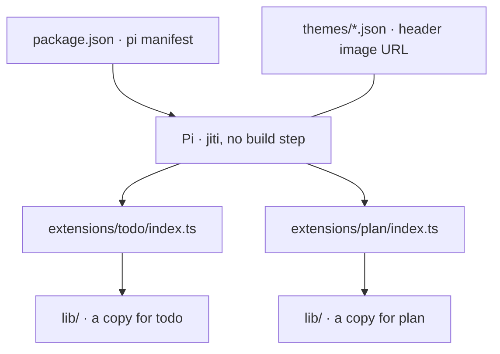
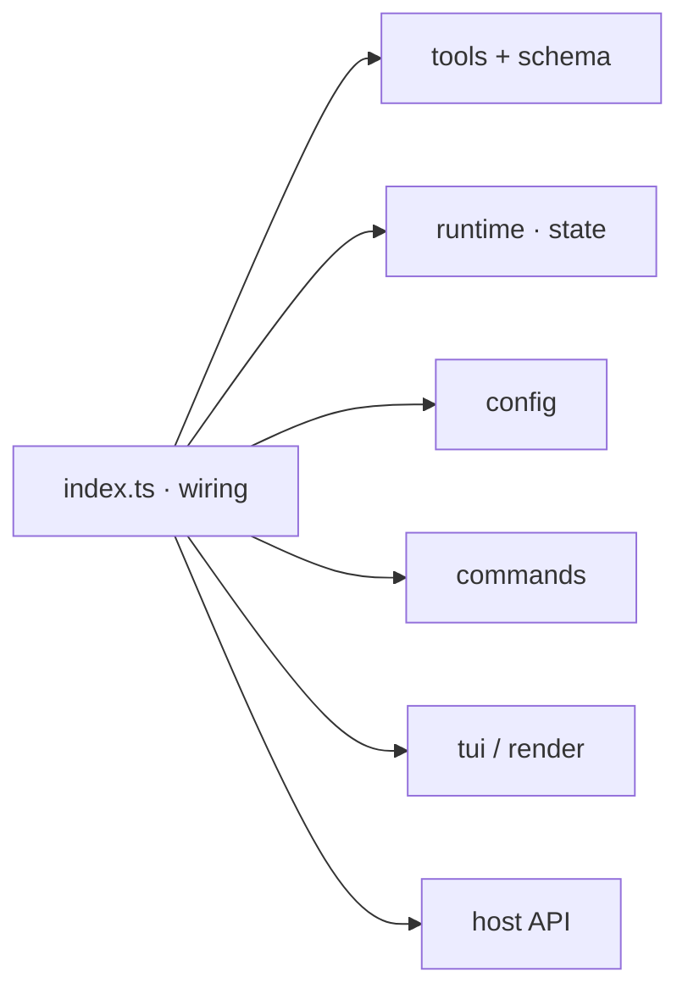
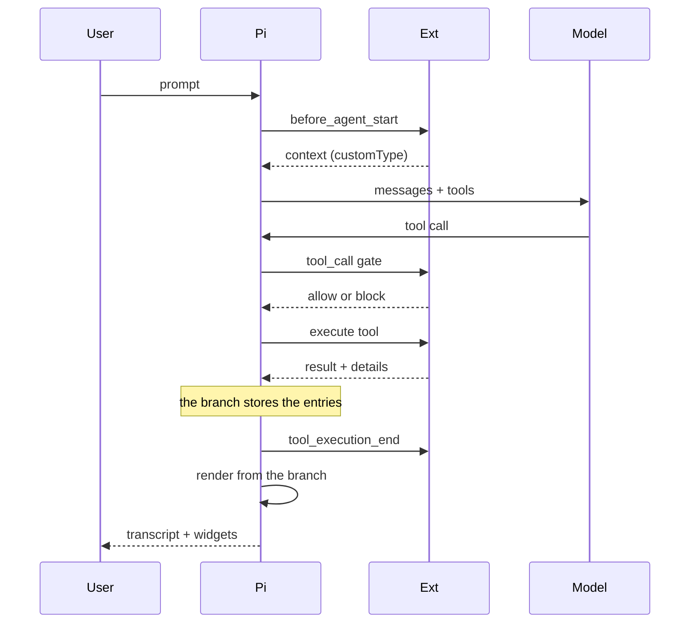
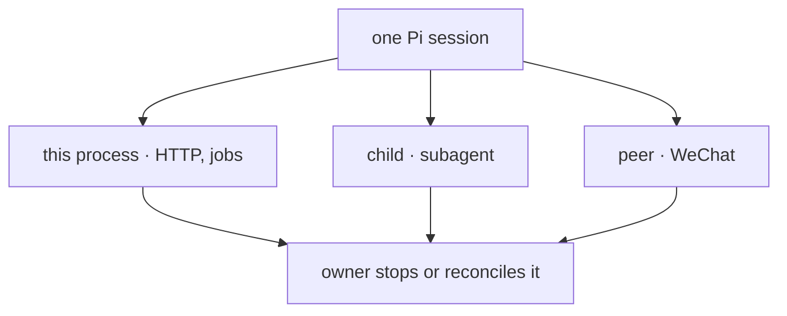
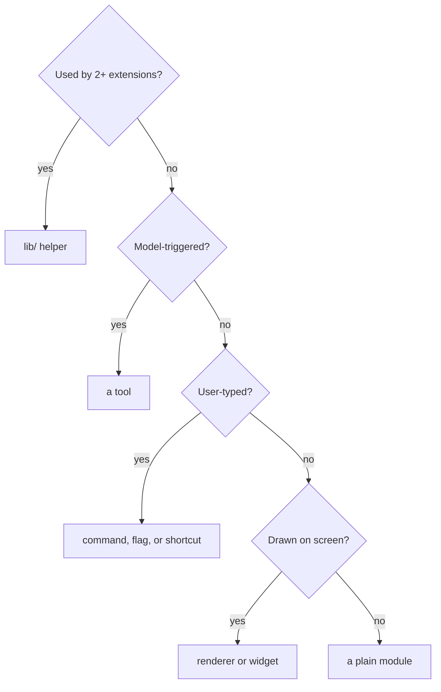

# Architecture

This page is the map a contributor needs before changing this package: what Pi
loads, what an extension is made of, what a turn does, where state lives, how
extensions cooperate without importing each other, and which shape new code
should take.

It is deliberately not the rulebook. The normative invariants, the code-quality
bar, and the workflow live in [`../AGENTS.md`](../AGENTS.md); the shared module
tables in [`../lib/README.md`](../lib/README.md); the terminal design system in
[`../lib/tui/README.md`](../lib/tui/README.md); the test tiers in
[`../test/README.md`](../test/README.md); and one extension's full surface in its
own `README.md`. Where this page states a reason, the rule itself is one link
away.

## Contents

- [What this page is for](#what-this-page-is-for)
- [The package Pi loads](#the-package-pi-loads)
- [The load path](#the-load-path)
- [An extension from the inside](#an-extension-from-the-inside)
- [A turn, end to end](#a-turn-end-to-end)
- [State: what survives, and where](#state-what-survives-and-where)
- [How extensions cooperate without importing each other](#how-extensions-cooperate-without-importing-each-other)
- [Shared layers underneath](#shared-layers-underneath)
- [Long-lived work and who stops it](#long-lived-work-and-who-stops-it)
- [Trust boundaries](#trust-boundaries)
- [Where new code belongs](#where-new-code-belongs)
- [Reading the code](#reading-the-code)
- [Related docs](#related-docs)

## What this page is for

It answers three questions:

1. **How does the thing fit together?** The load path, the module roles, the
   turn, and the stores below.
2. **Why are the rails where they are?** One paragraph of reasoning per
   invariant, instead of a second copy of the rule.
3. **Where does my change belong?** The decision tree in [Where new code
   belongs](#where-new-code-belongs).

The vocabulary is Pi's, so a short glossary is worth the lines:

| Term | What it means here |
|---|---|
| Extension factory | The default export of an `index.ts`. It receives the host API and **registers**; it does not start work. |
| Host | Pi itself: the agent loop, the session, the terminal UI, the tool registry. |
| Session branch | The ordered entries of the current conversation. It is the authoritative state store. |
| Session entry | One record on the branch: a message, a tool result, or a custom entry an extension wrote. |
| Tool result `details` | Structured data attached to a tool result, persisted with it on the branch. |
| `customType` | A string an extension puts on injected context or custom entries so it can recognise its own records later. |
| Renderer | The component that draws one tool call or result in the transcript. |
| Status key | A named slot in the footer, e.g. the plan badge. The key and its glyph are one shared contract. |
| Widget | A line above the editor, derived on each render from branch state. |

## The package Pi loads

One npm package, no build step. Pi does not scan a directory: it reads the `pi`
manifest in [`../package.json`](../package.json), which lists every extension
entrypoint, the theme glob, and the header image. Loading an entrypoint is
`jiti` compiling TypeScript on demand, so there is no bundling, no transpiled
output, and no build artefact to keep in sync.

**What the manifest wires up.**

Each extension gets its own module graph, so the `lib/` box is drawn twice on
purpose; [The load path](#the-load-path) explains why that is not a detail.

The package splits its dependencies by who supplies them. Pi and its UI packages
are `peerDependencies` with a `"*"` range: the host provides them, so the package
never pins a second copy of the agent loop. Real `dependencies` exist only where
the package itself does the work — the document parsers behind `read_doc`, and
the QR encoder behind the WeChat login. `files` ships `extensions/`, `lib/`, and
`themes/`, minus the grouped tests; `assets/` stays in the repository, and the
manifest's header image is a raw URL rather than a packaged file.

## The load path

**Registration and lifetime are separate steps.** The factory registers; the
session owns everything else.

1. **Factory.** Pi calls the default export with the host API. The factory reads
   its extension's name from the shared disable list
   ([`../lib/env.ts`](../lib/env.ts)) and returns early when disabled, then
   registers tools, commands, flags, shortcuts, renderers, and event handlers.
   It does not open a server, spawn a process, or start a timer.
2. **`session_start`.** Anything long-lived starts here: the file browser, the
   WeChat poller, watchers, the doctor probe, widget restoration. The startup
   event also carries the context each extension needs to rebuild its state from
   the branch.
3. **`session_tree`.** A `/tree` switch reloads the branch, so extensions that
   derive widgets or read published state rebuild here too.
4. **`session_shutdown`.** Everything started in step 2 is released, idempotently
   — a shutdown may arrive twice, and after a failed start.

That split is what lets `/resume`, `/tree`, RPC, and print modes rebuild the same
state: no extension holds state the branch does not, and no factory carries a
resource the session cannot release.

The second consequence is the module cache. Pi gives **each extension its own**
instantiation of every module it imports, including `lib/`. A module-level value
in `lib/` would therefore exist once per extension rather than once shared, so
`lib/` stays value-only: pure functions, constants, and classes. A test enforces it,
[`../test/structure.test.ts`](../test/structure.test.ts). The one shared-state
pattern is the event bus in [`../lib/rails.ts`](../lib/rails.ts), where the state
lives in the caller's closure rather than in `lib/`.

## An extension from the inside

**One wiring point, five code roles, grouped tests.** `index.ts` is the only
place that touches the host API; every other module is a unit with a single job,
and the capability suites beside the extension cover their public surface.

| Module | Job |
|---|---|
| `tools.ts`, `schema.ts` | The model-facing surface: the tool definition, its TypeBox schema, and the transcript renderers. |
| `runtime.ts`, `state.ts` | In-memory state for one session, rebuilt from the branch, plus the pure functions that read it. |
| `config.ts` | Load and normalise this extension's section of the shared config document. |
| `commands.ts` | Slash-command entry points and their argument completions. |
| `tui.ts`, `render.ts` | Full-screen components, dialogs, and tool renderers, drawn from `lib/tui/`. |
| `*.test.ts` | The declared capability suites for this extension or `lib/` subsystem. |

Two shapes show why the roles exist. `todo` is the smallest complete extension: a
tool that replaces a list, one command, and a widget derived from tool-result
`details` ([`../extensions/todo/index.ts`](../extensions/todo/index.ts)). `plan`
is the largest: a read-only policy, four tools, a web review server, a shortcut,
and injected context, all coordinated through one runtime
([`../extensions/plan/index.ts`](../extensions/plan/index.ts)).

No extension imports another extension's modules. The boundary is not stylistic:
the module cache makes such an import a second copy of state the other extension
believes it owns. Sharing happens through `lib/`, event channels, and replayed
state — the next two sections.

## A turn, end to end

The hook order is the whole runtime in one picture. Each hook may change one
narrow thing, and the branch records the result.

The hooks an extension uses most:

| Hook | What it may do |
|---|---|
| `before_agent_start` | Add injected context, tagged with a `customType` so it can be removed later, or write a system-prompt section (`worktree` adds its facts, `bytefly` adds the next-steps instruction). |
| `tool_call` | Block a call with a reason, or rewrite its input. Plan mode's policy gate and the shell guard live here. |
| `tool_execution_end` | Observe a finished call: mark work done, nudge the model, publish an event. |
| `agent_before_settle` | Add one more request before the run settles. `todo` uses it to remind the model to update the list. |
| `context` | Filter or dedupe injected context before it reaches the model, so repeated instructions do not accumulate. |
| `agent_settled` | One inert entry per settled turn, drawn by a registered entry renderer. `bytefly` appends its turn receipt, then the model's next-steps block, which is why the registration order decides the reading order. |

A tool definition carries four contract fields this package relies on, and this
page names them rather than restating them: `annotations` (including
`readOnlyHint` and `openWorldHint`), `executionMode`, `exposure`/`defaultActive`,
and `outputSchema`. [`../AGENTS.md`](../AGENTS.md) states the rules; three
consumers depend on them — plan mode's default-deny policy
([`../lib/policy.ts`](../lib/policy.ts)), rewind's snapshot classification, and
`todo`'s work nudge all read `readOnlyHint`.

## State: what survives, and where

**The branch is authoritative; everything else is either configuration or a
derived view.** A widget or a footer segment that does not replay from the branch
is a bug, because `/resume` and `/tree` rebuild from it.

| Store | Holds | Read back by |
|---|---|---|
| Session branch | Messages, tool results with `details`, custom entries (plan mode, goals, notices) | `ctx.sessionManager.getBranch()`, on `session_start` and `session_tree` |
| `bytefly.json` | Configuration, one section per owner | Each extension's `config.ts`, global then project ([`../lib/config.ts`](../lib/config.ts)) |
| Project `.pi/` | Plans, worktrees, subagent transcripts, memory notes, project config | The owning extension, by path |
| Agent directory | Global memory and config, job registry and logs, WeChat state | The owning extension, by path |
| Git refs | Rewind snapshots under `refs/pi/rewind` | `rewind`, by ref name |
| Environment | `PI_WORKTREE_*` and `PI_DISABLED_EXTENSIONS` | Process-wide seams in [`../lib/env.ts`](../lib/env.ts) |

Two rules follow from the table. First, state that must survive a resume is a
session entry or tool-result `details`, never a module variable. Second, a
derived surface — widget, chip, footer segment — is computed on each render from
live state and calls for a repaint only after a change; it is never the thing
that remembers.

## How extensions cooperate without importing each other

Three mechanisms, each for a different kind of dependency:

| Mechanism | Used when | Examples |
|---|---|---|
| Event channels | One side needs to *announce* something and must not know the consumer | `job`, `watch`, and `subagent` publish finished work; bytefly's notify and footer consume it ([`../lib/events.ts`](../lib/events.ts)) |
| Published state replay | Both sides must read the *same session fact* | `goal` and `todo` publish state through [`../lib/goal-state.ts`](../lib/goal-state.ts) and [`../lib/todo-state.ts`](../lib/todo-state.ts); `plan` replays it without importing either extension |
| Shared names | The two sides must *agree on an identifier* | Tool and parameter names in [`../lib/tool-names.ts`](../lib/tool-names.ts); glyphs and status keys in [`../lib/tui/glyphs.ts`](../lib/tui/glyphs.ts) |

The choice is a rule of thumb, not a preference. An event carries no state and is
fire-and-forget; replaying the branch carries state but no notification; a shared
name carries neither. The above-editor rails in [`../lib/rails.ts`](../lib/rails.ts)
are the small event channel that orders the goal and todo widgets, which is why
the ordering can change without either widget importing the other.

## Shared layers underneath

Three layers sit below the extensions, each with its own contract:

- **`lib/`** — code used by two or more extensions. The promotion rule is the
  second user, not the first: a helper with one consumer stays in that extension,
  where it can change freely. [`../lib/README.md`](../lib/README.md) is the module
  table and the seam conventions; a module that needs the host takes a function
  (`RunGit`, an HTTP runner) rather than the whole API, so it is testable without
  a runtime.
- **`lib/tui/`** — the terminal design system: semantic colour roles, rules,
  rows, columns, gauges, the tool-transcript kit, the render cache, and the
  navigation math. Its own doc is normative
  ([`../lib/tui/README.md`](../lib/tui/README.md)); this page only notes that every
  interactive surface draws through it, so the transcript can change once.
- **`lib/web/`** — the same idea for the two browser surfaces (the file browser
  and the plan review): tokens, base CSS, components, and markup helpers shared so
  the pages do not grow two brands.

Two shared services are worth naming because they cut across extensions rather
than sitting in the layer stack. The **notice** contract
([`../lib/notice.ts`](../lib/notice.ts)) lets `job`, `watch`, and bytefly's doctor
post one transcript block that bytefly renders, instead of three ad-hoc messages.
The **requirements** table ([`../lib/requirements.ts`](../lib/requirements.ts))
declares what each extension needs at runtime, and the doctor probes it through
injected seams, so a missing binary is a report rather than a crash.

## Long-lived work and who stops it

**Four process shapes, one rule: whoever starts one stops it, or records enough
for the next session to reconcile it.**

| Shape | Owner and stop path | What it avoids |
|---|---|---|
| Loopback HTTP | The extension starts it on `session_start`, closes it on shutdown; the port is fixed for the session | A page outliving the session it describes |
| Background job or watcher | Started by a tool call, tracked in a registry with its own log, reconciled on shutdown | A detached process nobody can list or stop |
| Child `pi` process | `subagent` spawns, enforces a deadline, and reports the exit | A delegation that hangs the turn |
| Peer session | The WeChat bridge opens one per admitted sender; logout or shutdown stops the bridge, and each peer's history stays on disk | Two conversations sharing one context |

Two rules keep this honest. A one-runtime resource takes a lock, so a second Pi
cannot drive the same account or directory (the WeChat poller is the example). A
resource whose state outlives the process — a job's log, a snapshot ref — is
written where the next session can find it, and pruned by its owner (a cap, or an
`/worktree prune`-style command) rather than on exit.

## Trust boundaries

Five boundaries, with the guard for each. The guards are named here so a change
that moves one is visible; the threat model itself is
[`./security.md`](./security.md).

| Boundary | Guard |
|---|---|
| Model or file text reaching the terminal | Sanitize at the boundary: [`../lib/format.ts`](../lib/format.ts) for single lines, [`../lib/escape.ts`](../lib/escape.ts) for HTML |
| A shell command or a path escaping its root | [`../lib/shell.ts`](../lib/shell.ts) and the path guards; `worktree` re-roots the file tools and refuses what it cannot re-root |
| A tool mutating the tree while planning | Default-deny classification in [`../lib/policy.ts`](../lib/policy.ts), plus the path backstop in `plan` |
| A local page reaching beyond its session | Loopback binding, `Host` checks, and read-only routes |
| A remote chat reaching the terminal's session | Admission of senders, owner-only proactive messages, and peer sessions that never inject into the host session |

## Where new code belongs

**Ask three questions in order: who uses it, who triggers it, and what the user
sees.**

Then place it in the right extension, or make a new one. A new extension means,
in this order: the factory, its declared suites, its `README.md`, the `pi`
manifest, the catalog table in both entry READMEs, and
[`../CONTRIBUTING.md`](../CONTRIBUTING.md) has the checklist. A config key means
a section in the shared document, a normaliser in the owner's `config.ts`, and a
row in the settings catalogue if a person is expected to change it.

## Reading the code

If you are new to the tree, this order teaches one idea per stop:

| Path | What it teaches |
|---|---|
| [`../package.json`](../package.json) | The manifest is the load list; the dependency split is deliberate |
| [`../extensions/todo/`](../extensions/todo/) | A complete small extension: one tool, one command, one widget, branch replay |
| [`../extensions/plan/`](../extensions/plan/) | Policy, cross-tool orchestration, injected context, and a second surface |
| [`../extensions/worktree/`](../extensions/worktree/) | Re-rooting the host's file tools, and the shell guard shared with plan mode |
| [`../extensions/job/`](../extensions/job/) | A registry, a log, and work that outlives a turn |
| [`../extensions/wechat/`](../extensions/wechat/) | A transport, peer sessions, and a one-runtime lock |
| [`../extensions/bytefly/`](../extensions/bytefly/) | Chrome and renderers: one extension that draws the others |
| [`../lib/tui/`](../lib/tui/) | The design system every surface above draws through |

## Related docs

| Topic | Document |
|---|---|
| Normative invariants, code quality, workflow | [`../AGENTS.md`](../AGENTS.md) |
| Shared modules and host seams | [`../lib/README.md`](../lib/README.md) |
| The terminal design system | [`../lib/tui/README.md`](../lib/tui/README.md) |
| Test tiers and determinism | [`../test/README.md`](../test/README.md) |
| Config resolution and the section index | [`./configuration.md`](./configuration.md) |
| Trust boundaries | [`./security.md`](./security.md) |
| Local setup, checks, and the release process | [`./development.md`](./development.md) |
| What every feature does, for a user | [`./user-guide/`](./user-guide/) |
| Adding an extension, tool, or document | [`../CONTRIBUTING.md`](../CONTRIBUTING.md) |
