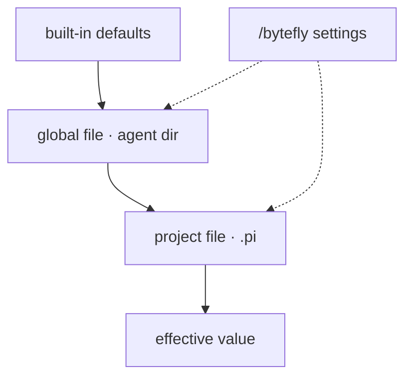
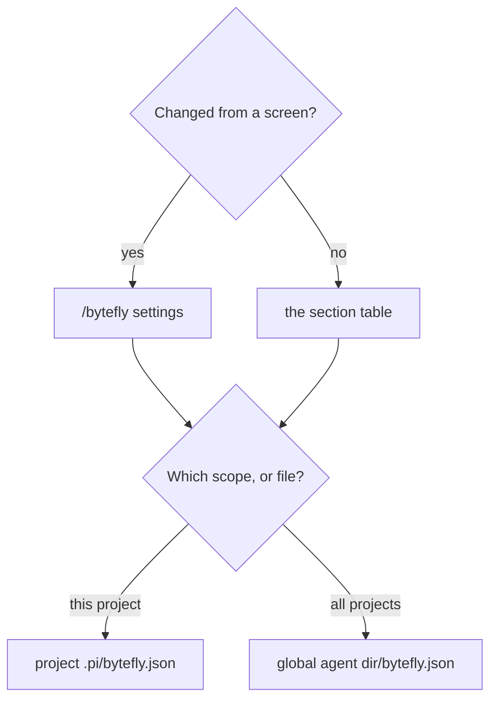

# Configuration

Most extensions need no configuration. Everything that can be changed lives
under one top-level section of one document, `bytefly.json`, named for the
extension — bytefly itself owns four (`price`, `notify`, `doctor`, `chrome`).

This page is the how-to: where a setting lives and how to change it. Every key,
with its type, default, and bounds, is in
[the configuration reference](./configuration-reference.md).

## Contents

- [Where a setting lives](#where-a-setting-lives)
- [Change a setting](#change-a-setting)
- [What people usually change](#what-people-usually-change)
- [Migrating from older versions](#migrating-from-older-versions)
- [Environment variables](#environment-variables)
- [State](#state)
- [Related docs](#related-docs)

## Where a setting lives

A value resolves in three layers, each later one over the previous:

1. the loader's built-in default;
2. `<agent-dir>/bytefly.json` — the global document, in Pi's agent directory
   (`PI_CODING_AGENT_DIR`, usually `~/.pi/agent`);
3. `<cwd>/.pi/bytefly.json` — the project document.

A key set in the project file overrides the same key from the global file; a key
the project file leaves out keeps the global value. `worktree` is the exception:
it reads its project document from the repository root, not the effective working
directory, so the setting follows the checkout rather than a worktree inside it.

**The three layers, and the screen that writes into two of them.**



Read it top to bottom: a value falls through the defaults and the two files, and
the last file that states it wins; the settings screen writes a single key into
whichever file the scope selector names.

| Scope | File | Applies to | Written by |
|---|---|---|---|
| Global | `<agent-dir>/bytefly.json` | every session on this machine | the settings screen's **Global** scope, or a hand edit |
| Project | `<cwd>/.pi/bytefly.json` | this project (for `worktree`, the repository root) | the settings screen's **Project** scope, or a hand edit |

Three exceptions are worth knowing:

- **Pi's own settings.** The **Startup screen** and **Theme** rows write Pi's
  `settings.json` rather than `bytefly.json`, and are Global only because Pi
  exposes no project scope for them. The other Pi preferences the screen once
  carried — output padding and the hardware cursor — stay in Pi's own `/settings`.
- **One key at a time.** The screen writes only the key you changed, preserving
  every sibling, other section, and metadata key.
- **Metadata.** `$schema` and `version` are ignored by the loaders: `migrate:config`
  stamps `version` when it is missing, and nothing warns about it. See
  [Document metadata](./configuration-reference.md#document-metadata).

A missing or malformed document is ignored, so a broken file never blocks a
session; `/bytefly doctor` reports the file that failed to parse.

## Change a setting

Two ways in, and the same two destinations.

**Which control, and which file.**



If the row exists in `/bytefly settings`, change it there: the screen validates
the value and writes one key. If it does not, edit the section's table below in
the file for the scope you want, and the next session reads it.

**From the settings screen.**

1. Run `/bytefly settings` (`/bytefly`, then `→`, opens the same section).
2. Press `s` to choose **Global** or **Project** scope.
3. Move with `↑`/`↓`, then `Space` or `Enter` to change the value: a switch
   toggles, a choice cycles, and a text row opens an editor saved with `Enter`.
4. `u` removes the key so its default applies again; it refuses for **Startup
   screen** and **Theme**, which are Pi's own rows, and for a Project row that
   only inherits Global. `J` shows the stored section as JSON.
5. Close the screen and accept the reload it offers.

**By hand.**

1. Open `<agent-dir>/bytefly.json` for every project, or `<cwd>/.pi/bytefly.json`
   for one. Create the file if it does not exist.
2. Put the key under its section, as a dotted path flattened into nested objects:

   ```json
   {
     "version": 1,
     "chrome": { "rail": "│" },
     "job": { "wakeOnFinish": true }
   }
   ```

3. Save valid JSON; a malformed file is ignored and `/bytefly doctor` names it.
   The next session picks the value up.

## What people usually change

| I want to… | Where |
|---|---|
| get a desktop alert when a turn, a job, or a question needs me | **Desktop notifications** in `/bytefly settings` |
| see costs in another currency, or set a budget | **Currency**, **Session budget** |
| set the cost precision after choosing a currency | [`price.currency.decimals`](./configuration-reference.md#price--cost-calculation) |
| change the rail glyph beside tool results | [`chrome.rail`](./configuration-reference.md#chrome--transcript-chrome) |
| use the light palette, or follow the system's preference | **Theme** in `/bytefly settings`, or `theme` in Pi's own settings |
| keep an achieved goal visible | [`goal.achieved`](./configuration-reference.md#goal--the-goal-widget) |
| keep more snapshots, or turn off the pre-restore one | [`rewind.max`](./configuration-reference.md#rewind--snapshots), [`rewind.safetySnapshot`](./configuration-reference.md#rewind--snapshots) |
| wake the agent when a job finishes, or keep jobs after exit | **Resume after a job**, [`job.detachedByDefault`](./configuration-reference.md#job--background-jobs) |
| wake the agent on a watcher match | [`watch.wakeOnMatch`](./configuration-reference.md#watch--file-and-command-watchers) |
| stop injecting memory notes | [`memory.inject`](./configuration-reference.md#memory--durable-notes) |
| choose the worktree base, branch prefix, fetch, or prune age | [`worktree`](./configuration-reference.md#worktree--isolated-worktrees) |
| pin the port every page of a session shares, so a bookmarked URL survives a restart | [`serve`](./configuration-reference.md#serve--the-sessions-page-server) |
| use a self-hosted search service or a Brave key | [`web-access`](./configuration-reference.md#web-access--search-and-fetch) |
| change document read limits | [`file-read`](./configuration-reference.md#file-read--document-and-spreadsheet-extraction) |
| raise the board's WIP limits, or name the team lead whose signature the board's gates take | **Plan limit**, **Execute limit**, **Lead** in `/bytefly settings`, or [`board`](./configuration-reference.md#board--the-shared-feature-board) |

`/bytefly settings` is a shortlist of the preferences a session changes — fifteen
rows under six headings (Startup, Notifications, Session, Board, Team, and Price), named in
bold above. Everything else — the tuning numbers, the
cosmetic labels, and the settings Pi's own `/settings` owns — is the file or Pi's
screen; the full list is on
[the configuration reference](./configuration-reference.md).

## Migrating from older versions

Before the shared document, each extension read its own `<name>.json`
(`document.json`, `jobs.json`, `web-access.json`, …). The migration ships with the
repository rather than with the published package — `scripts/` is not in the tarball
`pi install npm:` unpacks — so run it from a checkout, once per machine and per
repository:

```bash
git clone https://github.com/gavin-hu/my-pi-agent && cd my-pi-agent && bun install
bun run migrate:config --project <repo-root>   # --dry-run previews, --keep keeps the old files
```

It moves each legacy file into its section, renames an already-migrated
`document` section to `file-read`, moves bytefly's former top-level
`currency`/`rates`/`peak` under `price`, stamps `version`, and deletes the legacy
files. It skips an existing section and refuses to touch a malformed document,
so it is safe to re-run. It reads the same agent directory an installed `pi`
writes, so the checkout migrates what the package left behind.

## Environment variables

Three variables change how the package runs; the `PI_WORKTREE_*` ones are set by
the extension and need no attention.

**You set these.**

| Variable | Meaning |
|---|---|
| `PI_DISABLED_EXTENSIONS` | Comma- or whitespace-separated extension names to load without; case-insensitive, unknown names ignored. |
| `PI_OFFLINE` | Turns off Pi's automatic network activity; `bytefly`'s update check reads it too, so an offline session makes no package-update or version request. |
| `PI_CODING_AGENT_DIR` | The agent directory the global document resolves against. |

**The package sets these.**

| Variable | Meaning |
|---|---|
| `PI_WORKTREE_ROOT` | The effective working directory while a worktree is active. |
| `PI_WORKTREE_BRANCH` | The worktree's branch name. |
| `PI_WORKTREE_MAIN` | The main checkout path, used by exit and prune. |

Do not set those by hand: they describe the session to its child processes.

## State

The `wechat` extension keeps runtime state under `<agent-dir>/wechat/`:
`credentials.json` (mode `0600`, the one stored account this bridge runs),
`state.json` (the poll cursor, the one conversation's reply token and last
inbound time, and the recent message ids used to ignore a replay), `media/`
(downloaded inbound files, pruned once they pass `mediaRetentionDays`), and
`poller.lock` (one runtime owns the account at a time). This is login and runtime
state, not configuration; [each extension's page](./extensions/README.md) names
the files it writes.

## Related docs

| Topic | Document |
|---|---|
| Changing settings on screen, for a user | [`bytefly`](./extensions/bytefly.md) |
| Trust boundaries around state and credentials | [Security](./security.md) |
| One extension's own configuration section | [each extension's page](./extensions/README.md) |
