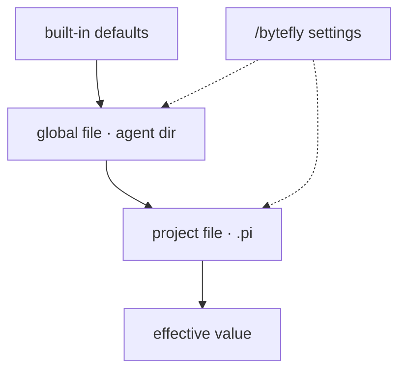
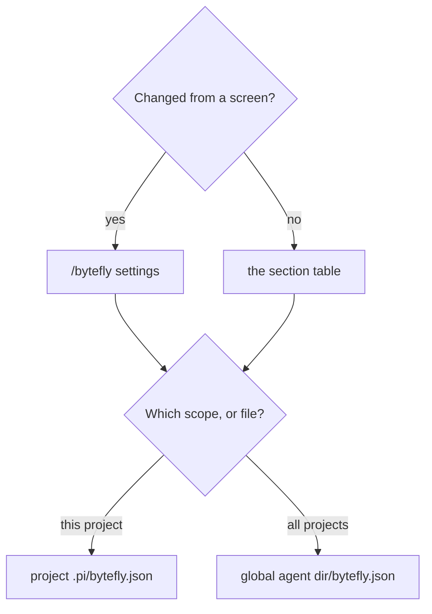

# Configuration

Most extensions need no configuration. Everything that can be changed lives
under one top-level section of one document, `bytefly.json`, named for the
extension — bytefly itself owns four (`price`, `notify`, `doctor`, `chrome`).

This page is both the how-to and the key list: the first half tells you where a
setting lives and how to change it; [Look up a key](#look-up-a-key) has every
section and every key with its type, default, and bounds.

## Contents

- [Where a setting lives](#where-a-setting-lives)
- [Change a setting](#change-a-setting)
- [What people usually change](#what-people-usually-change)
- [Look up a key](#look-up-a-key)
- [Section index](#section-index)
- [Document metadata](#document-metadata)
- [`check` — verification runs](#check--verification-runs)
- [`price` — cost calculation](#price--cost-calculation)
- [`notify` — OS notifications](#notify--os-notifications)
- [`doctor` — diagnostics](#doctor--diagnostics)
- [`chrome` — transcript chrome](#chrome--transcript-chrome)
- [`file-read` — document and spreadsheet extraction](#file-read--document-and-spreadsheet-extraction)
- [`file-browse` — the local file server](#file-browse--the-local-file-server)
- [`goal` — the goal widget](#goal--the-goal-widget)
- [`job` — background jobs](#job--background-jobs)
- [`watch` — file and command watchers](#watch--file-and-command-watchers)
- [`memory` — durable notes](#memory--durable-notes)
- [`rewind` — snapshots](#rewind--snapshots)
- [`subagent` — delegated runs](#subagent--delegated-runs)
- [`todo` — the todo widget](#todo--the-todo-widget)
- [`web-access` — search and fetch](#web-access--search-and-fetch)
- [`wechat` — the WeChat bridge](#wechat--the-wechat-bridge)
- [`worktree` — isolated worktrees](#worktree--isolated-worktrees)
- [Environment variables](#environment-variables)
- [State](#state)
- [Migrating from older versions](#migrating-from-older-versions)
- [Related docs](#related-docs)

## Where a setting lives

A value resolves in three layers, each later one over the previous:

1. the loader's built-in default;
2. `<agent-dir>/bytefly.json` — the global document, in Pi's agent directory
   (`PI_CODING_AGENT_DIR`, usually `~/.pi/agent`);
3. `<cwd>/.pi/bytefly.json` — the project document.

A key set in the project file overrides the same key from the global file; a key
the project file leaves out keeps the global value. `worktree` is the exception:
it reads its project document from the repository root, not the effective working
directory, so the setting follows the checkout rather than a worktree inside it.

**The three layers, and the screen that writes into two of them.**



Read it top to bottom: a value falls through the defaults and the two files, and
the last file that states it wins; the settings screen writes a single key into
whichever file the scope selector names.

| Scope | File | Applies to | Written by |
|---|---|---|---|
| Global | `<agent-dir>/bytefly.json` | every session on this machine | the settings screen's **Global** scope, or a hand edit |
| Project | `<cwd>/.pi/bytefly.json` | this project (for `worktree`, the repository root) | the settings screen's **Project** scope, or a hand edit |

Three exceptions are worth knowing:

- **Pi's own settings.** The **Bytefly startup TUI** and **Theme** rows write Pi's
  `settings.json` rather than `bytefly.json`, and are Global only because Pi
  exposes no project scope for them. The other Pi preferences the screen once
  carried — output padding and the hardware cursor — stay in Pi's own `/settings`.
- **One key at a time.** The screen writes only the key you changed, preserving
  every sibling, other section, and metadata key.
- **Metadata.** `$schema` is ignored by the loaders; `version` defaults to `1` and
  a newer value only warns. See [Document metadata](#document-metadata).

A missing or malformed document is ignored, so a broken file never blocks a
session; `/bytefly doctor` reports the file that failed to parse.

## Change a setting

Two ways in, and the same two destinations.

**Which control, and which file.**



If the row exists in `/bytefly settings`, change it there: the screen validates
the value and writes one key. If it does not, edit the section's table below in
the file for the scope you want, and the next session reads it.

**From the settings screen.**

1. Run `/bytefly settings` (`/bytefly`, then `→`, opens the same section).
2. Press `Tab` to choose **Global** or **Project** scope.
3. Move with `↑`/`↓`, then `Space` or `Enter` to change the value: a switch
   toggles, a choice cycles, and a text row opens an editor saved with `Enter`.
4. `u` removes the key so its default applies again; `J` shows the stored
   section as JSON.
5. Close the screen and accept the reload it offers.

**By hand.**

1. Open `<agent-dir>/bytefly.json` for every project, or `<cwd>/.pi/bytefly.json`
   for one. Create the file if it does not exist.
2. Put the key under its section, as a dotted path flattened into nested objects:

   ```json
   {
     "version": 1,
     "chrome": { "rail": "│" },
     "job": { "wakeOnFinish": true }
   }
   ```

3. Save valid JSON; a malformed file is ignored and `/bytefly doctor` names it.
   The next session picks the value up.

## What people usually change

| I want to… | Where |
|---|---|
| get a desktop alert when a turn, a job, or a question needs me | **Desktop notifications** in `/bytefly settings` |
| see costs in another currency, or set a budget | **Currency**, **Session budget** |
| set the cost precision after choosing a currency | `price.currency.decimals` below |
| change the rail glyph beside tool results | `chrome.rail` below |
| keep an achieved goal visible | `goal.achieved` below |
| keep more snapshots, or turn off the pre-restore one | `rewind.max`, `rewind.safetySnapshot` below |
| wake the agent when a job finishes, or keep jobs after exit | **Wake when a job finishes**, `job.detachedByDefault` |
| wake the agent on a watcher match | `watch.wakeOnMatch` below |
| stop injecting memory notes | `memory.inject` below |
| choose the worktree base, branch prefix, fetch, or prune age | `worktree` below |
| pin the browser's port | [`file-browse`](#file-browse--the-local-file-server) |
| use a self-hosted search service or a Brave key | [`web-access`](#web-access--search-and-fetch) |
| change document read limits | [`file-read`](#file-read--document-and-spreadsheet-extraction) |

`/bytefly settings` is a shortlist of the preferences a session changes — twelve
flat rows, named in bold above. Everything else — the tuning numbers, the
cosmetic labels, and the settings Pi's own `/settings` owns — is the file or Pi's
screen; the rest of this page is the full list.

## Look up a key

Every key is listed below, section by section, with its type, default, and
bounds. The key column is the dotted path inside the section, so
`currency.decimals` under `price` is the document's `price.currency.decimals`. A
key whose value is a free-form map or an array of objects gets one row, with its
child shape described under the table.

The sections, by what they are for:

| Group | Sections |
|---|---|
| Plan and delegate | [`check`](#check--verification-runs), [`todo`](#todo--the-todo-widget), [`goal`](#goal--the-goal-widget), [`job`](#job--background-jobs), [`watch`](#watch--file-and-command-watchers), [`subagent`](#subagent--delegated-runs) |
| Keep your work safe | [`worktree`](#worktree--isolated-worktrees), [`rewind`](#rewind--snapshots), [`memory`](#memory--durable-notes) |
| Reach the world | [`web-access`](#web-access--search-and-fetch), [`file-browse`](#file-browse--the-local-file-server), [`file-read`](#file-read--document-and-spreadsheet-extraction), [`wechat`](#wechat--the-wechat-bridge) |
| Chrome and upkeep | [`price`](#price--cost-calculation), [`notify`](#notify--os-notifications), [`doctor`](#doctor--diagnostics), [`chrome`](#chrome--transcript-chrome) |

Every table is checked against the defaults its loader exports by
`test/config-docs.test.ts`, so a renamed key or a changed default fails the
suite. Each extension's own `README.md` remains the place for behaviour beyond
the keys.

## Section index

One top-level key per extension. `worktree` reads its project document from the
repository root rather than the active working directory.

| Extension | Section | Covers |
|---|---|---|
| [`bytefly`](../extensions/bytefly/) | `price`, `notify`, `doctor`, `chrome` | Cost rates/currency/peak schedule, OS notifications, diagnostics settings, and the transcript rail glyph. |
| [`check`](../extensions/check/) | `check` | Detection override, run timeout, and log tail. |
| [`file-read`](../extensions/file-read/) | `file-read` | Read limits, enabled formats. |
| [`file-browse`](../extensions/file-browse/) | `file-browse` | Server port and page limits. |
| [`goal`](../extensions/goal/) | `goal` | Widget behaviour, such as keeping an achieved goal visible. |
| [`job`](../extensions/job/) | `job` | Log-tail size and other job limits. |
| [`watch`](../extensions/watch/) | `watch` | Watch limits, wake behaviour, and poll interval. |
| [`memory`](../extensions/memory/) | `memory` | Note injection limits. |
| [`rewind`](../extensions/rewind/) | `rewind` | Snapshot scope and retention. |
| [`subagent`](../extensions/subagent/) | `subagent` | Run deadline, transcript retention. |
| [`todo`](../extensions/todo/) | `todo` | Widget behaviour. |
| [`web-access`](../extensions/web-access/) | `web-access` | Search provider and fetch limits (`search` and `fetch` groups). |
| [`wechat`](../extensions/wechat/) | `wechat` | Bridge, media, and peer-feedback settings. |
| [`worktree`](../extensions/worktree/) | `worktree` | Worktree directory name and behaviour. |

`question` and `file-open` read no configuration.

## Document metadata

| Key | Type | Default | Values | What it does |
|---|---|---|---|---|
| `$schema` | string | | | Editor-schema pointer; ignored by the loaders. |
| `version` | integer | `1` | `1` or newer | Document schema version; a newer value warns, an older one is read as-is. |

## `price` — cost calculation

The footer's cost total. Read once per footer install, so a change needs a
reload. `/bytefly settings` edits `currency.code` and `budget`; choosing a currency
also writes its default `currency.decimals`, which is a `bytefly.json` edit after
that.

| Key | Type | Default | Values | What it does |
|---|---|---|---|---|
| `currency.code` | string | `"CNY"` | `CNY`, `USD` | Pricing algorithm, and which built-in table `rates` starts from. Both apply `peak`; only `USD` falls back to Pi's recorded dollars for an unmatched model. |
| `currency.decimals` | integer | `2` | `0`–`4` | Digits after the decimal point. |
| `budget` | number | `0` | `0`–`10000000` | Session spend that triggers one warning, in the selected currency; `0` turns the guardrail off. It warns; it never stops a turn. |
| `rates` | object | DeepSeek's published rates in the selected currency | One entry per `provider/model` | Per-million-token prices; merged key by key across the global and project documents. |
| `peak.timezone` | string | `"Asia/Shanghai"` | An IANA zone | Zone the peak windows are stated in; an unknown zone drops the whole schedule. |
| `peak.windows` | array | DeepSeek's weekday windows | Up to 16 entries | The peak windows. |

`rates` are stated in the currency `currency.code` selects: `CNY` starts from
DeepSeek's published yuan table and `USD` from its published dollar table, and a
hand-written entry is read in that same unit. Switching the code therefore
starts from the other built-in table instead of reinterpreting your numbers, and
a `rates` stated in the same section as the code merges over it. Choosing a
currency also writes its default precision; that can be overridden afterwards. The symbol follows the code and is not configurable. A `rates` entry takes `input`, `output`, `cacheRead`, and `cacheWrite` (number,
`0`–`1000000`, default `0`) and `offPeakMultiplier` (number, `0`–`1`, default
`1`). A key present in both documents replaces the other. An entry stating none
of the five numbers is ignored.

A `peak.windows` entry takes `from` and `to` (`HH:MM`, both required) and `days`
(ISO weekdays `1`–`7`, `1` = Monday; omitted means every day). `from` is
inclusive, `to` exclusive, and a `to` at or before `from` wraps past midnight.

## `notify` — OS notifications

Read at `session_start`; `/bytefly settings` edits `enabled` and the four
triggers. `method` and `title` are `bytefly.json` edits.

| Key | Type | Default | Values | What it does |
|---|---|---|---|---|
| `enabled` | boolean | `false` | | Raise a notification at all. |
| `turnFinished` | boolean | `true` | | Announce a run that settled. |
| `needsInput` | boolean | `true` | | Announce a prompt raised during a run. |
| `jobFinished` | boolean | `true` | | Announce a finished background job. |
| `matchFound` | boolean | `true` | | Announce a `watch` wake match: a watcher with `wake` on matched, raised as soon as the agent is idle. |
| `method` | string | `"auto"` | `auto`, `osc777`, `osc99`, `toast`, `osascript`, `notify-send` | Delivery route; `auto` picks from the terminal, then the platform. |
| `title` | string | `"Pi"` | Up to 40 characters | Notification title. |

An explicit `method` this host cannot deliver — a platform notifier on another
platform, or an OSC method with no terminal — is reported by `doctor` as a
`degraded` finding and is still dropped at send time; `auto` never is, because
it picks from the environment.

## `doctor` — diagnostics

Read at `session_start`; `/bytefly settings` edits `proactive`.

| Key | Type | Default | Values | What it does |
|---|---|---|---|---|
| `proactive` | boolean | `true` | | Probe enabled extensions at session start and post a notice for a missing requirement. |
| `timeoutMs` | integer | `2000` | `100`–`30000` | Per-probe timeout for one spawned command. |
| `skip` | string[] | `[]` | | Extension names left out of every report. |

## `chrome` — transcript chrome

The part of bytefly's look that a config file controls. It has no row on the
settings screen; `rail` is a `bytefly.json` edit.

| Key | Type | Default | Values | What it does |
|---|---|---|---|---|
| `rail` | string | `"╎"` | Exactly one visible column | Glyph that leads a tool result and a notice body. |

## `file-read` — document and spreadsheet extraction

| Key | Type | Default | Values | What it does |
|---|---|---|---|---|
| `maxFileBytes` | integer | `20971520` | `1024`–`536870912` | Reject files larger than this many bytes. |
| `maxChars` | integer | `40000` | `200`–`100000` | Default character budget for the returned slice. |
| `extractTimeoutMs` | integer | `30000` | `1000`–`300000` | Per-call extraction deadline; a parser that outlasts it is abandoned and the read fails with this limit named. |
| `formats.pdf` | boolean | `true` | | Enable PDF extraction. |
| `formats.docx` | boolean | `true` | | Enable DOCX extraction. |
| `formats.doc` | boolean | `true` | | Enable DOC extraction. |
| `formats.odt` | boolean | `true` | | Enable ODT extraction. |
| `formats.rtf` | boolean | `true` | | Enable RTF extraction. |
| `formats.xlsx` | boolean | `true` | | Enable XLSX extraction. |

`formats` accepts only the six ids above; an unknown id or a non-boolean value is
ignored, and an absent id keeps its registry default.

## `file-browse` — the local file server

| Key | Type | Default | Values | What it does |
|---|---|---|---|---|
| `port` | integer | `0` | `0`–`65535` | TCP port on `127.0.0.1`; `0` picks one random port for the session, a positive value pins it. |
| `autoOpen` | boolean | `true` | | Open the default browser when the server starts. |
| `maxFileBytes` | integer | `1048576` | `0`–`1073741824` | Files larger than this are not rendered inline. |
| `maxThumbBytes` | integer | `5242880` | `0`–`1073741824` | Images larger than this get an icon instead of a thumbnail. |
| `maxTextLines` | integer | `5000` | `1`–`1000000` | Lines rendered before a text file is truncated. |
| `maxDirEntries` | integer | `2000` | `1`–`1000000` | Directory entries listed before the listing is truncated. |
| `thumbnails` | boolean | `true` | | Render inline image thumbnails in listings. |
| `markdown` | boolean | `true` | | Render Markdown files as formatted HTML instead of plain text. |
| `markdownHtml` | boolean | `true` | | Re-emit sanitized raw HTML inside rendered Markdown; `false` escapes it as text. |
| `maxIndexEntries` | integer | `20000` | `1`–`1000000` | Files collected for the quick-open index before it is truncated. |
| `gitDiff` | boolean | `true` | | Offer the read-only git diff view. |
| `diffContext` | integer | `3` | `0`–`100` | Unified diff context lines. |
| `maxDiffLines` | integer | `4000` | `1`–`1000000` | Diff lines rendered before the view is truncated. |
| `live` | boolean | `true` | | Push live status to open pages over `/events`. |
| `liveIntervalMs` | integer | `5000` | `250`–`60000` | How often a connected page is sent a status frame. |

## `goal` — the goal widget

The settings screen has no row for it; `achieved` is a `bytefly.json` edit.

| Key | Type | Default | Values | What it does |
|---|---|---|---|---|
| `achieved` | string | `"hide"` | `show`, `hide` | How an achieved goal renders: `show` keeps the dimmed rail line, `hide` removes it. |

## `job` — background jobs

`/bytefly settings` edits `wakeOnFinish`; `detachedByDefault` is a `bytefly.json`
edit.

| Key | Type | Default | Values | What it does |
|---|---|---|---|---|
| `enabled` | boolean | `true` | | Track jobs at all. |
| `showStatus` | boolean | `true` | | Show the `▸ N` / `✗ N` chips while jobs run or a failure is unreported. |
| `wakeOnFinish` | boolean | `false` | | Default `wake` for a new job: trigger one agent turn when it finishes. |
| `detachedByDefault` | boolean | `false` | | Leave jobs running when the session ends unless a job opts out; inert on Windows, which refuses to detach. |
| `maxJobs` | integer | `20` | `1`–`500` | Finished jobs kept in the registry before the oldest are pruned. |
| `maxLogLines` | integer | `100` | `1`–`5000` | Log lines returned to the model by `logs`. |
| `maxLogBytes` | integer | `8388608` | `0`–`1073741824` | Bytes a log segment may reach before it rotates to `<id>.log.1`; `0` keeps logs unbounded. |
| `killGraceMs` | integer | `5000` | `0`–`60000` | Grace period before a SIGTERM escalates to SIGKILL. |
| `repaintMs` | integer | `1000` | `100`–`10000` | Chip refresh interval while jobs run. |
| `sessionTtlMs` | integer | `60000` | `5000`–`600000` | How long a session heartbeat is trusted before its jobs are reaped. |
| `registryDir` | string | | | Override for the registry and log directory; the default sits under the agent directory. |

## `watch` — file and command watchers

The settings screen has no row for it; `wakeOnMatch` is a `bytefly.json` edit.

| Key | Type | Default | Values | What it does |
|---|---|---|---|---|
| `enabled` | boolean | `true` | | Allow `add`; `false` refuses to start a watcher. |
| `showStatus` | boolean | `true` | | Show the chips while watchers run or a match is unreported. |
| `wakeOnMatch` | boolean | `false` | | Default `wake` for a new watcher: trigger one agent turn on a match. |
| `maxWatchers` | integer | `20` | `1`–`200` | Live watchers kept before `add` is refused. |
| `maxMatches` | integer | `200` | `1`–`5000` | Matches kept per watcher before the oldest are dropped. |
| `maxLogLines` | integer | `500` | `1`–`5000` | Raw lines kept per watcher for `logs`. |
| `matchLines` | integer | `50` | `1`–`2000` | Lines returned by `matches` and `logs` when the call omits a count. |
| `pollMs` | integer | `500` | `100`–`60000` | File poll interval; watchers do not use `fs.watch`. |

## `memory` — durable notes

The settings screen has no row for it; `inject` is a `bytefly.json` edit.

| Key | Type | Default | Values | What it does |
|---|---|---|---|---|
| `inject` | boolean | `true` | | Inject stored notes before each run. |
| `maxInjectBytes` | integer | `8192` | `512`–`32768` | Largest injected body, in UTF-8 bytes. |

## `rewind` — snapshots

`/bytefly settings` edits `autoSnapshots`; `max` and `safetySnapshot` are
`bytefly.json` edits.

| Key | Type | Default | Values | What it does |
|---|---|---|---|---|
| `autoSnapshots` | boolean | `true` | | Take one automatic snapshot per user prompt. |
| `max` | integer | `20` | `0`–`1000` | Snapshot refs kept per root; automatic and pre-restore safety snapshots both count. |
| `includeUntracked` | boolean | `true` | | Include untracked, non-ignored files in a snapshot. |
| `safetySnapshot` | boolean | `true` | | Snapshot the current state before a restore, so a rewind can itself be undone. |
| `autoPrune` | boolean | `true` | | Prune refs beyond `max` after an automatic snapshot. |
| `showStatus` | boolean | `true` | | Show the `↺ N` chip. |
| `watch` | string[] | `[]` | | Extra tool names treated as mutating, so a call triggers a snapshot. |
| `ignore` | string[] | `[]` | | Tool names never to snapshot; the extension's own tools are always excluded. |
| `refNamespace` | string | `"refs/pi/rewind"` | | Git ref namespace for stored snapshots; trailing slashes are stripped. |

Pruning runs after an automatic snapshot, not after a restore, so a safety
snapshot and the snapshot it restored from remain available for a follow-up
restore. Both count toward `max`, so a restore-heavy session keeps fewer prompt
snapshots than the number alone implies.

## `subagent` — delegated runs

Read once per session. A transcript is written by the dispatching process, never
by the child, so the read-only tool set and the project-agent trust gate are
unaffected.

| Key | Type | Default | Values | What it does |
|---|---|---|---|---|
| `timeoutMs` | integer | `600000` | `0`–`3600000` | Wall-clock limit for one child run; `0` disables it. A run past it is killed and fails with `Timed out after …`. |
| `transcripts` | string | `"off"` | `"off"`, `"failed"`, `"all"` | Which finished runs keep a transcript under `.pi/subagents/`. |
| `retentionDays` | integer | `14` | `1`–`3650` | Age after which a run directory is pruned at session start. |
| `maxRuns` | integer | `100` | `1`–`1000` | Run directories kept; the oldest are pruned first. |
| `backgroundMax` | integer | `4` | `1`–`8` | Background children allowed to run at once. |

## `check` — verification runs

`/bytefly settings` has no rows for these; they are `bytefly.json` edits.

| Key | Type | Default | Values | What it does |
|---|---|---|---|---|
| `command` | string | `""` | | Shell command that overrides detection for every target. Empty means detect. |
| `timeoutMs` | integer | `600000` | `0`–`3600000` | Wall-clock limit per command; `0` disables it. |
| `maxLogBytes` | integer | `1048576` | `65536`–`16777216` | Bytes of output retained per command. |

## `todo` — the todo widget

| Key | Type | Default | Values | What it does |
|---|---|---|---|---|
| `hideWhenComplete` | boolean | `true` | | Hide the one-line widget once every item is completed; an empty list always hides. |

## `web-access` — search and fetch

| Key | Type | Default | Values | What it does |
|---|---|---|---|---|
| `search.provider` | string | `"auto"` | `auto`, `duckduckgo`, `searxng`, `brave` | `auto` picks the first configured backend; a named id forces it, even when it is not configured. |
| `search.endpoint` | string | `""` | `""` or an `http(s)://` URL | SearXNG base URL; empty means SearXNG cannot run. |
| `search.language` | string | `"auto"` | `auto` or a language code | SearXNG language; `auto` picks `zh-CN` for CJK input and `en` otherwise. |
| `search.safeSearch` | integer | `0` | `0`–`2` | SearXNG safesearch level: 0 off, 1 moderate, 2 strict. |
| `search.categories` | string | `"general"` | | SearXNG `categories` parameter. |
| `search.apiKeyEnv` | string | `""` | | Environment variable holding an API key; preferred over `apiKey`. |
| `search.apiKey` | string | `""` | | Literal API key fallback for keyed backends and auth proxies. |
| `search.maxResults` | integer | `8` | `1`–`20` | Default number of results. |
| `search.timeoutMs` | integer | `15000` | `1000`–`120000` | Per-request timeout in milliseconds. |
| `search.maxBytes` | integer | `5000000` | `1024`–`50000000` | Maximum response size in bytes. |
| `search.minIntervalMs` | integer | `500` | `0`–`60000` | Minimum spacing between requests. |
| `search.maxOutputChars` | integer | `12000` | `1000`–`100000` | Character budget for the model-facing text. |
| `search.userAgent` | string | `"my-pi-agent/0.1 (+https://github.com/gavin-hu/my-pi-agent)"` | | User-Agent sent with search requests. |
| `fetch.timeoutMs` | integer | `20000` | `1000`–`120000` | Per-request timeout in milliseconds. |
| `fetch.maxBytes` | integer | `5000000` | `1024`–`50000000` | Maximum response size in bytes. |
| `fetch.maxOutputChars` | integer | `20000` | `500`–`100000` | Default and ceiling for the returned text slice. |
| `fetch.userAgent` | string | `"my-pi-agent/0.1 (+https://github.com/gavin-hu/my-pi-agent)"` | | User-Agent sent with fetch requests. |
| `fetch.acceptLanguage` | string | `"zh-CN,zh;q=0.9,en;q=0.8"` | | `Accept-Language` header. |
| `fetch.allowPrivateHosts` | boolean | `false` | | Allow loopback, private, and internal targets, disabling the SSRF guard. |
| `fetch.maxRedirects` | integer | `5` | `0`–`10` | Redirect hops to follow, each one re-validated. |
| `fetch.maxBodyChars` | integer | `100000` | `1000`–`1000000` | Maximum request body length in characters. |
| `fetch.pdfEnabled` | boolean | `true` | | Extract text from PDF responses with the optional `unpdf` package. |
| `fetch.cacheEnabled` | boolean | `true` | | Cache extracted pages for the registration. |
| `fetch.cacheTtlMs` | integer | `300000` | `0`–`3600000` | Cache entry lifetime; `0` never expires. |
| `fetch.cacheMaxEntries` | integer | `8` | `1`–`50` | Maximum cached pages. |
| `fetch.cacheMaxBytes` | integer | `8000000` | `1024`–`50000000` | Maximum total cached text bytes. |

## `wechat` — the WeChat bridge

| Key | Type | Default | Values | What it does |
|---|---|---|---|---|
| `allowedPeers` | string[] | `[]` | | Extra peers allowed to drive the agent, by id or label; the owner is always allowed. |
| `peers` | object | `{}` | | Per-peer overrides, keyed by peer id or label. |
| `maxTurnsPerHour` | integer | `0` | `0`–`500` | Turns allowed per peer in a rolling hour; `0` disables the cap. |
| `maxReplyChars` | integer | `4000` | `1`–`20000` | Replies longer than this are split into several messages. |
| `botAgent` | string | `"pi-wechat"` | Up to 256 characters | Identifier sent as `base_info.bot_agent`. |
| `channelVersion` | string | `"0.1.0"` | | Plugin version sent as `base_info.channel_version`. |
| `cdnBaseUrl` | string | `"https://novac2c.cdn.weixin.qq.com/c2c"` | | Base URL for CDN media downloads and uploads; trailing slashes are stripped. |
| `maxMediaBytes` | integer | `20971520` | `1024`–`104857600` | Inbound media larger than this is skipped. |
| `maxInboundChars` | integer | `8000` | `1000`–`100000` | Inbound text longer than this is truncated before it reaches the model. |
| `typingIndicator` | boolean | `true` | | Send a typing indicator while an inbound turn is generated. |
| `remotePrompts` | boolean | `true` | | Route interactive dialogs raised during a WeChat turn back to WeChat. |
| `pollHoldMs` | integer | | `1000`–`120000`; below `1000` clears the setting | Long-poll hold to request from the server, in milliseconds. |

`peers` is keyed by peer id or label (both forms match, e.g. `alice` and
`alice@im.wechat`). Each value is an object shaped `{ "tools"?: string[] }`,
where `tools` lists that peer's active tool names: absent keeps the full set, an
empty list disables tools, and the list is capped at 200 entries.

## `worktree` — isolated worktrees

`worktree` reads the project document from the repository root rather than the
active working directory. The settings screen has no rows for it; every key below
is a `bytefly.json` edit.

| Key | Type | Default | Values | What it does |
|---|---|---|---|---|
| `dir` | string | `".pi/worktrees"` | | Directory under the repository root that holds managed worktrees. |
| `baseRef` | string | `"fresh"` | `fresh`, `head` | Branch a new worktree starts from: `fresh` fetches the remote default branch, `head` uses local HEAD. |
| `branchPrefix` | string | `"worktree-"` | | Prefix of the branch a managed worktree creates. |
| `fetchRemote` | boolean | `true` | | Fetch the remote before branching from the default branch. |
| `fetchTimeoutMs` | integer | `5000` | `0`–`600000` | Timeout for that fetch, in milliseconds. |
| `onExit` | string | `"ask"` | `ask`, `keep`, `remove` | What `exit_worktree` does by default: ask, always keep, or always remove. |
| `pruneAfterDays` | integer | `7` | `0`–`3650` | Age in days after which `/worktree prune` may remove a clean, unused worktree. |
| `include` | string[] | `[]` | | Gitignored files copied into a new worktree; the fallback when `.worktreeinclude` is absent. |
| `skipOverrides` | string[] | `[]` | | Built-in tool names not to re-register, so another extension can own them. |
| `guard.blockFileEscapes` | boolean | `true` | | Block `write`/`edit` whose resolved path leaves the active worktree. |
| `guard.blockReadEscapes` | boolean | `false` | | Also block read-only tools (`read`, `grep`, `find`, `ls`) from leaving it. |
| `guard.blockGitRedirects` | boolean | `true` | | Block git commands aimed at the main checkout. |
| `guard.blockSymlinkEscapes` | boolean | `true` | | Block writes whose real path leaves the worktree through a symlink. |
| `guard.blockUnparsableCommands` | boolean | `false` | | Block shell commands whose git behaviour cannot be verified. |
| `guard.blockPowershell` | boolean | `true` | | Refuse the `powershell` tool while isolated; it is not re-rooted or guarded, so its relative paths would resolve at the main checkout. `false` allows it and is reported as a gap by `/worktree` and as `degraded` by `doctor`. |

## Migrating from older versions

Before the shared document, each extension read its own `<name>.json`
(`document.json`, `jobs.json`, `web-access.json`, …). Run the migration once per
machine and per repository:

```bash
bun run config:migrate --project <repo-root>   # add --dry-run to preview, --keep to keep the old files
```

It moves each legacy file into its section, renames an already-migrated
`document` section to `file-read`, moves bytefly's former top-level
`currency`/`rates`/`peak` under `price`, stamps `version`, and deletes the legacy
files. It skips an existing section and refuses to touch a malformed document,
so it is safe to re-run.

## Environment variables

Three variables change how the package runs; the `PI_WORKTREE_*` ones are set by
the extension and need no attention.

**You set these.**

| Variable | Meaning |
|---|---|
| `PI_DISABLED_EXTENSIONS` | Comma- or whitespace-separated extension names to load without; case-insensitive, unknown names ignored. See [User guide → Turning features off](./user-guide/settings-and-customization.md#turning-features-off-or-removing-the-pack). |
| `PI_OFFLINE` | Turns off Pi's automatic network activity; `bytefly`'s update check reads it too, so an offline session makes no package-update or version request. |
| `PI_CODING_AGENT_DIR` | The agent directory the global document resolves against. |

**The package sets these.**

| Variable | Meaning |
|---|---|
| `PI_WORKTREE_ROOT` | The effective working directory while a worktree is active. |
| `PI_WORKTREE_BRANCH` | The worktree's branch name. |
| `PI_WORKTREE_MAIN` | The main checkout path, used by exit and prune. |

Do not set those by hand: they describe the session to its child processes.

## State

The `wechat` extension keeps runtime state under `<agent-dir>/wechat/`:
`credentials.json` (mode `0600`, every stored account plus the active one),
`state.json` (the poll cursor, the owner, per-peer reply tokens, and the recent
message ids used to ignore a replay), `media/` (downloaded inbound files), and
`poller.lock` (one runtime owns the account at a time). This is login and runtime
state, not configuration; the [user guide's files table](./user-guide/reference.md#files-on-disk)
lists everything else the package writes.

## Related docs

| Topic | Document |
|---|---|
| Changing settings on screen, for a user | [User guide](./user-guide/) |
| Where configuration sits in the runtime | [Architecture](./architecture.md) |
| Trust boundaries around state and credentials | [Security](./security.md) |
| One extension's own configuration section | [`docs/extensions/<name>.md`](./extensions/) |
