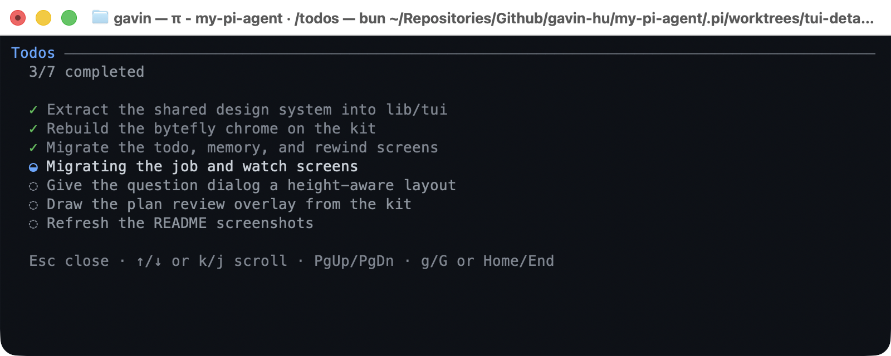
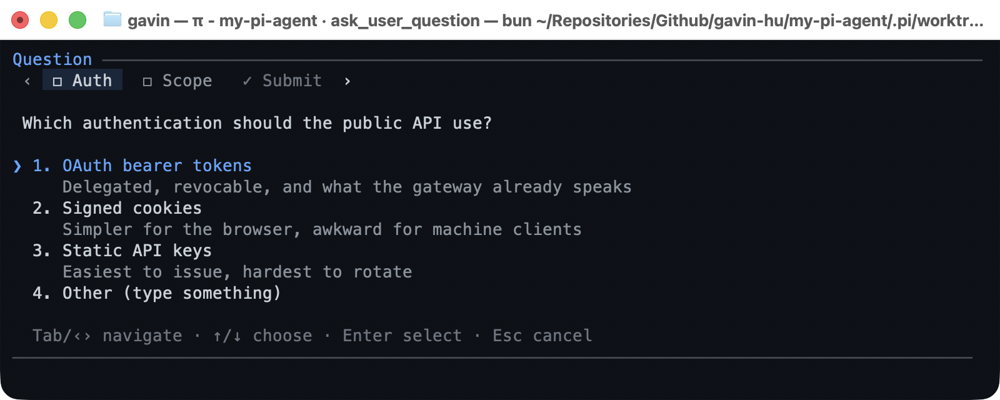
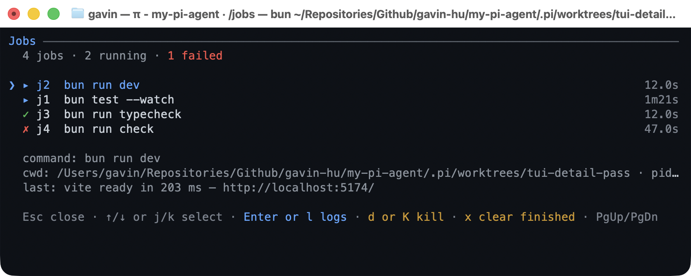
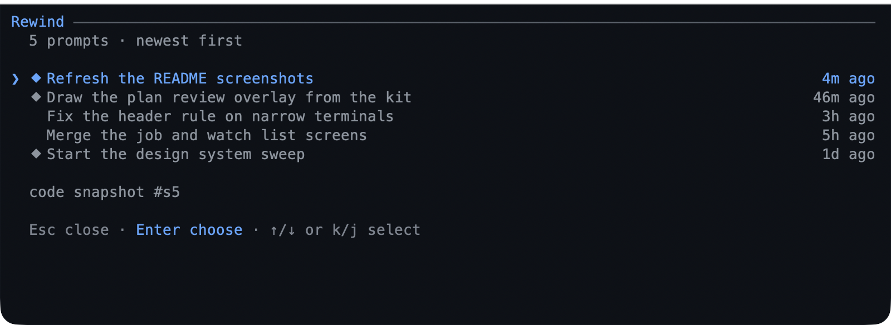
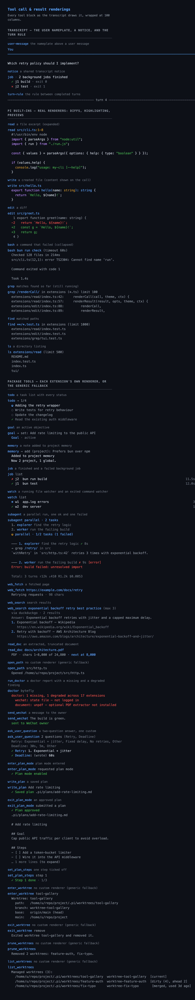

# Extensions

Every extension ships its own `README.md` under its directory with the full tool
and command surface, the Pi integration contract, and design notes. This page is
the catalog: what each one does and the names it registers. It is grouped the
same way as the root README; within a group the order matches the `pi` manifest.

## Plan and delegate

### plan

Read-only planning, modelled on Claude Code's `EnterPlanMode` / `ExitPlanMode`.
While plan mode is on, the model investigates and proposes, but the only thing
it may write is the plan file itself, saved under `.pi/plans`. Tools that are
not read-only are removed or blocked (raw shell is limited to read-only git
commands, `powershell` is blocked, and mutating tools wait), `subagent` is forced
read-only, and the policy is default-deny through `lib/policy.ts`. The plan
follows a documented outline (`# <Title>`, `## Goal`, `## Context`,
`## Approach`, `## Steps`, `## Risks`, `## Verification`); steps are `- [ ]`
checkboxes in the `Steps` section that approval merges into `todo` — existing
items keep their place and status — and `set_plan_steps` keeps the file current
afterward. A plan with more than the 50 steps approval tracks is refused at
write time, so approval never drops steps it cannot track. `exit_plan_mode`
presents the plan for approval, keeps
planning, or takes a refinement; the review screen jumps between headings with
`n`/`p` and, after a refinement, names the sections that changed since the last
review. Press `w` (or run `/plan review [path]`) to open the plan in a loopback
browser — a measured document with a comment rail and the `Steps` section's
progress, plus `j`/`k`/`c`/`a`/`s` shortcuts — leave inline comments, save them
back as `> [!REVIEW]` lines, or **Approve & run** straight from the page when the
review was opened for approval. The browser outline dots the sections that
changed since the last review.
`/plan <prompt>` enters plan mode and sends the task in one step; `/plan` toggles
and `Ctrl+Alt+P` is the shortcut. The enabled flag is a session entry, so
`/resume` and `/tree` restore it.

Tools: `enter_plan_mode`, `write_plan`, `exit_plan_mode`, `set_plan_steps`.
Commands and flags: `/plan`, `/plan <prompt>`, `/plan review [path]`,
`Ctrl+Alt+P`, `--plan`.

[Full README](../extensions/plan/README.md)

### subagent

Delegate a task to a specialized agent running in its own `pi` process. Built-in
agents are `explorer`, `planner`, `reviewer`, `worker`, `researcher`, `tester`,
`debugger`, and `documenter`; optional user and project markdown agents add more.
Calls run single, in parallel (max 8 queued, 4 at once), or chained through a
`{previous}` placeholder. A `readOnly` mode passes only reader tools to the child.

Tool: `subagent`.

[Full README](../extensions/subagent/README.md)

### todo

A TodoWrite-style task list. The whole list is replaced on every call, each item
is `pending`, `in_progress`, or `completed`, and a persistent one-line widget
keeps the list visible (stacked under `goal` when both are loaded).

Tool: `todo`. Command: `/todos`.

[Full README](../extensions/todo/README.md)

### goal

A single persistent session objective, kept visible in a one-line widget and
restated to the model before every turn as an invisible `[SESSION GOAL]` message.
Status is `active` or `achieved`; an empty objective clears it. `/goal <prompt>`
runs an understanding loop (restate, ask any questions the model needs, confirm
or edit) and starts the run; `/goal raw` records the typed words verbatim,
`/goal set`/`edit` record without running, and `/goal done`/`clear` change state
only. Tool-set goals live in tool-result `details` and command-set goals as a
session entry, so either survives `/resume` and `/tree`. Marking a goal achieved
while the todo list still has open items names the count in the result, so the
model closes the *how* before it calls the *what* done.

Tool: `goal`. Command: `/goal`.

[Full README](../extensions/goal/README.md)

### question

Ask the user one or more structured questions — labelled options plus a
free-form "Other" answer — and wait for the response.

Tool: `ask_user_question`.

[Full README](../extensions/question/README.md)

### job

Run long-lived shell commands in the background. Start a job, list jobs, check
status, read a sanitized log tail, feed a `stdin: true` job input, wait for
completion, or kill one. `list` and `/jobs` also show another live session's
jobs, tagged `peer` and read-only. A `▸ N` chip shows running jobs and `✗ N`
shows unreported failures; jobs reconcile on session shutdown, and a finished job
is also drawn as a bytefly notice. A log segment rotates at `maxLogBytes` (8 MiB
by default), so a chatty job cannot fill the disk.

Tool: `job`. Command: `/jobs`.

[Full README](../extensions/job/README.md)

### watch

Tail a file or a command's merged output and match each new line against a
regular expression, with an optional exclude list and case-insensitive matching
by default. A `⊚ N` chip shows running watchers and `! N` shows unreported
matches; matching lines are sanitized, alerted, and reported as a bytefly notice
at the next turn, or wake a turn immediately when a watcher was added `wake: true`.
Watchers are session-only and stopped on session shutdown.

Tool: `watch`. Command: `/watch`.

[Full README](../extensions/watch/README.md)

## Keep your work safe

### worktree

Let one Pi session work inside an isolated `git worktree` on its own branch, and
manage the worktrees it creates. The model keeps calling `read` / `write` /
`edit` / `bash` with ordinary relative paths; only the effective root changes.
`exit_worktree` returns to the main checkout — a clean worktree is removed, and
one with uncommitted changes or new commits is never discarded silently. Cleanup
refuses to throw work away, and path and shell escapes are guarded.

Tools: `enter_worktree`, `exit_worktree`, `prune_worktrees`, `list_worktrees`.
Commands and flags: `/worktree*`, `--worktree <name>`.

[Full README](../extensions/worktree/README.md)

### rewind

Automatic per-prompt snapshots stored under `refs/pi/rewind`, plus `/rewind` to
restore code, conversation, or both. A `↺ N` status chip shows the available
snapshots. Parallel tool calls in one prompt share a single snapshot.

Command: `/rewind`.

[Full README](../extensions/rewind/README.md)

### memory

Durable cross-session notes as human-editable markdown: global notes under the
agent directory, project notes under the repo root's `.pi/`. Add, update, or
forget notes, and list what is stored; an active note set is injected as a
hidden `[MEMORY]` context before each run. `/memory` opens a picker to add,
edit, or forget a single note (and otherwise lists, edits, or clears them).

Tool: `memory`. Command: `/memory`.

[Full README](../extensions/memory/README.md)

## Reach the world

### web-access

Web access with two tools. `web_search` searches through a pluggable provider —
keyless DuckDuckGo by default, with optional self-hosted SearXNG or a keyed
Brave search. `web_fetch` GETs or POSTs a URL and returns readable text, with
paging, `find`, per-hop SSRF checks against private/internal addresses, and
optional PDF extraction. Configuration lives in the `web-access` section of
`bytefly.json`.

Tools: `web_search`, `web_fetch`.

[Full README](../extensions/web-access/README.md)

### file-browse

`/browse` starts a read-only local HTTP server bound to `127.0.0.1` and opens a
two-pane browser tree rooted at the working directory: listings, a rendered
Markdown preview (heading anchors, an on-this-page outline, GitHub's centred
content column, autolinked bare URLs, styled tables and images), sortable
listings, copy and wrap, image
thumbnails, per-language icons, a filter, a fuzzy quick-open palette, a
keyboard sheet (`/`, `u`, `r`, `n`/`p`, `?`) over a reading-progress bar, and a
read-only git diff view (`/diff` overview and per-file unified diffs with
`head` / `staged` / `worktree` scopes, syntax-highlighted changed lines, pinned
hunk headers, and change markers in the listing and tree). No dependencies,
with a `◉ <port>` status chip while it runs.

Command: `/browse`.

[Full README](../extensions/file-browse/README.md)

### document

`read_doc` extracts plain text from a local PDF, DOCX, DOC, ODT, RTF, or XLSX in
process, paged with `startIndex` / `maxChars` and confined to the effective
working directory.

Tool: `read_doc`.

[Full README](../extensions/document/README.md)

### file-open

Open or reveal a file or directory in the OS-native application with
`/open <path>` (or `/open -r <path>` for the file manager), plus the codemode
`open_path` tool.

Tool: `open_path`. Command: `/open`.

[Full README](../extensions/file-open/README.md)

### wechat

A bridge to WeChat over the Weixin iLink bot API. Each admitted sender gets their
own Pi session (own history, own context, the package's tools), so inbound text,
images (as model image content), and files (saved and referenced by path) start a
turn immediately, independent of the terminal, and the reply is sent back with a
typing indicator. Each peer session is told it is answering in a phone chat
window, so replies are shaped for the chat rather than for a terminal. The bridge
starts automatically once an account is stored.
`/wechat` opens a control screen (`login`, `new`, `status`, `pause`, `resume`,
`doctor`, `stop`, `reset`, `history`, `allow`, `logout`, `help`) in
the TUI and prints a one-line summary elsewhere (or while a peer turn is
running). Peers can also send `/new`,
`/stop`, `/status`, and `/help`. The `send_wechat` tool messages the account owner
only.

Tool: `send_wechat`. Command: `/wechat`.

[Full README](../extensions/wechat/README.md)

## Chrome and upkeep

### bytefly

The themed TUI chrome and the package's diagnostics surface. It draws the
startup header (a two-tone nameplate with the agent and chrome identities and a
signature rule, drawn from the active theme through the `lib/tui/` design
system's semantic roles), a compact, width-adaptive two-line footer (pwd + session name + git branch/worktree + browse chip, then context gauge + usage +
mode/alert + model + thinking level), the labeled `╌╌╌ turn N ╌╌╌` rule
between completed turns, a two-row `You` nameplate above each user message on the
terminal background, and one frame that every non-prose block hangs from — the
shared notice and every tool block, built-ins included, share one left edge, with
a tool's call line as the headline and its result body two columns in under it,
led by the transcript rail. The rail is the `chrome.rail` setting (default `╎`),
and it is painted by status (a running result takes the accent, a failure red, a
finished one neutral; a notice takes its worst severity). A result is always
railed; a call is railed only for the two file-mutating tools (`edit`, `write`),
whose call body carries the result. There is no status band. While the working
row is up it also advances a live elapsed counter (`Working… 12s`) on Pi's
working message, handing it back to Pi when the row comes down. DeepSeek is
priced out of the
box from its published yuan rates and peak tariff, or from its published
dollar table when `price.currency.code` is `USD`; `bytefly.json` adds or overrides
per-model rates with an optional peak/off-peak schedule. It also owns the `/bytefly` control center — a
keyboard-driven docked screen with two sections: Extensions, a list of every
resolved Pi extension with one row per extension carrying its `◼`/`◻` settings
checkbox and one verdict (`off` when switched off, `env disabled` when
`PI_DISABLED_EXTENSIONS` excludes it, otherwise its worst-severity health), and
Settings, ten curated preferences in six groups — bytefly startup TUI,
desktop notifications, their delivery method and title, the proactive health
check, the currency and cost precision, the rail
glyph, output padding, and the hardware cursor — with each row's value and its
source file. A boolean toggles, an enum cycles, and a text row opens an inline
editor with its own caret, save, and cancel keys. `Space` toggles the
focused extension and `Enter` expands
its findings (per row, into the free height); in Settings `Space`/`Enter` change
the focused row. `Tab` switches Global/Project scope, `←`/`→` switch sections,
`x` clears a project override in Project scope, and `r` re-probes. The screen
mounts on the session's cached findings and probes
on the first Extensions view, so opening it or `/bytefly settings` is instant.
App rows are Global-only; `bytefly.json` rows write the selected scope one key
at a time. `/bytefly settings` opens the Settings section,
`/bytefly doctor [extension] [refresh]` prints the doctor report (the same
screen in `tui`), and every other mode prints the grouped listing or one
extension's full findings. The read-only `run_doctor` tool returns the same
report, and its proactive session-start notice enters the message flow through
the shared notice renderer, shown only when the bytefly startup TUI is on
(Pi's `quietStartup: true`). An opt-in notify capability raises an
OS notification when a run or a background job finishes or the agent asks for
input, configured through the `notify` section of `bytefly.json`, for
unattended runs. Once per interactive session it also compares the loaded
version with the published `@gavin-hu/my-pi-agent` on npm: a newer one adds
`↑0.12.0` to the header's chrome version and posts one notice naming
`pi update --extensions` (skipped with `PI_OFFLINE`, silent on failure).

Tools: `run_doctor`. Command: `/bytefly` (with the `doctor` and `settings`
subcommands).

[Full README](../extensions/bytefly/README.md)

### Tool renderings

Every tool block as the transcript draws it: the tool's own call line is the
headline (the tool name in the theme's tool-title colour as the line's only
accent, with a path, URL, or query and a shell call's command in the body colour)
and the result body sits two columns under it behind the transcript rail — the
tool's own renderer, or its generic fallback. A call line is always one physical
line: a long subject clips at the margin (middle clip for a path or URL, so its
head and tail survive) instead of wrapping into the railed body. A rejected call
renders as one sanitized `error` line in the error role, a running tool shows a
live `Fetching example.com… 3s` label, and a finished long call appends its
duration. `edit` and `write` carry their result on the call body, so that body is
railed too; there is no status band.
The page covers the user
nameplate, a shared notice, and the turn rule, then Pi's built-ins (`read`,
`write`, `edit`, `bash`, `grep`, `find`, `ls` — diffs with the changed words in
reverse video, syntax highlighting and previews intact), then every
tool this package registers: `todo`, `goal`, `memory`, `job`, `watch`,
`subagent`, `web_search`, `web_fetch`, `read_doc`, `open_path`, `run_doctor`,
`send_wechat`, `ask_user_question`, the plan tools, and the worktree tools. The
package section also carries the state variants: a denied `web_fetch`, a partial
`read_doc`, a cancelled question, and a long memory note whose call clips at the
margin.

`bun run screenshot:tools` regenerates the page with headless Chrome and
`bun run screenshot:tool-pngs` writes one image per tool under `assets/tools/`;
`bun run scripts/tool-renderings.ts render <name> --width <n>` prints a single
block as ANSI on any OS.

### Themes

| Theme | Description |
|---|---|
| [`bytefly-dark`](../themes/bytefly-dark.json) | A GitHub-inspired dark palette: deep blue-black canvas, cool gray text, blue accent, green/red/yellow status colors, purple/pink operators. |
| [`bytefly-light`](../themes/bytefly-light.json) | The light companion: white canvas with GitHub light accents, for `bytefly-light/bytefly-dark` auto-switching. |

Select a theme through `/settings` → **Theme**, or set
`"theme": "bytefly-light/bytefly-dark"` in settings.
