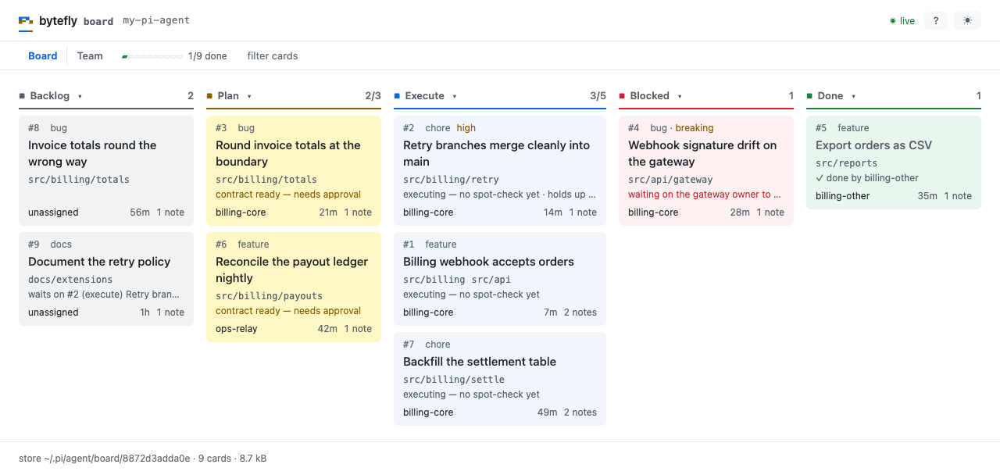

# board — one shared feature board per repository

The board is one list of features for a repository, worked by every session on it. A card
carries what kind of work it is, its owner, its priority, what it waits on, the contract it
promises, and the notes that explain it — and two signatures are needed before it can ship.



- **One board per repository**, one page: the first `/board` serves it, every other session opens it.
- **The page is a view**, and it follows the files: nothing is claimed, moved, or signed from a
  browser, and a card another session writes reaches an open tab as it lands, wearing a mark.
- **Two signatures**: the lead signs both gates — a contract before `execute`, the work before
  `done` — with the `board` tool or `/board` in its own session.
- **The lane is the record**, and a session is told once which cards are its own, with what each owes.
- **Steps stay out of it** — they live in the owner's plan and `todo`.

## What you can do

| What you want | What to do |
|---|---|
| See the board | `/board` — Board and Team tabs, live |
| Put a feature on it | `board({ action: "add", title, paths })` — a call, because `add` takes a title rather than a card id |
| Say what kind of work it is | `type` on `add` or `edit`: `feature`, `bug`, `refactor`, `docs`, `test`, or `chore` |
| Flag a breaking change | `breaking: true` on `add` or `edit`; `false` clears it |
| Take a card | `board claim 4` — into `plan`, owned by this session; `board reclaim 4` takes one back — the lead from anyone, a peer only once that owner's record says it stopped |
| Record what it promises | `board contract 4 path <plan file> goal … acceptance … scopeOut … verify …` — all four lines, and the `verify` command is required |
| Approve the contract | `/board approve 4` in the lead's session, or the lead with the `board` action `approve` |
| Start the work | `board move 4 execute` |
| Park a card | `board move 4 blocked blocker decision blockedBy "waiting on the API owner"` |
| Sign off finished work | `/board review 4` in the lead's session, then `board move 4 done` |
| Explain something | `board note 4 "why the retry is capped at three"` |
| Set finished work aside | `/board archive` in the lead's session, or the `board` action `archive` from any session |
| Read the round | `board list round: true`, or `/team` — owners, unassigned, unplanned, awaiting approval, awaiting review, untold, blocked, done |

## Try it

```text
Put the billing webhook's order acceptance on the board, under src/billing.
```

The model calls `board({ action: "add", … })` and then, when you say so, `board({ action: "claim", card: "1" })`.
Those are tool actions, not commands: `Reference` below lists every `/board` word, and who may run one.

The claim's result names the next step, and `/board approve 1` refuses until the contract
names a plan file in this repository's store. A claim also joins the team ([`team`](team.md)).

A card is as tall as it draws: the line above its last one says what it owes or waits on, and is
blank when it owes nothing. The row and `board list` print that gate in one word; a transcript row
too narrow to hold it beside the number and title draws it on the next line instead of losing them.

## Reference

**Lanes.** `backlog` is the pool nobody holds, `plan` is where the card is designed and its
contract signed, `execute` is where the work happens, `blocked` waits on a person, and `done`
is closed. Each move follows the one transition from where the card is; no lane is skipped.

**The page.** A lane's width follows its work; five lanes sit side by side (one below 1180px, via the picker)
and a lane of 24 cards folds. The pane is the one scroll box: a lane is as tall as the board, its head riding
its edge. The Team tab draws the board's card and raises what needs a lead above it: a band shows five rows,
folds the rest, pins its head, and says a sentence every row shares once.

**Actions.** One tool, shaped by action: `list`, `add`, `claim`, `release`, `reclaim`, `move`, `note`, `contract`, `approve`,
`review`, `edit`, `archive`, `drop`. `claim` and `move` are refused while `plan` or `execute` is full; `assign` is `team`'s verb
under that rule, and one session holds one card in flight by default (`board.wip.perOwner`). `reclaim` takes a card back: the
person and the lead always, a peer only while its owner is quiet or gone. `move` into `execute` or `done` re-reads the plan, and
one that is gone refuses it. An `execute` card holds its `paths`: `edit` claims added ones and releases removed ones, claiming
first so a conflict releases nothing; `release` alone is undone by the next crossing. A contract names a `verify` command — the
card's own check, not the repository's whole gate, [as the walkthrough writes one](../tutorials/first-board.md) — and `review` runs
it in the tree `root` names. `done` refuses a sign with no result or one older than the card's state (a note is not a change) and
resolves the landing: an older tree (a merge before the work, past it, or rewriting the review's lines), a tip declaring another
card, or a squashed branch named by the card id its subject ends with. A reviewed merge is its own landing only while it is the
tip, so a checkout sign needs a re-sign; `done` records the merge, `landed: <sha>` names it, and `override` reads "by instruction".

**Commands.** `/board` serves or opens the page (add `team` for the Team tab; `serve.autoOpen` off prints
the URL, and a remote turn says the browser needs this machine); `/board approve <id>` and `review <id>
[--root <tree>]` sign, `archive` sweeps, `status` prints the seat, repository, port, and tabs; `stop` ends it.

**Who signs.** The lead is `team.lead` in `bytefly.json` (default `gavin`), and the page serves as that name; an
empty lead lets only the person sign and serves no page. A session signs only while it is the lead, never while
it holds the card — a lead releases its own card first — and the `/board` words gate on that same label, so they
sign as the serving session. The sign says who heard it — quiet, not listening, or not told — and an untold one
is sent again; a completed contract is told the same way, and a failed send is a line that asks again.

**Where it lives.** `~/.pi/agent/board/<repo-key>/` — a card per file under `cards/`, with `archive/` and `ended/` beside it. The archive holds more than one record shape: a file written before the lanes says `status` and no `lane`, and the reader maps that word (`todo` → `backlog`, `doing` → `execute`, `done` and `blocked` as themselves), so a card set aside reads `done` like the rest and no file is ever rewritten. A card records its plan by the **name** it holds in this repository's plan store, not this host's path, so two machines sharing a store resolve it on either — and a card holding an older absolute path still executes.

## Limits

- `done` is terminal: a card finished by mistake is dropped and re-added at a new number. Nothing prunes
  itself: `archive` takes a card nothing waits on, and `--older-than 30d` bounds it, naming what it kept.
- The lead is a name, not an authority: any session can join it, and a lead holding a card can release it, sign it and
  claim it again. A lead holding no card may still move it `plan` → `execute`, or close a signed card whose holder the
  bus lost — a close, not a signature; every other verb is the holder's. A gate is a reading.
- Settle title, paths and contract before the sign: a write after the spot-check stops it speaking, and a branch is
  proved against `main` as cut. Restart when board code lands — an old session's card reads a note as a message, and a `/reload` is not a restart: Bun keeps a `lib/` module another extension loaded, so a lazily-imported one calls a function its cached copy never had.
- Ownership is a session id, not a lock — only `session-bus` path claims are. A card in `execute` holds its `paths`,
  `edit` moves them with the hints and a lane change frees only the writer's; a dead owner's card is released by a
  start, or re-seated to the session wearing that name and told on its first turn. Eight transitions are kept.
- The page asks the bus for a stamp every second — mail waiting, a peer's state, a turn starting — and sweeps every five for what no file announces; a page with no watch scans every second.

## Settings

| Key | Default | What it does |
|---|---|---|
| `wip.plan` | `3` | Cards a repository may hold in `plan` at once (1–20). |
| `wip.execute` | `5` | Cards a repository may hold in `execute` at once (1–20). |
| `team.lead` | `"gavin"` | The team name whose signature the two gates take. A stated empty lead is no lead: only the person signs, and `/board` will not serve. |
| `team.teammates` | `["gavin","tom","jack","mike","sam"]` | Who is on the team: labels, at most 20 of them. A session the bus has not recorded takes the first free one as the name it writes — `team-agent-<id>` once every one is held — and the footer draws a name only when it is one of these, so a stated empty list draws no chip. |

The limits live in `board` and the names in `team`, both edited by `/bytefly settings`
([configuration](../configuration-reference.md#team--the-projects-own-team)); toggle `board` to switch it off.

## Learn more

- [Your first board](../tutorials/first-board.md) — one feature through both gates.
- [Several sessions](../multi-session.md) — the round the cards, the bus, and the lead make together.
- [`team`](../extensions/team.md) — handing a card to a peer.
- [`session-bus`](../extensions/session-bus.md) — the bus the signs travel on.
- [`plan`](../extensions/plan.md) — the plan a contract points at.
- [Troubleshooting](../troubleshooting.md) — when a gate refuses the session that holds the card.
