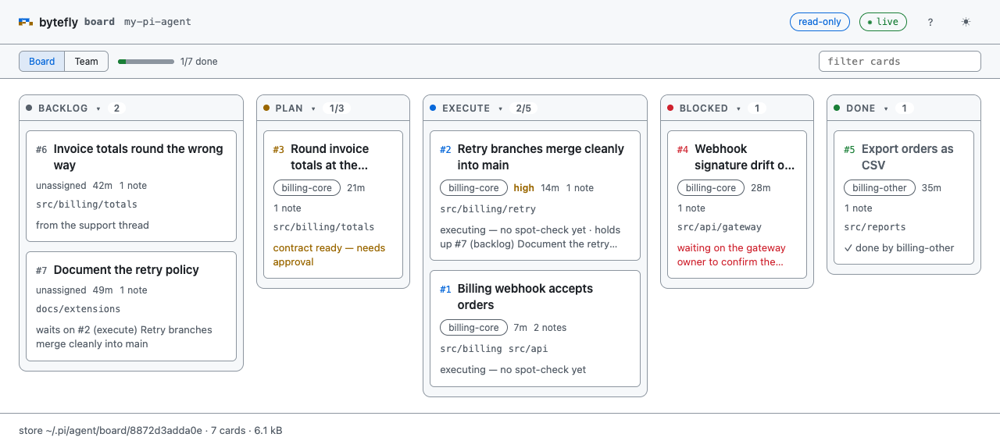

# board — one shared feature board per repository

The board is one list of features for a repository, worked by every session on
it. A card carries what kind of work it is, its owner, its priority, what it waits
on, the contract it promises, and the notes that explain it — and two signatures
are needed before it can ship.



- **One board per repository**, and one page: the first `/board` serves it, every
  other session opens that same page.
- **The page is a view.** Nothing is claimed, moved, or signed from a browser.
- **Two signatures**: the lead approves a contract before `execute`, and
  spot-checks the work before `done`. The person at the keyboard can give either
  with `/board approve` and `/board review`.
- **Steps stay out of it** — they live in the owner's plan and `todo`.

## What you can do

| What you want | What to do |
|---|---|
| See the board | `/board` — Board and Team tabs, live |
| Put a feature on it | `board add "<title>" paths ["src/area"]` |
| Say what kind of work it is | `type` on `add` or `edit`: `feature`, `bug`, `refactor`, `docs`, `test`, or `chore` |
| Flag a breaking change | `breaking: true` on `add` or `edit`; `false` clears it |
| Take a card | `board claim 4` — into `plan`, owned by this session |
| Record what it promises | `board contract 4 path <plan file> goal … acceptance … scopeOut …` |
| Approve the contract | `/board approve 4` as the person, or the lead with the `board` action `approve` |
| Start the work | `board move 4 execute` |
| Park a card | `board move 4 blocked blocker decision blockedBy "waiting on the API owner"` |
| Sign off finished work | `/board review 4`, then `board move 4 done` |
| Explain something | `board note 4 "why the retry is capped at three"` |
| Set finished work aside | `/board archive` |
| Read the round | `board list round: true`, or `/team` — owners, unassigned, unplanned, awaiting approval, awaiting review, blocked, done |

## Try it

```text
board add "Billing webhook accepts orders" paths ["src/billing"]
board claim 1
```

The claim's result names the next step — design it in plan mode, save the plan,
record the contract — and `board approve 1` will refuse it until the contract
names a plan file in this repository's store.

Every card's last line says what it needs next, so a lane can be read without
opening a card: `contract ready — needs approval`, `executing — no spot-check
yet`, `offered 2h ago — nobody took it`. The round is one line, and `/team`
prints it in the terminal.

A full walkthrough through both gates is [Your first
board](../tutorials/first-board.md).

## Reference

**Lanes.** `backlog` is the pool nobody holds, `plan` is where the card is
designed and its contract signed, `execute` is where the work happens, `blocked`
waits on a person, and `done` is closed. Each move follows the one transition the
board allows from where the card is; no lane can be skipped.

**Actions.** One tool, shaped by action: `list`, `add`, `claim`, `release`,
`reclaim`, `move`, `note`, `contract`, `approve`, `review`, `edit`, `archive`,
`drop`. `add` and `edit` record the kind of work (`type`) and the breaking marker
(`breaking`); both draw as one quiet label on the card, and `list query` matches
them. `review` takes an `override` — one line saying why — for a card closed
without the gate; the record then reads `closed by instruction`.

**Commands.** `/board` serves or opens the page (add `team` for the Team tab);
`/board approve <id>` and `/board review <id>` write the person's signature;
`/board archive` runs the sweep; `/board status` prints the seat, repository,
port, watching tabs, and store; `/board stop` stops the page this session serves.

**Who signs.** The lead is `board.lead` in `bytefly.json` (`lead` by default), and
the page serves as that name. A session signs only while it is the lead and never
while it holds the card; `/board approve` and `/board review` sign as the person,
marked `person: true`, which is how a one-session repository finishes work.

**Where it lives.** `~/.pi/agent/board/<repo-key>/` — one card per file, plus an
`archive/` pile. A note beside the cards is how a second session finds the page
already being served instead of starting a second one.

**Limits per lane.** Three cards in `plan` and five in `execute` by default; a
claim past either is refused with the count and the ways out.

## Limits

- `done` is terminal: a card finished by mistake is dropped and added again, and
  the new card takes a new number.
- Nothing prunes itself — `done` cards cost a read until `archive` sets them
  aside.
- Ownership is a label, not a lock: two sessions can still touch one file. Only
  `session-bus` path claims are a lock.
- The page is read-only by design, so the one thing a browser cannot do is assign
  a card without messaging its owner.
- A card keeps the last eight lane transitions; a card file a newer build wrote is
  reported rather than silently skipped.

## Settings

| Key | Default | What it does |
|---|---|---|
| `lead` | `"lead"` | The team name whose signature the two gates take. |
| `wip.plan` | `3` | Cards a repository may hold in `plan` at once (1–20). |
| `wip.execute` | `5` | Cards a repository may hold in `execute` at once (1–20). |

They live in the `board` section of `bytefly.json`; `/bytefly settings` edits all
three ([configuration](../configuration.md#board--the-shared-feature-board)). To
switch the extension off entirely, toggle `board` in `/bytefly`.

## Learn more

- [Your first board](../tutorials/first-board.md) — one feature through both gates.
- [`team`](../extensions/team.md) — handing a card to a peer.
- [`session-bus`](../extensions/session-bus.md) — the bus the signs travel on.
- [`plan`](../extensions/plan.md) — the plan a contract points at.
