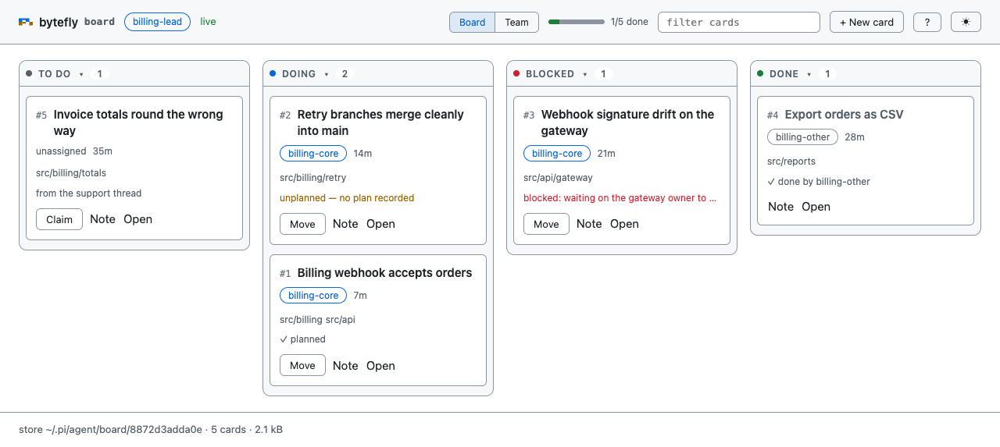
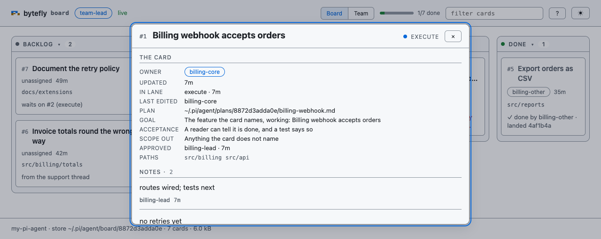
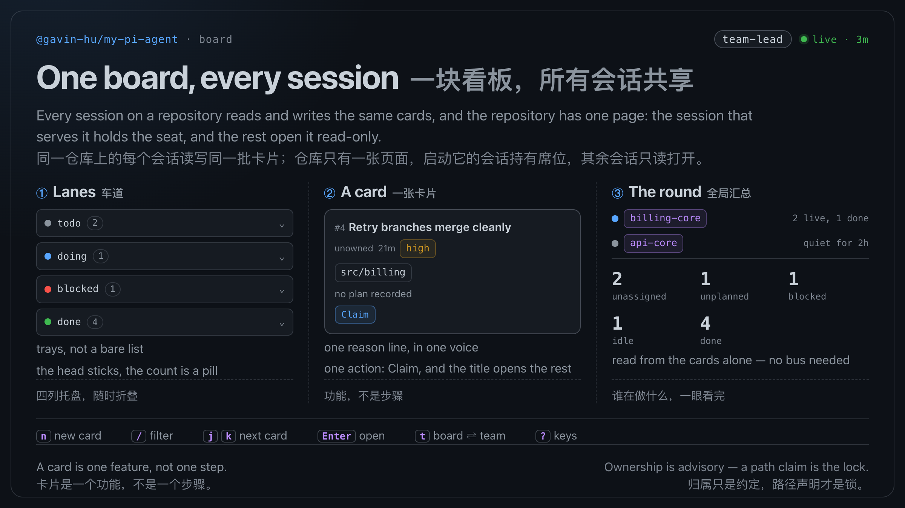
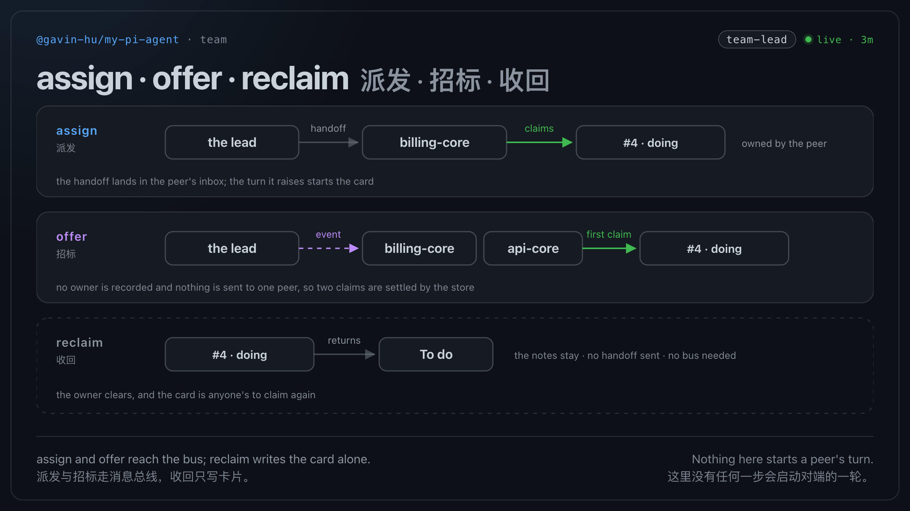

# board — one shared feature board per repository

Every Pi session on a repository works the same cards through the tools, and a repository
has **one** page that shows them: the session that starts it serves it under the seat
`team-lead`, and every other session opens that same page instead of a second one. The
page is a **view** — it cannot change a card — so what a browser shows and what the
terminal holds cannot disagree. A card is one **feature**: its outcome, who holds it,
where the work happens, the plan it is executing, how urgent it is, what it waits for,
and the notes that explain how it got there.

The steps of the work are deliberately *not* on the board. They live in the
owner's plan and in `todo`; the board answers who is doing what, and what needs a
decision.



*`/board`: the four lanes, with the round one tab away and every card opened by its title.*



*The card dialog: the record of one card — a ladder of facts, then its notes at body size
(`screenshot:board --dialog card`).*

## Capabilities

| Capability | How | What you get |
|---|---|---|
| A shared feature list for one repository | `board` action `list` | Every open card in lane order — `todo`, `doing`, `blocked` — or one card, or one lane; the `done` cards are left out with a count of how many, and `status: "done"` reads them |
| The lead's rollup | `board` action `list` with `round: true` | Every owner with its live cards and, beside the count, what it has finished — an owner whose last card is done stays listed — then unassigned, unplanned, blocked, idle, and done |
| Publish a feature | `board` action `add` | A `todo` card with path hints and a first note |
| Take a feature | `board` action `claim` | The card is `doing` and owned by this session |
| Hand it back | `board` action `release` | The card is `todo` again, with no owner |
| Change lane | `board` action `move` | Wherever the owner moves it: `doing`, `blocked`, `done` |
| Record what happened | `board` action `note` | A note appended to the card's history, attributed and stamped |
| Record the plan | `board` action `plan` | The plan file the card is executing, so "unplanned" work is visible |
| Fix what a card says | `board` action `edit` | A new title, path hints, priority, or the cards it waits for — by its holder, or by anyone while nobody holds it |
| Say how urgent it is | `board` action `add` or `edit` with `priority` | `high` sorts first inside its lane, and the card says so |
| Record what a card waits for | `board` action `edit` with `dependsOn` | An unfinished dependency refuses a claim and a move to `doing` or `done`, and the reason line names it; the card it waits on answers the other half — `list` on it names the cards waiting on it, and its dialog row `waited on by` says the same |
| Hand a card to a teammate | `team` action `assign` | The owner is recorded **and** a handoff is sent to that session's inbox. The page cannot do this: a browser has no way to message a peer, so a page assignment that recorded an owner and told nobody is gone with the write path |
| Take a card back from the tool | `board` action `reclaim` | The owner clears and the card returns to To do, without the page and without `team` |
| Find a card without reading every lane | `board` action `list` with `query` | The cards whose title, path hint, or holder matches — the same rule the page's filter uses |
| See the work you hold | `board` action `list` with `mine` | The cards this session holds, by the same rule a claim is checked against |
| Delete a card | `board` action `drop` | The card and its notes are gone, and its id is spent: a record of the title, the lane, who ended it, and when stays in `ended/`, so a note or a handoff that names that id cannot come to mean a different feature. A `todo` or `done` card is anyone's to drop, one in flight only its holder's, and one that a card waits on cannot leave at all |
| One page per repository | `/board` | Serves a loopback page as `team-lead` with a **Board** and a **Team** tab, following the store live; a page already served is opened instead |
| Watch somebody else's page | `/board` on a session that is not serving | The same page, because there is one: every page is a read view, so a second session gets exactly what the first one sees instead of a writable rival. It joins the team under its own label, so a handoff can still reach it |
| Read a board at its real size | the `Done` fold, an empty lane's rail | `Done` starts folded past six cards, its count in the head, and a reader's toggle decides from then on. A lane holding no cards narrows to its head, word, and count, so the lanes carrying work keep the width |
| Open a card | the card's title, or `Enter` on a focused one | The title is the only door, because it is the only one needed: it opens the dialog holding the card whole — its lane, its owner, its paths, what it waits for, its plan, and every note |
| See the lead's round at a glance | `/board team`, or `/team` with no browser | A queue of cards that need a decision, each with the reason and its way out, then who is on the team and what they hold |
| Join the team | `/board`, or any card you work | Opening the page joins this session to the team — as `team-lead` when it serves the page, under its own name when it opens one somebody else serves — and the first card a tool writes joins it too, so nothing has to be armed by hand. `/board status` says which team a `/board` in this session put you on |
| See who is around | `/board team` | The Teammates list: every session this repository's bus has recorded, plus every owner a card names, each stating `live`, `quiet`, `no record`, or `—` when no bus is loaded |

## Quickstart

```
you:  publish two features for the billing work
      → board add "Billing webhook accepts orders" paths ["src/billing"]
      → board add "Retry branches merge cleanly"
lead: board edit 2 dependsOn ["1"] priority "high"
      → #2 waits on #1 (todo), and sorts first in To do
peer: claim the first, plan it, note the phases, finish it
      → board claim 1 → /plan → board plan 1 <plan file> → board note 1 … → board move 1 done
      → board claim 2 — refused while #1 is unfinished, allowed once it is done
lead: board list round: true
      → 1 owner · 2 features · 0 unassigned · 1 unplanned
```

## Commands

| Command | Who | Effect |
|---|---|---|
| `/board` | lead | Serves the page as `team-lead`, or opens the one another session already serves |
| `/board team` | lead | The same, opened on the Team tab |
| `/board status` | both | One line: the seat, the port, how many tabs are watching, the store, and the team the last `/board` joined — or the page being watched |
| `/board stop` | lead | Stops the page this session serves; on a session that opened somebody else's page it says who serves it |
| `/team` | both | The round in the terminal: the rollup, the work a dead owner left behind, then who is live, who has gone quiet, and who is gone |

**Who serves the page.** The first `/board` in a repository serves it; after that the
page is found by the note it leaves beside the cards (`page.json`, in the board's own
directory), so a second session opens the same page rather than a rival one. That holds
while a page answers; if nobody is serving, the next `/board` serves — the seat's name
does not change, so a card a browser claimed is still the seat's. A note a session left
behind when it died is not a dead end either: `/board` says which page it named — with its
URL — takes the note over, and serves.

**Joining.** One thing, done for you: `/board` puts this session on the team — as
`team-lead` when it serves the page, under its own name when it watches one — and so does
the first card you work. The join is also the listening: mail is reported at that
session's next turn, and no turn is raised, so being on the team never spends a turn. A
session that has neither opened the board nor touched a card is not on it. `/board
status` reports the join `/board` made itself: a session that joined by writing a card
is on the team, and its status line does not say so.

The page still serves as a seat: `/board status` names `team-lead`, the toolbar chip says
so, and a card a browser claimed **before** the page stopped writing still names
`board:team-lead` as its owner — `reclaim` is how a lead takes that back from the
terminal.

## Tool

`board` is one action-shaped tool. `readOnlyHint: false`, `destructiveHint: true`,
`openWorldHint: false`, `executionMode: "sequential"`.

| Action | Parameters | Result |
|---|---|---|
| `list` | `status?`, `mine?`, `card?`, `query?`, `round?` | the cards in lane order, one card, or what a query or `mine` matches — a query reads a card's title, holder, path hints, plan, and the text of its notes; a listing that names no lane leaves out the `done` cards and says how many, since a finished card is history rather than work; `round: true` adds the rollup, which always covers the whole board |
| `add` | `title`, `paths?`, `priority?`, `note?` | the new `todo` card |
| `claim` | `card` | the card, now `doing` and owned by this session |
| `release` | `card` | the card, back in `todo`, keeping any block it recorded |
| `reclaim` | `card` | the card, back in `todo`, whoever held it |
| `move` | `card`, `status`, `blockedBy?` | the card in its new lane; `blockedBy` (one line, ≤200 characters) is what a block waits on, and a move to `done` records the commit `HEAD` resolved to, when the directory is a repository |
| `note` | `card`, `text` | the card with the note appended |
| `plan` | `card`, `path` | the card with its plan recorded |
| `edit` | `card`, `title?`, `paths?`, `priority?`, `dependsOn?` | the card with what it says corrected; an omitted field is left alone, and `dependsOn: []` removes every link |
| `drop` | `card` | the id that was dropped, whose number is now spent |

`card` takes `4` or `#4`. A refused call is an error result that still carries the
card, so the next attempt starts from the truth.

The parameters are one flat object, so a field is published to every action at once.
An action reads only the fields in its row above, and a call carrying one that its
action does not read is **refused**, naming the action that takes it — not ignored.
`add` with `dependsOn` used to create the card and drop the link, so a caller could
not tell a recorded link from an ignored one:

```
add does not act on dependsOn: `edit` takes it.
```

To link a new card, add it and then edit it. `ACTION_FIELDS` in `types.ts` is the
table that answers this, and a test holds every published parameter to an action that
acts on it.

## Routes

Every route but two needs the token, and there is exactly one: 128 random bits minted
when the page starts, compared in constant time, in the URL the browser was opened at.
The two that do not are the page's own furniture — `/theme.js` and `/app.js` are the same
bytes to every reader and can neither read nor change a card, so refusing them to a fetch
that has no token would only break the page. Everything below a
token is a **read**: the method list is `GET` and `HEAD`, so a `POST` or a `DELETE` is
refused by the envelope — `405`, `Allow: GET, HEAD` — before the token is even read.

The tab's icon is not a route: the document head links the mark as an SVG data URI, so
a browser fetches the icon out of the page it already has, and `/favicon.ico` is one more
path the board does not serve.

```
GET    /theme.js             the theme script — no token
GET    /app.js               the client script — no token
GET    /                     the document (?view=board|team), whose tab reads
                             board · <store key> · <N> open
GET    /api/board            the snapshot
GET    /events               the live frame stream
```

## Layout

One page, two tabs, one lifecycle. The kit shell keeps the toolbar and the footer
pinned and makes the main pane the only scroll box; the page adds no second one.

| Band | What it holds |
|---|---|
| Toolbar | the mark, the seat the page is served as, as a chip, a live badge (`connecting…`, `live` or `live · 3m`, `reconnecting…`), then one group: the Board\|Team switch, done-of-total progress, a filter, the keys button, and the theme toggle |
| Lanes | trays, not a bare list: one column per lane, sized by the work it holds, so a lane showing nothing — because it holds no cards, or because it is folded — narrows to a rail of dot, word, and count, and the lanes carrying cards keep the width. Three or four across above 1180px, two at 1180px or narrower, one lane plus the lane switch at 860px or narrower — where it opens on the first lane that holds a card. Each head sticks while the pane scrolls, carries its count as a pill, and folds its cards away: `Done` starts folded past six cards, since finished work is history, and a reader's toggle decides from then on |
| Cards | the id and a two-line title (the page's loudest text and its only door), an owner chip and an age, a muted priority chip when it is not `normal`, path chips, and one reason line in one voice — what a card waits for, a blocked card's recorded reason or else its last note (or `blocked, with nothing recorded`), `no plan recorded`, `planned`, `✓ done by <owner>` with the commit it landed as, and the last note of a card that is none of those — clamped, with the whole sentence as its tooltip. A card draws **no button**: claiming, moving, editing, and annotating are the tools' work, and a face that offered them would be offering a refusal. A hovered card lifts a pixel; a finished one recedes, title and owner chip muted |
| Team | two panels and a strip. **Needs a decision** is one row per card — a card that is both idle and unplanned arrives once, keeping its strongest reason — laid out as two lines: the id, title and owner chip on the first, the reason on the second — a blocked card's recorded `blockedBy`, else its last note — with the whole sentence as its tooltip, and its kind as a left edge (`--danger` blocked, `--warn` idle, `--dim` unplanned or waiting, the same `--dim` dashed for nobody's). The row is a reason to pick the card up in the terminal, and it draws no button: claiming and reclaiming are the tools' work. An unassigned card that waits on unfinished work is a row of its own kind, ranked just under a blocker. Above 1180px the queue stops at one screen's height and scrolls inside its panel, so the roster and the Done strip stay on the same page as its top. **Teammates** is one row per person — a state dot, the label, a `you` chip, a `not listening` chip on a live peer whose inbox watch is off, a mail badge, then `live · 3 held · 1 done · oldest 21m` (a quiet session reads `quiet for 2h`, because a word without an age is no reason to reclaim) — sorted you, live, quiet, no record, and an owner whose label nothing answers to keeps its row. Done is one quiet strip whose ids open their cards. Both panels honour the toolbar's filter, and their headings read `shown/total` the way a lane head does. Below 1180px the queue comes first and the roster follows |
| Card dialog | the record of one card, in two named sections. The head carries the id, the title, and the lane as a dot and a word. **The card** is a ladder — one fact per row, labels sized to the longest of them so the values line up: owner, priority when it is not `normal`, updated, last edited, landed, waits on, waited on by, plan, paths. The plan and each path are one line that elides, with the whole value on the hover title; what it waits for reads `#2 (doing)`, the lanes that make the id a decision. Empty rows take their labels with them. **Notes · N** is the cargo at body size on a 68ch measure, each sentence with its attribution under it and a rule between notes, and `M earlier notes dropped` when the store capped them. The body is the only scroll, so the head and `Close` stay put. Nothing in it writes, every field is a set as `textContent`, and the title underneath every card is the way in. `j`/`k` walk to the next or previous card without closing it, and an `sr-only` live region announces `card 2 of 3: <title>` — a title that changes inside an open modal is not announced on its own |

Colour is a role: `--muted` for `todo`, `--accent` for `doing`, `--danger` for
`blocked` and destructive choices, `--success` for `done`. The Team tab's decision
rows sit on the kit's `--raised`, the one step above `--surface` that lets a block read
as a plane instead of an outline; the Done lane sits on the page itself, so history
stops competing with the lanes a lead works in. A card takes its colour
from the lane it sits in — the head's dot, and the reason line's tone — rather than
from a bar of its own, so one card does not shout twice. The page states a lane and
a card with `data-status`, so a theme change repaints it without a rule of its own.

The board as a posting card — the same rules, drawn to be read at half width:



*`board`: the lanes, one card's atoms, and the lead's round — three readings of one board, drawn by `screenshot:cards board`.*



*`board-team`: `assign`, `offer`, and `reclaim` — the two that reach the bus, and the one that writes the card alone (`screenshot:cards team`).*

## Keys

| Key | What it does |
|---|---|
| `/` | Filter the cards by title, holder, path hint, plan, or the text of a note |
| `j` / `k` | Next or previous card — or, with a card open, the next or previous card in the dialog |
| `Enter` | Open the focused card |
| `t` | Switch Board and Team |
| `Esc` | Close a dialog, or clear the filter |
| `?` | The keyboard sheet |

A dialog traps `Tab`, closes on `Esc` or a backdrop click, and returns focus to
whatever opened it — the kit's `dialogScript`, shared with the review and browse
pages. A field keeps its keys: `/` inside the filter box types a slash.

## Security

- The page binds loopback only, answers only its own host names, and has no
  state-changing request to refuse.
- One credential, 128 random bits minted when the page starts and compared in constant
  time, in the URL and never a cookie, with no CORS. The note beside the cards
  (`page.json`, owner-only) carries it, so a second session can attach — and because the
  page cannot change a card, pasting that URL hands out nothing but a view.
- The page reads only: the board store under the agent directory, and the session bus's
  own records read-only — labels, modes, heartbeats, message counts, and whether each is
  listening — to draw the Teammates list. It never writes your repository.

## Limitations

- **Ownership is advisory.** Two sessions can still edit the same file; only
  `session-bus`'s path claims are a lock.
- **A listing is bounded, the rollup is not.** Nothing prunes a finished card, so the
  cards accumulate — most of this repository's own board is finished cards — and reading
  them on every call is a cost that grows with the history rather than with the work. A
  `list` that names no lane therefore leaves `done` out and prints the count, which is
  what keeps the omission from reading as a smaller board; `status: "done"` reads them,
  and `round` counts every card, because a rollup that hid half the board would not be
  one. The page bounds its own View the same way, folding a long `done` lane.
- **A finished card stays finished.** `done` is terminal for every transition — claim,
  assign, release, move, and plan all refuse it — so a card a dependency was recorded
  against cannot un-finish and reopen the order after the fact. A card finished by
  mistake is dropped and added again: the new card takes a new number, and the dropped
  one's title and lane stay in `ended/` under the id nothing will use again. Its notes
  do not come with it.
- **A card file this build cannot read is reported, not skipped.** A file written by a
  newer build, a half-written one, or a record moved under another name is named by
  `list` with the reason and counted in the page's footer beside the store's size, so a
  board that is not readable never reads as a board that is empty. `done` stays
  terminal until a `reopen` is designed.
- **Links are recorded by the tool.** A link names an id, so the page shows what a
  card waits for but does not edit it; `board edit` records it while the card is being
  planned, and `board drop` refuses to strand one.
- **The board knows when a process is gone, not when work is stuck.** The Teammates
  list reads the bus's records, where `live` is a heartbeat inside ten minutes,
  `quiet` is a heartbeat that has aged, `gone` is a record whose process is no longer
  running, and `no record` means only that the bus holds no record of that label. A
  `gone` owner's cards join **Needs a decision** with the reason that they are free, and a
  *hung* session reads `live`, so "idle" still means what a card can know — nobody has
  touched it for 30 minutes — rather than that its owner is stuck. With `session-bus`
  unloaded, or before any session has joined here, every state reads `—` and the board
  works exactly as before.
- **The page is read-only, deliberately.** A browser is not an identity: every page write
  was made as the seat, and a page `assign` had to record that no handoff was sent. Rather
  than duplicate the card rules in the client — which had already drifted from
  `lib/board/rules.ts` — the write path is gone. What a reader loses is editing from the
  browser; what the product keeps is every one of those verbs as a tool. The one capability
  with no tool-side twin is assigning **without** messaging the peer: `team`'s `assign`
  sends a handoff, and nothing else records an owner silently.
- **A seat can outlive its writes.** A card claimed from the page before this change still
  names `board:team-lead` as its owner, and `reclaim` is how a lead takes it back.
- **Nothing prunes.** A `done` card stays until someone drops it, and a dropped card
  leaves its record behind for the same reason; the page shows how many bytes the store
  occupies and how many files it could not read.
- **A page claim is a claim nobody cleans up.** A card a page claimed before this change
  is the seat's until a tool reclaims it; the page itself can no longer add to that pile.
- **The page stops a minute after its last tab leaves.** Closing the tab to run a
  command and coming back is fine, and a teammate's watching tab counts as one, so a
  page nobody is reading does not answer a port for the rest of the session. `/board`
  starts it again on the same port.
- **The port is found, or pinned.** With no setting the page prefers a free port in
  4780–5779, falls back to whatever free port the OS gives it if that one is taken, and
  remembers the answer for the session; `board.port` in `bytefly.json` pins it, so a
  bookmarked URL survives a restart. A pinned port that is already taken fails the start —
  `port 4780 is in use — change "port" in the bytefly.json board section, or stop what
  answers on it` — because a quiet fallback would move the page out from under the
  bookmark. A live note still wins: one repository has one page, so this session attaches to
  the port that note names rather than serving a second one.
- **The note is believed only while it answers.** A page that crashed leaves its note
  behind; the next `/board` probes it, takes it over when nothing replies, and attaches to
  the page that won when two sessions start in the same instant. A note it cannot read at
  all is named with its path — "another session is serving" is only said of a page that was
  seen answering.

## Pi integration

- **`session-bus`**: a card's owner is the bus label, so a card names a session a
  peer can be addressed by. The board calls one thing on it — the join, through
  `lib/session-tool.ts`, because a command context cannot call a tool and the request
  therefore travels on `pi.events` — and reads its records otherwise, which is why the
  page works with the bus disabled. A failed join is a clause on the `/board` line, not
  a failed page. The seat is the name the page is served and reported under, and `/board
  status` says which session is on the team through it.
- **`plan`**: `board plan` records a plan file's path; the plan extension owns the
  file. The board stays available while planning, and only `list` works: the same tool
  writes, so its read-only hint cannot say that, and plan mode reads the action in the
  call instead — `add`, `claim`, or any other verb is refused with the exit guidance.
  The plan is recorded **after** approval, when the writing verbs work again.
- **`todo`**: the approved plan's steps are seeded into `todo`. Steps never become
  cards. A `list` call is a read for the lag reminder too, so reading the board never
  forces a todo update, while `add` or `claim` counts as work like any other write.
- **`worktree`**: the store is keyed by the repository's common git directory, so
  every worktree shares one board.
- **`bytefly`**: the page's port appears as a `board` status chip, and `doctor`
  reports nothing new — the board needs no binary and no per-machine setup; its one
  setting, `board.port`, is a `bytefly.json` edit.

## Design notes

- **One JSON file per card**, in `<agentDir>/board/<repo-key>/cards/`, and one per
  ended card in `ended/`. The listing is the index, so a reader needs no cache and no
  daemon.
- **An id is never reused.** The next id is the highest in `cards/` *or* `ended/` plus
  one, so an ended card's number cannot be handed to the next add — which is the only
  thing that lets a note, a handoff, or a link name a card and still mean it. A record
  is written before its card is removed: a crash between the two leaves a card that
  still exists with a record explaining it, never a card that is gone unexplained.
- **Create is exclusive**, by hard-linking a temporary file onto the target name,
  so two adds cannot share an id. **Update** re-reads, re-checks the operation's
  own preconditions, then renames over the old file: an operation means "apply when
  this holds", never "force this state".
- **The page is a dumb renderer** over one snapshot built on the server, pushed
  only when a card's revision, or a teammate's state, mail, or listening flag, moves: a
  heartbeat every ten seconds is not news, and a frame nobody needs costs the page a
  parse.
- **A query reads what a card says, not just what it is called.** A card's reasoning lives
  in its notes and in the plan it is executing, so leaving both out of the search made the
  two fields that hold the argument the two a reader could not find. The order is the
  answer's weight — title, holder, path hints, plan, notes — and it is one body spliced
  into the page from `lib/board/card.ts`, so the filter box and `board list query:` cannot
  disagree about which card a word names.
- **The record is a ladder, not a paragraph run.** A card's facts are one per row so each
  can be read and copied alone: the meta line it replaces merged id, updated, and who into
  one sentence, and named the last writer as though it were the author. The notes are the
  cargo — they read at body size on a measure, with their attribution under them — and the
  dialog's body is the only scroll, because a second scrollbar inside a 70vh panel hid most
  of what a reader opened it for. A long plan path elides on one line with the whole value
  on its hover title: the plan is the reason to open a card, and it used to shred across
  three lines of `--dim`.
- **The walk is over the board as drawn.** `j`/`k` step through the cards the page has
  boxes for, so a folded Done lane and a filter are both respected; opening a card does not
  take the keyboard away, it points it at the next record. The position is announced
  because a title that changes inside an open modal is not.
- **A class is a symbol, not a string.** The document and the bundle cannot import from
  each other, so both read `view/names.ts` — the only place a `board-*` class is spelled.
  A name assembled from a prefix is what made the old contract untestable: it passed on
  the prefix and could not see the whole name, so a rule with nothing behind it (or a
  name with no rule) survived until a capture showed it.
- **The page is given what it prints.** A card arrives with the priority it acts on and
  the unfinished dependencies that block it (`waits`, as `#2 (doing)`), so the client
  holds no copy of a rule `lib/board` owns — the copies it did hold had already drifted
  from the tool's. The one body that cannot cross as data is `plural`, and it crosses as
  source (`PLURAL_JS`), because a second wording for `1 card` is the same mistake in a
  smaller place.
- **`waits on` answers two questions, on purpose.** The page names the *unfinished*
  dependencies in one line — "why can I not start" — and `board`'s result names every
  dependency with its lane, including finished ones — "what is this card tied to". Both
  read `links.ts`, so neither can invent a blocker; the difference is the question, not
  a drift.
- **A link is stored once, and read both ways.** `dependsOn` lives on the waiting card
  alone, so nothing on disk says what a card is holding up; `openDependentsOf` answers
  it over the board, `list <card>` prints `waited on by N cards: #2 (todo)`, and the
  dialog has the rung the card's own row cannot. Both skip a finished card, unlike the
  drop refusal, which keeps every edge: "what is held up" is about work, and "would this
  drop strand a link" is about the file.
- **One page is found, not configured.** A note beside the cards carries the port, the
  seat, and the token; it is created exclusively, so two sessions starting at
  once cannot both serve, and the loser attaches to the winner. The alternative —
  a setting that names the lead — was rejected: the role moves, the seat's name does
  not. The port is the one thing a file may pin: `board.port` states where the page
  listens, never who serves it.
- **The page is a view because a browser is not an identity.** Every page write was made
  as the seat, so a page `assign` had to write down that nobody had been told, and the
  client's copy of the card rules drifted from `lib/board/rules.ts` — it offered a drop
  the server refused. The write path was deleted rather than hidden behind a flag: a
  disabled verb is still a verb the page has to decide. Deleting it took the composer's
  dialog, the confirm dialog, the note field, and 60-odd buttons with it.
- **One edge, stored once.** A link is one id in the waiting card's file and the
  reverse edge is computed over the board, because a copy of the same edge on the card
  being waited for is a copy that drifts; the cycle check and the drop rule are what
  keep the graph whole instead.
- **A priority is a field, not a lane.** The four lanes are the board's vocabulary and
  a fifth would double the counts and the heads; inside a lane, priority then age is the
  order, and a card says its priority only when it is not the ordinary one.
- **`edit` leaves an omitted field alone.** It is the one action whose job is "make it
  say this", so an absent field must mean "not this field" — a caller that sends only a
  title must not clear the path hints and links it never mentioned.
- **Rejected:** steps as cards (they flood the board), a shared database (a file per
  card needs no dependency and no lock), an index file (every write maintains it,
  every read can find it stale), drag-and-drop (a lane change is a named `move`), a
  priority lane (four lanes are the vocabulary), and a reverse link field (two copies of
  one edge).
- **A block says why, and a finished card says with what.** `blocked` exists to ask a
  person for a decision, so the move into it records the sentence — `blockedBy`, one
  line — and the page draws that rather than the last note somebody wrote, which was a
  guess. The reason survives a `release` (the decision is still pending) and is cleared
  on the way back into `doing` or `done` (a stale sentence reads as a current one).
  `landed` is the commit `HEAD` resolved to at the move to `done`, recorded because
  `done` is terminal and nothing later can say which change closed the card. Both
  fields are optional and neither is required: a card may be blocked with nothing
  recorded, and one finished before the field, or outside a repository, has no commit
  to record — finishing never depends on a git read.

## Files

| File | Responsibility |
|---|---|
| `index.ts` | The factory: gate on `PI_DISABLED_EXTENSIONS`, build the runtime and the page, register both, close on shutdown |
| `config.ts` | The board's one setting: the port its page is pinned to, clamped, from the `bytefly.json` `board` section |
| `schema.ts` | The tool's parameters |
| `types.ts` | The shapes the tool registers and reports — the actions and the fields each acts on, the card an action produced, the cards a list read, the rollup when it was asked for, and the card a refusal carries |
| `tools.ts` | Action dispatch and the refusal shape |
| `input.ts` | A card body as the tool reads it: the `add` fields normalized in one place |
| `format.ts` | The model-facing text |
| `rows.ts` | The transcript row grammar |
| `result.ts` | The transcript block |
| `page.ts` | The page's lifecycle: the port it remembers or is pinned to, the chip that names it, and the three closes — `/board stop`, the idle grace, and shutdown |
| `snapshot.ts` | The page's snapshot: the cards, the bus's records, and the store's size, handed to `buildView` |
| `commands.ts` | `/board`, its three words, and the one line `/board status` prints |
| `seat.ts` | The seat the page is served as: one name, and an id derived from it. The page cannot write, so it is a label now — but the id is still what a card claimed from an older page names |
| `join.ts` | The board's side of the team: the one request that joins for the user, the label it lands on, and how the outcome reads on a `/board` line |
| `transport/router.ts` | The six reads, the token gate, and the guards in front of them |
| `transport/server.ts` | The loopback listener, the frame push, and the close |
| `view/page.ts` | The document: an inert shell the client fills, with no form on it |
| `view/styles.ts` | The page's `board-*` layout rules |
| `view/render.ts` | The client's snapshot → DOM renderer: toolbar, lanes, cards, the dialog's contents |
| `view/names.ts` | The page's class vocabulary: one table the document and the bundle both read, so what the page wears and what its stylesheet draws can be compared |
| `view/team.ts` | The client's round: the two tables and the Done line |
| `view/dialog.ts` | The client's card dialog: open one card, close it, and forget it when the kit closes it |
| `view/keys.ts` | The key table, and the bindings that make it true — including `j`/`k` walking the open dialog through the drawn cards |
| `view/live.ts` | The client's tabs, filter, and frame stream |
| `view/client.ts` | The one script served at `/app.js` |

The store, the rules, the rollup, and the snapshot are `lib/board/` — see
[`lib/README.md`](../../lib/README.md).

## Testing

`test/suite-manifest.ts` declares the suites:
`lib/board/{card,links,page-pointer,round,round-text,rules,session,store,view}` for the
record, the dependency graph, the note a page leaves, the rollup and its text, the card's
transitions, the store a call opens and the identity it writes as, the files that store
keeps, and the snapshot, and
`extensions/board/{input,seat,tools,page,commands,config,extension,transport/router,view/pages}`
for the card body, the seat, every action, the page's lifecycle over a real socket (a page
served, attached to, and taken over, and a write refused on the wire), the command, the
`board.port` setting, the factory, the routes, and the document and client bundle.
