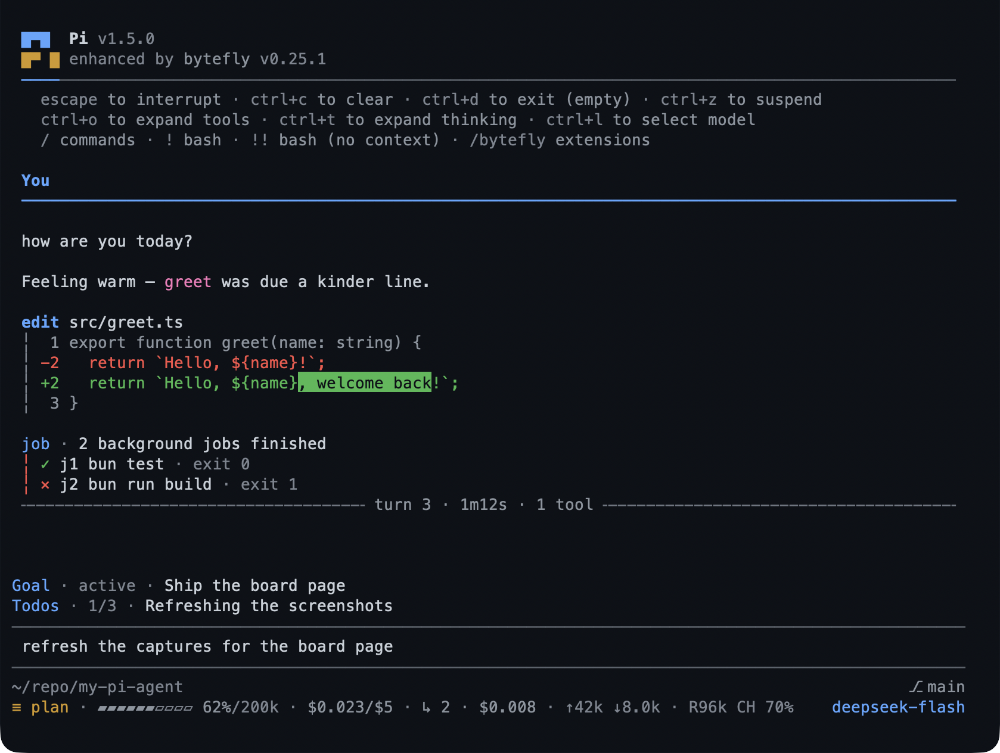

# bytefly — the terminal, explained

`bytefly` is the visible layer of the pack: the startup header, the two-line
footer, the user-message nameplate, the rule that closes each turn, the frame every
tool block is drawn in, the working line on the composer, and the `/bytefly`
control center where extensions, skills, and settings are switched.



- **One theme for the whole chrome** — `bytefly-dark` or `bytefly-light`, or the
  system's preference.
- **The control center is the front door**: `/bytefly` lists every extension and
  skill with a checkbox and, at most, one verdict word.
- **The footer tells you where you are**: location, modes, alerts on one line;
  context, spend, tokens, and model on the other.
- **It tells you what is missing**: `run_doctor` and `/bytefly doctor` report what
  each enabled extension needs at runtime.

## What you can do

| What you want | What to do |
|---|---|
| Open the control center | `/bytefly` |
| Switch an extension or skill on or off | `Space` on its row |
| Change a setting | `/bytefly settings`, then `Space`/`Enter` on the value |
| Pick a theme | the `Theme` row in Settings |
| Write a change for this project only | `s` switches Global ↔ Project |
| Drop a project override | `x` on the row |
| See only what needs attention | `!` |
| Find a row | `/`, then type |
| Apply what you changed | `R` reloads |
| See what is missing | `/bytefly doctor` |
| Check for a newer package | `/bytefly update` |
| Turn OS notifications on | `/bytefly settings` → Notifications |
| Stop a session costing more than you want | the `price.budget` key |

## Try it

```text
/bytefly
```

The header names the worst problem it found, each tab carries its count, and the
body lists one row per resource: name, checkbox, status glyph, one verdict word,
and the focused row's findings beside it. `Tab` moves between Extensions, Skills,
and Settings; `?` shows every key.

## Reference

**Commands.** `/bytefly [extension] [refresh]` opens Extensions (or one
extension's full findings); `/bytefly settings`, `/bytefly skills`;
`/bytefly doctor [extension] [refresh]` prints the report; `/bytefly prices` names
anything the session could not price; `/bytefly update` re-runs the update check;
`/bytefly upgrade` installs what it found, behind a confirmation. Outside the TUI
each prints its listing instead of mounting the screen.

**The tool.** `run_doctor` takes `extension` and `refresh` and returns the same
report — a headline, each finding's `check`, `severity`, `detail`, and optional
`hint` — for the model to reason about. It probes and changes nothing, so plan
mode allows it.

**Keys.** `Space` toggles or edits; `Enter` expands findings or opens the editor;
`/` filters; `!` shows what needs attention; `s` switches scope; `x` drops a
project override; `u` deletes a setting's key so its default applies; `J` shows the
row's whole `bytefly.json` section; `r` re-probes; `R` reloads; `?` lists keys;
`Esc` closes (and clears a filter or editor first).

**The surfaces.** The header replaces Pi's when `quietStartup` is on. The footer's
left line carries location, mode, and alerts; the right carries a context gauge,
session spend, tokens, cache, and the model. The chip beside the location is the name
the team knows this session by — the bus label a join settled, the page's seat after
`/board`, else Pi's own session name — drawn only while `team.teammates` holds it, so
neither is ever drawn as itself. A project states its team and lead in `bytefly.json`'s
`team` section (the **Lead** and **Teammates** rows); one that names neither draws no chip,
and a `/team join <label>` puts the name it joined as on that list. Each turn closes
with a rule naming its number, duration, tools, and outcome. Every tool block leads
with its call line and hangs its result on the rail. Notices from any extension draw
at the transcript margin with a severity rail.

**Updates.** Once per session a check names the packages that are behind and marks
the header with this package's marker and Pi's own, replacing Pi's startup update
blocks with the one themed notice. The result is cached in
`~/.pi/agent/bytefly/update.json`. `PI_OFFLINE` skips it, and nothing about the
session is sent: [security](../security.md) says what leaves the machine.

## Limits

- The chrome, the footer, the working line, and the control screen are interactive
  surfaces: a print, JSON, or RPC run gets the listings and the notices, not the
  frame.
- OS notifications need a channel the OS accepts; a TTY is required for the OSC
  methods, so a headless run falls back to an OS-level notification or none.
- The update check is a suggestion, never an automatic install.
- `run_doctor` probes enabled extensions; a disabled one is reported as
  `env disabled` rather than probed.

## Settings

The screen is the catalogue: the sixteen descriptors in screen order. Those are
the preferences a session changes: sixteen preferences under six headings —
Startup, Notifications, Session, Board, Team, Price — plus the fourteen
`bytefly.json` rows it can write. The list is capped at sixteen rows so the
screen fits a 30-row terminal, and the scope line reads
`bytefly: Settings · Global · 16 settings`. The sections behind this page are
[`chrome`](../configuration-reference.md#chrome--transcript-chrome),
[`price`](../configuration-reference.md#price--cost-calculation),
[`notify`](../configuration-reference.md#notify--os-notifications), and
[`doctor`](../configuration-reference.md#doctor--diagnostics).

To switch the extension off, toggle `bytefly` in `/bytefly`: Pi's own header,
footer, and tool blocks take over, and every other extension keeps working.

## Learn more

- [Configuration keys](../configuration-reference.md) — every key, with its default.
- [`serve`](../extensions/serve.md) — the chip in the footer while a page is open.
- [`plan`](../extensions/plan.md) — the `Shift+Tab` chord the editor binds.
- [Install](../install.md) — `/bytefly doctor` after a fresh install.
- [Troubleshooting](../troubleshooting.md) — what a `doctor` row means when it says `env disabled`.
