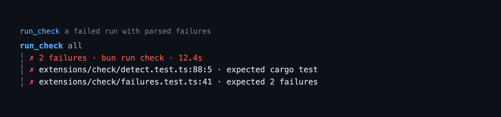

# check — cross-stack verification runs

Run the project's test, lint, or typecheck command from Pi, watch it live, and
turn its output into a navigable `file:line` list. The model gets the same run
as `run_check`, with structured failures instead of a wall of log text. Detection
is manifest-driven and deliberately generic: `check` assumes no language, test
framework, or CI system.

## Capabilities

| Capability | How | What you get |
|---|---|---|
| Plan-mode refusal | `/check`, the read-only policy | Plan mode refuses a check because tests still write caches, snapshots, or generated files; approve the plan first. |
| Single active run | `run_check`, `/check` | A second run is refused with the corrective action while one process is active, instead of starting a parallel check. |
| Supervised run | `/check`, `run_check` | One process per command, with a wall-clock timeout, a bounded log, and `Esc` to cancel the process tree. |
| Command detection | a project manifest, `check.command` | The project's test, lint, and typecheck commands are found without configuration, with a shell command override. |
| Target selection | `/check` with a target, `run_check.target` | Run `test`, `lint`, `typecheck`, or `all`; `all` is the default. |
| Structured failures | `run_check` | The model gets `path`, `line`, `column`, `test`, `message`, and `command` instead of a wall of log text. |
| Failure list | `/check` | A navigable list with a detail view for the focused failure, drawn from a source excerpt or the bounded tail. |
| Rerun from the list | `r` in the failure list | Rerun the same check after reading a failure; `Enter` opens its detail and `Esc` closes. |
| Live run screen | `/check` | A scrolling tail that repaints while the command runs, so a silent compiler still shows progress. |
| Capped transcript | `run_check` | One status summary and at most five failure rows, expanded with `ctrl+o` to the model's 20-failure cap. |
| Headless report | `/check`, `run_check` | RPC, JSON, and print sessions post the summary plus the failure list, with no screen. |
| Honest fallback | `/check`, `run_check` | An unparsed failure names the exit status and the last output lines, never an invented location. |

## Quickstart

```bash
pi --extension ./extensions/check   # load just this extension
pi -e .                             # load the whole @gavin-hu/my-pi-agent package
pi install ./                       # install the package
```

```text
/check                              # run every detected command
/check test                         # run the detected test command
```

The model calls `run_check` with the same four targets.

## Tool



`run_check` — direct exposure (the default), `executionMode: "sequential"`,
annotations `readOnlyHint: false`, `destructiveHint: false`,
`openWorldHint: false`. It takes one optional parameter:

| Parameter | Type | Meaning |
|---|---|---|
| `target` | `test` \| `lint` \| `typecheck` \| `all` | Which command to run; defaults to `all`. |

Result (`details` / `structuredContent`): `{ target, status, commands, exitCode,
durationMs, truncated, failures[] }`. `details` also carries the bounded `tail`,
which the transcript block reads and the structured mirror deliberately omits.

`content` is a short summary plus up to 20 failures. A failing check is a normal
result (`isError: false`) so the model can fix it; a check that cannot run — no
detected command, a spawn failure, or another run already active — is an error
with the corrective action.

The call line is `run_check <target>`. While the command runs, the result is one
line — `Running bun run check… · 12s` — and it repaints once a second, so a
silent compiler still shows progress. The settled block keeps the transcript to
a capped view of the run: a status summary, at most five failure rows, and the
bounded tail when nothing parsed. `ctrl+o` expands it to the model's 20-failure
cap; `/check` remains the full navigable list.

A failed command whose output parsed no location names the exit status in the
summary, prints `no parsed failure; last output:`, and shows the last five tail
lines instead of an exit-status row. The transcript never prints the model
report; the full failure list and the tail stay in `details`.

## Commands

`/check [target]` runs one target, or every detected command, with the same
timeout, bounded log, and failure list as `run_check`.


" width="100%">

| Command | What it does |
|---|---|
| `/check` | Run every detected command (or `check.command`). |
| `/check test` | Run the detected test command. |
| `/check lint` | Run the detected lint command. |
| `/check typecheck` | Run the detected typecheck command. |
| `/check all` | Same as `/check`. |

`getArgumentCompletions` offers the four targets. In the TUI the run screen
shows a scrolling tail and `Esc cancel`; a failed run then opens the failure
list, where `Enter` opens the focused failure's detail, `r` reruns, and `Esc`
closes. The command refuses while plan mode is on: relying on tests is still
writing to the project (caches, snapshots, generated files), so the plan must be
approved first.

## Behaviour by mode

| Mode | Behaviour |
|---|---|
| Interactive TUI | The run screen, then the failure list; a pass posts one notice. |
| RPC | Runs headless and posts the summary plus the failure list; no custom screen. |
| `print` / `json` | Runs headless and posts the same report. |
| `run_check` | No UI of its own. Returns the summary in `content`, the structured result, and a capped transcript block drawn from `details`. |

## Configuration

The `check` section of the shared `bytefly.json`; resolution rules are in
[`../configuration.md`](../configuration.md#check--verification-runs). All keys
are JSON-only; none has a `/bytefly settings` row.

| Key | Default | Bounds | Meaning |
|---|---|---|---|
| `command` | `""` | | When non-empty, run this shell command for every target instead of detection. |
| `timeoutMs` | `600000` | `0`–`3600000` | Wall-clock limit per command; `0` disables it. |
| `maxLogBytes` | `1048576` | `65536`–`16777216` | Bytes of tail retained per command. |

`command` is the escape hatch for any stack without a detector. It is a shell
command and runs with the project root as its working directory.

## Security

`check` executes project scripts. That is the same trust boundary as running the
command yourself or letting the agent call `bash`: a project with a hostile
`test` script can do anything your user can do. The extension does not add a
sandbox. `/check` is user-invoked and refuses in plan mode; `run_check` declares
`readOnlyHint: false`, so a permission policy can gate it, and plan mode blocks
it.

The extension adds no network calls of its own. The command's environment is
made non-interactive (`CI=1`, `NO_COLOR=1`, `FORCE_COLOR=0`, `TERM=dumb`,
`GIT_PAGER=cat`, `PAGER=cat`).

## Detection

Detection order stops at the first family that declares a command:

| Manifest | `test` | `lint` | `typecheck` | `all` |
|---|---|---|---|---|
| `package.json` | `scripts.test` | `scripts.lint` | `scripts.typecheck` | `scripts.check`, else the detected targets |
| `Cargo.toml` | `cargo test` | `cargo clippy -- -D warnings` | `cargo check` | the detected targets |
| `go.mod` | `go test ./...` | `go vet ./...` | `go build ./...` | the detected targets |
| pytest config or `tests/` | `pytest` | `ruff check .` with `[tool.ruff]` | `mypy .` with `[tool.mypy]` | the detected targets |
| `justfile` | `just test` if declared | `just lint` if declared | `just typecheck` if declared | `just check` if declared, else the detected targets |
| `Makefile` | `make test` if declared | `make lint` if declared | — | `make check` if declared, else the detected targets |
| any other stack | — | — | — | `check.command` |

Node package managers come from the lockfile (`bun`, `pnpm`, `yarn`, `npm`;
default `npm`). Scripts run as `<pm> run <name>`; Make and Just recipes only by
their declared names. Nothing is guessed beyond those manifests.

A detector is one function returning `DetectedCommands`; adding a family is one
module entry, not a change to the runtime, screens, or tool.

## Failure parsing

Known runner lines are recognized first; the generic compiler-style location is
the fallback for everything else:

| Output shape | Parser |
|---|---|
| `path:line(:col): error …` | generic, including a Windows `C:\…` path |
| `FAIL path` and `● test` | Vitest/Jest |
| `● test` and `at … (path:line:col)` | Jest/Vitest, Java, and bare stack frames |
| `File "path", line N, in test` | Python tracebacks |
| `FAILED path::test - message` | pytest |
| `--- FAIL: Test` and `path:line:` | Go |
| `thread 'test' panicked at path:line` | Cargo |
| anything else on a non-zero exit | one fallback entry with the bounded tail |

Failures are deduped and capped at 200; the model report shows 20. A miss is
never turned into an invented location.

## Limitations

- Detection covers the families above. Other stacks need `check.command`.
- Parsing is best-effort. A custom reporter that prints neither a location nor a
  known shape falls back to the tail, not to a guessed file.
- The failure list and detail are TUI-only; other modes print the report.
- A source excerpt is read only from a regular file inside the project root, at
  most 512 KiB, and only when the reported line exists. A missing, binary,
  oversized, or external file falls back to the bounded tail with the reason.
- There is no run history, retry policy, or watch mode. Each invocation is one
  run.
- A test runner that opens a full-screen UI is not supported: stdout is a pipe,
  stdin is closed, and `TERM=dumb`.
- The tail is bounded; earlier lines are dropped and marked truncated.

## Non-goals

- Auto-fixing or editing code in response to a failure.
- A remote CI client, a scheduler, or a durable run queue.
- Watching files and rerunning on change.
- Parsing every reporter in existence; the generic location and the bounded tail
  are the contract.
- Replacing `job` for long-lived processes.

## Pi integration

| Aspect | Contract |
|---|---|
| Registration | `checkExtension(pi)` guards on `isExtensionEnabled("check")` and calls `registerCheck(pi)`, which registers `run_check`, `/check`, and one `session_shutdown` hook. The factory only registers. |
| Tool | `run_check`, `exposure: "direct"`, `executionMode: "sequential"`, annotations `{ readOnlyHint: false, destructiveHint: false, openWorldHint: false }`, TypeBox `parameters` and `outputSchema`, `structuredContent` mirror. |
| Command | `/check [target]` with `getArgumentCompletions` for the four targets; reports through `ctx.ui.notify`. |
| State | None persisted. The runtime closure owns the single active child, its controller, and the live line buffer; `session_shutdown` aborts it. |
| Lifecycle | Each run spawns one process per command and kills the tree on timeout, cancel, or shutdown. No `session_start` work. |
| Config | `check` section of `bytefly.json`, read once per run. |

## Design notes

- **The excerpt is guarded like a path-taking tool.** The path comes from command
  output, so `source.ts` resolves it, requires both string and real-path
  containment under the project root, rejects non-files, binaries, and files over
  512 KiB, and checks the line before reading. A miss shows the tail, never a
  guessed source line.
- **Why `check`.** It runs the project's *check* command, matching `bun run check`
  and the scripts it detects. `/verify` describes a verdict rather than the
  action, and `run_verify` reads worse than `run_check`; the extension,
  command, tool, and config section all use one word.
- **Generic by design.** Only `detect.ts` knows manifests, and only `failures.ts`
  knows runner output. The runtime, screens, and tool speak in `CommandSpec` and
  `Failure`.
- **One-shot, not a job.** `job` owns reattachment, stdin, detached lifetime, and
  a registry; `check` owns a foreground verdict. Reusing `job` would make both
  surfaces worse, so the runner is local and smaller.
- **A bounded tail is the honest fallback.** A parser miss must not invent a
  location; the exit status and the tail are useful on their own.
- **The transcript is a capped view.** `render.ts` draws from the same `details`
  the model report reads but caps the rows and never prints the report; `/check`
  is still the full navigable list.
- **The failure list is a `DockListScreen`.** The frame, the id-anchored cursor,
  the navigation keys, the range row, and the detail pane come from
  `lib/tui/dock-screen.ts`, the base `/jobs`, `/watch`, and `/agents` share, so
  this module holds only the check vocabulary. A failure has no id, so its index
  in the finished run's fixed array is the cursor key.
- **One run at a time.** The runtime refuses a second start instead of
  interleaving outputs or processes.

## Files

| File | Responsibility |
|---|---|
| `index.ts` | Registrar: guard, runtime, tool, command, shutdown. |
| `types.ts` | `CheckTarget`, `CommandSpec`, `Failure`, `CheckResult`, `RunCheckDetails`, `ActiveCheck`. |
| `config.ts` | `check` config defaults, clamps, and loader. |
| `detect.ts` | The detector registry and `check.command` planning. |
| `runner.ts` | One-shot streaming process, bounded log, timeout, cancel, tree kill. |
| `failures.ts` | Known-runner and generic failure parsers, stack frames, and the tail fallback. |
| `source.ts` | Guarded source excerpt around a failure's `path:line`. |
| `runtime.ts` | Planning, sequencing, aggregation, live lines, cancel/shutdown. |
| `format.ts` | Summary, failure rows, source-excerpt/detail text, model report. |
| `view/check-screens.ts` | `CheckRunComponent` (a live tail) and `CheckResultComponent` (a `DockListScreen` over the failures), loaded on first use. |
| `tools.ts` | `run_check` schema, registration, the running partial result, and the call/result renderers. |
| `render.ts` | The transcript result block: status summary, capped failure rows, tail fallback. |
| `commands.ts` | `/check`, target parsing, completions, TUI/headless flow. |

## Testing

Co-located tests cover config clamps, every detector family, the runner's
streaming/timeout/cancel/log cap, the parsers, command planning, aggregation,
the tool's output contract and transcript block, the command's guards and
headless path, and both screens' keys and width bounds.
`extensions/check/extension.test.ts` runs a real Node script through the
extension, so the process path is exercised without depending on Bun or a test
framework.
