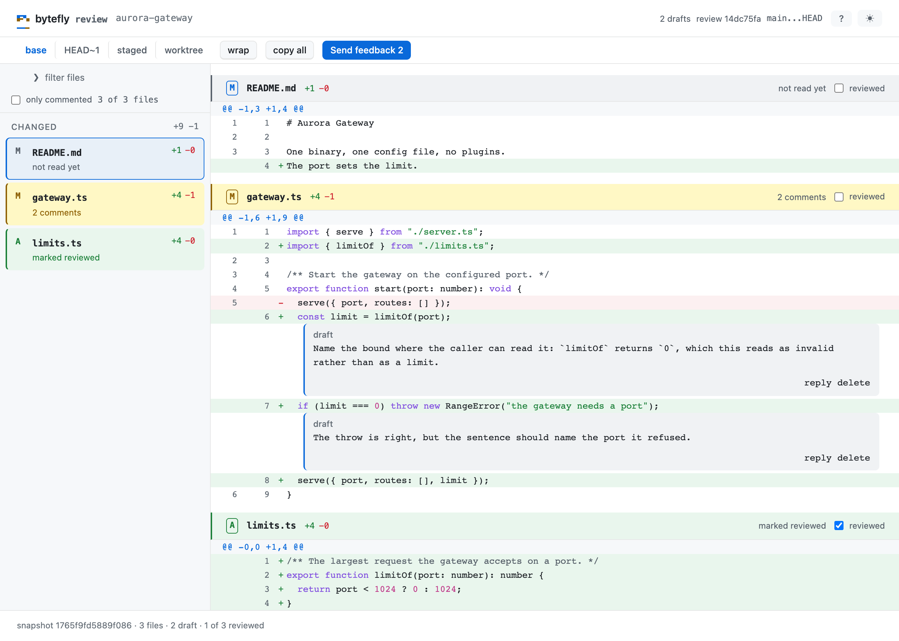

# code-review — review a diff as a page, line by line



A branch, an uncommitted change, or the index, served as a page you can read
line by line and comment on. The comments are the model's next turn — nothing
is written to your tree.

- **Use it for** the change you would otherwise review in a terminal with
  `git diff`, where the note you want to leave has nowhere to go.
- **`/review`** serves the page and opens it; **`code_review`** is the model's
  side of it — open, read, and close.
- The page is loopback-only and carries a token, so no other process can post
  to it.

## What you can do

| What you want | What to do |
|---|---|
| Serve a review of the branch | `/review`, or `code_review` with `action: "open"` |
| Review the last commit, everything uncommitted, the index, or the tree | `/review last`, `/review head`, `/review staged`, `/review worktree` |
| Read one file of it | open the page with `?file=<path>`; the changes tag on a `file-browse` page lands there |
| Comment on a line | click a gutter number, then **comment** — or `c` with a line selected |
| Comment on a range | click one gutter, Shift-click another |
| Copy a line reference | select lines, then **copy ref** — it copies `path:12-30` |
| Mark a file read | its **reviewed** box, or `m` |
| Send the notes to the session | **Send feedback** |
| Read what was sent | `code_review` with `action: "comments"` |
| Close the page | `/review stop`, or `code_review` with `action: "close"` |

## Try it

```text
/review
review: my-pi-agent vs origin/main — 5 files
review: http://127.0.0.1:4781/review/new
```

Comment in the page and press **Send feedback**. The session reads one notice at
its next turn:

```text
[CODE REVIEW]
2 review comments sent:
gateway.ts:6 — Name the bound where the caller can read it…
limits.ts:2 — Say which port was refused.
Run `code_review` action "comments" for all of them.
```

## Reference

`code_review` has four actions; `/review` drives the page.

| Action | What it does |
|---|---|
| `open` | Serve the page and hand back its address; `scope` and `base` choose the comparison |
| `status` | What the page shows: its address, scope, files, and comment counts |
| `comments` | Every comment the reviewer sent, with file, line, and side |
| `close` | End the page; refused while comments are still drafts |

**The five comparisons.** `base` reads `<base>...HEAD`, the branch against the
line it left; `last` reads `HEAD~1...HEAD`; `head` (shown as **uncommitted**)
reads the tree against `HEAD`, so the index and the working tree arrive together
with untracked files, which is the comparison `file-browse`'s changes tag means;
`staged` reads the index; and `worktree` reads the working tree alone, untracked
files included. The base ref is `code-review.base`, else `origin/HEAD`, else
`main` or `master`; a repository where none resolves is refused, naming the key
to set.

**The page.** A review is one page per session, at `/review/`. Its id is minted
by the first write, so opening a page to look costs nothing; the query carries
the write token, and the first write puts the review's own id in the address. A
comment is a draft until **Send feedback** marks it sent — after that it is the
session's, and the page shows it as sent.

**One file at a time.** `?file=<path>` turns the page into that one file's diff,
which is what a changes tag on a `file-browse` page opens: the rail shows the one
file and an **all files** link back, and the comparison is still the whole scope,
so nothing about the snapshot or its token changes. The file's head carries
**view file** and **download**, which are `file-browse`'s own pages
(`/files/view/<path>` and `/files/raw/<path>`) — they need that page serving, and
answer `404` without it. `n` and `p` step between the focused file's hunks; the
whole review keeps `[` and `]`. A reference copied from a selection is
`path:12-30`, the same form `file-browse` copies.

**What a comment anchors to.** A path, a side of the diff, and a line number on
that side. The page posts the snapshot it rendered with every write, and the
server re-reads the diff: a tree that moved under the page is refused with the
reload sentence rather than a comment landing on a line nobody read.

## Limits

- The review is the session's. Its comments live as long as the page does;
  sending is what keeps them, in the transcript notice and in `code_review`.
- One page per session. Changing scope is refused while a comment is on the page —
  send or delete it first, because a comment's line numbers belong to one scope.
- A focused page (`?file=`) hides the other files without forgetting them: a
  comment already written on one of them is still counted and still sent.
- At most 200 comments of 2,000 characters each, 200 changed files, and 4,000
  diff lines per file; the page says what a cap left out.
- In a repository with no commits yet, `staged` and `worktree` still render a page;
  `base`, `last` and `head` say the commit they compare is missing — `head` too,
  since `git diff HEAD` needs one where `git diff --cached` does not.
- The page needs `git`, `serve`, and a local browser; without `serve` the tool
  says the session has no port, and a launcher that cannot start is reported with
  the address to paste.

## Settings

`base`, `diffContext`, `maxDiffLines`, and `maxFiles` are read from the
`code-review` section of `bytefly.json` — see
[Configuration reference](../configuration-reference.md#code-review--what-a-review-compares).

## Learn more

- [`serve`](./serve.md) — the session's one port, which the page answers on.
- [`file-browse`](./file-browse.md) — the read-only browser for the whole tree.
- [`plan`](./plan.md) — the other review page: a plan before the code is written.
