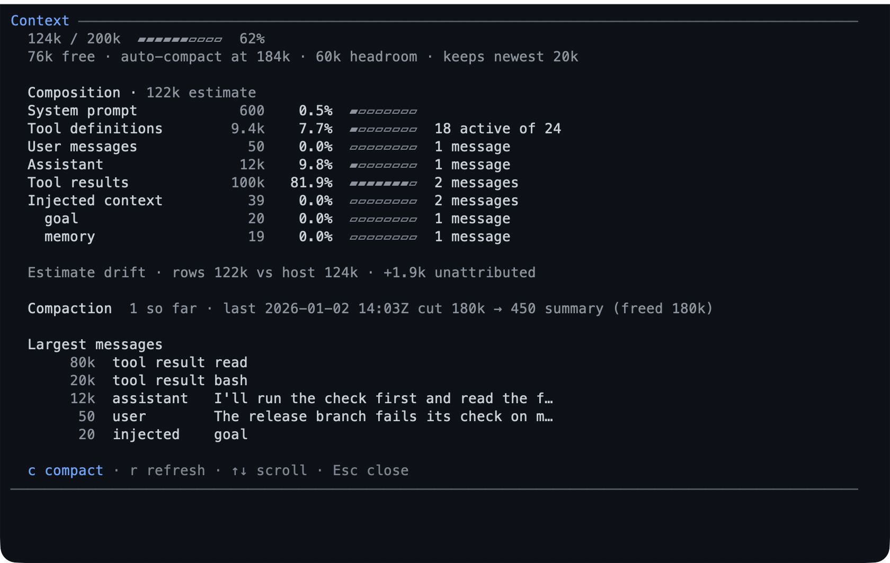

# context — see where the window goes

`/context` reports what your context window is made of: the system prompt, the
tool definitions, the conversation by role, injected notes, summaries, and shell
output. When the window is nearly full, the same report is where you compact.



- **A report, not a tool** — the model's prompt budget is untouched.
- **Where it went, not just how full**: the parts are named, and the difference
  between Pi's total and the estimate is shown rather than hidden.
- **Compaction from the report**, with the before and after numbers.
- **It refuses to compact** while a turn is streaming or another compaction runs.

## What you can do

| What you want | What to do |
|---|---|
| See the window | `/context` |
| See what is using it | the composition table and bars in the same report |
| Find the biggest single items | the largest-messages list in the report |
| Compact | `c` on the screen, or `/context compact` |
| Compact with instructions | `/context compact keep the design notes and the failing test` |
| See what compaction did | the before and after counts in its result |
| Check the history | the compaction count and what the newest one cut |

## Try it

```text
/context
```

If the conversation is the bulk of it, press `c` — the report tells you what it
will cost before it runs, and the result reports the new total.

## Reference

**The command.** `/context` opens a scrollable screen in the TUI and prints the
same facts as text in `rpc`, `json`, and `print` modes. `/context compact
[instructions]` compacts without opening the screen.

**What it reports.** Pi's own estimate — tokens, window, percentage, free space,
and the auto-compaction threshold with the headroom left — then the composition:
system prompt, active tool definitions, conversation by role, injected pack
context, summaries, and shell output, each with a gauge. A `drift` figure names
what the estimate cannot attribute.

**After a compaction.** The report shows the branch's compaction count, what the
newest one cut from and to, what its summary costs, and a pending total while Pi
recalculates rather than a made-up number.

## Limits

- The numbers are estimates, and an estimate with unattributed remainder says so.
- It cannot compact a streaming turn or a compaction already running.
- Injected context is counted where it lands, so a change in an extension's
  injected text moves this report too.

## Learn more

- [Configuration](../configuration.md) — the settings an extension's injected
  text answers to.
- [`plan`](../extensions/plan.md) — the largest single injected block in a
  planning session.
