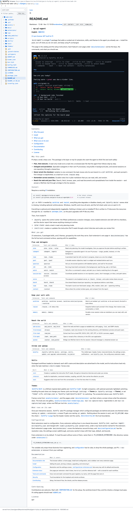

# file-browse — your working directory, in a browser

`/browse` serves the project you are working in to a loopback page and opens it: a
tree, file previews, a fuzzy quick open, and a read-only git diff. Nothing on the
page writes.



- **Read-only.** The server answers `GET` and `HEAD`, binds `127.0.0.1`, and
  never edits a file.
- **The session's one port**, so a bookmark survives a restart.
- **It follows the session**: enter or leave a worktree and the open page
  re-roots itself on the same URL.

## What you can do

| What you want | What to do |
|---|---|
| Open the page | `/browse` — at the working directory, or `/browse <path>` for a subdirectory |
| Jump to a file | `Ctrl+K` (`Cmd+K`), then type part of the path |
| Read Markdown as a page | click the file; the toolbar has a raw view |
| Look at an image | click it — thumbnails are inline in the listing |
| Read a diff | the **changes** chip, or `/files/diff`; `n`/`p` move between hunks |
| Paste a line reference | select lines, then copy the `path:12-30` form |
| Sort a folder | the Name / Size / Modified headers |
| See every key on the page | `?` opens the shortcut sheet |
| Find the address again | `/browse status` |
| Stop the server | `/browse stop`, or close the last tab |

## Try it

```text
/browse
```

The URL is printed and the page opens on the project's port. `Ctrl+K` finds a
file, and the toolbar copies a path, the contents, or a line reference.

[Browse your working directory](../tutorials/first-browse.md) walks the page.

## Reference

**Commands.** `/browse` starts at the working directory; `/browse <path>` starts
at a subdirectory of it (a path outside is refused); `/browse status` prints the
root and URL, or "not running"; `/browse stop` closes it.

**Routes.** Everything lives under `/files/`: the tree and a listing
(`/files/browse/<rel>`), a file page (`/files/view/<rel>`, `?raw=1` for source),
raw bytes (`/files/raw/<rel>`), the diff (`/files/diff[/<rel>]?mode=head|staged|worktree`),
and the JSON calls the page makes for the tree, quick open, and the reload check.
`/files/events` carries the live status frames.

**Previews.** Markdown renders as headings, lists, tables, code, and links, with
raw HTML allowlisted; code files are tokenized for JavaScript/TypeScript, JSON,
CSS, HTML and template components, shell, Python, Java, YAML, and SQL. The
tokenizer is first-party and carries state across lines, so a block comment or a
template literal colours correctly.

**Sorting and copying.** Directories come first; the sort is remembered per
browser. The toolbar copies a path, the contents, or a `path:12-30` reference for
a selection, and toggles line wrapping.

**Live status.** While a page is open it patches its own chips and row markers
from `/files/events`: branch, change markers, and the reload hint. The root
moving — a worktree switch — reloads the page onto the new tree.

## Limits

- Loopback only, with no auth: a malicious local page could probe the port. The
  `Host` allowlist, the absent CORS headers, and a read-only server are the
  mitigation; there is no LAN exposure.
- Live status patches what the page already has. A new file on disk needs the
  page's `⟳ reload`; the check covers the listed folder by name, not the folders
  inside it, a listed file's contents, or a file page's diff.
- Files over `maxFileBytes` show a download card; images over `maxThumbBytes` get
  an icon; long listings and diffs are truncated with the cap named.
- It is not a static-file server: the root is confined to the session's working
  directory, and a subdirectory must resolve inside it.

## Settings

| Key | Default | What it does |
|---|---|---|
| `autoOpen` | `true` | Open the browser on start; `false` keeps it headless and only prints the URL. |
| `maxFileBytes` | `1048576` | Larger files show a download card instead of a view. |
| `markdown` | `true` | Render Markdown files as pages. |
| `gitDiff` | `true` | Offer the read-only diff view. |
| `live` | `true` | Stream live status to open pages. |

The rest — thumbnail, listing, and diff caps, `maxIndexEntries`, `diffContext`,
and `liveIntervalMs` — are in
[configuration](../configuration.md#file-browse--the-local-file-server). To
switch the extension off, toggle `file-browse` in `/bytefly`.

## Learn more

- [Browse your working directory](../tutorials/first-browse.md) — the walkthrough.
- [`serve`](../extensions/serve.md) — the server and its port.
- [`worktree`](../extensions/worktree.md) — the checkout the page follows.
