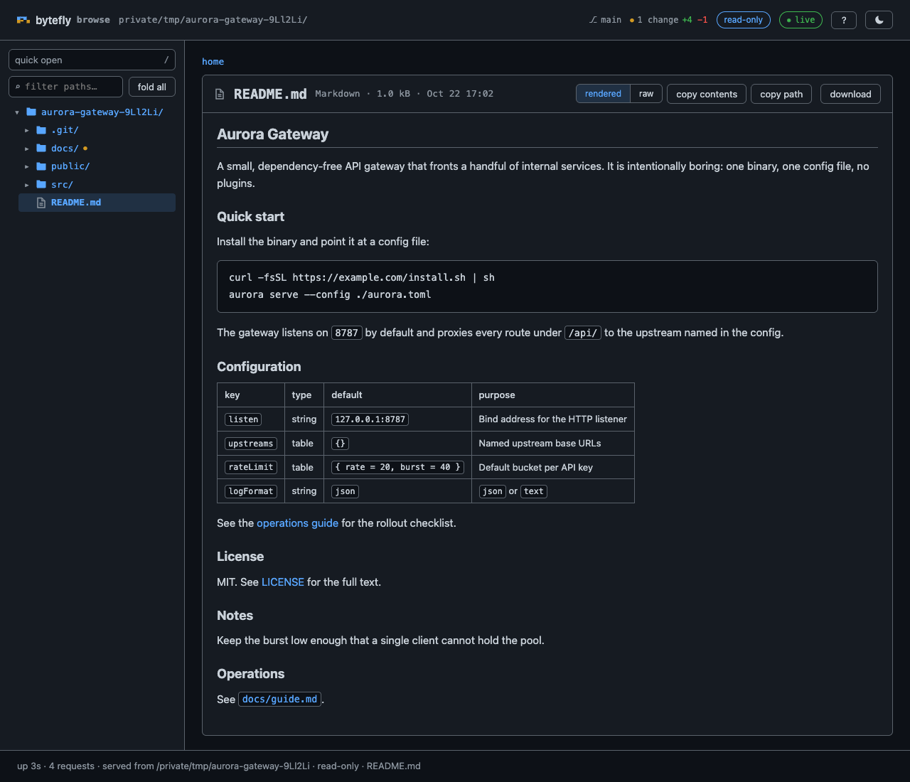

# file-browse — view the working directory in a browser

`/browse` starts a **read-only** HTTP server rooted at the effective working
directory, opens the default browser at it, and prints the URL. The page is a
two-pane file browser: a collapsible path tree on the left, directory listings
and file views on the right, with image thumbnails, rendered Markdown,
highlighted code, per-language icons, a fuzzy quick-open palette, and a
read-only git diff view. It is bound to `127.0.0.1` and ships no dependencies —
the shared loopback layer plus one small vanilla script.



## Capabilities

Status records what a reader can rely on: **Shipped** is in a tagged release, **Unreleased** is complete in the current tree but not yet tagged, and **Partial** has one released part and one unreleased part. Rows are ordered by user value, highest first.

| Capability | How | What you get | Status |
|---|---|---|---|
| One-command browsing | `/browse` | The server starts at the effective working directory, prints its URL, and opens the browser. | Shipped |
| Read-only serving | `/browse` | Nothing is edited or written, and the server binds `127.0.0.1` only. | Shipped |
| Two-pane page | `/`, `/browse[/<rel>]` | A collapsible tree beside the current folder's listing, with the tree, filter, and quick-open trigger pinned in their own pane. | Shipped |
| File previews | `/view/<rel>` | Text, rendered Markdown, image thumbnails, and download cards for binary or over-size files, each with a per-language icon. | Shipped |
| Quick open | `/`, `Ctrl/Cmd+K`, `/api/files` | A fuzzy path finder over the tree opens a file without walking the tree. | Shipped |
| Git diff view | `/diff`, `/diff/<rel>` | A change overview and one file's unified diff, scoped to `head`, `staged`, or `worktree`. | Shipped |
| Live status | `/events`, the `◉ live` chip | An open page keeps its branch, change markers, and footer up to date without a reload. | Shipped |
| Reload hint | `/api/dir-rev`, `⟳ reload` | A page whose folder gained or lost a file offers a reload control instead of changing its rows. | Shipped |
| The session's page port | `serve`'s `◉ <port>` chip | The footer names the one port every page of the session answers on, this one included. | Shipped |
| Listing controls | the `Name`, `Size`, and `Modified` headers | The current folder sorts by name, size, or modified time, directories first, and the choice is remembered per browser. | Shipped |
| Keyboard navigation | the tree's keymap, `?` | The tree is one tab stop with arrow, fold, and open keys; a shortcut sheet lists the page's own keys. | Shipped |
| Diff hunk navigation | `n`/`p` in `/diff` | Jump between changed hunks without scrolling the whole file. | Shipped |
| Fold and expand all | the `fold all` control | Collapse or expand the whole tree in one click. | Shipped |
| Reading progress | `browse-progress` hairline | A long directory or diff read shows how much has loaded, and printing hides the indicator. | Shipped |
| Printing | `@media print` styles | The page prints without the toolbar, progress hairline, or other screen-only chrome. | Shipped |
| Syntax highlighting | `/view/<rel>`, `/view/<rel>?raw=1` | Supported code files show keywords, strings, numbers, and comments in colour in both themes; other text stays plain. | Shipped |
| Markdown preview | `/view/<rel>`, `/view/<rel>?raw=1` | A README renders as headings, lists, tables, code, and links, with a one-click raw view. | Shipped |
| Copy and wrap | the page toolbar, `y`, `u` | Copy a file's path or contents or a `path:12-30` line reference, and toggle line wrapping for text and raw views. | Shipped |
| Theme toggle | the header button, `/theme.js` | Dark and light palettes, following the system until an explicit choice is remembered per browser. | Shipped |
| Idle stop and prefix reuse | `/browse stop`, the idle grace | The page gives its prefix back when nobody is reading it, so a closed tab never holds the session's server. | Shipped |

## Quickstart

```bash
pi --extension ./extensions/file-browse   # load just this extension
pi -e .                                    # load the whole @gavin-hu/my-pi-agent package
pi install ./                              # install the package for a user
```

```text
/browse            # start at the working directory and open the browser
/browse status     # print the root and URL, or "not running"
```

`/browse <path>` starts the same server with a subdirectory as its root.

## Commands

`/browse` is the only command: it starts, reports, or stops the server, and
selects the root.

```bash
/browse            start at the working directory, open the browser, print the URL
/browse <path>     start with a subdirectory of the working directory as the root
/browse status     print the root and URL, or "not running"
/browse stop       stop the server
```

- The root is the effective cwd, so an active `worktree` session serves the
  worktree. `<path>` must resolve inside it.
- The port is the session's: `serve` picks one in `4780`–`5779` (and `serve.port` pins
  it), so the origin stays stable across roots and restarts. A busy pinned port is
  reported, not silently changed.
- Starting while already running with the same root reprints the URL without
  restarting; a different root restarts the page.
- The server is closed when its last page has been gone for ten seconds, so
  closing the browser window ends the session's browse server and `/browse`
  starts it again on the session's port. A reload or a new tab inside that grace keeps
  it. `session_shutdown` closes it too, and `/browse stop` closes it at once.

## Routes

| Route | Result |
|---|---|
| `/`, `/browse[/<rel>]` | tree + directory listing |
| `/view/<rel>` | tree + file page (text, Markdown, image, binary, or over-size) |
| `/view/<rel>?raw=1` | raw Markdown/text source instead of the rendered view |
| `/raw/<rel>` | raw bytes, streamed; downloads and image sources |
| `/diff[?mode=head\|staged\|worktree]` | changed-file overview with `--stat` |
| `/diff/<rel>[?mode=…]` | one file's unified diff |
| `/api/tree?path=<rel>` | JSON children for lazy tree expansion |
| `/api/files?q=<query>` | JSON fuzzy path matches for the quick-open palette |
| `/api/dir-rev?path=<rel>` | JSON listing revision for the reload check |
| `/events` | Server-Sent Events stream of `status` frames for the open page |
| `/app.js` | the first-party client script |
| `/theme.js` | the pre-paint theme bootstrap |

## Configuration

The `file-browse` section of the shared `bytefly.json`. Resolution rules —
global document then project document, project wins — are in
[`../configuration.md`](../configuration.md#file-browse--the-local-file-server).

| Key | Default | Meaning |
|---|---|---|
| `autoOpen` | `true` | Open the browser on start; `false` for headless. |
| `maxFileBytes` | `1048576` | Larger files show a download card only. |
| `maxThumbBytes` | `5242880` | Larger images get an icon, not a thumbnail. |
| `maxTextLines` | `5000` | Rendered lines before truncation. |
| `maxDirEntries` | `2000` | Listed entries before truncation. |
| `thumbnails` | `true` | Render inline image thumbnails in listings. |
| `markdown` | `true` | Render Markdown files as formatted HTML. |
| `markdownHtml` | `true` | Re-emit sanitized raw HTML in rendered Markdown. |
| `maxIndexEntries` | `20000` | Files collected for quick open before truncation. |
| `gitDiff` | `true` | Offer the read-only diff view; `false` also drops the changes chip. |
| `diffContext` | `3` | Unified diff context lines. |
| `maxDiffLines` | `4000` | Diff lines rendered before truncation. |
| `live` | `true` | Stream live status to open pages. |
| `liveIntervalMs` | `5000` | Milliseconds between status frames while a page is connected. |

## Security

- **Loopback only.** Binds `127.0.0.1`; no auth and no LAN exposure.
- **Method and Host.** Only `GET`/`HEAD` are served (else `405`); a `Host`
  header that is not `127.0.0.1[:port]`, `localhost[:port]`, or `[::1][:port]`
  is rejected (else `403`, DNS-rebinding defense), and no CORS headers are sent.
- **Path guard.** Every path is decoded once, NUL and absolute paths are
  rejected, the path is resolved under the root, and the target (or nearest
  existing ancestor) is `realpath`-checked for containment. This blocks `../`,
  encoded traversal, and symlink escapes. Symlinks are listed but only followed
  when their real path stays inside the root.
- **CSP.** Pages allow only same-origin scripts and inline styles, and refuse to
  be framed (`frame-ancestors 'none'`, `X-Frame-Options: DENY`), so a local page
  cannot clickjack the controls or re-point relative URLs through an injected
  `<base>`; the policy comes from `lib/http/headers.ts`, shared with `plan`, so
  the two surfaces cannot drift. `/raw` uses
  `default-src 'none'; script-src 'none'; sandbox` plus `nosniff`, so a served
  SVG/HTML file cannot execute.
- **Markdown safety.** Rendered Markdown is escape-first, and raw HTML passes an
  allowlist (`raw-html.ts`): only known elements and attributes are re-emitted,
  rebuilt from the parsed names rather than copied, so `script`, `style`,
  `iframe`, `svg`, event handlers, `style=` and `class=` never reach the page.
  Link schemes are allowlisted (`javascript:`/`data:` dropped), an external
  image renders as a link instead of loading, and open elements are balanced at
  the end of the document so an unclosed `<div>` cannot swallow the page chrome.
  A suppressed element (`script`, `style`, `svg`, …) is dropped with its body;
  any other unknown tag is escaped and stays visible. `markdownHtml: false`
  restores escape-only rendering. The page CSP keeps the rest inert.
- **Highlighting safety.** The highlighter escapes every literal before it
  wraps it in a token span, so a code file's content cannot inject markup or
  attributes; only the fixed `tok-*` class names reach the page.
- **Event stream.** `/events` is a `GET` on the same loopback server, behind
  the same method and `Host` checks, and it only reads: the frame is the branch,
  the change paths and their revision, an uptime, and a request count, all of
  which the page it feeds already renders. It carries no page policy
  (`text/event-stream` is not a document), sends `Cache-Control: no-store`, and
  cannot be cached or replayed. A tick runs only while a page is attached, and
  the timer is `unref`ed, so an idle server does no work and a forgotten tab
  cannot hold the process open. At most eight pages may attach; a ninth is
  answered `204`, the one status an event source never reconnects after.
- **Caps.** `maxFileBytes` (inline rendering), `maxTextLines` (rendered lines),
  `maxThumbBytes` (thumbnails), and `maxDirEntries` (listings) bound every read.
- **Git reads.** The header chip and the diff view run read-only git
  (`rev-parse`, `status --porcelain=v1 -z`, `diff --stat`, `diff -U<n>`) with a
  timeout and a short cache; any failure simply omits the chip or the diff. A
  per-file diff sets `GIT_LITERAL_PATHSPECS=1`, so a filename containing glob
  characters is matched literally.
- **Read-only.** Nothing is ever written.

## The page

The page is server-rendered HTML with an inline style block and inline SVG
icons, progressively enhanced by one first-party script (`client.ts`). Each page
names its own subject in the tab — `browse · <folder>`, `browse · <rel>` for a file, the
`<page> · <subject>` shape the kit's `tabTitle` gives every served page — and links the
brand mark as an SVG data URI, in the appearance the system is in. A folder
folds from its twisty, and a `fold all` / `expand all` button beside the filter
folds the whole tree at once. The tree scrolls in its own pane with quick open
and the filter pinned above it; below 860px it collapses into a `Files`
disclosure above the listing. Below 820px the served folder's path takes a row of
its own and keeps its last segments, an ellipsis cutting the leading directories;
below 520px the card's controls hold one scrolling row above the file instead of
stacking. A hairline progress bar tracks whichever column is scrolling (the card
body for a file or diff, the main column otherwise), and the served folder names
the root page. The sidebar is a `<details>` whose content wrapper has no definite
height, so the panel fills it absolutely and the tree flexes inside.

The filter hides non-matching rows while keeping ancestors, and disclosure
triangles lazily fetch `/api/tree`. Without JavaScript the page still browses and
renders Markdown, and the JS-only controls (filter, disclosure, actions, quick
open) are hidden; the sort buttons lose their pointer so they do not look live.

The page palette is the shared Bytefly web theme (`lib/web/tokens.ts`), derived
from the `bytefly-dark`/`bytefly-light` terminal themes. It follows
`prefers-color-scheme` until an explicit choice sets `data-theme` on the root:
`/theme.js` applies the saved choice in the head before first paint, and the
header toggle flips and stores it (`pi-web-theme` in `localStorage`, the key
shared with plan's review page).

The page is keyboard-first, and the tree is one tab stop rather than two per
folder:

| Key | What it does in the tree |
|---|---|
| `↑` / `↓` | Move between the rows on screen |
| `→` | Open a folder (reading its children first if needed), or enter it |
| `←` | Close the folder, or step out to its parent |
| `Space` | Open or close the focused folder |
| `Enter` | Follow the focused row's link |
| `Home` / `End` | First or last row on screen |

The folder's own link carries `aria-expanded`, so a screen reader hears its
state once; the twisty beside it is a pointer control kept out of the tab order.
A mouse click moves the tab stop to that row, so `Tab` comes back to where you
were. Elsewhere the page keeps its own keys: `/` or `Ctrl`/`Cmd`+`K` for quick
open, `-` to fold, `u` to wrap, `r` for raw Markdown, `y` to copy a line
reference, `n`/`p` between diff hunks, and `?` for the sheet, whose dialog traps
`Tab` and returns focus to its button.

Printing is supported: the paper gets the light palette whatever the screen is
showing, the chrome and the tree are dropped, and a file or diff prints whole
instead of inside its scroll box.

## Previews

Text, rendered Markdown, images (thumbnails), and binary/over-size download
cards, with per-language icons. Broken thumbnails fall back to the category
icon.

Code files render with keywords, strings, numbers, and comments coloured, in the
dark and light palettes: JavaScript/TypeScript (`js`, `mjs`, `cjs`, `jsx`, `ts`,
`mts`, `cts`, `tsx`), JSON, CSS (`css`, `scss`, `sass`, `less`), HTML/XML and
template components (`html`, `htm`, `xml`, `vue`, `svelte`), shell (`sh`,
`bash`, `zsh`), Python (`py`, `pyw`, `pyi`), Java, YAML (`yaml`, `yml`), and
SQL. Other text types stay plain.

`lib/highlight.ts` is a first-party, escape-first tokenizer for those file
types. `detectLanguage` maps a filename to a tokenizer and an unmapped type
stays plain. `highlightLines` walks the whole file, so block comments, template
literals, open HTML tags, CSS brace depth, and Python triple-quoted strings
carry across lines; every literal is escaped with the same `escapeHtml` the
plain view uses, and a line's markup is only the fixed `tok-*` classes the
stylesheet colours. It backs both the plain text view and fenced code blocks in
the rendered Markdown view.

The Name / Size / Modified headers sort the current directory, directories
first, and the choice is remembered per browser. Below 520px the Modified column
is dropped, so the name keeps the row instead of truncating to the first few
characters. Copy a file's root-relative path or its contents, copy a
`path:12-30` reference for the lines you selected, and toggle line wrapping for
text and raw views.

## Markdown preview

`.md`, `.markdown`, `.mdown`, `.mkd`, and `.mkdn` files render as headings,
lists, tables, code, inline and reference links, bare-URL autolinks, and images,
with a one-click **raw** view (`?raw=1`). The page fills the card, so the scroll
bar sits at the card edge; headings, prose, and images keep a centred reading
measure of at most 1012px. Code blocks stay inside that column; tables start at
it and are never wider than it, so every table in a document ends on the same
line as the prose above it, and one wider than the pane scrolls, its right edge
fading until the last column is reached. Columns size to
the content, and in a pane narrower than 600px they stop shrinking: each cell
keeps a readable width, so the table scrolls instead of stacking one word per
line. A task list's checkbox is drawn by the page, so a done item carries the
success colour in both themes. Named and numeric character references are
decoded. Headings get stable anchor ids, so in-document `#anchor` links work.
Fenced code blocks are syntax-highlighted when the fence names a supported
language.

A README's raw HTML is re-emitted through an allowlist (`<details>`,
`<summary>`, tables, `<kbd>`, images), so it renders without becoming an
injection path. Raw HTML in the source is escaped, never executed, and external
images are shown as links rather than fetched. `markdownHtml: false` restores
escape-only rendering; `markdown: false` falls back to the plain-text view.

`markdown.ts` is a first-party, escape-first renderer for the constructs that
show up in repository READMEs. It emits only a known tag set, escapes every
literal character, allowlists URL schemes (dropping `javascript:`/`data:`),
rewrites local links and images to `/view`/`/raw`, and renders an external image
as a link instead of loading it (the page CSP is `img-src 'self' data:`). Link
reference definitions (`[id]: url`), including the full `[text][id]`, collapsed
`[text][]`, and shortcut `[text]` forms, and numeric and common named character
references are resolved. The Rendered/Raw switch is a server-side `?raw=1` link,
so it works without JavaScript. Headings are demoted one level so the card title
stays the page's only `h1`, and each gets a slug `id` (unique in the document). A
fenced code block whose info string names a supported language is highlighted
through `lib/highlight.ts` (either an extension or a long-form alias,
`fenceLanguage`); an absent or unknown language stays plain.

A line that starts with an allowed block tag (`<details>`, `<table>`, `<div>`,
`<pre>`, …), a comment, or a closing tag opens an HTML block that runs to the
next blank line; text inside it stays text, and a suppressed tag (`<script>`,
`<style>`, `<svg>`) drops its body through the matching close tag. `raw-html.ts`
re-emits only allowlisted elements and attributes: `a`/`img` go through the same
`/view`/`/raw` resolution as Markdown, an external image becomes a link, and
`class`/`style`/handlers are dropped. Phrasing tags are also accepted inside a
line, while a block tag mid-paragraph stays escaped. Open elements are balanced
across blocks, which is how a `<details>` can wrap Markdown paragraphs.

## Quick open

`/` (or `Ctrl/Cmd+K`, or the sidebar button) opens a fuzzy path finder over a
capped index of the tree, with keyboard navigation and a highlighted match;
Enter opens the file. `/api/files` ranks the cached index with `fuzzy.ts` and
returns the matched character positions; the client fetches on an 80 ms debounce
and builds rows with `textContent`, so a file name cannot inject markup. The
index skips `.git`, `node_modules`, and symlinks, is capped by
`maxIndexEntries`, and is cached per server for 10 s by `createFileIndex`. The
palette is a `dialog`/`combobox`/`listbox` with `aria-activedescendant` and
`Esc` / arrow / `Enter` handling.

## Git context and diff view

A read-only header chip shows the checked-out branch (or detached head) and
reflows on narrow screens. Uncommitted changes are stated once, by the changes
chip below; turn the diff view off (`gitDiff: false`) and the header reports no
changes at all.

A `● N changes +A −D` chip links to `/diff`, a change overview with
`git diff --stat` and a per-file status table, and `/diff/<rel>` renders one
file's unified diff, whose head carries its own `+A −D` and hunk count. Below
520px that table's change word is dropped, where the badge already carries the
same letter and the path needs the room. Changed lines are syntax-highlighted
with the file's language, and dirty files and their directories carry a marker
in the listing and the tree. The scope is switchable between `head` / `staged` /
`worktree`; untracked files show as all-add, an unborn `HEAD` falls back to the
index, and a non-repository is a plain empty
state. Read-only, capped, and rendered with the shared diff colours. A diff's
hunk headers pin to the top of the code viewport while its body scrolls.

`git.ts` extends the read-only provider set with a TTL-cached
`git status --porcelain=v1 -z` and a per-mode `git diff`; `diff.ts` parses the
unified diff and the porcelain records into plain view models, so `router.ts`
and `html.ts` stay pure. `head` compares against `HEAD` (falling back to
`--cached` before the first commit), `staged` against the index, and `worktree`
against the index from the other side. An untracked file renders as all-add
through `readFileView`, so binary and over-size handling is shared with the file
view. `git diff --stat` supplies the chip totals and `changeDirs` derives the
directory markers; the changed lines are highlighted per hunk by rebuilding the
old and new sides for `lib/highlight`.

## Live status

The page answers at the origin's root of the session's one server, so the footer's one
`◉ <port>` chip is the session's, not this page's: [`serve`](./serve.md) publishes it
while anything is mounted, and [`bytefly`](./bytefly.md) routes it to line 1's right
zone, after `⎇ branch` and `⑂ worktree`. It is cleared when the session's server closes,
so a session with no page open shows nothing at all.

The page has its own live status, which is what a left-open tab reads. A `◉ live`
chip beside `read-only` says whether status is flowing (green), still
connecting (accent), stalled (amber, after three missed frames), or offline
(red); the branch chip, the `● N changes +A −D` chip, and the change markers in
the tree and the listing update in place; and the footer line reports `up 2m
14s · 37 requests`. The chip names its state and never counts, and a frame whose
change set did not move repaints nothing at all. One Server-Sent Events stream
per page carries it, on the same loopback server, so nothing extra is opened and
nothing is written; that stream is also how the server notices the last page
closing its window, after which it stops listening.

The header chip starts hidden and is painted by the client from `/events`:
`◉ live` in the success colour while frames arrive, `◉ connecting` before the
first one, `◉ stale` in the warning colour when three intervals pass without a
frame on an open connection, and `◉ offline` in the danger colour once the
stream errors. The chip names its state rather than counting, so it is repainted
only when that state changes. The same frame carries the branch (or detached
head), the uncommitted-change totals and paths, the server's uptime, and the
requests it has answered, so the branch chip, the changes chip, the markers, and
the footer line are painted from one snapshot rather than four requests. Each
change set also carries a short revision, and a frame whose revision the page
already painted does no work at all — so an idle tree costs no DOM, however many
rows the page drew. Losing the stream leaves everything the page last showed in
place: it is read-only, so a stale label is never a stale action. `"live": false`
turns the whole surface off — no chip, no stream, no `/events` route — and so
does JavaScript off.

At most eight pages may hold the stream at once: a ninth is refused and its chip
reads `offline`, which keeps one local page from pinning the server — and the
git read behind each frame — alive. The stream is also how the server knows a
page is still there: when the last one leaves, the port is released after ten
seconds and the chip is cleared, because nothing is left to serve. That is why a
page with JavaScript off — or with live status off — never counts as a reader,
and the server then waits for `/browse stop` or the end of the session.

`live.ts` builds one snapshot per tick — the git status, the `head` change
index, the server's uptime, and its request count — and `frameOf` serializes it
as one `status` event. `createLiveChannel` holds the attached pages and starts
the ticker on the first attach, so an idle server does no work; it shares a
single in-flight snapshot between pages and stops the ticker on the last detach
and on `close()`, which `server.ts` calls before closing the socket. The idle
stop is one layer down: `lib/http` arms a single timer when a server's last
stream ends, a reload re-attaches and cancels it, and `server.ts` turns that into
the extension's `close()` and a cleared chip. Both providers are already
TTL-cached, so a tick
re-reads at most one `git status`, and every read failure degrades to `null`
rather than a failed frame. The event-stream headers and the `retry:` preamble
live in `lib/http` with the rest of the loopback policy, shared with plan's
review page. The client half is `live-client.ts`: one `EventSource`, one
snapshot paint (`textContent` only, never markup), one staleness timeout armed
per frame, and a `pagehide` cleanup.

## Reload hint

A page that lists a folder carries the revision of the names it drew, and asks
`/api/dir-rev` for the folder's current one on the frame cadence — one directory
read every five seconds by default, skipped while the tab is hidden and stopped
for good once it has an answer. A difference reveals `⟳ reload` beside the live
chip, which reloads the page; the rows themselves are never touched, because a
page that could grow a row is a page that writes. A folder whose listing was
truncated, and a file, `/diff`, or error page, has nothing to compare and shows
no control.

`/api/dir-rev` answers one folder's listing revision, so the page can tell
whether its rows are stale. It goes through the same path guard as every other
route and reads one directory; its answer is a hash of the names, not the names
themselves, so it discloses nothing the page above it does not already show. The
check compares names, so it is a directory read rather than a stat pass, and it
stops at the first difference because the control, not the checker, is the fix.

## Limitations

- Syntax highlighting covers the built-in language set above; any other text
  type renders exactly as before. State that the tokenizer does not carry
  across lines (shell heredocs, interpolation inside a template literal) is
  approximated rather than parsed.
- Live status updates what the page already contains: the header chips, the
  markers on the rows it rendered, and the footer line. A file that appears on
  disk does not join the listing by itself — the page offers `⟳ reload` instead —
  and the check covers the folder the page lists, by name, not the folders inside
  it, a listed file's contents, the `/diff` table, or a file page's `changes`
  action, which stay page-load snapshots. The branch chip is only patched when
  the page was served inside a repository.
- `/browse` has no auth; a malicious local page could probe the port. The `Host`
  allowlist and the absence of CORS headers mitigate reads, and the server is
  read-only.
- Serving the root exposes whatever is on disk to the local user who started it;
  this is intentional and scoped to loopback.

## Non-goals

- No editing or writing from the browser.
- No third-party assets: the Markdown renderer, its raw-HTML sanitizer, and the
  syntax highlighter are first-party, so raw HTML in a Markdown file is
  allowlisted and never executed.
- No auth and no LAN exposure: loopback only.
- Not a general static-file server: the root is confined to the effective cwd.

## Pi integration

| Integration point | How |
|---|---|
| Command | `/browse` registers a single command from the factory; no tools are exposed. |
| State | The running mount, its root, and the session id live in a module-local closure; nothing is persisted and no session entries are written. The port is `serve`'s, not this extension's. |
| Lifecycle | The factory opens no socket; the server is created on `/browse` and closed idempotently by `/browse stop`, by `session_shutdown`, and once its last page has been gone for the idle grace, which also ends every attached status stream. |

## Design notes

- **Lifecycle.** `/browse` resolves `resolveEffectiveCwd(ctx.cwd)`, loads config,
  parses args, and mounts the page through `requestMount`: `realpath` the root, claim
  the origin's root on the session's server, return `{ url, port, root, close }`. The
  port belongs to `serve` — `serve.port` pins the session's origin — so nothing here
  picks or retries one. `/browse stop` and `session_shutdown` await the idempotent
  `close()`, which gives the prefix back. The page is the mount's only reader, so the
  channel reports the last page's departure after `IDLE_STOP_MS` and the command
  releases the prefix — and the session's port is `serve`'s, remembered per session,
  so the next `/browse` answers on the same origin.
- **Pure routing.** `handleRequest(context, method, rawUrl, headers)` validates
  method and `Host`, parses the URL, matches a route, and runs every path
  through `paths.ts`. It returns a plain `ServeResponse`, so routing is tested
  without a socket; `server.ts` is the only part that hands those routes to
  `lib/http`'s loopback server.
- **One snapshot, one frame.** The status source is shared by every attached
  page, so a tick costs one `git status`, one `git diff --stat`, and one
  serialization however many tabs are open. The frame carries a revision of the
  change set, and the client compares it before painting, which is why an idle
  page does no DOM work. The cadence is what bounds those reads, so the default
  is five seconds rather than matching the providers' two-second render cache.
- **A poll, not a watcher.** The folder check is one request from the page to
  `/api/dir-rev`, not an `fs.watch`: recursive watching is the one part of
  `node:fs` whose availability and event semantics differ per platform, and it
  would add a long-lived resource to start and release around `close()`. The
  check compares names, so it is a directory read rather than a stat pass, and it
  stops at the first difference because the control, not the checker, is the fix.
- **Progressive enhancement.** The page is server-rendered first, so it browses
  and renders Markdown without JavaScript; the client only adds the filter, lazy
  disclosure, sorting, wrap, copy, and quick open.
- **Streaming responses.** The server streams `filePath` responses and
  suppresses bodies for `HEAD`, so large `/raw` files are not buffered.
- **Root confinement over feature breadth.** The root is deliberately confined
  to the effective cwd rather than serving an arbitrary directory, so a
  worktree session serves the worktree and nothing above it.

## Files

| File | Purpose |
|---|---|
| `index.ts` | `/browse` command, running-server closure, shutdown cleanup |
| `config/config.ts` | Config defaults, validation, global/project merge |
| `files/paths.ts` | Decode/encode, resolve, and `realpath`-containment guard |
| [`../../lib/escape.ts`](../../lib/escape.ts) | `escapeHtml`, the shared HTML escaping used by every renderer |
| [`../../lib/highlight.ts`](../../lib/highlight.ts) | First-party escape-first syntax tokenizer for the code view (shared with `plan`) |
| [`../../lib/web/index.ts`](../../lib/web/index.ts) | The shared Bytefly web brand system: tokens, base, components, layout, runtime, and markup |
| `files/files.ts` | The barrel over the four reads: one surface for the callers, four modules behind it |
| `files/classify.ts` | What a name is: kind, Markdown, image, MIME type, and the text sample |
| `files/list.ts` | Capped directory listings and one file's bytes, over injected filesystem reads |
| `files/tree.ts` | The sidebar tree and the page-level walk (`directoryView`) that returns it with the listing |
| `files/index.ts` | The quick-open file index, walked once per root up to a cap |
| `text/diff.ts` | Pure unified-diff and porcelain-status parsing for the diff view |
| `text/fuzzy.ts` | Fuzzy path matching and ranking for the quick-open palette |
| `view/markdown.ts` | First-party escape-first Markdown-to-HTML renderer (fenced code highlighted; raw HTML through `raw-html.ts`) |
| `view/raw-html.ts` | Allowlisted raw-HTML sanitizer: element/attribute policy, suppressed bodies, and cross-block balancing |
| `view/urls.ts` | Shared link/image URL policy: scheme allowlist and `/view`/`/raw` rewriting |
| `view/emit.ts` | The anchor and image elements both renderers emit, so a link written in Markdown and the same one written as HTML are one element |
| `git/git.ts` | Read-only branch/dirty provider for the header chip |
| `view/icons.ts` | Inline SVG sprite and the per-language mapping |
| `view/client.ts` | The `/app.js` source: sort, wrap, copy, hunk navigation, reading progress, and the page keymap |
| `view/tree.ts` | The sidebar block: path filter, fold-all, lazy tree loading, and the tree's keyboard model (interpolated into `client.ts`) |
| `view/palette.ts` | The quick-open palette: fuzzy search, the combobox wiring, and the `window.bfPalette` contract (interpolated into `client.ts`) |
| `view/live-client.ts` | The client's live status block: the event stream, the chips, the markers, and the footer line (interpolated into `client.ts`) |
| `live/live.ts` | The live status snapshot, its frame, and the fan-out channel that ticks it |
| `live/rev.ts` | Short digests of the change set and a folder's listing names, so an unchanged frame is skipped |
| `view/chrome.ts` | Header chrome: the git and changes chips, the live chip, the reload control, and the footer line |
| `view/styles.ts` | The page-only `browse-*` stylesheet (the `bf-*` kit comes from `lib/web`) |
| `view/html.ts` | Page renderers: the shared shell, the two-pane layout, the listing, and the cards |
| `view/diff-html.ts` | The unified-diff body: the gutter, the sign, the hunk sections, and per-hunk highlighting |
| `transport/router.ts` | Pure request handler: routes, the `/raw` sandbox policy, and the error page |
| `transport/server.ts` | This extension's routes over `lib/http`'s loopback server: the request count, the stream cap, and the idle policy |
| [`../../lib/http/index.ts`](../../lib/http/index.ts) | Loopback HTTP layer shared with `plan`: one server entry (`serveHttp`) and the mount contract a page claims a prefix with (`requestMount`), page/script/JSON/event-stream headers, `ServeResponse`, the request-envelope helpers, the event-stream sink and its idle grace |
| [`../../lib/browser.ts`](../../lib/browser.ts) | Cross-platform browser opener (shared with `plan`) |

## Testing

`extensions/file-browse/` covers the path guard (traversal, encoded, NUL, malformed,
absolute, symlink escape and in-root symlink), file classification/listings/
reads/tree and the quick-open file index, listing revisions, the fuzzy matcher,
the syntax highlighter (language detection, fence aliases, token classes,
cross-line state, and escaping), the Markdown renderer (blocks, inline,
fenced-code highlighting, safety, raw HTML, and path resolution), the raw-HTML
sanitizer (allowlist, suppressed bodies, attribute policy, balancing, and a
seeded invariant test over fragment soup),
the icon mapping and sprite, the page chrome and page renderers, HTML
escaping/encoding, the client script and its serving, the platform browser
commands with an injected spawn, the router (routes, `/api/tree`, `/api/files`,
`/api/dir-rev`, `?raw=1`, status codes, `Host`, `HEAD`, `/raw` headers, and the
`/diff` view routes and mode validation) without a socket, a real
`127.0.0.1:0` server, the session-port lifecycle (fixed on first start, reused,
and re-rolled after a conflict), config normalization and clamping, the git
status provider (branch, dirty, detached, non-repo, failure, and TTL cache), the
git diff parser and provider (line kinds, line numbers, status and rename
parsing, mode filtering, untracked all-add, unborn-HEAD fallback, literal
pathspec, and TTL cache), the diff renderers (highlighted changed lines, marker
sets, and chip totals), the live status feed (snapshot fields, degraded
providers, the frame, and the channel's ticker driven by an injected timer, plus
the ticker parking on the last detach and on `close()`), the `/events` route and its 404 when the channel is off, a real
socket that reads a page's first frame and the ticker's next one and sees the
stream end when the server closes, the live chrome a page renders when on and
not when off, and the command lifecycle with injected seams.
