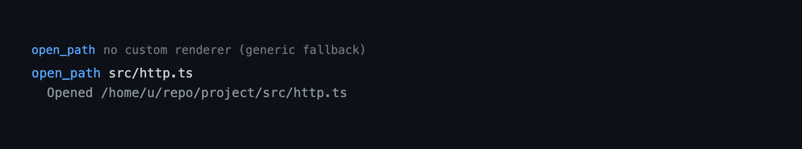

# file-open — open files and directories in the OS-native app

`file-open` opens a file or directory in the operating system's default
handler, or reveals it in the file manager. `/open` does it interactively and
the `open_path` tool does it from a script, both resolving the path against the
effective working directory.

## Capabilities

Status records what a reader can rely on: **Shipped** is in a tagged release, **Unreleased** is complete in the current tree but not yet tagged, and **Partial** has one released part and one unreleased part. Rows are ordered by user value, highest first.

| Capability | How | What you get | Status |
|---|---|---|---|
| Native open | `/open`, `open_path` | The file or directory opens in the application the OS associates with its type. | Shipped |
| Reveal in the file manager | `/open -r`, `open_path` with `reveal: true` | The target is selected in the file manager instead of opened. | Shipped |
| Working-directory resolution | `/open`, `open_path` | A relative path resolves against the effective working directory, so under [`worktree`](./worktree.md) `/open .` opens the isolated worktree. | Shipped |
| Codemode-only exposure | `exposure: "codemode"` | The model cannot call `open_path` directly unless a codemode script asks for it; the table does not promise otherwise. | Shipped |
| Pasted-path cleanup | `/open`, `open_path` | The editor's `@` mention prefix, surrounding quotes, and control characters are stripped before the path is used. | Shipped |
| Failure reporting | `/open`, `open_path` | A missing path, a launcher that cannot start, and a non-zero exit after a successful start on macOS/Linux are reported. | Shipped |
| Session-outliving launch | `/open`, `open_path` | The handler runs detached, so the application outlives the Pi session. | Shipped |

## Quickstart

```bash
pi --extension ./extensions/file-open       # this extension only
pi -e .                                     # the package from this checkout
pi install ./                               # install the package for a user
```

```text
/open              open the working directory in the default app
/open src/app.ts   open a file in its default app
/open -r src       reveal src in the file manager
```

## Commands and flags

```bash
/open [path]      open a path (default: the working directory) in its default app
/open -r [path]   reveal the path in the file manager instead
```

The `-r` flag must come first. A missing path is reported through a notification
and nothing is launched. An empty argument means the working directory. The
command first reports `Opening <path>` (or `Revealing <path>`); a launcher that
starts but then fails adds a `Could not open` error notification. The command
needs an interactive terminal UI.

## Tool



`open_path` — `exposure: "codemode"`, inactive by default, not read-only,
open-world (`openWorldHint: true` because it starts an OS process). It is listed
by the `codemode` tool for a script to call as `tools.open_path(...)`, and an
extension can reach it through `ctx.executeTool`; it is not declared to the
model unless activated.

| Parameter | Type | Meaning |
|---|---|---|
| `path` | string, required, 1–4096 chars | Path to open, relative to the working directory or absolute (a leading `@` is ignored). |
| `reveal` | boolean | Reveal in the file manager instead of opening. Defaults to `false`. |

Result (`details` / `structuredContent`):

| Field | Meaning |
|---|---|
| `target` | The absolute path that was handled. |
| `reveal` | Whether it was revealed rather than opened. |

The model-facing `content` is `Opened <target>` or `Revealed <target>` — the
handler was started, not proof that it succeeded. A path that does not exist is
thrown as an error naming the resolved path; a launcher that cannot be started,
or (on macOS and Linux) exits non-zero, is reported through `ctx.ui.notify`
because the handler runs detached, and the tool result still names the target.

## Behaviour by mode

The tool has no widgets or status output and behaves identically in `tui`, RPC,
JSON, and print modes; a codemode script can call it in any of them. Only the
`/open` command's notification needs an interactive UI.

## Security

- **It starts an OS process for a path the model names.** Whatever application
  is registered for the target's type is launched with the user's privileges. A
  file whose default handler is executable (`.app` on macOS, `.exe` on Windows,
  `.desktop` on Linux) can run code. The tool is `codemode`-exposed rather than
  active by default for this reason, and its annotations let a permission
  extension confirm the call.
- **No shell.** The handler receives the target as a `spawn` argument, never
  through a shell, so the path is not re-parsed.
- **Control characters are stripped** from the target before it reaches the
  process arguments or the notification.
- **Not confined.** Unlike `read_doc`, the tool opens any path on the machine:
  confinement would defeat its purpose of showing the user a file wherever it
  lives. Relative paths resolve against the effective worktree root.
- **Best-effort launch.** A launcher that cannot be started is reported, and so
  is a non-zero exit on macOS and Linux, where `open` and `xdg-open` return a
  failure status when no handler accepts the target. Windows `explorer` can exit
  non-zero after a successful open, so only a failure to start is reported
  there. Nothing is retried.

## Native handlers

Both surfaces run the same command for a platform; the mode alone chooses
between open and reveal.

| Platform | Open | Reveal |
|---|---|---|
| macOS | `open <path>` | `open -R <path>` |
| Windows | `explorer <path>` | `explorer /select,<path>` |
| Linux | `xdg-open <path>` | `xdg-open <dir>` |

Reveal has no native meaning on Linux, so there the containing directory opens.

## Limitations

- Reveal has no native meaning on Linux, so it opens the containing directory.
- On Windows a refused target is not reported: `explorer` does not relay the
  failure and its exit status is unreliable, so `/open` and `open_path` can only
  report that the launcher started.
- A launch that the OS accepts but the user never sees (a backgrounded app, a
  hidden window) is not detected: `spawn` reports only that the process started.
- `-r` is parsed only as the first token of `/open`, so a path that genuinely
  starts with `-r ` cannot be opened by the command. Use the `open_path` tool
  with the full path instead.

## Pi integration

| Aspect | Contract |
|---|---|
| Registration | `fileOpen(pi)` in `index.ts` registers `open_path` and the `/open` command. The factory only registers. |
| Tool | `open_path`, `exposure: "codemode"` (inactive by default), default (`parallel`) execution, `annotations: { readOnlyHint: false, destructiveHint: false, openWorldHint: true }`, TypeBox `parameters` and `outputSchema`. No custom renderer. |
| Command | `/open [path]` and `/open -r [path]`; reports through `ctx.ui.notify`. |
| State | None persisted, and none needed: every call is independent. |
| Lifecycle | No `session_start` / `session_shutdown` hooks; the factory holds no long-lived resources. |
| Host seams | `resolveEffectiveCwd` and `isExtensionEnabled` ([`lib/env.ts`](../../lib/env.ts)), `stripControlChars` ([`lib/format.ts`](../../lib/format.ts)), `spawn` / `open` / `xdg-open` / `explorer` (via the injected launcher in [`open.ts`](../../extensions/file-open/open.ts)). |
| Config | None. |

## Design notes

`buildCommand` and `normalizeTarget` are pure and `openTarget` takes an injected
launcher, so the command for each platform is asserted without a process and a
test launches nothing. The launch is best-effort: `spawn` reports a missing
launcher asynchronously and the child reports its exit, so both failures go to
`onError` (and a notification) rather than being thrown from a synchronous call
the tool could catch. `exitMeansFailure` opts Windows out because `explorer` can
exit non-zero after a successful open. Windows opens through `explorer` rather
than `cmd /c start` so cmd cannot re-parse a path containing `%`.

The tool is `codemode`-exposed, matching how it was configured before the move:
opening a native app is a side effect the user should trigger, so it stays out
of the model's active tool set unless a script explicitly reaches for it.

## Files

| Module | Responsibility |
|---|---|
| [`index.ts`](../../extensions/file-open/index.ts) | The extension factory: registers `open_path` and the `/open` command, resolves the target, and routes a launch failure to `ctx.ui.notify`. |
| [`open.ts`](../../extensions/file-open/open.ts) | `normalizeTarget` and `buildCommand` (pure), `resolveTarget` (existence check), and `openTarget` with the injectable launcher, which reports a start failure and a meaningful non-zero exit. |
| [`schema.ts`](../../extensions/file-open/schema.ts) | `TOOL_NAME`, the TypeBox `parameters` / `outputSchema`, and the `OpenPathArgs` / `OpenPathResult` types. |
| [`extension.test.ts`](../../extensions/file-open/extension.test.ts) | The capability suite: normalization, resolution, per-platform commands, the launcher seam, registration, disabling, the tool call, and the command. |
