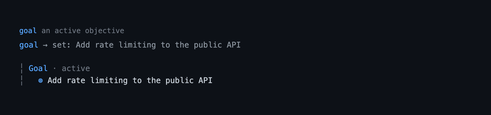

# goal — a persistent session objective for Pi

A single high-level objective for the session, kept visible and restated before
every turn. The goal is the *what*; the [`todo`](./todo.md) list is the *how*.

## Capabilities

Status records what a reader can rely on: **Shipped** is in a tagged release, **Unreleased** is complete in the current tree but not yet tagged, and **Partial** has one released part and one unreleased part. Rows are ordered by user value, highest first.

| Capability | How | What you get | Status |
|---|---|---|---|
| Goal recording | `goal`, `/goal set`, `/goal raw`, `/goal clear` | The objective is replaced whole, cleared by an empty value, and recorded verbatim when you ask for it. | Shipped |
| Phase tracking | `goal`, `/goal done` | The goal is `planning`, `active`, or `achieved`, and only the workflow can open a draft. | Shipped |
| Plan-first question | `goal`, `/goal <prompt>`, `/goal raw` | One dialog decides whether a new goal enters plan mode before it is pursued. | Shipped |
| Plan-mode allowlist | `goal` in plan mode | The model can record or update the objective while plan mode keeps the rest of the session read-only. | Shipped |
| Plan-phase settlement | `planning` goal, `exit_plan_mode` | Leaving plan mode without approval makes the draft `active`; approving the plan writes its `## Goal` into it. | Shipped |
| Understanding loop | `/goal <prompt>`, `/goal set`, `/goal edit` | A typed goal is restated, questioned when it is unclear, and confirmed in the editor before it is recorded. | Shipped |
| Goal rail | the `Goal · active · …` widget, the `achieved` key | The objective stays one line above the editor while it is pursued. | Shipped |
| Per-turn restatement | the `[SESSION GOAL]` reminder | The model reads the pursued objective before each turn, without it entering the transcript. | Shipped |
| Open-list check | `goal`, `/goal done` | Completing the goal names the todo items the list still has open. | Shipped |
| Branch-following state | tool-result `details`, the `goal` session entry | The goal survives `/resume` and `/tree`, and abandoned branches never leak in. | Shipped |
| Command help | `/goal help`, `/goal -h`, `/goal --help` | The verb list and the usage of each form, without changing the goal. | Shipped |

## Quickstart

```bash
pi --extension ./extensions/goal    # load just this extension
pi -e .                             # load the whole @gavin-hu/my-pi-agent package
pi install ./                       # install the package
```

```text
/goal                               # show the goal, or the usage when none is set
/goal Refactor the parser to support streaming input
```

The model records the same objective with `goal`; the model-facing tool never
runs the understanding loop.

## Tool



`goal` — `exposure: "direct"` (the default), `executionMode: "sequential"`,
read-write, closed-world, idempotent. It is a whole-goal replacement: the model
sends the complete objective and the previous goal is discarded.

| Parameter | Type | Meaning |
|---|---|---|
| `objective` | string, required | The complete objective, one line. Pass `""` to clear. |
| `status` | `active` \| `achieved` | `achieved` completes the goal; `active` records a final objective; omit it to let the workflow ask whether to plan first. `planning` is the workflow's to set; a call cannot. |

Result (`details` / `structuredContent`): `{ goal, action, error? }`, with
`goal: null` after a clear.

Validation (a violation returns an error result and leaves the goal unchanged):
a known `status`, an objective of at most 2000 characters, and a non-blank
objective when `status` is `achieved`. A blank objective clears only an
active/default goal; completing a goal requires resending its objective, so
"mark done" can never be mistaken for "forget".

Before those checks, the objective is normalized to a single terminal-safe
line: control characters (including `ESC`) become spaces and any whitespace run
(newlines, tabs, repeated spaces) collapses to one space. This keeps the widget
to one logical line and stops model text from injecting terminal sequences.

A successful `status: "achieved"` call also appends one line to the model-facing
text when the branch's todo list still has open items — `3 todo items are still
open; close or clear the list if that work is done.` `/goal done` shows the same
text in its notice. The list is replayed from the branch, so the note appears
whether the todos were written by the model, by `/todos`, or by an approved
plan. It is text only: `details`, `structuredContent`, and the transcript header
are unaffected.

The transcript result is the status header alone, directly under the call line
that names the objective:

```
goal → set: Refactor the parser to support streaming input
  Goal · active
```

The renderer reuses the slot's component (`context.lastComponent`) rather than
rebuilding it each render.

## Commands

The command has no tool result, so it persists each change as a `goal` custom
entry; `reconstructGoal` replays both entry kinds in branch order through
`lib/goal-state.ts`, so its readers agree. `/goal` completes each verb.

| Command | What it does |
|---|---|
| `/goal` | Show the current goal, or the command usage when none is set. A draft also names its exits: approve the plan to set the final goal, or leave plan mode to keep its wording. |
| `/goal <prompt>` | Run the understanding loop — restate, ask any questions the model needs, then confirm/edit in the editor, whose answer notes are dropped on save — ask once whether to plan first, then start the run. Replacing a live goal is confirmed first. |
| `/goal raw <prompt>` | Skip the loop: record the typed words verbatim, ask whether to plan first, and start the run. |
| `/goal set <prompt>` (or `/goal edit <prompt>`) | The same loop, but record the goal without starting a run, so the plan question is not asked. An explicit `set`/`edit <text>` replaces a pursued goal without asking, since the command already says so. |
| `/goal set` (or `/goal edit`) | Open the editor prefilled with the current goal and save it as the active goal, without starting a run. |
| `/goal done` (or `/goal achieved`) | Mark the current goal achieved (idempotent), naming the todo items the list still has open. |
| `/goal clear` | Clear the goal. |
| `/goal help` (or `-h` / `--help`) | Show the command usage. |

The questions and the confirm step are host dialogs, forwarded by RPC, so the
loop needs one; in print and JSON mode the typed text is set and run unchanged.
A dismissed question or editor cancels the command, changing nothing. The
[`plan`](./plan.md) extension owns plan mode, so the plan question is skipped
when it is not loaded, and a bare `/goal set` shows the usage instead of an
editor when there is no dialog UI.

## Behaviour by mode

The tool works in every mode. The persistent widget requires interactive
(`tui`) mode; the reminder and the `/goal` command work everywhere. The
`/goal <prompt>` comprehension call uses a cancellable `tui` spinner in
interactive mode and runs directly in RPC. When a goal exists, the widget is
always a single line above the editor; while a dock screen is open (`/todos`,
`/jobs`, `/rewind`, or the `question` questionnaire), the rail is hidden and
returns on close.

## Configuration

The widget presentation is configurable from the `goal` section of the shared
`bytefly.json`; resolution rules are in
[`../configuration.md`](../configuration.md#goal--the-goal-widget).

| Key | Default | Meaning |
|---|---|---|
| `achieved` | `"hide"` | How an achieved goal renders in the one-line widget: `show` draws the dim line, `hide` removes it. |

Malformed documents and invalid values are ignored, and goal behavior never
depends on config.

## Plan entry

A new goal's phase is decided once, with one dialog. Accepting enters plan mode
and stores the objective as `planning`, so a plan can be designed against it;
declining stores it `active`, the final objective. The question is skipped for
an update to a goal that is already pursued, without a dialog UI, and when
`plan` is not loaded. The question and its consent sentence come from
`lib/plan-entry.ts`, the same ones `enter_plan_mode` shows, so the user answers
once.

A draft whose plan never arrived is settled rather than stranded. If plan mode is
left without an approved plan — the toggle, the shortcut, a resumed branch — the
`planning` goal becomes `active` with its own wording on the next observation, so
the phase can never get stuck. Approval is different: `plan` sets the goal from
the plan's own `## Goal` section (see the [`plan`](./plan.md) docs), and only a
`planning` goal is eligible, so a final objective is the user's.

`goal` is allowlisted in `plan-mode` (alongside `todo`), so the model can record
or update the objective during read-only exploration without leaving plan mode.
Plan mode also reads the goal: it restates a pursued one in its injected context,
it promotes a `planning` goal when a plan is approved, and it offers to record the
plan's `## Goal` when the session has none (`lib/goal-state.ts` is the reader). An
`active` or `achieved` goal — a final objective — is never rewritten by an
approval.

## The understanding loop

`/goal <prompt>` asks the session model to restate the goal as it understands it
and, when it cannot yet, to ask up to three questions, which the command asks
directly through host dialogs (`select` / `input`). The answers are carried into
the editor under the restatement, below a `--- notes (not saved) ---` line, so
accepting the restatement as-is records the goal alone; folding an answer into
the sentence above the line keeps it. `/goal set <prompt>` reuses the loop but
records without starting a turn, and `/goal raw <prompt>` records the typed words
verbatim.

The loop is best-effort and needs a dialog UI plus a model. A plain-text clarifier
reply is treated as a restatement, so a model that ignores the JSON instruction
still works; a failed, timed-out, or unusable comprehension notices the user and
keeps the typed text. The questions are asked one at a time with `ctx.ui.select`
(for a question with options) and `ctx.ui.input` (for a free-form one); the
command never calls `ask_user_question`. `/goal raw` never needs a dialog for the
words, but the plan question does: both run variants ask it only where a dialog
UI exists, and record `active` otherwise. The record-only paths never ask, and a
goal recorded while plan mode is already on is still a draft (`planning`), because
that is what it is. The `goal` tool stays the silent setter.

## Non-goals

- No multiple or nested goals — one objective per session.
- No due dates, priorities, or success criteria — that is the todo list's job.
- No cross-session persistence beyond the session branch.
- No per-field edit tool; the model resends the whole goal.
- No automatic completion detection; the model (or `/goal done`) decides.
- No interception of ordinary user prompts — only the text passed to
  `/goal <prompt>` is understood.

## Pi integration

| Aspect | Detail |
|---|---|
| Tool | `goal` (direct, active by default) |
| Command | `/goal` — show, understand+set+run, record (`set`/`edit`), verbatim (`raw`), done/achieved, or clear |
| Execution mode | `sequential` — calls share the in-memory goal |
| Annotations | `readOnlyHint: false`, `destructiveHint: false`, `idempotentHint: true`, `openWorldHint: false` |
| Output schema | `GoalResult` — `{ goal, action, error? }`, returned as `details` and `structuredContent` |
| State storage | tool-result `details` plus a `pi.appendEntry("goal", { goal })` custom entry for command-set goals and for a phase settled after plan mode ends |
| Lifecycle hooks | `session_start` (load config, reconstruct, settle a draft), `session_tree` (reconstruct, settle), `session_shutdown` (clear widget); `before_agent_start` (settle, then inject `goal-context`), `context` (filter stale/duplicate reminders) |
| UI | `ctx.ui.setWidget` one-line rail in `tui` mode; coordinated through `pi.events` so it stays the top rail; one `ctx.ui.confirm` decides the phase |
| Plan entry | `lib/plan-entry.ts`'s `requestPlanMode` sends a `pi.events` request; `plan` enables the mode with the caller's context, so goal's question is the only dialog |
| Model calls | One `ctx.modelRegistry.complete` call on the session model with a 30 s timeout and `cacheRetention: "none"`; skipped without a dialog UI or a model; its usage is not counted in session totals |
| Questions | When the goal is not yet understood, the command asks the model's questions through `ctx.ui.select` / `ctx.ui.input` and carries the answers into the editor prefill. No cross-extension tool is used. |

## Design notes

- **A goal has a phase, and the phase is decided in one place.** `planning` is a
  draft being designed, `active` is the final objective, `achieved` is done.
  `plan-route.ts` is the only decision: a pursued goal keeps its phase, plan mode
  already on means a draft, and otherwise one confirm decides it. Both entry
  points call it, so the tool, the command, and plan's promotion cannot disagree
  about what phase a goal is in.
- **One dialog per decision.** Entering planning needs the user's consent, and
  the extension that asks also has to act on the answer — which a command context
  cannot do, since `ExtensionCommandContext` has no `executeTool`. So the consent
  sentence and the request channel live in `lib/plan-entry.ts`: `goal` asks, and
  `plan` enables silently over `pi.events`. `enter_plan_mode` keeps its own
  confirm for the model-initiated path, using the same sentence, so the user is
  never asked twice and the two texts cannot drift.
- **The draft is settled, not stranded.** A `planning` goal is normalised by the
  next observation when plan mode is off: `settledGoal` (pure, in `state.ts`)
  turns it `active` with its own wording, because leaving plan mode is a decision
  to act. Approval never goes through that path — `plan` writes the plan's own
  goal, and only a `planning` goal is eligible, so a final objective is the
  user's.
- **The model cannot claim a phase.** `status` accepts only `active` and
  `achieved` from a call; `planning` is written by the workflow, so a single call
  can never assert a plan that was never designed. `GOAL_STATUSES` (every phase,
  used by the output schema) and `GOAL_MODEL_STATUSES` (the parameter) are
  separate lists for that reason.
- **One goal, whole-value replacement.** `todo` replaces its list each call; the
  goal does the same with one value. There is no id or append. An empty
  objective on an active/default goal clears; a blank objective with
  `status: "achieved"` is rejected, so "mark done" can never be mistaken for
  "forget" and a rejected call cannot half-apply. Marking achieved keeps the
  record and stops the reminder, which a single empty-clear cannot express.
- **The command runs the understanding loop.** `/goal <prompt>` is the
  user-driven path: one comprehension call (`clarify-prompt.ts` + `clarify.ts`)
  returns `{ understood, goal, questions }`. No second model call rewrites the
  goal, so the user is the one who folds an answer into the sentence, above the
  sentinel line, when they want it kept; and no conversation history is sent, so
  the model cannot invent scope the user did not state. The loop is best-effort
  and a dismissed dialog cancels the command, so nothing is half-applied. The
  `goal` tool remains the model's setter, with no comprehension loop.
- **State in `details` and a custom entry.** A `goal` tool call stores the goal
  in its result's `details`; the `/goal` command appends a `goal` custom entry
  (`pi.appendEntry`). `reconstructGoal` reads the branch through
  `lib/goal-state.ts`'s `lastGoal`, which replays both in branch order, last
  writer wins, so `/resume` and `/tree` reproduce the goal that was correct at
  that point and stale branches never leak. An appendEntry-only design was
  rejected because a durable side-channel would not branch with the
  conversation.
- **The reminder is an injected, filtered message.** While the goal is pursued,
  `before_agent_start` returns a `goal-context` message (`[SESSION GOAL]`,
  `display: false`). The `context` hook keeps only the newest injection while
  the goal is pursued and removes all of them once it is cleared or achieved, so
  repeated instructions never accumulate and stale ones never survive a
  `/resume`.
- **Visibility is derived; the goal is the top rail.** `runtime.setGoal` mirrors
  the goal into `ctx.ui.setWidget()`; the tool works in every mode while the
  widget exists only in `tui`. Because Pi re-inserts a widget on every set and
  re-insertion appends, `lib/rails.ts` coordinates on `pi.events`: the goal
  announces, `todo` re-asserts, and the stack stays `Goal / Todos`. Dock screens
  hide all rails and restore them on close.
- **One-line widget, achieved hidden by default.** The rail follows the
  `todo` grammar (`Goal · active · <objective>`): accent label leads, status
  follows, no prefixed glyph, clipped to the terminal. The transcript result is
  the status header alone (`Goal · active`), because the call line above it
  already carries the objective; it does not restate it. `achieved: "show"`
  restores the dimmed widget line; config only affects presentation.
- **Completing the *what* checks the *how*.** Marking a goal achieved while the
  todo list still holds open items appends one line to the model-facing result
  naming the count, and `/goal done` puts the same sentence in its notice, so
  neither path can close the *what* silently over an unfinished list. The list is
  replayed from the branch by `lib/todo-state.ts` (shared with plan's
  approval-time merge, which reads the same channel), never by importing the
  `todo` extension. The same reasoning
  applies to the goal itself: `lib/goal-state.ts` owns the entry type and the
  objective limit, and plan reads the published goal through it. Only the text is
  affected: `details` and `structuredContent` stay the goal alone, and the
  transcript result is still the status header.
- **One verb table.** `GOAL_VERBS` is the only list of reserved words: the
  parser looks a first word up in it, the completions are generated from it, and
  a test asserts every word is offered as a completion and named in `GOAL_HELP`.
  Adding a verb without documenting or completing it fails that test instead of
  drifting silently.
- **Sanitize at the boundary.** `normalizeGoal` and `parseClarification` both route
  model text through `lib/format.ts`'s `sanitizeLine`, so an embedded newline
  cannot corrupt the widget and raw escapes cannot restyle the terminal.

## Files

| File | Responsibility |
|---|---|
| `index.ts` | Factory: wire the runtime, tool, command, reminder, and session events. |
| `types.ts` | `Goal`, `GoalStatus`, `GoalDetails`. |
| `schema.ts` | TypeBox parameters and pure validation/normalization. |
| `clarify-prompt.ts` | The comprehension prompt and its message builder (pure). |
| `clarify-parse.ts` | Parse the `{ understood, goal, questions }` reply (and the plain-text fallback), normalize questions, and expose the limits (pure). |
| `clarify.ts` | The model call, its cancellable loader, the in-command questionnaire, and the confirm/edit dialog (host). |
| `state.ts` | Branch-derived facts (pure): the published replay from `lib/goal-state.ts`, the open-todo count, and `settledGoal`. |
| `plan-route.ts` | The one phase decision (host): the plan question, its shared consent sentence, and the request that turns plan mode on. |
| `format.ts` | Model-facing and terminal text plus the header and rail vocabulary (pure). |
| `config.ts` | Widget config load/validation (the `goal` section of `bytefly.json`). |
| `tui.ts` | The persistent goal widget and the transcript status header. |
| `runtime.ts` | Session-scoped state and widget synchronization. |
| `tools.ts` | `goal` tool registration and rendering. |
| `commands.ts` | `/goal`: the `GOAL_VERBS` table, the argument parser, the completions, and the command handler. |

## Testing

Unit tests cover config, validation/normalization, branch reconstruction,
prompt comprehension (parse and flow), formatting, the TUI renderers, and the
tool/extension wiring:

```bash
bun test extensions/goal
```
