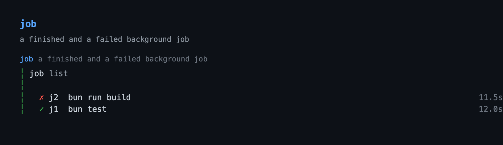

# job — background shell-command jobs for Pi

Run long-lived shell commands (builds, test suites, dev servers, watchers) in
the background and manage them without blocking the turn. A job starts
immediately and keeps running across tool calls; poll it, tail its output, wait
for it, or kill it.

## Capabilities

| Capability | How | What you get |
|---|---|---|
| Background execution | `job` (`start`) | A long build, test suite, server, or watcher keeps running while the turn moves on. |
| Job listing | `job` (`list`), `/jobs` | This session's jobs with status and elapsed time, and a live peer session's tagged `peer`. |
| Polling and waiting | `job` (`status`, `logs`, `wait`) | One call returns a job's status, a bounded output tail, or blocks until it finishes. |
| Stopping jobs | `job` (`kill` with `signal`) | A running job receives `SIGTERM`, `SIGKILL`, or `SIGINT`, and a finished one can be cleared. |
| Selective clear | `job` (`clear` with `id`, `all`) | Clear one finished record by id, or remove running jobs with `all` after a confirmation in the screen. |
| Start deadline | `timeoutMs` on `start` | A job is killed after the requested wall-clock limit instead of running until the session ends. |
| Kill escalation | `killGraceMs` | A kill sends `SIGTERM` first, then `SIGKILL` after the grace period, on a user kill and on shutdown. |
| Stdin driving | `job` (`send` with `input`, `newline`, `eof`) | A line or a bare keystroke reaches a running job started with `stdin: true`, and `eof` closes its input. |
| Rotating logs | `job` (`logs`), `job.maxLogBytes` | stdout and stderr stream to an append-only log that rotates at 8 MiB, so a chatty job cannot fill the disk. |
| Status chips | `job.showStatus` | `▸ N` running and `✗ N` unreported-failure counts in the footer. |
| Completion reporting | `job` (`wake`), `job.wakeOnFinish` | A finished job is reported at the next turn, or triggers one as soon as the agent is idle. |
| Job screen | `/jobs` | Select a job, open its log, kill it, or clear finished ones, with a confirmation on the destructive verbs. |
| Detached lifetime | `job` (`start`, `detached`) | A POSIX job outlives the session and is reattached next time; Windows refuses the detach instead of faking one. |
| Finished-job pruning | `maxJobs` | The registry drops the oldest finished records once the configured count is exceeded. |
| Structured result | tool-result `details` | Every call returns a `JobDetails` record of the job and the action's outcome. |

## Quickstart

```bash
pi --extension ./extensions/job   # load just this extension
pi -e .                           # load the whole @gavin-hu/my-pi-agent package
pi install ./                     # install the package
```

```text
/jobs                             # this session's jobs, and their logs
```

The model starts a job with `job start` and collects it with `job status`,
`job logs`, or `job wait`.

## Tool



`job` — `executionMode: "sequential"`, `readOnlyHint: false`,
`destructiveHint: true`, `idempotentHint: false`, `openWorldHint: true`. One
tool with eight actions: `start` returns immediately with an id, and the rest
act on it.

| Field | Value |
|---|---|
| `name` | `job` |
| `action` | `start` \| `list` \| `status` \| `logs` \| `send` \| `kill` \| `wait` \| `clear` |
| `command` | Shell command to run (`start`). |
| `cwd` | Working directory (`start`); defaults to the session cwd. |
| `label` | Short display label (`start`); defaults to the command. |
| `wake` | Wake the agent with one triggered turn when it finishes (`start`). |
| `detached` | Leave it running when the session ends (`start`); POSIX only, refused on Windows. |
| `stdin` | Give the job a stdin pipe so `send` can write to it (`start`); not with `detached`. |
| `id` | Job id such as `j1` (`status`/`logs`/`send`/`kill`/`wait`/`clear`). |
| `lines` | Log lines to return (`logs`, 1–2000). |
| `input` | Text to write to a running job's stdin (`send`; max 8192 characters). |
| `newline` | Append a newline to `input` (`send`; default `true`). |
| `eof` | End the job's stdin after writing, so it sees EOF (`send`). |
| `signal` | `SIGTERM` \| `SIGKILL` \| `SIGINT` (`kill`; default `SIGTERM`). |
| `timeoutMs` | `start`: kill the job after this many ms. `wait`: how long to block (default 30s). |
| `all` | With `clear`, also remove running jobs. |

Example: start a test suite, then poll it.

```
job start  { "command": "bun test", "label": "tests" }   → j1
job status { "id": "j1" }
job logs   { "id": "j1", "lines": 50 }
job wait   { "id": "j1", "timeoutMs": 120000 }
job kill   { "id": "j1" }
job clear
```

`wait` honours the tool's abort signal: pressing Escape cancels the wait but
leaves the job running. While it blocks, the transcript draws a railed
`Waiting on j1… 12s` line with a live elapsed count. Validation is pure and runs
before any side effect, so `codemode` callers that bypass the TypeBox schema
cannot start a process with missing arguments.

Example: drive an interactive program. Only a job started with `stdin: true`
accepts input, and `eof` closes it once you are done.

```
job start { "command": "python3 -q", "stdin": true, "label": "repl" }   → j2
job send  { "id": "j2", "input": "print(1 + 1)" }
job logs  { "id": "j2" }
job send  { "id": "j2", "eof": true }
```

`send` writes `input` plus a newline by default, so a line-oriented program
sees one line per call; pass `newline: false` to deliver a bare keystroke.
Writing to a finished job, a job without `stdin: true`, or a job this session
does not hold the pipe for is an error, and the call changes nothing.

Each result carries a `JobDetails` object in tool-result `details`:

```
JobDetails {
  action: JobAction
  job?: JobRecord           // start/status/logs/send/kill/wait
  jobs?: JobRecord[]        // list/clear
  logs?: string             // sanitized tail for `logs`
  truncated?: boolean
  cleared?: number
  signalled?: boolean       // kill sent a signal to a running job
  signal?: KillSignal       // signal sent by kill (SIGTERM/SIGKILL/SIGINT)
  sent?: number             // characters of `input` written by send
  stdinClosed?: boolean     // send ended the job's stdin (EOF)
  timedOut?: boolean        // wait hit its timeout
  cancelled?: boolean       // wait was aborted; job still running
  sessionId?: string        // list/status: who made the call, for tagging peers
  error?: string
}
```

### Transcript

The call line names the action and its target. The result is themed and reuses
the slot's component: `list` draws the same rows as `/jobs`, `logs` draws a
blank line and the sanitized tail, and a single-job action draws one outcome
line. A `kill` that sent a signal appends it (`· SIGTERM sent`) instead of
showing the job's pre-kill running state, a `start` badges `detached` and
`wake`, a `send` appends what it did (`· sent 5 · stdin closed`), and a `logs`
call on a job with no output yet renders `No output yet.`

```
job list
  ▸ j1  tests                            3.2s
  ✗ j2  build                            0.4s
```

```
job logs j1

… 412 earlier lines
compiled successfully
```

```
job status j1
✓ j1 tests · exit 0 · 12.0s
```

## Commands

`/jobs` opens an interactive list in the TUI, and prints a text summary
elsewhere.


| Command | What it does |
|---|---|
| `/jobs` | Show and manage background jobs: an interactive list in the TUI, a text summary elsewhere. |

The list shows the jobs this session started, a dead session's records adopted
into it, and a live peer session's jobs tagged `peer`. On the screen: `↑`/`↓` or
`j`/`k` select, `PgUp`/`PgDn` page, `Home`/`End` jump, `Enter`/`l` opens the log
pane, `d` (or `K`) kills the selected running job, `x` clears finished jobs,
`Esc`/`q` closes. `d` and `x` ask for a `y`/`N` confirmation before acting, so a
stray key cannot kill a build; when `x` would drop an unreported result, the
prompt says how many. A `d` on a finished job (or an `x` with nothing finished)
says so instead of doing nothing. Another session's row opens its log but is
otherwise left alone: `d` answers `j9 is another session's job; not killed.`,
and `x` counts and clears only this session's finished jobs. In the log pane,
`↑`/`↓`, `PgUp`/`PgDn`, `Home`/`End`, and `g`/`G` scroll; the view follows the
tail until you scroll up, and `Esc`/`Backspace`/`q` returns to the list. The
pane's subheader names the job's log file, notes when only a bounded tail is
loaded, and shows whether the view is `following` the tail or `paused`.

The screen shows a counts summary (`N jobs · R running · F failed · P peer`) over
the rows it shows, so it includes a peer's running job even though the footer
chips count only this session's. Running jobs come first, then recent finished
ones, and a focused detail pane follows (command, cwd, outcome, the owner when
it is another session, and the last output line). Selection is tracked by job
id, so the live re-sort cannot move the cursor or switch the open log out from
under the user. Any dock screen (`/todos`, `/jobs`, `/rewind`, or the
`question` questionnaire) hides the above-editor goal/todo rails for its
lifetime and restores them on close.

## Behaviour by mode

The tool and `/jobs` work in every mode. The status chip and the interactive
`/jobs` screen need a UI; RPC and non-interactive runs receive tool results and
notifications instead.

## Configuration

The keys live in the `job` section of the shared `bytefly.json`; resolution rules
are in
[`../configuration.md`](../configuration.md#job--background-jobs).

| Key | Default | Meaning |
|---|---|---|
| `enabled` | `true` | Track jobs at all. |
| `showStatus` | `true` | Show the `▸ N` / `✗ N` status chips. |
| `wakeOnFinish` | `false` | Wake the agent when any job finishes. |
| `detachedByDefault` | `false` | Leave jobs running when the session ends; inert on Windows. |
| `maxJobs` | `20` | Finished jobs kept before the oldest are pruned. |
| `maxLogLines` | `100` | Log lines returned by `logs`. |
| `maxLogBytes` | `8388608` | Bytes a log segment may reach before it rotates to `<id>.log.1`; `0` keeps logs unbounded. |
| `killGraceMs` | `5000` | Grace before SIGTERM escalates to SIGKILL. |
| `repaintMs` | `1000` | Status-chip refresh interval while jobs run. |
| `sessionTtlMs` | `60000` | How old a session heartbeat may be before its pid is re-checked for reuse. |
| `registryDir` | — | Override the registry/log directory. |

## Security

Job output is arbitrary program output and is sanitized at every boundary
before it reaches a terminal or the model: ANSI/OSC escapes and control
characters are stripped, and carriage-return progress rewrites collapse to
their final state. This runs before text reaches the `/jobs` pane, the
model-facing `logs` result, and completion notes. The raw log file is never
rewritten.

## Limitations

- **`unknown` still has no exit code on some paths.** A POSIX job is wrapped in
  an `EXIT` trap that writes `$?` to a per-job `.status` file, so a job
  reattached after its session died reports its real exit code. `exec cmd`
  replaces the shell and bypasses the trap, and a Windows job has no equivalent,
  so those settle as `unknown`.
- **Another session's jobs are shown, but not managed here.** Records are merged
  from every session file so ids stay unique and a peer's job is not reaped, and
  `list`/`/jobs` show them tagged `peer` (a dead session's records are adopted
  into this one and lose the tag). The screen opens a peer's log but refuses to
  kill or clear it, and the tool's `clear` refuses that record too; the tool can
  still take one over by explicit id (`status`/`logs`/`kill`, where `kill`
  adopts it). Chips, completion notices, and pruning stay this session's own, so
  a peer's finished job waits for that session to clear it — including when that
  session has been idle long enough for its heartbeat to age, because the
  heartbeat only ticks while a job is running.
- **A carriage return is not a line break.** Output is split on `\n` only; a
  progress rewrite (`10%\r50%\r100%`) is one line whose sanitized form keeps the
  text after the last `\r`. A program that only ever emits `\r` therefore
  surfaces nothing until it emits a newline or the line reaches the 1 MiB cap.
- **stdin is a pipe, not a TTY.** A job started with `stdin: true` can be fed
  with `send`, but the child sees a pipe: line-oriented programs (a REPL, a
  debugger prompt, `read`, `npm init`) work, while a full-screen program that
  requires a terminal does not. Only the session holding the child's pipe can
  write to it, so a reattached or peer job cannot be fed, and a `detached` job
  cannot take stdin at all.
- **A detached job's log is not rotated.** A POSIX `detached` job points its
  own stdout at the log file (`exec >> …`), so the file has a writer this
  process does not own and cannot safely rename or truncate: the child would
  keep appending to the moved inode, or lose everything. Its log therefore grows
  without the `maxLogBytes` cap; `logs` still reads a bounded tail, and the file
  can be emptied by hand.
- **Windows cannot detach a job.** There is no process group to leave and no
  shell `EXIT` trap, so `detached: true` is refused with the three alternatives
  (`detached: false`, WSL, a `subagent`) rather than starting a job that would
  die with the session while claiming to outlive it. `job.detachedByDefault` is
  inert there instead of failing every start with a config set on another
  machine, and `doctor` names both facts. Tree-kill is still `taskkill /T`, and a
  job reported only after its process is gone settles as `unknown`.

## Non-goals

- **No cron/scheduling.** Jobs run when started, not on a timer.
- **No durable task queue.** Persisted work items are `todo`'s domain; a job is
  an OS process, and mixing the two would blur both.
- **No subagent-job wrapping.** Subagents already have a purpose-built result
  pipeline; a job wrapper adds surface for little gain.

## Pi integration

| Integration point | Details |
|---|---|
| Tool | `pi.registerTool` name `job`; `exposure` defaults to `direct`. |
| Execution mode | `sequential` — actions share the in-memory job table. |
| Annotations | `readOnlyHint: false`, `destructiveHint: true`, `idempotentHint: false`, `openWorldHint: true` — plan mode blocks it. |
| `outputSchema` / `structuredContent` | None. Results return `JobDetails` in tool-result `details` only. |
| State storage | One durable registry file per session, `~/.pi/agent/jobs/<projectKey>/registry-<sessionHash>.json` (keyed by the session cwd, so entering a worktree does not move it), merged from every session file on load; a dead session's records are adopted and a legacy shared `registry.json` is migrated once. Ids are reserved with an atomic `O_EXCL` `<id>.lock` before `start`, and a POSIX job's exit code is written to a per-job `.status` file. Tool results carry `JobDetails`; unreported completions arrive as a shared transcript notice (`my-pi-agent/notice`) at `before_agent_start`. |
| Lifecycle | `session_start` loads and reconciles the registry and arms `onFinish` and `onComplete`; `session_shutdown` kills session-owned jobs and clears both status chips. `session_tree` repaints; `agent_start`/`agent_settled` track busy; `context` prunes stale notices of its own source. |
| Event bus | Each job that reaches a terminal state is published on `my-pi-agent/job-finished` (`lib/events.ts`) with its id, label, status, exit code, and signal, from the one path every transition goes through — a close event, a pid observed gone on the clock, a gone peer's leftover reaped, and an orphan killed while the registry loads — which announces the completion and fires the one wake turn together. A peer's record settled here is adopted, so its completion is this session's to report. bytefly's notify capability subscribes there instead of importing this extension. |

## Design notes

- **Visibility is not ownership.** `list` shows every record in the merged
  table, but each mutation keeps its own rule: the screen refuses a `peer` row,
  `clear` refuses another session's record, `kill` adopts it deliberately, and
  `send` has no pipe to reach it. The chips, completion notices, and pruning
  stay own-only, so showing a peer never makes this session responsible for it.
- **Shell commands only, one action-based tool.** A single `job` tool with
  eight actions mirrors `rewind` and keeps the model surface small. Validation
  is pure and runs before any side effect.
- **The log rotates under the stream, not behind its back.** A parent-owned log
  is a `WriteStream`; when the live segment reaches `maxLogBytes` the stream is
  ended, the file renamed to `<id>.log.1`, and a fresh stream opened, with
  chunks that arrive during the swap queued (and bounded) rather than written
  into the renamed inode. `logs` fills a request from the previous segment when
  the live one is shorter, so the rotation is invisible to the model and to the
  `/jobs` pane. A detached job writes its own log and is exempt.
- **Stdin is an opt-in pipe.** `start` keeps the child's stdin closed by
  default, so it gets EOF immediately and a `read` exits instead of blocking;
  `stdin: true` swaps in a pipe that `send` writes to and `eof` closes. The pipe
  belongs to this process, so it never outlives the handle that owns it, and a
  `detached` job is refused rather than handed EOF when the session ends.
- **`child_process.spawn`, not `pi.exec`.** `pi.exec` resolves on exit, the
  opposite of a background job. Jobs are spawned with a shell in their own
  process group, and signals go to the whole group so a shell and its
  descendants die together; Windows uses `taskkill /pid <pid> /T`.
- **One registry file per session, merged on load.** A job outlives a tool
  call and, when detached, a session, so each session writes only its own
  `registry-<sessionHash>.json` (atomic tmp + rename, best-effort) and every
  file is merged on load. A dead session's records are adopted and rewritten
  into this session's file before its file is deleted, while a live peer's are
  kept for id reservation and reaping without being shown; a legacy shared
  `registry.json` is migrated once.
- **Session-scoped surface, project-wide storage.** The registry merges every
  session file for id reservation and adoption, but `list`, the chips, and the
  `/jobs` screen show only this session's jobs. A job the session cannot clear
  or report is never presented as its own.
- **Ids are reserved atomically.** Because ids are project-global but files are
  per session, `start` claims the next `j<n>` with an `O_EXCL` `<id>.lock`
  before spawning, so two sessions cannot pick the same id from a stale read;
  the reservation is pruned once the id is committed to a registry file.
- **Sessions heartbeat; ownership is the process.** Each session writes a liveness
  marker (its pid, that process's start time, and its last beat), and the beat only
  ticks while a job runs — so a session that has finished its work goes quiet rather
  than dying. Only a session that is *gone* — its pid is dead, or a reused one —
  gives up its records: a quiet peer keeps its file, its marker, and its jobs, and a
  peer's live non-detached job is never reaped. `persist` merges onto a fresh read and
  drops ids this session deleted.
- **Exit codes survive a session boundary.** A POSIX job is spawned behind an
  `EXIT` trap that writes `$?` to a per-job `.status` file (path passed in the
  environment); a later session reads it when it finds a dead pid and reports
  `exited`/`failed` with the recovered code instead of `unknown`.
- **Reconcile on load; kill by default.** A dead pid becomes `unknown`, a live
  detached job is reattached, and a live non-detached job whose owning session
  is gone is killed. An abandoned build cannot keep running unnoticed, while a
  `detached` dev server survives.
- **Pid reuse is guarded by a start-time token.** Before signalling an unowned
  pid, its best-effort start token (`ps -o lstart=`) is re-checked; a mismatch
  is treated as gone instead of as a signal. The same token is written into a
  session's marker, so a pid that has been reused is a gone session rather than a
  quiet one. Where no token is available the check degrades to liveness.
- **Reattached jobs are polled.** A reattached detached job has no child
  handle, so its `close` event never fires; the repaint clock polls it and
  settles it (recovering an exit code from the status file, else `unknown`)
  when the pid disappears.
- **Shared seams, job policy.** The spawn/tree-kill/liveness seam
  (`lib/spawn.ts`), the command supervisor (`lib/child.ts`, which `watch` drives
  too: one SIGTERM → SIGKILL body, each extension's own grace), the byte-safe
  line splitter (`lib/lines.ts`), the
  untrusted-line boundary (`lib/format.ts`), the pending-report coordinator
  (`lib/report.ts`), the status chips (`lib/tui/status-controller.ts`), and the
  `/jobs` screen frame (`lib/tui/dock-screen.ts`) are shared with `watch`; this
  extension keeps only what is job-shaped — the durable registry, rotation,
  stdin, and the job vocabulary. The report coordinator is also why a wake can
  never stack two turns: it owns the guard for the window between the triggered
  send and `agent_start`, and it retries a wake the running turn suppressed.
- **Notify by default, wake opt-in.** A failed job raises one `ctx.ui.notify`
  (a clean exit is left to the list and chips). Finished jobs are also posted
  as a shared transcript notice — model-facing text plus the notice block — at the
  next `before_agent_start`, or in the wake turn it raises. A `wake: true` job (or
  `wakeOnFinish`) additionally triggers one turn as soon as the agent is idle,
  including right after a running turn settles; auto-wake is not the default
  because it easily loops and burns tokens.
- **Width-1 glyphs and cached latest line.** The running chip is `▸ N` and the
  failure chip `✗ N`, each a two-token badge under its own status key, so the
  status bar compacts each independently (`▸N` / `✗N`) and an unreported
  failure is never hidden behind the running count. The latest output line is
  cached from the stdout stream for `status`/`wait`/completion notes; only the
  `/jobs` log pane reads the file.
- **Pure logic split from IO.** `format.ts` and the reconciliation in
  `registry.ts` are pure; the runtime takes injectable
  spawn/liveness/kill/clock functions, so the whole suite runs without
  launching a process.
- **The transcript reuses the `/jobs` grammar.** `job list` renders the same
  `jobRow` rows as the screen (running first, capped, `… N more`), minus the
  selection-marker column (`listRow`'s `marker: false`), which only the
  interactive screen needs; `job logs` draws a themed tail with a `… N earlier
  lines` note, and single-job actions
  draw one `formatJobOutcomeLine` (plus a signal note on `kill` and
  `detached`/`wake` badges on `start`). A capped collapsed result ends with the
  `app.tools.expand` hint, and an expanded list shows every job. The renderers
  reuse `context.lastComponent`, and a `wait` in progress (`options.isPartial`)
  renders as a `Waiting …`
  warning.

## Files

| File | Responsibility |
|---|---|
| `index.ts` | Factory: registers the tool/command and wires events, including the shared `lib/report.ts` completion reporter. |
| `schema.ts` | Parameter schema and pure validation (a `JobCall` union). |
| `config.ts` | The `job` section of `bytefly.json`: loading and clamping. |
| `format.ts` | Pure formatting, duration, and transcript outcome-line helpers, plus the job row both surfaces draw; sanitization is `lib/format.ts`'s `sanitizeUntrustedLine`. |
| `paths.ts` | Session/marker/registry/status file-name helpers. |
| `registry.ts` | Per-session registry load/merge under `<agent-dir>/jobs/<project>/`, legacy migration, and the pure reconciliation a load runs — `loadRecords` merges every file, recovers dead pids, and classifies the survivors and orphans. |
| `reservations.ts` | Atomic `O_EXCL` job-id reservation and release. |
| `status.ts` | `EXIT`-trap exit-status file (write path via env, read on reattach). |
| `session.ts` | Per-session heartbeat markers and the ownership rule: `live`, `quiet`, or `gone`. |
| `store.ts` | Durable store: the registry directory (`<agent-dir>/jobs/<project>/`), this session's atomic merge-write, deletions. |
| `logs.ts` | Bounded, sanitized log-tail reading. |
| `ui.ts` | Footer status chips and the failure alert, over the shared `lib/tui/status-controller.ts` (chips, attached context, `notify`). |
| `waiters.ts` | `wait` resolver bookkeeping. |
| `log-writer.ts` | Per-job log sink: write stream, line split, rotation queue, and the output-driven repaint window. |
| `runtime.ts` | The job table and the durable record: load and reconcile, the one settle path that announces a completion and its wake turn (holding either until the session arms its listener), waiters, clear, shutdown. |
| `child.ts` | A job's process and its output: the spawn policy, the handle, the log stream and stdin, close/error settle, the signal and its SIGKILL grace, and the files a job leaves, over the shared `lib/child.ts` supervisor. |
| `clock.ts` | The periodic work: the repaint clock that re-asserts the chip, and the sweep that polls the jobs this session reattached. |
| `render.ts` | The `JobResult` transcript block over the shared `TailResult`. |
| `view/jobs-screen.ts` | The `/jobs` screen (a `DockListScreen` subclass: job rows, focus block, counts, verbs), loaded on first use. |
| `tools.ts` | The `job` tool and its transcript rendering. |
| `commands.ts` | The `/jobs` command. |
| `types.ts` | Shared types. |

## Testing

`extensions/job/` covers schema validation (`schema`), pure formatting and
sanitization (`format`), the durable store (`store`), per-session reconciliation
(`registry`), id reservation (`reservations`), exit-status recovery (`status`),
session markers and the ownership rule (`session`), bounded log reads and tail
flags (`logs`), log rotation and its two segments (`log-writer`), wait
bookkeeping and the wait promise (`waiters`), the `job` tool (`tools`), the
`/jobs` screen (`view/jobs-screen`), the table's session-scoped list,
reattachment, clear and failure notification (`runtime`), a job's spawn, finish,
kill, Windows policy, detached output, bounded tail and pid questions (`child`),
`send` to a job's stdin and the pipe's lifecycle (`stdin`), the repaint clock and
the external sweep (`clock`), and the install/resume/shutdown lifecycle
(`extension`). Tests drive a scripted `FakeChild` and a temp registry, so the
suite runs without launching a process.
