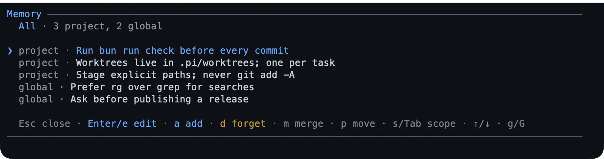

# memory — facts worth remembering between sessions

`memory` keeps short notes the model recalls automatically: a preference, a
convention, an environment quirk, a decision. They live in plain markdown you can
read and edit, and they survive `/new`, `/resume`, and `/tree`.



- **Two scopes**: global, or this project. One file each.
- **Recall is automatic** — stored notes arrive before each run, without you
  asking.
- **It is not a second `AGENTS.md`**: one-liners, not long-form guidance.

## What you can do

| What you want | What to do |
|---|---|
| Make it remember something | say "remember that …" |
| See what it remembers | `/memory` — the picker, filterable by scope |
| Edit a note | the picker's edit, or `/memory edit` for the whole file |
| Forget one note | the picker's delete; the model can also `forget` it |
| Fold two notes into one | `m` in the picker, or the tool's `merge` with `first`, `second`, `merged` |
| Clear a whole scope | `/memory clear` (behind a confirmation) |
| Find where the files are | `/memory path` |
| Check the store | `/memory doctor` — the file each store resolved to, counts, bytes, notes over the 500-character cap, the injection budget, near-duplicates |
| Pick up a hand edit | `/memory reload` |

## Try it

```text
Remember that I run tests with bun.
Remember that releases are tagged from main.
```

Then start a new session: those notes are in context again, and a near-duplicate
you ask for later is a no-op that names the note that already says it.

## Reference

**The tool.** `memory` adds, updates, forgets, merges and lists notes, and `list` returns
all of them. Restating a stored fact in new words is refused as a duplicate, naming
the existing note, so the file does not fill with paraphrases. An `update` writes the
corrected note at the end of the store, because position is age: a correction is the
newest thing known, not the oldest. `update`, `forget` and `merge` name a note by its exact
stored text, and a name is not length-capped: it is collapsed to one line like a note, so a
copied file line still matches, but the cap belongs to the note being written — a note
longer than it, hand-written into the file, still reads, updates and forgets, and is
reported rather than refused, with its line and length, by the load warning and `/memory doctor`.

**The stores.** The global file is `~/.pi/agent/memory.md`. The project store is
`~/.pi/agent/repos/<repo-id>/memory.md` — with the rest of the repository's state, under
the identity both machines compute — so a subdirectory, every worktree and a second
machine read the same file; it is read and written only while the project is trusted.
Either store is written owner-only (`0600`), because a note is instruction the next
session trusts.

**Who wrote it.** A note written from a session carries its label and the moment after
the text, as `<!-- by: jack @ 2026-11-18T05:12:00.000Z -->`; the text before it is the
note, so `forget` and `update` match what you read. A note with no trailer — hand-written,
or from before this existed — reads as unattributed, which is not a defect: the tool mints
none when no session label resolves, and `/memory doctor` counts them. An older build does not mistake the
file, but it does not understand this note either: the trailer shows as part of the text,
and its `forget` and `update` are given the whole line, so a note written here has to be
maintained here. An `update` or a `merge` refreshes it: whoever last wrote the note is the
one asserting it now, so a merged pair carries the name of the session that combined it
rather than of either original.

**Recall.** Notes are injected as a `[MEMORY]` context block before each run,
newest first, bounded by a byte cap. Past the cap the **oldest** notes are the ones
left out, and the block's last line counts them: `/memory doctor` reports the budget, which
store overflowed, and any note past the 500-character per-note cap — characters, not bytes.

**The picker.** `/memory` lists notes with their scope; add, edit, forget, merge
and move are in place, `s`/Tab filters by scope, `r` reloads.

## Limits

- Short facts only: long-form knowledge belongs in `AGENTS.md`, and a dump of
  prose into memory crowds out the context it is meant to save.
- The injected body is capped, so a store grown too large starts losing notes from
  the context rather than from the file — the oldest first, and the founding rules
  (branch flow, the landing gate) are the oldest notes a project has. That trade is
  recency over founding, and it is only safe because the cap's tail names the store's
  size on every run: prune it when it says so.
- A project's notes are trusted only while that project is; a global note is
  always read.
- A store stops taking new notes at 256 KB. Growth past that is refused, and a write that
  shrinks it always lands — so `forget`, `/memory clear` and a shorter `/memory edit` are the
  way back — while a store that reached the ceiling is still listed, read and injected.
  `/memory doctor` names it with the byte count; Pi never writes one that large.
- A note's own ceiling is 500 characters, enforced only on what the tool writes: a longer
  one put straight into the file still reads and still forgets, and both reports name it.
- A checkout written by an older build may hold a `.pi/memory.md`; it is taken across to the
  repository's directory once, on the first read that misses the new one, and that older file
  is not read again. A worktree's own copy is debris from before this rule: it is not read.
- Two sessions adding a note at the same instant both land: an `add` appends one line
  rather than rewriting the store. An `update`, `forget`, `merge` or `clear` racing an add can
  still lose the other's line — those rewrite — and closing that window would take a lock the
  store does not have. An append also leaves a store's trailing blank lines alone; the next
  rewrite tidies them.
- A label is a hint, not a signature: any session can claim any name, and the file is
  yours to edit by hand. It makes a peer's assertion visible; it does not prove it.
- Notes are markdown on disk, so an edit outside Pi lands on the next read.

## Settings

| Key | Default | What it does |
|---|---|---|
| `inject` | `true` | Recall stored notes before each run; off keeps the notes and stops injecting them. |
| `maxInjectBytes` | `8192` | Largest injected body, in UTF-8 bytes (512–32768). |

They live in the `memory` section of `bytefly.json`
([configuration](../configuration-reference.md#memory--durable-notes)). To switch the
extension off, toggle `memory` in `/bytefly`; the files stay on disk.

## Learn more

- [Install](../install.md) — where the agent directory lives.
- [`plan`](../extensions/plan.md) — a plan whose steps become your task list.
