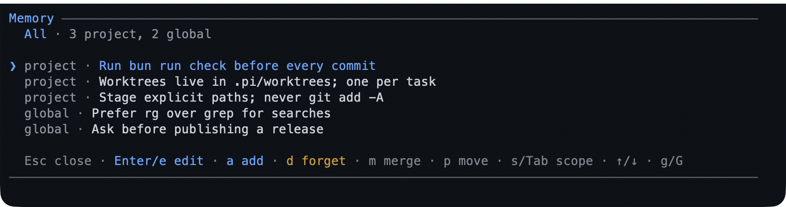

# memory — facts worth remembering between sessions

`memory` keeps short notes the model recalls automatically: a preference, a
convention, an environment quirk, a decision. They live in plain markdown you can
read and edit, and they survive `/new`, `/resume`, and `/tree`.



- **Two scopes**: global, or this project. One file each.
- **Recall is automatic** — stored notes arrive before each run, without you
  asking.
- **It is not a second `AGENTS.md`**: one-liners, not long-form guidance.

## What you can do

| What you want | What to do |
|---|---|
| Make it remember something | say "remember that …" |
| See what it remembers | `/memory` — the picker, filterable by scope |
| Edit a note | the picker's edit, or `/memory edit` for the whole file |
| Forget one note | the picker's delete; the model can also `forget` it |
| Clear a whole scope | `/memory clear` (behind a confirmation) |
| Find where the files are | `/memory path` |
| Check the store | `/memory doctor` — counts, bytes, the injection budget, near-duplicates |
| Pick up a hand edit | `/memory reload` |

## Try it

```text
Remember that I run tests with bun.
Remember that releases are tagged from main.
```

Then start a new session: those notes are in context again, and a near-duplicate
you ask for later is a no-op that names the note that already says it.

## Reference

**The tool.** `memory` adds, updates, forgets, and lists notes. Restating a stored
fact in new words is refused as a duplicate, naming the existing note, so the file
does not fill with paraphrases.

**The stores.** The global file is `~/.pi/agent/memory.md`. The project store is
anchored at the repository root, so a subdirectory and every worktree read the
same file; it is read and written only while the project is trusted. Either store
is written owner-only (`0600`), because a note is instruction the next session
trusts.

**Recall.** Notes are injected as a `[MEMORY]` context block before each run,
bounded by a byte cap; `/memory doctor` reports the budget and anything the cap
left out.

**The picker.** `/memory` lists notes with their scope; add, edit, forget, merge
and move are in place, `/` filters, `r` reloads.

## Limits

- Short facts only: long-form knowledge belongs in `AGENTS.md`, and a dump of
  prose into memory crowds out the context it is meant to save.
- The injected body is capped, so a store grown too large starts losing notes from
  the context rather than from the file.
- A project's notes are trusted only while that project is; a global note is
  always read.
- Notes are markdown on disk, so an edit outside Pi lands on the next read.

## Settings

| Key | Default | What it does |
|---|---|---|
| `inject` | `true` | Recall stored notes before each run; off keeps the notes and stops injecting them. |
| `maxInjectBytes` | `8192` | Largest injected body, in UTF-8 bytes (512–32768). |

They live in the `memory` section of `bytefly.json`
([configuration](../configuration-reference.md#memory--durable-notes)). To switch the
extension off, toggle `memory` in `/bytefly`; the files stay on disk.

## Learn more

- [Install](../install.md) — where the agent directory lives.
- [`plan`](../extensions/plan.md) — a plan whose steps become your task list.
