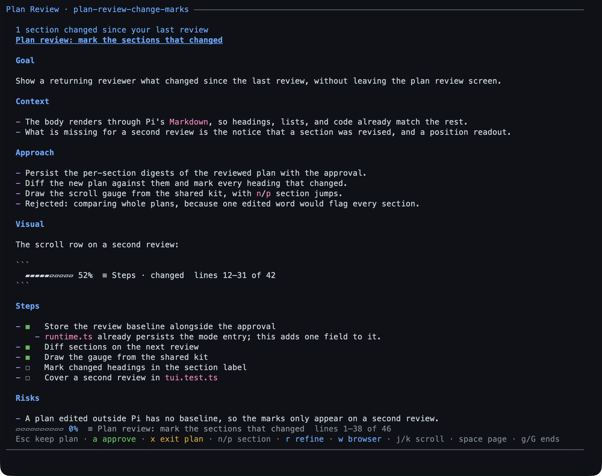

# plan — decide before the model writes

Plan mode keeps the session read-only, then hands you a plan to approve.



On that screen `◼` is a done step and `◻` a pending one, and after a
refinement a midline dot in the margin marks each section that changed.

- **Use it for** any change you would want to read before it lands.
- **`/plan <task>`** starts one; `Shift+Tab` toggles plan mode too.
- **Nothing in your tree is written** until you approve — no file, no command, no
  commit, the plan file aside. A card still in `plan` refuses a write anyway until
  `board move <id> execute`, so the approval and the move are two steps.

## What you can do

| What you want | What to do |
|---|---|
| Start a task read-only | `/plan add rate limiting to the public API` |
| Switch plan mode on or off | `/plan`, or `Shift+Tab` with bytefly |
| Let the model start plan mode | it asks first; declining keeps write access |
| Read the plan | the review screen: `n`/`p` between sections, scroll keys for the body |
| Approve and start | `a`, then `y` — steps become your todo list |
| Ask for a change | `r` to refine, or comment in the browser |
| Review with a teammate | `w` for the browser page, then **Share** for a QR or link on this Wi-Fi |
| Leave without approving | `Esc` sends it back for another round; `x` leaves plan mode — the plan file stays either way |
| Read an older plan | `/plan list`, then `Enter` |
| Keep the store small | `/plan prune`, or `/plan prune --dry-run` for the counts first |

## Try it

```text
/plan add rate limiting to the public API
```

The model reads the code and the git history. When it is done it saves a plan under
`~/.pi/agent/repos/<repo-id>/plans/` and opens the review screen; `a` approves it, `r` sends it back.

```text
plan exit 2026-10-09-1809-add-rate-limiting
✓ Plan approved
```

Approving ends plan mode, hands write access back, and puts the plan's steps into
`/todos`, appended after any items already there, so the list is the one you watch
while the work runs. A full walkthrough — refining, commenting, sharing with a
teammate — is [Your first plan](../tutorials/first-plan.md).

## Reference

The `plan` tool has five actions; `/plan` is the command that drives it.

| Action | What it does |
|---|---|
| `enter` | take write access away, after asking you |
| `write` | save the plan file; pass the file it returned to refine it |
| `exit` | read the plan back and present it for approval |
| `steps` | tick a step in the file and in its todo item, in one call |
| `cancel` | leave plan mode, keeping any saved plan |

**The plan file.** `~/.pi/agent/repos/<repo-id>/plans/<YYYY-MM-DD-HHmm>-<slug>.md` — one store per
repository, shared by its worktrees, with each refinement's replaced text kept beside it as a hidden
file, five deep. The plan is what the model follows: approving it seeds its steps into your todo list
and finalizes a session goal that was only drafted, from the plan's own `Goal`. Approving a refinement
again replaces the items the earlier approval added that nobody has started, so the list matches the
plan you last read.

**Ticking a step.** `steps` matches each entry's `expected` with inline markdown,
case, and spacing ignored, so the plan's own line works as written; a refusal names
the plan file and the text it now reads.

**Review screen keys.** `a` approve (`y`/`Enter` confirms), `r` refine inline,
`Esc` keep planning, `x` exit without approving, `w` open the browser review,
`n`/`p` jump sections. `Ctrl+C` interrupts without approving or rejecting
anything: plan mode stays on.

**Browser review.** `w` opens the plan as a page: comment in the margin, send feedback, or share a
link. A reviewer reads and comments and draws no **Approve & run**; only the machine that opened
the review approves, cancels, saves, or shares. The tab is the step, so `serve.autoOpen` does not
gate it — but a launcher that cannot start is named with the URL to paste, since a review nobody
can see waits on nobody. The page announces its two moves: a section jump
puts the keyboard on the section it scrolled to, so a screen reader reads the heading that
arrived, and a view the page cannot offer says why in the note under the switch rather than in a
title a keyboard reader never reaches. The rail's mark reads the pane's own scroll position, so
End and a scrollbar dragged to the bottom mark the section a stepped scroll would. The rules that
hold while you comment — the draft, `Esc`, the sections switch — are in
[the walkthrough](../tutorials/first-plan.md).

**Read-only means:** the model keeps what reads and loses what writes. It can
still look at the repository's git status and history; a write, an edit, and a shell
redirect are refused. Reads are not confined — the readers reach whatever the process
can, as the Limits below say — and a worktree's `guard.blockReadEscapes` is where
that changes. A delegated agent runs with writing forced off.

## Limits

- Read-only is a guard rail against accidents, not a sandbox — extensions share Pi's permissions.
- A plan holds at most 50 steps and 256 KiB; a bigger one is refused, not trimmed. Steps are the plan's `## Steps`
  section: with no such heading the whole document's shallowest list is read as the steps — a bullet under Context or
  Risks included — and approval seeds it, so a save and a review say when that is the list they took. A session holding
  the board's seat cannot enter plan mode — planning strips the contract and the signature the seat is for, so
  `/board stop` first.
- The board refuses the model's `plan` `enter` while the session holds no card of its own: claim one first, so
  the plan has a card to record it against, or the refusal names the way out. `/plan` and Shift+Tab are the
  person's doors and are not gated.
- Plan mode has no PowerShell on Windows: Git Bash is the shell, and it must be installed.
- The browser review needs `serve` and a local browser; a reviewer's page is only reachable while
  its link is shared. At 1180px and below the sections list folds above the document and starts
  shut; below 640 the four actions become two and a **More** menu.

## Settings

**The store's bound** is `bytefly.json`'s `plan` section: `keep` (the newest 100 per repository) and
`maxAgeDays` (180). It counts plans, not bytes: `/plan prune` names the files it can never remove —
screenshots and the like, by kind with their bytes — beside the store's real size, and counts a store it
could not read. The count bound and the card exemption are the protections; the keys are in the
[reference](../configuration-reference.md#plan--the-plan-stores-bound), `enabled: false` leaves `/plan
prune` as the only door, and plan mode has no key — toggle `plan` in `/bytefly`.

## Learn more

- [Your first plan](../tutorials/first-plan.md) — the walkthrough.
- [`todo`](../extensions/todo.md) — where the steps land.
- [Security](../security.md) — what a shared review link is.
