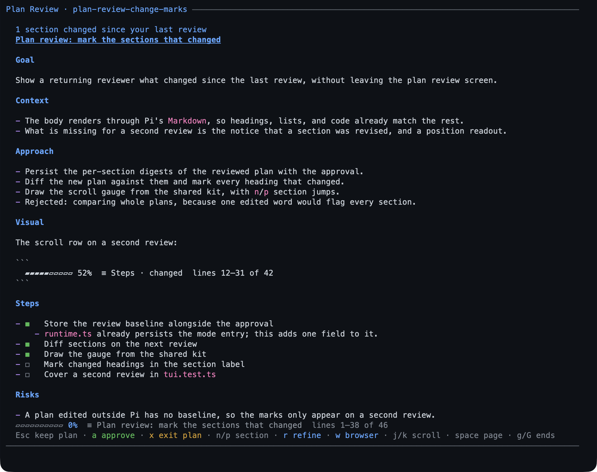

# plan — decide before the model writes

Plan mode keeps the session read-only while the model investigates, then hands
you a plan to approve. Nothing lands in your tree until you say yes.



On that screen `◼` is a done step and `◻` a pending one, and after a
refinement a midline dot in the margin marks each section that changed.

- **Use it for** any change you would want to read before it lands.
- **`/plan <task>`** starts one; `Shift+Tab` toggles plan mode too.
- **Nothing in your tree is written** until you approve — no file, no command,
  no commit. The one thing planning writes is the plan file itself, outside the
  checkout.

## What you can do

| What you want | What to do |
|---|---|
| Start a task read-only | `/plan add rate limiting to the public API` |
| Switch plan mode on or off | `/plan`, or `Shift+Tab` with bytefly |
| Let the model start plan mode | it asks first; declining keeps write access |
| Read the plan | the review screen: `n`/`p` between sections, scroll keys for the body |
| Approve and start | `a`, then `y` — steps become your todo list |
| Ask for a change | `r` to refine, or comment in the browser |
| Review with a teammate | `w` for the browser page, then **Share** for a QR or link on this Wi-Fi |
| Leave without approving | `Esc` sends it back for another round; `x` leaves plan mode — the plan file stays either way |
| Read an older plan | `/plan list`, then `Enter` |

## Try it

```text
/plan add rate limiting to the public API
```

The model reads the code and the git history, never the write path. When it is
done it saves a plan under `~/.pi/agent/plans/<repo-key>/` and opens the review
screen; `a` approves it, `r` sends it back for a change.

```text
plan exit 2026-10-09-1809-add-rate-limiting
✓ Plan approved
```

Approving ends plan mode, hands write access back, and puts the plan's steps into
`/todos` — appended after any items already there, so the list is the one you
watch while the work runs. A full
walkthrough — refining, commenting, sharing with a teammate — is
[Your first plan](../tutorials/first-plan.md).

## Reference

The `plan` tool has five actions; `/plan` is the command that drives it.

| Action | What it does |
|---|---|
| `enter` | take write access away, after asking you |
| `write` | save the plan file; pass the file it returned to refine it |
| `exit` | read the plan back and present it for approval |
| `steps` | tick a step in the file and in its todo item, in one call |
| `cancel` | leave plan mode, keeping any saved plan |

**The plan file.** `~/.pi/agent/plans/<repo-key>/<date>-<slug>.md` — one store per
repository, shared by its worktrees. Each refinement keeps the previous text
beside it as a hidden file, five deep, so two rounds can be compared. The plan is
what the model follows: approving it seeds its steps into your todo list, and
finalizes a session goal that was only drafted, from the plan's own `Goal`.
Approving a refined plan again replaces the items the earlier approval added that
nobody has started, so the list matches the plan you last read.

**Review screen keys.** `a` approve (`y`/`Enter` confirms), `r` refine inline,
`Esc` keep planning, `x` exit without approving, `w` open the browser review,
`n`/`p` jump sections. `Ctrl+C` interrupts without approving or rejecting
anything: plan mode stays on.

**Browser review.** `w` opens the same plan as a page: the title, the live comment
count, **Approve & run**, **Save feedback**, and **Back to Pi**. Hover a block and
press the `+` in its margin (a button named "Comment on this block"), or select text
to quote it, then **Save feedback** to send the
comments back. A comment-only review has no approve action.

**Sharing.** **Share** mints a link and QR for this Wi-Fi, one per teammate (at
most eight), and each link binds the reviewer's name on its first post;
**Revoke** drops one. Only the machine that opened the review may approve,
cancel, save, or share — a reviewer reads and comments.

**Read-only means:** the model keeps what reads and loses what writes. It can
still look at the repository's git status and history; a write, an edit, a shell
redirect, or a path outside the project is refused. A delegated agent runs with
writing forced off.

## Limits

- Read-only is a guard rail against accidents, not a sandbox — extensions share
  Pi's permissions.
- A plan holds at most 50 steps and 256 KiB; a bigger one is refused rather than
  trimmed.
- Plan mode has no PowerShell on Windows: Git Bash is the shell, and it has to be
  installed.
- The browser review needs `serve` and a local browser; a reviewer's page is only
  reachable while its link is shared.
- The plans directory is the only index — nothing deletes a plan for you.

## Settings

Plan mode has no `bytefly.json` keys — the mode is the extension. To switch it
off, toggle `plan` in `/bytefly`; the tool, the command, and the mode go with it.

## Learn more

- [Your first plan](../tutorials/first-plan.md) — the walkthrough.
- [`todo`](../extensions/todo.md) — where the steps land.
- [Security](../security.md) — what a shared review link is.
