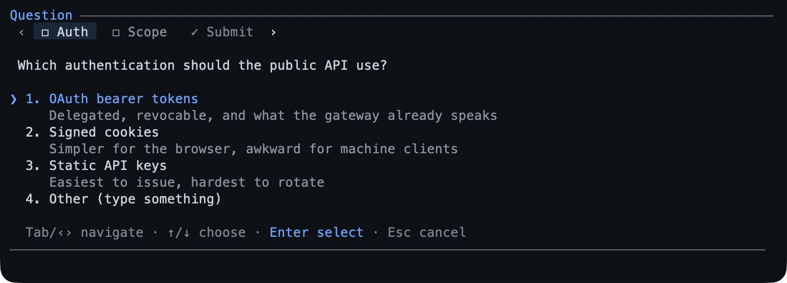

# question — the model asks, you answer

Sometimes the model needs a decision before it can continue. `question` is how it
asks: one to four questions, each with labelled options, answered in a small
dialog instead of a wall of prose.



- **You answer; you never call it.** The model decides when a decision is needed.
- **Options, plus your own words**: every question carries an `Other` row you can
  type into, and a question with no options asks for plain text.
- **`Esc` cancels**, and the model is told you cancelled rather than being left
  waiting.
- **The dialog reaches you where the turn is** — terminal, RPC, or the WeChat
  bridge.

## What you can do

| What you want | What to do |
|---|---|
| Answer with one of the options | `↑`/`↓` to the row, `Enter` |
| Answer in your own words | choose `Other`, then type |
| Pick several | `Space` toggles, `Enter` confirms |
| Move between questions | the tab row, `Tab`/`Shift+Tab` |
| Submit a batch | the `Submit` tab, once every question is answered |
| Cancel the questions | `Esc` |

## Try it

Ask for something with a real decision in it:

```text
Add rate limiting, and ask me which store to keep the counters in.
```

The model asks; you pick an option, or type one it did not list, and the turn
continues with the answer.

## Reference

**Shape.** Up to four questions in one call, each with up to four options and an
optional second line describing one. A question may take several selections, and
a batch is answered in one pass — `Submit` refuses until every question has an
answer and names the missing ones. A single question submits on `Enter` without a
`Submit` tab.

**Where it appears.** The TUI shows the dialog and waits for the editor's focus;
RPC and remote turns use the same dialog through Pi's own `select`/`input`/`editor`
fallbacks; a `print` or `json` run with no dialog channel gets `unavailable`
instead of a hang.

**History.** The answers are part of the transcript, so `/resume` and `/tree`
show the questions and what you chose.

## Limits

- The model decides when to ask; there is no command to open the dialog yourself.
- At most four questions per call and four options per question — a decision with
  more branches is better asked in prose.
- An answer is not saved anywhere else: it lives in the transcript, not in config.

## Learn more

- [`plan`](../extensions/plan.md) — its approval question.
- [`wechat`](../extensions/wechat.md) — questions answered from the phone.
