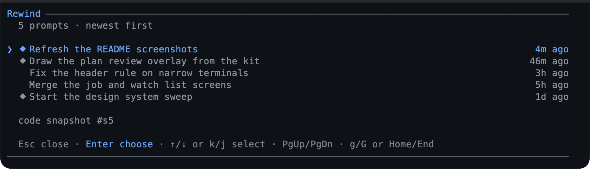

# rewind — go back to an earlier prompt

`rewind` snapshots your working tree before each prompt's first change, so a bad
turn is one screen away. From the timeline you choose a prompt and restore the
**code**, the **conversation**, or **both**.



- **Automatic.** One snapshot per prompt, taken before anything is written.
- **Git refs, not stashes.** Snapshots live under `refs/pi/rewind`, so restoring
  one never moves `HEAD` or touches your index.
- **A restore is undoable**: the state it replaces is snapshotted first.
- **The branch you leave stays** — a conversation rewind moves the session tree
  and puts the prompt text back in the editor.

## What you can do

| What you want | What to do |
|---|---|
| Go back to an earlier prompt | `/rewind`, pick the prompt, then the scope |
| Restore files only | **Code only** |
| Restore the conversation only | **Conversation only** |
| Restore one directory, not everything | **Choose paths…** in the second step |
| Undo a restore | `/rewind` again — the pre-restore state is a snapshot |
| See which prompts have a snapshot | the `⬥` beside a timeline row |
| Know how many prompts the branch has | the `↺ N` chip in the status bar |
| Stop snapshots for a while | `rewind.autoSnapshots: false` |

## Try it

```text
/rewind
```

`↑`/`↓` or `j`/`k` move, `PgUp`/`PgDn`/`Home`/`End` jump, and `Enter` picks the
focused prompt. The screen closes, then asks what to restore; a code restore with
several changed paths asks **Everything (N files)** or **Choose paths…**, and the
checklist takes `Space` per file, `a`/`n` for all or none, and `Enter` to confirm.
A confirmation with the diff preview is the last step.
[Go back to an earlier prompt](../tutorials/first-rewind.md) walks a code restore,
a conversation restore, and the undo.

## Reference

**The command.** `/rewind` is the only command; it prints the prompt list instead
of a picker in `print`/`json` runs, and falls back to Pi's own `select` in RPC.

**What a snapshot captures.** Tracked files plus untracked files that git does not
ignore, with the tree's content as it was before the prompt's first mutating
call. Files matched by `.gitignore` are never captured.

**Where they live.** `refs/pi/rewind/<id>`, one ref per snapshot, listed from git
rather than from session state — so they survive the session and worktrees share
the store while another root's snapshots are filtered out and refused. The store
is capped at `max` refs and pruned oldest-first, except that the state a restore
just replaced is kept for a follow-up restore.

**Refusals.** A merge, rebase, cherry-pick, revert, or bisect in progress refuses
the restore rather than fighting it. A project that is not a git repository still
gets conversation rewinds; only code snapshots need git.

## Limits

- The path checklist is terminal-only: RPC, print, and JSON runs restore the whole
  tree, with no typed path syntax.
- Ignored files are not captured, so a `.env` a turn deleted does not come back.
- It never commits, stashes, pushes, or moves `HEAD` — a restore is a working-tree
  write.
- Snapshots are not cleaned up at session end; they stay until pruned by the cap.

## Settings

| Key | Default | What it does |
|---|---|---|
| `autoSnapshots` | `true` | Take one snapshot per prompt. |
| `max` | `20` | Snapshot refs kept per root. |
| `safetySnapshot` | `true` | Snapshot the current state before a code restore. |
| `includeUntracked` | `true` | Capture untracked, non-ignored files. |
| `showStatus` | `true` | Draw the `↺ N` chip. |

The rest — `autoPrune`, `refNamespace`, `watch`, and `ignore` — are in
[configuration](../configuration-reference.md#rewind--snapshots). To switch the extension
off, toggle `rewind` in `/bytefly`.

## Learn more

- [Go back to an earlier prompt](../tutorials/first-rewind.md) — the walkthrough.
- [`worktree`](../extensions/worktree.md) — where a rewind happens when a task is
  isolated.
- [`plan`](../extensions/plan.md) — design before writing, so fewer rewinds.
