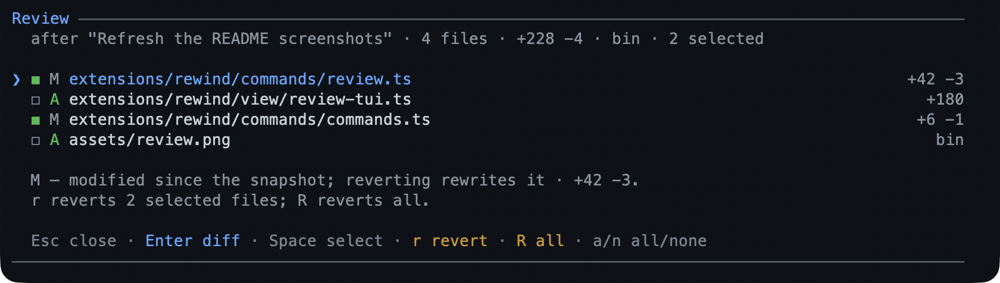

# rewind — prompt-anchored snapshots and conversation rewind for Pi

Snapshot the working tree at the start of each task and return to an earlier
prompt from a menu — restoring the **code**, the **conversation**, or **both**.
Snapshots are git commits under `refs/pi/rewind/<id>`, so restoring one rewrites
the working tree without touching the real index or moving HEAD, and a
conversation rewind moves Pi's session tree without erasing the branch you leave.
`/review` uses the same snapshot to show the latest turn's changes and revert a
file, a selection, or the whole turn.


## Capabilities

| Capability | How | What you get |
|---|---|---|
| Automatic snapshots | the `autoSnapshots` key | One snapshot per prompt, taken before its first mutating call, so every task has a restore point. |
| Durable snapshots | `refNamespace` | Snapshots survive the session and are listed from git rather than from session state. |
| Prompt timeline | `/rewind` | Every user prompt on the active branch, newest first, marked `⬥` where a code snapshot was captured. |
| Scoped restore | `/rewind` | Code, conversation, or both, from the prompt you pick. |
| Undoable restore | the `safetySnapshot` key | A code restore snapshots the state it replaces first, so it can itself be undone. |
| Partial restore | `/rewind` | The changed paths grouped by directory, chosen with a checklist, and previewed as the subset you selected. |
| Latest-turn review | `/review` | The changed files of the latest prompt, with `M`/`A`/`D`/`R` marks and line counts. |
| File, batch, and hunk revert | `/review` | Revert one file, a selection, the whole turn, or chosen hunks, each with its own safety snapshot. |
| Busy-git refusal | `/rewind`, `/review` | A merge, rebase, cherry-pick, revert, or bisect in progress refuses the restore instead of fighting it. |
| Root-scoped snapshots | `refs/pi/rewind` | Worktrees share the ref store, while another root's snapshot is filtered out and refused. |
| Untracked capture | `autoSnapshots` | Non-ignored untracked files are captured, and a restore removes the ones that appeared after the snapshot. |
| Ref cap and auto-prune | `max`, `autoPrune` | The snapshot store is bounded and pruned instead of growing without limit. |
| Review plan guard | `/review` in plan mode | Review refuses while plan mode is on, matching the read-only planning rule. |
| Prompt-count chip | `↺ N`, the `showStatus` key | The status bar counts the prompts on the active branch, whether or not each has a snapshot. |

## Quickstart

```bash
pi --extension ./extensions/rewind   # load just this extension
pi -e .                              # load the whole @gavin-hu/my-pi-agent package
pi install ./                        # install the package
```

```text
/rewind                             # pick a prompt, then a scope, then the paths
/review                             # the latest turn's changes, ready to revert
```

Nothing is registered for the model: snapshots are taken automatically, and both
commands are user-driven.

## Commands

| Command | What it does |
|---|---|
| `/rewind` | Open the timeline; pick a prompt, then a restore scope, then (for code) the paths. |
| `/review` | Review the latest prompt's changes; open a diff, select files with `Space`, revert the selection or all files, or revert chosen hunks with `h`. |

The timeline is keyboard-driven: `↑`/`↓` or `j`/`k` move,
`PgUp`/`PgDn`/`Home`/`End` jump, `Enter` chooses the focused prompt, the mouse
wheel scrolls, and `Esc` closes. The scope choice and the confirmation (with a
diff preview) run after the screen closes. Picking a point asks what to restore:
**Code and conversation**, **Conversation only**, or **Code only**. A conversation
rewind moves the session tree back to that prompt and puts the prompt text back in
the editor; the abandoned branch stays in the session.

When code moves and more than one path changed, a second step asks **Restore
what?** — **Everything (N files)** or **Choose paths…**. The path checklist is
its own `ctx.ui.custom` screen: it lists every changed path grouped by directory
(`M` modified, `D` deleted since the snapshot, `A` created after it, `R`
renamed), with all of them selected, so `Enter` twice reproduces a whole-tree
restore. `Space` toggles a file or a directory, `a`/`n` select all or none, and
`Enter` returns the selection. The confirm that follows previews only the chosen
subset.



`/review` compares the working tree with the snapshot taken before the latest
prompt on the active branch. The list is keyboard-driven too: `↑`/`↓` or `j`/`k`
move, `PgUp`/`PgDn` and `Home`/`End` jump, `Space` toggles the focused file,
`a`/`n` select all or none, `Enter` opens the focused file's diff, `r` reverts the
selection (or the focused file when nothing is selected), `R` reverts every
changed path, and `Esc` closes. A selected batch is one restore and one
pre-restore safety snapshot, not one per file. A rename is one `R` row, so
reverting it restores the old path and removes the new one together.

In the diff, `j`/`k`, the arrows, `PgUp`/`PgDn`, and `g`/`G` scroll, `r` reverts
the file, and `Esc` goes back. A modified text file's diff offers `h` for the
hunk checklist: `Space` toggles, `a`/`n` select all or none, `Enter` reverts the
chosen hunks, and `Esc` cancels back to the diff. The chosen hunks revert as one
reverse patch with its own pre-restore safety snapshot. When the working tree
matches HEAD, the screen says the changes are already committed and a revert
leaves the commits in place.

## Behaviour by mode

| Mode | Behaviour |
|---|---|
| Interactive TUI | Full selectable timeline, then the scope choice, the path checklist, and the confirmation. `/review` mounts the changed-file list, the per-file diff, and the hunk checklist. |
| RPC (`hasUI`) | Timeline falls back to `ui.select`; scope choice and confirmation use forwarded dialogs. `/review` prints the changed-path list. |
| `print` / `json` | No picker: the prompt list is printed. `/review` prints the changed-path list. |

## Configuration

The `rewind` section of the shared `bytefly.json`; resolution rules are in
[`../configuration.md`](../configuration.md#rewind--snapshots).

| Key | Default | Meaning |
|---|---|---|
| `autoSnapshots` | `true` | Take one automatic snapshot per prompt. |
| `max` | `20` | Snapshot refs kept per root; automatic and pre-restore safety snapshots both count. |
| `includeUntracked` | `true` | Capture untracked, non-ignored files. |
| `safetySnapshot` | `true` | Save the current state before a code restore. |
| `autoPrune` | `true` | Delete the oldest refs beyond `max` after an automatic snapshot. |
| `showStatus` | `true` | Draw the `↺ N` status chip. |
| `watch` | `[]` | Extra tool names to treat as mutating. |
| `ignore` | `[]` | Tool names never to snapshot; this package's own tools are always excluded. |
| `refNamespace` | `"refs/pi/rewind"` | Ref namespace for stored snapshots. |

A restore's safety snapshot is not pruned immediately, so the snapshot it
restored from stays available for a follow-up restore; the next automatic
snapshot applies the cap.

## What a snapshot captures

Snapshots include tracked files plus (by default) untracked, non-ignored files.
`.gitignore`d files are never captured. Because refs live in the shared git
directory, a snapshot taken inside a [`worktree`](./worktree.md) is visible from
the main checkout; `list`/matching filter to the current root by default.

## How snapshots are stored

Each snapshot is a commit under `refs/pi/rewind/<id>` whose body carries a
`pi-rewind: {json}` metadata line at **schema version 3**. The metadata records
the id, reason, prompt summary, timestamp, root, branch, HEAD, clean state, the
untracked flag, the **session id**, and the **conversation entry id** of the
prompt it precedes. A ref written by another schema version is ignored, so older
refs are not misread.

Because the schema moved to v3 with the conversation anchor, snapshots taken by
the old `checkpoint` extension (or an earlier rewind) under
`refs/pi/checkpoints/*` are no longer listed. They are not deleted; remove them
with `git update-ref -d` or `git for-each-ref --format='%(refname)' refs/pi/checkpoints | xargs -n1 git update-ref -d`.

A clean working tree still records a commit (so the metadata always travels with
the snapshot); git reuses the identical tree object, so the only cost is a small
commit. These refs are not branches and are not touched by `git push --all`.

## Limitations

- **The path checklist is TUI-only.** RPC, `print`, and `json` modes restore the
  whole tree; there is no typed path syntax, because a list of exact paths is what
  the checklist is for and a glob would need its own validation and preview.
- **Hunk selection covers modified text files.** Added, deleted, renamed, and
  binary files, and a change with no textual hunks (a mode-only change), revert
  whole; the diff offers `h` only when it has hunks to show.
- **`/review` follows the latest prompt with a snapshot.** A read-only prompt
  after it does not change the target, and a turn whose snapshot failed has no
  review of its own. Actions are TUI-only; other modes print the changed list.
- **`/review` refuses while plan mode is on.** Plan mode is read-only, so approve
  the plan before reverting its changes.
- **`/review` labels committed changes only when the working tree is clean.**
  `currentTree === HEAD^{tree}` means every reviewed difference is in commits;
  the confirm then says the commit stays. A dirty tree with some commits since
  the snapshot is unlabelled and keeps the generic "HEAD and the index are
  untouched" wording.

## Non-goals

- No capture of `.gitignore`d files.
- No moving HEAD, committing, stashing, or pushing.
- No non-git projects for code snapshots (conversation-only rewind still works
  outside git).
- No ref cleanup on session end; snapshots persist until pruned or cleared.
- No migration of the old `refs/pi/checkpoints/*` snapshots.

## Pi integration

| Integration point | Value |
|---|---|
| Model-facing tools | None. `/rewind` and `/review` are user-driven; automatic snapshots cover the start of every task. |
| Commands | `/rewind` and `/review` (`pi.registerCommand`). |
| Events | `session_start` (reset run state, status, stale-index sweep), `session_tree` (status refresh after tree navigation), `before_agent_start` (record the prompt — absent on a run a custom message starts — and resolve the run's snapshot decision), `tool_call` (take the run's snapshot before the first mutating call), `session_shutdown` (release indexes, clear status). |
| State storage | Git refs `refs/pi/rewind/<id>` with metadata in the commit body. No tool-result `details` and no `pi.appendEntry`. |
| Lifecycle | Index paths are created lazily and released in `session_shutdown`; status chip is set on start/tree/snapshot and cleared on shutdown. |

## Design notes

- **One snapshot per user prompt.** The unit is the task, not the tool call:
  `before_agent_start` records the prompt summary and resolves the run's root,
  policy, and config, so the first mutating `tool_call` takes the snapshot with a
  fully synchronous guard. No `await` sits between that guard's check and its
  claim, so parallel sibling calls cannot double-snapshot. A run a custom message
  starts (a wake) has no prompt to record; the snapshot it takes is otherwise the
  same.
- **The timeline comes from the session tree, not from git.** `/rewind` lists
  every user message on the active branch and pairs each with the snapshot whose
  recorded `entryId` matches, so read-only prompts appear too and the list
  follows `/tree` navigation. Conversation rewind calls `ctx.navigateTree` on the
  parent of the selected message and returns its text to the editor, leaving the
  abandoned branch reversible.
- **Snapshots are git refs, not copied files.** A tree is built from the working
  tree and stored as a commit under `refs/pi/rewind/<id>`, reusing git's
  content-addressed storage, surviving `git gc`, and staying listable with
  ordinary plumbing. A side directory would duplicate the tree and ignore git's
  ignore rules; `git stash` cannot reliably include untracked files and pollutes
  the stash list.
- **A temporary index keeps the real index and HEAD untouched.** Staging goes
  through `GIT_INDEX_FILE` under the worktree's own git dir (`<git-dir>/pi/`:
  `.git/pi/` in the main checkout, `.git/worktrees/<name>/pi/` in a linked
  worktree), so concurrent sessions never share a staging index. Because
  `pi.exec` has no `env` option the variable is set on `process.env` for the
  duration of a call, so every staging operation is serialized through the queue
  in `queue.ts`; read-only listings are not queued.
- **Rewind is `read-tree --reset -u` plus explicit untracked removal.** The
  target tree is loaded into the index and tracked tree; paths added since the
  snapshot are computed and deleted explicitly. HEAD is never passed to
  `read-tree`, and rewind refuses while a merge, rebase, cherry-pick, revert, or
  bisect is in progress.
- **Untracked handling is symmetric.** `includeUntracked` governs both capture
  and the removal set, and the flag is recorded in metadata so a later-session
  restore is interpreted the same way. When `false`, a rewind cannot delete a
  file the snapshot never contained.
- **Metadata is versioned in the commit body (v3).** A malformed line, or one
  from another schema version, is skipped rather than trusted; the ref name is
  treated as identity. The recorded `sessionId` guards against matching a
  same-id entry from another session or a fork.
- **A pre-restore safety snapshot makes code rewind undoable.** Unless disabled,
  restore first snapshots the current state with reason `pre-restore`.
  Conversation rewind is already reversible through `/tree`.
- **Worktrees share refs, so roots are recorded and filtered.** Each snapshot
  records its `root`; listing and matching filter to the current root and
  restoring another worktree's snapshot is refused. The effective root follows
  `PI_WORKTREE_ROOT` when set.
- **Review is derived, not stored.** `/review` uses the same
  `buildRewindPoints` pairing as `/rewind`, calls `planRestore`, and fetches a
  patch only when a file is opened. A revert is the existing subset restore, so
  the safety snapshot and the working-tree-only rewrite are the ones `/rewind`
  already guarantees. A selected batch is one subset restore, which is why it
  takes one safety snapshot; the list carries the selection across a diff/back
  round without persisting it.
- **A rename is one entry, not two.** `parseNameStatus` keeps git's `R` line as
  `{ path: destination, from: source }`, and `entryPaths` is the one helper that
  names both sides. The restore filters the full diff in memory rather than
  narrowing it with a pathspec, because git detects a rename only when both
  paths are in scope; a pathspec would turn the row into an addition and lose
  the side that has to be recreated. The row's patch and line counts stay a
  delete plus a create, so the pane and the counts describe the same two
  operations a revert performs. A rename whose two names resolve to one file (a
  case-only rename on a case-insensitive filesystem) skips the destination
  delete, because the checkout has already renamed that file.
- **A hunk revert is a reverse patch, not a checkout.** `patch.ts` splits one
  file's diff into its header and hunks; `buildHunkPatch` rebuilds only the chosen
  ones, and `git apply --reverse` writes them to the working tree without
  `--index`/`--cached`, so the real index and HEAD stay untouched. The patch goes
  through a private temp directory because `pi.exec` has no stdin, and git checks
  every hunk before writing, so a file edited after its diff was read fails
  atomically. The revert takes the same pre-restore safety snapshot as a file
  revert.
- **Identity is fixed for internal commits.** `commit-tree` runs with
  `-c user.name=pi -c user.email=pi@localhost`, so snapshots work without committer
  identity configured and never depend on the user's git config.

## Files

| File | Responsibility |
|---|---|
| `index.ts` | Registrar: wire the runtime, the commands, and the run-state module to Pi's events (`registerRewind`). |
| `types.ts` | `Snapshot`, `SnapshotReason`, `RestoreSummary`. |
| `config/config.ts` | Config defaults and merge/normalize over `lib/config.ts`. |
| `transport/git.ts` | Single git entry point: rewind plumbing, the shared read helpers rewind consumes (name status, stat, patch, and `--numstat`), the reverse apply a hunk revert uses, and the production `RunGit`. |
| `transport/snapshot.ts` | Create a snapshot (tree from a temporary index → commit → ref). |
| `state/snapshot-run.ts` | Per-run automatic-snapshot state: one snapshot per prompt, with a synchronous guard. |
| `transport/restore.ts` | Plan and apply a working-tree rewind, whole or for a chosen subset of paths, recreating a rename's source and removing its destination. |
| `text/paths.ts` | Pure: the changed-path list from `git diff --name-status` (a rename is one paired entry), its directory grouping, the change marks, the `--numstat` counts, and the restore counts. |
| `view/checklist.ts` | The shared multi-select checklist screen: the cursor, `Space`/`a`/`n`/`Enter`, the height math, and the dock frame. The three checklists below supply only their rows and their words. |
| `view/path-picker.ts` | The partial restore's checklist, a `ChecklistScreen` over grouped paths: directory toggles, the change marks, and the selection it returns. |
| `text/patch.ts` | Pure: split a single-file unified diff into its header and hunks, and rebuild a patch from chosen hunks. |
| `view/hunk-picker.ts` | The hunk checklist a modified file's diff opens, a `ChecklistScreen` over the hunks: previews, the indices it returns, and its own row budget. |
| `transport/store.ts` | Versioned metadata encoding and ref-backed listing/pruning. |
| `state/policy.ts` | Which tool calls are worth a snapshot. |
| `transport/temp-index.ts` | Per-process `GIT_INDEX_FILE` paths: create, release, and sweep stale files. |
| `status.ts` | The `↺ N` status chip. |
| `transport/queue.ts` | The serialized git operation queue for staging calls (`GIT_INDEX_FILE`). |
| `state/runtime.ts` | Root/config caches and the snapshot/list/plan/patch/numstat/restore/hunk-revert operations. |
| `state/timeline.ts` | Pure: prompts on the branch, paired with their snapshots. |
| `commands/rewind.ts` | Scope choice, the path step, confirmation, and applying code + conversation rewind. |
| `commands/review.ts` | The `/review` orchestration: the latest snapshot, the list/diff loop, the hunk step, confirmations, and the reverts. |
| `view/review-tui.ts` | The changed-file list (a `ChecklistScreen`) and the scrollable per-file diff, which offers the hunk checklist. |
| `view/rewind-tui.ts` | The selectable, width-safe timeline component, drawn from the `lib/tui/` kit (`titleRule`, `dockListFrame`, `listRow`, `emptyState`). |
| `commands/commands.ts` | The `/rewind` and `/review` commands. |
| `text/format.ts` | Pure rewind and review text, including diff bounding and the hunk prompt. |
