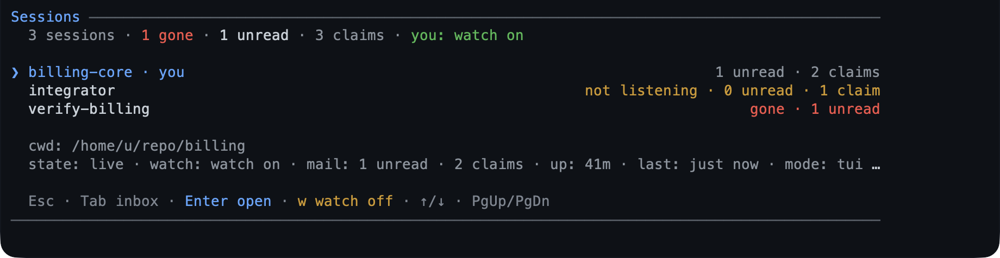

# session-bus — coordinate sessions on one repository

Two Pi sessions on the same repository can get in each other's way. The bus is
the local channel that prevents it: sessions discover each other, exchange short
messages, consume an inbox, and claim paths before editing them.



- **Local and pull-based.** Same machine, same OS user, files under the agent
  directory — no service, no network, no hidden context.
- **Joining is explicit.** The board opens empty; a session appears only when it
  joins, which every `session` action except `status` does — `/board` and
  `/team join` join too.
- **Listening is a mode**: mail reported at the next turn, or — with `wake` — one raised turn as
  soon as the agent is idle; any mail does it. A board or team join asks for `wake`, `session join`
  keeps its own flags, and `listen: false` is the one opt-out.
- **Waiting mail**: a listening session's turn starts with the count until `inbox` clears it.
- **Claims are all-or-nothing**, on a file or a directory prefix, and they expire
  with the session.

## What you can do

| What you want | What to do |
|---|---|
| See who is working here | `/sessions` — the board, or the listing outside the TUI |
| Join under a name | `/team join billing-core`, or `session join` |
| Message one session | `session send to billing-web text "the API route is free"` |
| Broadcast an event | `session send to "*" kind "event" text "…"` |
| Read your mail | `session inbox`, or `session read` to show it and keep it (the waiting line counts files, so `read` leaves it) |
| See mail no session holds, and clear one | the board's summary counts it; `/sessions drop` names each, and `<id>` clears one |
| Claim files before editing | `session claim paths ["src/api"]` |
| Release a claim | `session release paths ["src/api"]`, or `x` on the board |
| Be woken by mail | a board/team join asks for it; `session join wake: true` for a bare session |
| Stop listening | `w`, on the board |

## Try it

```text
/sessions
```

The board lists every session with its unread count and claims, plus your own
identity. `Tab` cycles Sessions, Inbox, and Claims, `Enter` opens the focused row,
`w` starts or stops listening, and `x` releases a claim you hold — after a
confirmation. It joins nothing by itself.

## Reference

**Actions.** `session status` reads without joining; `session send` writes one message per
recipient — a `key` folds a resend into the waiting copy, `replyTo` names the message it answers,
and `about` is what it concerns, in the sender's own spelling (a card's `#673`), printed beside
`re: <id>`; `session claim`/`release` hold and drop claims; `session join` puts this session on
the bus, with `wake` and `listen`.

**Message kinds.** `message`, `event`, `ask`, and `handoff`. An `ask` does not
block the sender; a `handoff` names the work it assigns. A message may carry the
repository paths it concerns. A broadcast is one file per recipient sharing one
message id: `to "*"`, which is refused unless `kind` is `event`.

**Mail is read, not taken, by the page.** The Team tab removes nothing: an inbox stays its owner's
to consume, and a message it shows is never marked as told — only the session advances its count.
A row's state comes from its recipient's id, not its label.

**Records.** `session status` lists each session with its state — `live` while its heartbeat
holds, `quiet` once it has aged, `gone` once its process is not running — and whether its watch
is armed, so a peer that will not be woken reads as one. The record carries the turn too:
stamped on `agent_start`, dropped on `agent_settled`, counted only beside a fresh heartbeat.
It also carries what its session was told, and that is what unread counts: a notice marks its
burst told, so the number falls with nothing deleted, and both surfaces draw that one number.
A notice previews five messages, so `session read` is what shows the rest; a file this build
cannot parse is named rather than counted, and its TTL is the only thing that ends it. Mail whose
recipient's record was pruned has no row to hang a number on, so `session status` and the
`/sessions` board name it under `Unaccounted (N)`, and a bare `/sessions drop` prints that list
while `/sessions drop <id>` clears one. A heartbeat
ends expired mail in its own inbox and in the ones no record holds; a stopped inbox is swept once
its record ages out, and each file still ends at its own TTL. That door is a command, not a
`session` action: a message is evidence, and the store refuses an id a record's inbox holds.

**Labels.** Name a session for the outcome it owns (`billing-core`), not its layer. A duplicate
label gets a short id suffix, and a label is reserved while the bus keeps its owner's record —
ten minutes past the last heartbeat — so a crashed session has not freed its name.

**Claims.** All-or-nothing: if one path conflicts, nothing is claimed. A directory claim conflicts
with claims below and above it. Two sessions claiming overlapping paths at once both pass the check —
`src` and `src/api` are two files — so each batch re-reads after publishing: the claim written first
keeps, the smaller session id decides a tie in one tick, and the loser gives its batch back and is
told who holds the path. Paths resolve against your working directory and are stored relative to the
repository root; the repository itself cannot be claimed, and there is no forced takeover.

**Where it lives.** `~/.pi/agent/session-bus/<repo-key>/`, under the agent directory, so never committed.

## Limits

- Same machine and OS user only: any process with your file access can read or rewrite it, with no
authentication between sessions; the [agent directory](../security.md#the-agent-directory) is trusted input.
- Pull-based for a bare `session join`: a message waits for a session that is not listening. A board
or team join asks for `wake`, so a handoff, an ask, or a sign starts a turn in an idle teammate.
- Reading is not joining: `/sessions` shows a board you are not on until you join or act.
- Membership is per session and does not survive a resume or a restart; unread mail and the derived
label do.
- The board acts on your own state only — it never consumes mail or touches a peer's claims.
- Two listening peers can wake each other in a loop; stop listening on one.
- A fan-out writes one file per inbox, so it can be partial; the result lists both the delivered
and the missed.

## Settings

The bus has no keys in this version: the heartbeat (10 s), watch poll (2 s), session TTL (10 min),
message TTL (24 h), text cap, and inbox limits are fixed. To switch the extension off, toggle
`session-bus` in `/bytefly`: the team goes, while the board and its cards stay workable without it
([what that costs](../minimal-install.md#what-switching-one-off-costs)).

## Learn more

- [Several sessions](../multi-session.md) — what the bus, the cards, and the
  lead's round do together.
- [`team`](../extensions/team.md) — the lead's round, over this bus.
- [`board`](../extensions/board.md) — the cards a handoff moves.
- [`subagent`](../extensions/subagent.md) — delegation inside one session.
