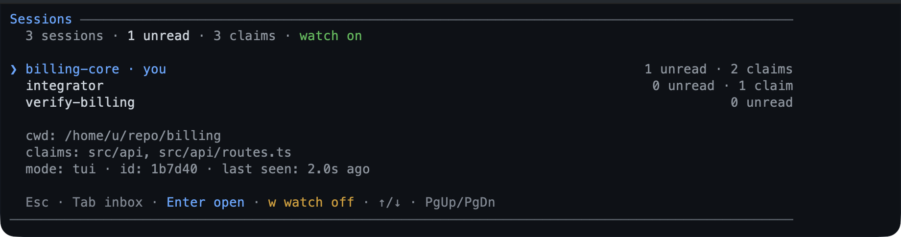

# session-bus — coordinate parallel Pi sessions

A local coordination bus for Pi sessions on the same machine and repository:
sessions discover each other, exchange short messages and events, consume an
inbox, and claim paths before editing. A session joins explicitly, so the
board opens empty and a peer never appears because the package loaded. Delivery is pull-based, and a session that
joined listens for new mail — a report at its next turn, or,
with `wake`, one raised turn as soon as the agent is idle, including right after
a running turn settles. There is no network service and no hidden context.



## Capabilities

| Capability | How | What you get | Status |
|---|---|---|---|
| Membership | `session join [label]`, `/team join [<label>]`, `/board`, the first `board` claim, the board's `w` | The join: this session is on the bus under a stable label peers address, and listens for mail unless told not to. A label given to `session join` or `/team join` is also Pi's session name, so the footer and `/resume` agree with the record; `/board` joins as the page's seat (`team-lead`) or, on a page it is only watching, under its own `team-agent-<id>` name; the first `board` claim joins under that same name, and renames nothing; `w` joins under the name the bus derives and writes nothing to Pi. | Shipped |
| Peer discovery | `session status` | Every active session with its unread count and claims, plus this session's identity, in one read — and a session whose process is gone says so, its paths free from that read on. | Unreleased |
| Live board | `/sessions` | Sessions, this session's unread mail, and every claim held on the repository, on one screen. | Shipped |
| Board actions | `/sessions` (`w`, `x`) | Start or stop listening from the board, or release an own claim behind a confirmation, without leaving it. | Shipped |
| Short messages | `session send` | One message per recipient, addressed by label or id, with a broadcast for events. | Shipped |
| Message kinds | `session send` with `kind` | A `message`, `event`, `ask`, or `handoff` keeps its meaning; `ask` does not block the sender, and a `handoff` is named as the work it assigns. | Shipped |
| Message paths | `session send` with `paths` | A message can name the repository paths it concerns, echoed in the inbox row. | Shipped |
| Inbox on demand | `session inbox` | Up to `limit` messages, oldest first, consumed only when the model asks. | Shipped |
| Listening | `session join` | New mail reported at the next turn; `join({wake: true})` raises one turn once the agent is idle, and `join({listen: false})` stops it. The record carries whether this session listens, so a peer's status read answers it without asking. | Shipped |
| Path claims | `session claim`, `session release` | A file or directory prefix held by one session at a time. | Shipped |

## Quickstart

```bash
pi --extension ./extensions/session-bus   # load just this extension
pi -e .                                   # load the whole package
pi install ./                             # install the package for a user
```

```text
/sessions                                       # open the board: empty until this session joins
session({action:"join", label:"billing-core"})  # join, name this session for Pi, and listen for mail
```

Nothing joins on `session_start`, in any mode: the board and `status` only read, so
a fresh session sees an empty board and a peer's session is not listed until it
joins. `join` is the join — it puts this session on the bus, names it when a label
is given, and starts listening — and so is the first action that needs you to be
addressable: `send`, `inbox`, `claim`, or `release`.

## Tool

`session` — `exposure: "direct"` (the default), `executionMode: "sequential"`,
read-write and closed-world. One action-shaped tool keeps the prompt surface
small: each action takes only the parameters it needs, and the result is one
collapsed line that expands to the board's rows.

| Action | Inputs | Result |
|---|---|---|
| `status` | — | Active sessions with unread counts, their state, claims, and this session's identity. A session whose process is gone is listed as `gone` until its heartbeat ages out, and its claims are not listed at all. Prunes stale records. A read: it never adds this session to the bus. |
| `send` | `to`, `text`, optional `kind`, optional `paths` | Writes one message per recipient. `to: "*"` is only valid with `kind: "event"`. A session whose process is gone is not a recipient: naming it is refused, and a broadcast skips it. |
| `inbox` | optional `limit` | Returns and deletes up to `limit` messages, oldest first (default 20, max 50). |
| `claim` | `paths` | Claims repository-relative files or directory prefixes; returns conflicts with their owner. |
| `release` | `paths` | Removes claims owned by this session; reports paths owned by someone else. |
| `join` | optional `label`, `wake`, `listen` | Joins the bus, names this session on it and in Pi when a label is given — the same path and uniqueness rule as `/team join`, so the footer and `/resume` agree with the record peers address — and starts listening for mail. `wake: true` raises one turn per burst once the agent is idle; `wake: false` reports at the next turn; `listen: false` joins without listening. A label a live session holds is refused, naming the session that holds it — its id, since the label it holds is the one you asked for — and the refusal leaves both names and the watch alone. The result reports the label the bus settled on and whether mail will reach this session. |

A claim is all-or-nothing: if one path conflicts, nothing is claimed. A claim on
a directory conflicts with claims below it and above it, so `src/api` and
`src/api/routes.ts` cannot be held by different sessions. There is no `force`
takeover; wait for the owner, ask it to release, or let the session expire.

Paths resolve against the caller's working directory and are stored relative to
its repository root; a path outside the repository is refused, and so is one that
resolves to the repository itself — `path "." is the repository, not a path in
it.` — because a claim on the root would own every file in it. Below the root,
the same `.` claims the directory the session is in.

`wake` is the mode, not an arm-time switch: `join({ wake: true })` raises a turn
for a session that was reporting at the next turn, and `join({ wake: false })` —
or a plain `join` — sets it back. The board's `w` starts and stops listening,
and it starts a plain watch; set `wake` with the tool. Nothing joins or listens on
`session_start`; a session that never asks stays pull-only and off the bus.

## Commands

`/sessions` is the human surface: in `tui` mode it opens the live board described
in [the board](#the-sessions-board), and every other mode prints the compact
listing. It takes no argument, and it joins nothing — the board's `w` is the one
act there that puts this session on the bus.

| Command | Effect |
|---|---|
| `/sessions` | Open the board: `Tab` cycles Sessions, Inbox, and Claims. `Enter` opens the focused row, `w` starts or stops listening, and in Claims `x` releases a claim you hold after a y/N confirmation. A non-TUI caller prints the listing. |

Labels are how another session addresses you. Name one by the outcome it owns
(`billing-core`, `integrator`, `verify-billing`), not by a layer or a role;
duplicate labels get a short id suffix automatically.

A label is also Pi's session name, so the footer's `[label]` and `/resume` agree
with the bus. Because the bus derives a joining session's label from that name, a
named session comes back under the same label after a resume.

The tool's `join` action is the same join from the model's side, so a `board` or a
`team` call can put a session on the bus without the user naming it, and
`/team join [<label>]` is that join from the terminal.

## Behaviour by mode

| Mode | Behaviour |
|---|---|
| `tui` | Does not join on start. `/sessions` opens the board: sessions, this session's unread mail, and every claim, with `Tab` between them, and lists nobody in this session until it joins. |
| `rpc`, `json`, `print` | Same rule: `/sessions` and `status` are reads, and the first addressable action joins. This is how a subagent or an RPC-driven session opts in. |
| WeChat peer | Same as `rpc`: the peer is a separate AgentSession in the bridge process and joins only on explicit use. Messages are read by that peer’s model; the bridge does not forward them to the phone. |

Every mode can join and listen; the notice is a visible transcript message, so
a `wake` raises that session’s own turn, not a phone notification.

## Configuration

None in v1. The heartbeat (10 s), watch poll (2 s), session TTL (10 min), message
TTL (24 h), text cap, inbox limit, and preview cap are fixed, not configurable.
The bus lives under the agent directory, not the project, so it is never committed.

## Parallel workflow

1. The user joins each session (`/team join <label>`, or `w` on the board), and the
   contract (OpenAPI, schema, or types) is written before parallel work starts.
2. Each session claims its paths before touching them, then implements its side.
3. A contract, build, or test change goes out as an event:
   `session({action:"send", to:"*", kind:"event", text:"contract v2: ..."})`.
4. Other sessions consume `inbox` at the start of their next turn, or join with
   `session({action:"join", wake:true})` so a message raises their turn as soon
   as they are idle; a wake that arrives mid-turn is raised once that run
   settles, never pushed into the running turn.
5. Whoever integrates merges the worktrees and runs the project's full check.

The bus carries coordination, not authority. The plan, todo list, contract, and
git branch remain the source of truth.

## The /sessions board

The TUI opens the board; RPC, JSON, and print print the compact listing. `Tab`
cycles Sessions, Inbox, and Claims, `Enter` opens the focused row, and `Esc` goes
back from a row's pane. `↑`/`↓` and `PgUp`/`PgDn` scroll a list; a pane adds
`g`/`G` for its ends.

The board changes only this session's own state: `w` starts or stops listening and
`x` releases a claim it holds. Mail is previewed, not consumed — `session inbox`
consumes it — and no view shows another session's inbox or releases its claims.

## Message kinds

Message kinds are `message` (default), `event`, `ask`, and `handoff`. An `ask` is
still a message: it does not block or wait for a reply. Text is capped at 4,000
characters.

A `handoff` is the one kind that assigns work, so it is the one kind the notice
treats as an instruction: the waking turn is headlined `1 handoff`, the preview
keeps 800 characters so the card, its paths, and the next step survive, and the
hint says the work is yours — read it with `session inbox`, record the plan, and
start. Nothing else changes: a handoff still waits in the inbox, and the recipient's
listening watch is what raises the turn.

## Limitations

- **Same machine, same OS user.** Any process with that user’s file access can
  read or write the bus; there is no authentication between sessions.
- **Pull-based by default.** A message does not reach a session that has not
  joined and is not listening. Agents must call `inbox` at coordination points, and
  joining listens unless `join({ listen: false })` says otherwise.
- **A reader is not a member.** `/sessions` and `session status` never add this
  session to the bus, so an unjoined session reads a board it is not on until it
  joins or acts.
- **Membership is per session and session-only.** It survives neither a resume nor a
  new process: the record and every claim it held go when the session stops, and a
  resumed pane is off the bus until it joins again. What does survive is everything
  stored as a file — unread mail is previewed once more after `/resume`, and the
  label a rejoining session takes is the same one, because it derives from Pi's
  session name (`runtime.test.ts`, *a resume*).
- **The board acts on your own state only.** `w` starts or stops listening and `x`
  releases a claim it holds. Mail is a preview, not a consume: the board never
  deletes a message, never marks one reported, and never touches a peer's inbox or
  claim.
- **Two listening peers can ping-pong.** Each reply wakes the other as soon as it is
  idle. A wake raises one turn per burst, and `inbox` consumes, so the loop needs
  both sides to keep replying; the answer is to stop listening on one of them.
- **No broadcast history.** A broadcast reaches the sessions active at send time;
  a session that joins later does not receive it.
- **Mail to a gone session is refused, not queued.** A record whose process has
  exited is not a recipient: `send` naming it answers `no active session`, and a
  broadcast skips it. Its inbox outlives a `/resume`, but a sender is never told a
  message arrived at a process that has exited — the bus's rule for a claim, and
  for `status`, is the same one.
- **No forced claims.** There is no takeover while an owner can still answer: a
  claim is released by its owner, or by the next bus call once the owner's process
  is gone. A *hung* owner still blocks its paths until the session TTL expires,
  because a running process is not evidence of a working one.
- **A dead process is named, not waited out.** A record carries its `pid` and, where
  the host can name one, that process's start time. A pid that is no longer running,
  or one whose start time is not the record's (a reused pid), reads `gone` at once:
  its label is free, the paths it held are nobody's, and `session status` and
  `/sessions` count it. It keeps its row until its heartbeat ages out, so a lead can
  see what died and reclaim it. A record with no `pid` — and a platform without
  `ps`, such as Windows — falls back to the heartbeat rather than being called dead
  on no evidence.
- **Bounded by TTL.** An idle session with a stopped heartbeat is pruned after
  ten minutes; its record, its claims, and an inbox directory left empty go with
  it, and its unread mail expires after 24 hours. A claim belongs to a record
  that was read from disk, not to the reader's idea of who is active, so a peer
  that claimed in the middle of someone else's prune keeps it.
- **One session id, one record.** Resuming a session in a second pane gives two
  processes the same id, and the record names the process that owns it: the older
  pane's shutdown leaves the record and the claims to the newer one instead of
  releasing them. Listening is still per process, so the survivor's watch is the
  survivor's.
- **A message file that does not parse is dropped.** The board's read never
  consumes mail, but it does delete a file it cannot validate, so a truncated
  message cannot linger on the bus.
- **No network.** It is not a distributed bus and does not synchronize machines.

## Pi integration

| Point | Detail |
|---|---|
| Tools | `session` — one action-shaped tool; `readOnlyHint: false`, `destructiveHint: true`, `openWorldHint: false`, `executionMode: "sequential"`. |
| Commands | `/sessions` — the board in `tui`, the listing elsewhere; no arguments and no sub-commands. |
| UI | `tui` mounts `SessionListComponent` through `withPolledScreen` (rails suppressed, a 1 s read-only poll of `snapshot()` + `peek()`); every other mode prints through `ctx.ui.notify`. No status chip, so listening never changes the footer. |
| Events | `session_start` resolves the repository and arms the mail trigger, without joining; `session_tree` only repaints, since navigating the tree changes no pending record; `agent_start` marks the run busy; `before_agent_start` reports queued non-wake mail at the next turn; `agent_settled` retries a wake the run suppressed; `context` prunes stale notices; `session_shutdown` clears the heartbeat, the watch ticker, and the record. The seven hooks are `lib/report.ts`'s `registerPendingChannel`, not a local copy. |
| State | Files under `<agent-dir>/session-bus/<repo-key>/`; nothing in the session branch. Listening is session-only. `/resume` re-registers the same session id. |
| Lifecycle | The factory only registers. The runtime starts on `session_start`; heartbeat, watch ticker, and cleanup belong to it. Disabling `session-bus` through `PI_DISABLED_EXTENSIONS` registers nothing. |
| Mode | Uses `ctx.mode` to decide whether `/sessions` mounts the board and how a label is derived; nothing joins at start in any mode; `askHuman` is not involved and no status chip is published. |

## Design notes

- **Common git dir as the key.** `git rev-parse --git-common-dir` gives all
  worktrees of one repository the same bus; `--show-toplevel` normalizes claim
  paths within each worktree. Non-repository sessions fall back to their cwd.
- **One path, one claim.** The cwd is canonicalized at join and every claim or
  release is re-keyed by its real target, so a working directory reached through
  a symlink still resolves inside its own repository, a link inside the repository
  and the file it names are the same claim, and a link that leaves the repository
  is refused. The automatic label is the real basename of the cwd, so a session
  started through a link named differently is named after the directory it is
  actually in. An absolute path argument that sits outside the repository is
  refused before it is re-keyed, and a relative one whose target leaves the
  repository is refused by the re-keying itself. A path whose target is the
  repository root is refused there too, and by that one rule: the spelling check
  hands the root on rather than pre-empting it, so the sentence a caller reads
  says what happened (`is the repository, not a path in it`) instead of claiming
  a path inside the repository is outside it.
- **One file per item.** Sessions never append to a shared registry: each session
  writes its own record, each message is its own file, and a claim is a temp file
  hard-linked into place — an exclusive create no reader can see half-written.
  This avoids a cross-process lock for the common path.
- **Lazy join.** Loading a package extension must not make every subagent and
  WeChat peer a team member. Nothing joins at start, in any mode; a session opts
  in by joining, or by the first action that needs it to be addressable.
- **Listening is on the record.** `join` writes this session's watch state onto its
  own record, so a peer's `status` read says whether mail will reach it without
  asking it anything. The field is absent when the session is not listening — which
  is also how a record written before the field existed reads, and neither is a
  claim about a peer that has since gone quiet.
- **Sanitized at the boundary.** Messages are model-authored and are sanitized
  before rendering, like other untrusted text in the transcript.
- **Poll, not `fs.watch`.** The listening watch reads this session's inbox directory
  with one `readdir` every 2 s, the same trade `watch` makes for a file tail, so
  it does not depend on a platform's event API or a filename in the event. Only
  a listening session polls.
- **Read the board, prune on the next call.** The open board polls a read-only
  `snapshot()` and `peek()` that hide a session past the TTL, a claim held by one,
  and consume nothing. The physical prune, and the claim release that goes with
  it, happen on the next `status` or `claim` call — which is the call that reader
  is about to make.
- **Release by the stored path.** A claim is stored relative to the repo root of
  the session that took it, so releasing one resolves nothing: re-resolving it
  against a cwd below that root would target `src/src/api`. The screen refuses a
  peer's claim before asking the store, which checks the owner again.
- **A pane is a log or prose.** `DetailContents.text` wraps at the render width
  and `tail: false` opens it at the top, so a message reads as prose while a job
  log keeps following its tail.
- **The notice reuses the shared report channel.** `lib/report.ts` already owns
  whether an outcome may raise a turn; the bus supplies the pending mail and the
  text, and bytefly renders the notice like a `job` or `watch` one.

## Files

| File | Responsibility |
|---|---|
| `index.ts` | Disable guard, registration, the pending-report channel, and the session hooks. |
| `join-request.ts` | The `board`/`team` join request: one `bus.join` answer, and the label it settles becomes Pi's session name. |
| `runtime.ts` | Lifecycle, repo key (`<agent-dir>/session-bus/<repo-key>/`), joining, heartbeat, and the session's own reads and writes. |
| `mail-watch.ts` | The armed inbox watch: the poll, the not-yet-reported queue, and its state. |
| `store.ts` | Atomic JSON files, inbox, peek, claims, pruning, and the one release loop. |
| `protocol.ts` | Pure labels, targets, paths, validation, conflict rules. |
| `overlap.ts` | The one "do these paths collide?" predicate: `claimsConflict`, which normalizes both spellings of a claim path first. |
| `resolve.ts` | `resolveClaimPaths` and `claimPathMessage`: a claim path made repository-relative, posix, and canonical through its real target, or the refusal naming why. |
| `types.ts` | The stored shapes — session record, message, claim — and the tool's `details`. |
| `tui.ts` | The `/sessions` board, its scopes, and the pane over one row; the row grammar is in `rows.ts`. |
| `rows.ts` | The session/claim/message row builders and summaries shared by the board and the transcript. |
| `result.ts` | The `session` tool's expanded result block and its collapsed line. |
| `notice.ts` | The mail notice's model text and renderer details. |
| `tools.ts` | The `session` tool and its renderer. |
| `commands.ts` | `/sessions`. |
| `format.ts` | Model-facing listing and result text. |

## Testing

The capability suites — `format`, `protocol`, `store`, `runtime`, `tui`, `tools`,
`overlap`, `resolve`, and `extension` — are declared in `test/suite-manifest.ts`.
They build a bus in a temp directory with a fixed clock, so none needs a live peer; `runtime.test.ts`
puts its real-repository cases behind `runSlowSuites`, which skips unless `CI` or
`PI_SLOW_TESTS=1` is set.
