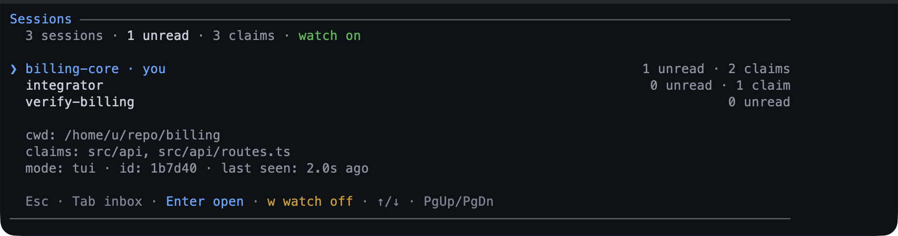

# session-bus — coordinate sessions on one repository

Two Pi sessions on the same repository can get in each other's way. The bus is
the local channel that prevents it: sessions discover each other, exchange short
messages, consume an inbox, and claim paths before editing them.



- **Local and pull-based.** Same machine, same OS user, files under the agent
  directory — no service, no network, no hidden context.
- **Joining is explicit.** The board opens empty; a session appears only when it
  joins, which `/board`, `/team join`, the first claim, or a `session` call does.
- **Listening is a mode**: mail reported at the next turn, or — with `wake` — one
  raised turn as soon as the agent is idle.
- **Claims are all-or-nothing**, on a file or a directory prefix, and they expire
  with the session.

## What you can do

| What you want | What to do |
|---|---|
| See who is working here | `/sessions` — the board, or the listing outside the TUI |
| Join under a name | `/team join billing-core`, or `session join` |
| Message one session | `session send to billing-web text "the API route is free"` |
| Broadcast an event | `session send to "*" kind "event" text "…"` |
| Read your mail | `session inbox` |
| Claim files before editing | `session claim paths ["src/api"]` |
| Release a claim | `session release paths ["src/api"]`, or `x` on the board |
| Be woken by mail | `session join wake: true` |
| Stop listening | `w`, on the board |

## Try it

```text
/sessions
```

The board lists every session with its unread count and claims, plus your own
identity. `Tab` cycles Sessions, Inbox, and Claims, `Enter` opens the focused row,
`w` starts or stops listening, and `x` releases a claim you hold — after a
confirmation. It joins nothing by itself.

## Reference

**Actions.** `session status` reads the bus (and never joins you to it);
`session send` writes one message per recipient, reporting any it could not
reach; `session inbox` consumes up to `limit` messages, oldest first;
`session claim` and `session release` hold and drop path claims; `session join`
puts this session on the bus with an optional label, `wake`, and `listen`.

**Message kinds.** `message`, `event`, `ask`, and `handoff`. An `ask` does not
block the sender; a `handoff` names the work it assigns. A message may carry the
repository paths it concerns.

**Labels.** Name a session for the outcome it owns (`billing-core`), not its
layer. A duplicate label gets a short id suffix; a label is reserved while the bus
keeps its owner's record — ten minutes past the last heartbeat — so a crashed
session has not freed its name and a slow one has not lost it.

**Claims.** All-or-nothing: if one path conflicts, nothing is claimed. A
directory claim conflicts with claims below and above it. Paths resolve against
your working directory and are stored relative to the repository root; the
repository itself cannot be claimed. There is no forced takeover.

**Where it lives.** `~/.pi/agent/session-bus/<repo-key>/` — the bus is under the
agent directory, never in the project, so it is never committed.

## Limits

- Same machine and OS user only: any process with your file access can read it,
  and there is no authentication between sessions.
- Pull-based by default: a message waits for a session that is not listening, and
  the model reads mail at coordination points.
- Reading is not joining: `/sessions` shows a board you are not on until you join
  or act.
- Membership is per session and does not survive a resume or a restart; unread
  mail and the derived label do.
- The board acts on your own state only — it never consumes mail or touches a
  peer's claims.
- Two listening peers can wake each other in a loop; stop listening on one.
- A fan-out writes one file per inbox, so it can be partial; the result lists both
  the delivered and the missed.

## Settings

The bus has no keys in this version: the heartbeat (10 s), watch poll (2 s), session
TTL (10 min), message TTL (24 h), text cap, and inbox limits are fixed. To switch
the extension off, toggle `session-bus` in `/bytefly`; the board and every other
coordination surface go with it.

## Learn more

- [`team`](../extensions/team.md) — the lead's round, over this bus.
- [`board`](../extensions/board.md) — the cards a handoff moves.
- [`subagent`](../extensions/subagent.md) — delegation inside one session.
