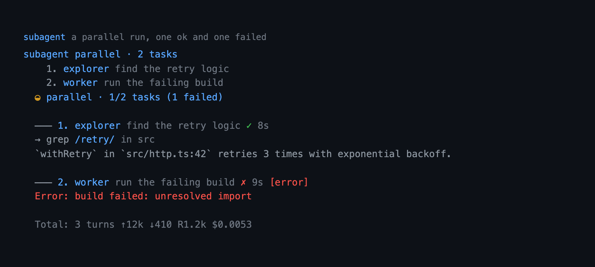

# subagent — isolated delegation for Pi

A `subagent` tool that hands a task to a specialized agent running in its own
`pi --mode json` process. The subagent gets a fresh context window, so broad
exploration or parallel work does not fill the main conversation. A single run
can also start in the background and be inspected, collected, or cancelled with
`/agents`.

## Capabilities

| Capability | How | What you get |
|---|---|---|
| Isolated context | `subagent` | Each task runs in its own process with its own transcript, and only its final reply returns to the caller. |
| Explicit tool allowlist | `--tools` for every child | An agent gets only its declared tools, not the parent's ambient extensions; `worker` cannot recurse into `subagent`. |
| Read-only delegation | `subagent` (`readOnly: true`) | Every spawned agent runs with a reader-only tool set, enforced at the process boundary. |
| Plan-mode guard | `subagent`, plan mode | Plan mode forces every call read-only and refuses `/agents` until the plan is approved. |
| Project-agent trust gate | `agentScope` with the trust gate | A `.pi/agents` file loads only when the project is trusted or confirmed, so a repository cannot inject a prompt by adding a file. |
| Three delegation modes | `subagent` (`agent` + `task`, `tasks[]`, `chain[]`) | One agent, an independent batch, or an ordered chain whose steps receive `{previous}`. |
| Parallel and chain bounds | `tasks[]`, `chain[]` | Parallel accepts up to 8 tasks with 4 running at once; a chain accepts up to 8 steps and stops at the first failure. |
| Per-step working directory | `cwd` | A single run, each parallel task, or each chain step can name its working directory; a relative path resolves against the active root. |
| Built-in agents | `subagent` (`agent`) | Recon, planning, review, implementation, research, testing, debugging, and docs work without writing an agent file. |
| External agents | `subagent` (`agentScope`) | Markdown agents from the user directory and the nearest `.pi/agents`, opt-in per scope and never replacing a built-in silently. |
| Background runs | `subagent` (`background: true`), `/agents` | A single run continues after the call returns and is inspected, collected, or cancelled from the board. |
| Background concurrency cap | `backgroundMax` | At most four background children run at once; finished runs release their slot. |
| Session-owned background run | `background: true` | `/tree` does not move the run and a restart cannot resume it; an unfinished start shows as `interrupted`. |
| Live progress | `subagent` | Tool calls and progress update in the transcript while the child runs, with a `↳ N` footer chip and a finish notice. |
| Bounded runs | `timeoutMs` | A child that hangs is killed at the deadline and reported as a failed run rather than rejecting the whole call. |
| Optional transcripts | `transcripts` | Per-run streams under `.pi/subagents/`, written by the parent and pruned by age and count. |
| Inherited model | `subagent` | Children use the dispatching session's model and thinking level unless an agent overrides them. |

## Quickstart

```bash
pi --extension ./extensions/subagent    # load just this extension
pi -e .                                 # load the whole @gavin-hu/my-pi-agent package
pi install ./                           # install the package for a user
```

```text
subagent({ agent: "explorer", task: "Find every place the HTTP client is retried" })
/agents                                 # inspect, collect, or cancel background runs
```

## Tool



`subagent` — `exposure: "direct"` (the default), read-write, open-world,
destructive, and parallel across calls: only a chain orders itself. A call takes
exactly one mode, plus `agentScope`, `readOnly`, and `cwd`. A call with no mode,
or with two, is refused before any process starts, and an unknown agent name is
refused with the resolved roster.

| Field | Value |
|---|---|
| `agent` + `task` | Single mode: one built-in/external agent and its task. |
| `background` | Single mode only: start the run and return immediately; manage it with `/agents`. |
| `tasks[]` | Parallel mode: independent `{agent, task, cwd?}` entries, max 8. |
| `chain[]` | Chain mode: ordered `{agent, task, cwd?}` steps, max 8; `{previous}` is replaced by the prior step's final output. |
| `cwd` | Optional working directory for the spawned process (single mode; per-step for the others). A relative path resolves against the active root. |
| `agentScope` | `user` (default), `project`, or `both` — which external agent directories to load. |
| `readOnly` | `true` forces every spawned agent to a reader-only tool set; plan mode sets it automatically. |

## Commands


| Command | What it does |
|---|---|
| `/agents` | Open the background-run board: inspect, collect, or cancel. |

The board is TUI-only for actions; RPC, print, and JSON print the run list.
`Enter` opens the run, `c` collects a finished result into the conversation, and
`x` cancels a running one. Collecting sends the result as a user message, which
starts the next turn. Plan mode refuses the command until the plan is approved.

## Behaviour by mode

The tool and its background runs work in every mode; only the run board is a
terminal surface.

- In `tui` mode `/agents` opens the board, the footer carries a `↳ N` chip while
  helpers run, and a finish notice points back at `/agents`.
- In RPC, print, and JSON `/agents` reports the same runs as a notification — a
  count, then one line per run with agent, task, status, elapsed time, and usage
  — and there is no board and no action.
- In plan mode `subagent` stays active but every call is forced read-only, and
  `/agents` refuses until the plan is approved.

## Configuration

Read from the shared `bytefly.json` section `subagent` (global then project),
once per session. Keys and bounds live in the
[configuration page](../configuration.md#subagent--delegated-runs);
the behaviour is here.

- **`timeoutMs`** (default ten minutes, `0` disables) bounds one child run. The
  limit is per run, not per call, so a chain is bounded step by step and a
  parallel batch bounds each task separately. On expiry the child gets the same
  `SIGTERM`, then `SIGKILL` after 5 s, as a user abort — but the run fails
  instead of throwing: a chain stops at that step, a parallel call counts a
  failure, and the model sees `Timed out after 10m00s`.
- **`transcripts`** (`off`, `failed`, or `all`; default `off`) keeps finished
  runs on disk, all of them or only the failed ones.
- **`retentionDays`** (default 14) and **`maxRuns`** (default 100) bound the
  store. It is pruned at `session_start`, and only while transcripts are on.
- **`backgroundMax`** (default 4, `1`–`8`) bounds concurrently running
  background children. Finished runs do not consume a slot. A run that is still
  running when the session ends is interrupted; the next `/agents` shows the
  start entry without a finish.

### Transcripts

```
.pi/subagents/20261015-143012-a1b2c3/
  meta.json     agent, task, cwd, model, timings, exit, status, usage
  events.jsonl  the child's raw stdout lines, verbatim
  stderr.log    only when the child wrote any
```

The store is resolved against the **session** cwd, so inside a worktree it lands
in the main checkout's `.pi/` and outlives that worktree — the anchoring the
`job` registry uses. Outside a repository it falls back to
`<agent-dir>/subagents`. The parent writes it and the child never learns it
exists, so `readOnly`, the `--tools` allowlist, and the project-agent trust gate
are unchanged. Writing is best-effort: an unwritable checkout records the failure
in the result and never fails a run. The stream is buffered in the parent up to
32 MiB, then truncated with a marker rather than silently dropped.

## Security

A subagent is a real `pi` process and shares Pi's OS permissions. The built-in
`worker`, `tester`, and `documenter` can write files; the others read files and
run bash (the `reviewer` and `debugger` are instructed to stay read-only, but
that is a prompt, not a sandbox). With `readOnly: true` the restriction is not a
prompt: the child never receives `write`, `edit`, `bash`, or `powershell` in its
`--tools` list, so it cannot write even if its system prompt says otherwise.
Subagent-authored text is stripped of terminal control characters before it
reaches the transcript, so content the child echoed from an untrusted source
cannot drive the parent terminal.

Built-in agents are fixed prompts installed with the package; a repository
cannot change them. Project-local agents **are** repository-controlled, so they
are not loaded under the default `agentScope: "user"`. When they are requested
(`"project"` or `"both"`) for an untrusted project, the extension asks for
confirmation before running them in an interactive session; without a UI it
refuses instead of running them silently. The gate is driven only by the
project's trusted state — the model cannot turn it off.

## Delegation modes

One mode per call, with a single `background` run available on the single-agent
shape.

### Single

```json
{ "agent": "explorer", "task": "Find every place the HTTP client is retried", "cwd": "." }
```

### Background

```json
{ "agent": "explorer", "task": "Map the auth module", "background": true }
```

The tool returns immediately with a run id such as `a2`. `/agents` lists every
run with its status, elapsed time, and usage. While a run is active, its detail
pane follows a bounded preview of the latest output, and a `↳ N` chip in the
footer counts running helpers. A finish notice points back at `/agents`; the
finalized result replaces the preview when the run finishes. A background run is
session-owned and is bounded by the same timeout and transcript settings as a
foreground run.

### Parallel

Runs up to 8 tasks, at most 4 at once. Independent tasks only.

```json
{
  "tasks": [
    { "agent": "explorer", "task": "Map the auth module" },
    { "agent": "explorer", "task": "Map the billing module" }
  ]
}
```

Each task's output is capped at 50 KiB in the model-facing reply; the complete
output remains in the tool details.

### Chain

Runs steps in order. `{previous}` in a step's `task` is replaced by the prior
step's final output. The chain stops at the first failing step, and a chain has
at most 8 steps (like the parallel task cap).

```json
{
  "chain": [
    { "agent": "explorer", "task": "Find the config loader" },
    { "agent": "planner", "task": "Using this context, plan a refactor:\n\n{previous}" },
    { "agent": "worker", "task": "Implement the plan:\n\n{previous}" }
  ]
}
```

## Built-in agents

| Agent | Tools | Purpose |
|---|---|---|
| `explorer` | `read, grep, find, ls, read_doc` | Fast codebase recon; returns files + line ranges, key code, architecture, and where to start. |
| `planner` | `read, grep, find, ls, read_doc` | Delegated planning in an isolated context (headless/chain); never edits. |
| `reviewer` | `read, grep, find, ls, read_doc, bash` | Reviews for bugs, security, and maintainability; bash limited to read-only `git diff/log/show`. |
| `worker` | `read, write, edit, bash, grep, find, ls, read_doc` | General-purpose executor; reports what changed. |
| `researcher` | `read, grep, find, ls, read_doc, web_search, web_fetch` | Investigates external questions and returns sourced findings with confidence. |
| `tester` | `read, write, edit, grep, find, ls, read_doc, bash` | Adds or updates tests and runs them; never weakens assertions to pass. |
| `debugger` | `read, grep, find, ls, read_doc, bash` | Root-causes a failure from evidence; read-only plus running tests/builds. |
| `documenter` | `read, write, edit, grep, find, ls, read_doc, bash` | Updates READMEs, docs, and changelogs to match the code. |

Each agent's system prompt is appended to the subprocess, and its tool list is
passed as `--tools`. Every built-in has an explicit allowlist, so an agent never
picks up ambient extensions and `worker` cannot recurse into `subagent`.

### Planner vs plan mode

`planner` is for **delegated** planning: it produces a plan in its own context
for another agent (typically `worker`) to execute, and it works headlessly. It
returns the plan as text and writes nothing. For **interactive** planning where
the user reviews and approves a saved plan, use the plan-mode extension instead
(`enter_plan_mode` / `write_plan` / `exit_plan_mode`), which operates on the
main session and persists to the agent directory. Plan mode keeps `subagent` available
for exploration but forces it read-only, so delegated recon is safe mid-plan.

## External agents

On top of the built-ins, `subagent` can load agents from markdown files:

- **User agents** — `<agent-dir>/agents` (usually `~/.pi/agents`).
- **Project agents** — the nearest `<repo>/.pi/agents` walking up from the
  session cwd.

Each file is YAML frontmatter plus a body that becomes the system prompt:

```markdown
---
name: auditor
description: Reviews changes for privacy issues
tools: read, grep, find, ls
model: anthropic/claude-sonnet-4-5   # optional; omit to inherit the session model
---
You are a privacy auditor. Report findings as file:line references.
```

`tools` accepts a comma-separated string or a YAML list. A file missing `name`
or `description` is skipped. Names that do not resolve to an available tool are
dropped from `--tools` silently, so keep them spelled as Pi reports them.

External agents are only as available as the extensions in the **subprocess's**
config: a subagent runs `pi --mode json` and does not inherit a parent's
`-e`/`--extension` flags, so tools such as `web_search` must come from an
installed package.

The `agentScope` parameter decides which files are consulted: `user` (default)
loads built-ins + user agents; `project` loads built-ins + project agents;
`both` loads built-ins + user + project. Resolution merges built-ins, then user,
then project, keyed by name — so a user or project file can customize a built-in
(for example a personal `reviewer`).

## Read-only delegation

Set `readOnly: true` to run every spawned agent with a reader-only tool set. It
is the safe way to delegate exploration, and plan mode sets it automatically.

```json
{ "agent": "explorer", "task": "Map the job extension", "readOnly": true }
```

The child is restricted at the process boundary, not by its prompt: the tool
list passed as `--tools` is the intersection of the agent's tools with
`read`, `grep`, `find`, `ls`, `read_doc`, `web_search`, and `web_fetch`. An agent
with no reader tools (or no `tools` declaration) gets the full reader set
instead. So `worker` cannot write under `readOnly`, and an external agent file that
customizes a built-in cannot widen it. A short read-only note is appended to the
child's system prompt for behavior; the tool list is the enforcement.

## Output display

**Collapsed** (default):

```
✓ explorer 4s

→ grep /retry/ in ~/src
→ read ~/src/http.ts:40-120
Retries are configured in http.ts:64...

2 turns ↑12.4k ↓1.1k R8.0k ctx:18.2k claude-sonnet-4-5
```

The footnote is the same in every mode: a blank line, the faint usage row, then —
when the run has more to show — the expand affordance, so the hint is always the
block's last line. The row carries turns, token counts, context size, and the
model — never money. A price needs a currency and a tariff, and those belong to
the status bar, which shows every child run as its own `↳` roll-up priced in the
configured currency (see [Non-goals](#non-goals)). A parallel or chain `Total:`
row sums the counters, and names a model only when every task ran the same one.

**Expanded** (the `app.tools.expand` key, `ctrl+o` by default): the full task,
every intermediate assistant message and tool call, the final output rendered as
Markdown, and per-step/per-task usage with a total.

A failed or aborted result always shows its `errorMessage`, falling back to the
subprocess `stderr`, in both the collapsed and expanded views, in every mode. A
run that exceeded its deadline reports `Timed out after …` the same way, and the
expanded view adds the transcript path, the truncation marker, or why the
transcript could not be written. A failure with neither falls back to
`Error: Subprocess exited with code N.` and an
`[exit N]` bracket, so a non-zero exit is never silent. A child terminated by a
signal (an OOM kill, a crash) has no exit code, so it is recorded as
`Terminated by <signal>` and reported as a failure. Parallel and chain
headers state the failure count (`1/2 tasks (1 failed)`); a chain that stops at
the first failing step also reports `stopped at step N`. Running tasks show an
elapsed-time label on the shared 1s repaint timer (the package's common
duration format, e.g. `12.0s`), and a finished run keeps its duration. A result
that hit tool errors appends `N tool errors` to its
usage line (and to the multi `Total:`). A usage payload the child reports with a
non-number (a string, `NaN`) contributes nothing, so a malformed event cannot
corrupt the row.

A chain step's expanded `Task` section shows the step's original instruction,
with `{previous}` left in place, rather than the substituted prior output that
was actually sent to the child; that output is already shown as the previous
step's `Output`.

## Limitations

- Background runs are single-mode only. Parallel and chain calls wait as before.
- A background run is session-owned: `/tree` does not move it, and a process
  restart cannot resume it. A start entry without a finish is shown as
  `interrupted`.
- The collected output is capped at 50 KiB; the optional transcript keeps the
  full stream. The `/agents` detail keeps only a bounded live preview, and a
  finished run keeps its bounded output in the session record rather than the
  child's full result.
- A finish notice appears in the TUI, but there is no OS notification; the run
  remains listed in `/agents`.

## Non-goals

- **No ambient external agents.** User agents load only when an explicit
  `agentScope` asks for them, and project-local agents additionally require a
  trusted project or interactive confirmation, so a repository cannot inject a
  prompt merely by adding a file under the default scope.
- **No in-process agent loop.** Subagents are real `pi` processes; the extension
  does not reimplement tool execution or model streaming.
- **No pinned models.** Built-in agents set no `model`, so a subprocess inherits
  the dispatching session's provider/model and thinking level.
- **No persistence by default.** A run's transcript lives in the tool result
  details; keeping it on disk is opt-in, parent-written, and bounded by age and
  count. It is an audit and handoff record, not a resume point: replaying a run
  whose writes already landed is not attempted.
- **No cost attribution to the parent session.** A subagent's token counts are
  captured in the tool result and shown in the transcript, but they belong to a
  separate process and are not added to the dispatching session's totals. The
  child's own dollar cost stays in the tool details (and in a run's `meta.json`)
  and is never printed in the transcript: only the status bar prices a delegated
  run, in the configured currency and tariff. Each finished run publishes
  `my-pi-agent/subagent-finished` (`SubagentFinishedEvent` in `lib/events.ts`)
  and bytefly's footer shows the session's child runs as their own `↳` roll-up,
  priced separately from the session total (the last 500 runs). The roll-up is
  per process: a resumed session starts from zero, and a run that never produced
  an assistant message publishes nothing.

## Pi integration

| Aspect | Detail |
|---|---|
| Tool | `subagent` |
| Exposure | `direct`, active by default |
| Execution mode | none: sibling calls are independent, each spawning its own child, so they stay parallel |
| Annotations | `readOnlyHint: false`, `destructiveHint: true`, `openWorldHint: true` |
| Output schema | none; the full result lives in tool-result `details` |
| Execution | spawns `pi --mode json` subprocesses; external agents discovered from `<agent-dir>/agents` and `.pi/agents` |
| Command | `/agents` |
| State storage | tool-result `details`; optional per-run transcripts under `.pi/subagents/`; background start/finish entries (`subagent-background`) on the session branch |
| Event | `my-pi-agent/subagent-finished` (`SUBAGENT_FINISHED_CHANNEL` in `lib/events.ts`) once per finished child |
| Lifecycle | `session_start` loads the config, prunes expired transcripts, and attaches the footer chip; `session_shutdown` aborts every live background child and clears the chip |

## Design notes

- **The child starts in the active root.** `defaultCwd` is
  `resolveEffectiveCwd(ctx.cwd)`, so a delegated run begins in the worktree when
  the session is isolated even though Pi's `ctx.cwd` never changes and the child
  may not load the worktree extension; a relative per-task `cwd` resolves
  against it.
- **Subprocess over an in-process loop.** A separate `pi --mode json` process
  gives true isolation (own context, system prompt, tools) and reuses the host's
  full agent loop and tool handling. The cost is process startup and JSON event
  parsing, which is worth it for real delegation.
- **Built-in registry plus opt-in discovery.** Built-ins are auditable
  TypeScript constants in `agents.ts` (description, prompts, allowlists).
  Markdown files are discovered only when `agentScope` includes them, and
  resolution merges built-ins, user, then project by name so a local file can
  customize a built-in. The unknown-agent error lists the resolved pool.
- **Project agents require trust, not a model flag.** There is deliberately no
  `confirmProjectAgents` parameter; a model-facing boolean would let the caller
  opt out. An untrusted project is confirmed interactively (or refused without a
  UI) based on trusted state alone, and shadowing a built-in is still caught by
  `source === "project"`.
- **Inherit model and thinking level.** `--model` is passed only when an agent
  sets one, falling back to `ctx.model`; `--thinking` is forwarded only when the
  agent did not pin a model. Built-ins pin neither, so both come from the parent.
- **Corrected event names.** `--mode json` serializes `AgentSessionEvent`s, so
  results arrive as `message_end` (messages, usage, model, stop reason) and
  failures as `tool_execution_end`. A tool error does not by itself fail the run,
  because the agent may recover.
- **A deadline reuses the abort kill path but not its outcome.** One kill
  closure serves both triggers, so the SIGTERM → 5 s SIGKILL escalation is
  identical; only the reporting differs, because a deadline must leave the
  finished steps in `details` while a user abort rejects the call.
- **The transcript is the parent's.** Teeing the child's stdout and stderr in
  `spawnAndCollect` and flushing in `runSingleAgent`'s `finally` means the
  artifact exists even on the abort path, and the child needs no tool, no prompt
  line, and no writable store.
- **Bounded parallel output.** Parallel mode runs at most 4 of up to 8 tasks at
  once and caps each model-facing section at 50 KiB, appending an omission notice
  pointing at the tool details. The full results stay in `details` for rendering.
- **One mode, resolved first.** `resolveMode` runs before any process starts and
  returns a readable error instead of spawning; the TypeBox `maxItems` cap is
  re-checked there because programmatic callers such as `codemode` bypass schema
  validation.
- **Pure logic split from IO.** `stream.ts` and `format.ts` are pure, `render.ts`
  is pure except for an optional elapsed-time repaint, and `run.ts` takes an
  injectable `SpawnFn`, so tests can drive a scripted child process without
  launching `pi` or spending tokens.
- **The transcript reuses its components.** `renderCall` reuses the slot's
  `Text`; `renderResult` reuses a `Text` for the collapsed view and rebuilds a
  reused `Container` for the expanded view via `context.lastComponent`. The
  expand affordance binds to `app.tools.expand` (built locally from `keyText`
  and the passed theme, so a rebind is respected and tests do not depend on the
  global theme). The collapsed single result and the multi view each lead with
  the block separator blank line, and the collapsed single result separates its
  header from the body with a second blank line, matching the `job`/`todo`/`goal`
  results.
- **Temp prompt file.** `--append-system-prompt` takes a path, so the agent's
  system prompt is written to a `0600` temp file and removed in `finally`; it is
  never written into the working tree.

## Files

| File | Responsibility |
|---|---|
| `index.ts` | Registers the `subagent` tool and assembles the mode context. |
| `orchestrate.ts` | The `single`/`parallel`/`chain` mode runners. |
| `agents.ts` | Built-in agent definitions, external markdown discovery, and pool resolution. |
| `schema.ts` | TypeBox params, limits, and `resolveMode`. |
| `invocation.ts` | `pi` subprocess invocation and argument construction. |
| `stream.ts` | JSON-event parsing, guarded usage accounting, output helpers (pure). |
| `transcripts.ts` | Per-run transcript buffer, run ids, the store directory, and pruning. |
| `config.ts` | The `subagent` section of `bytefly.json`: deadline, transcripts, retention. |
| `run.ts` | Runs one subagent process and captures its result (including the background abort-as-result path). |
| `background.ts` | Background run entries, replay, capacity, cancel, collect, and shutdown. |
| `background-tui.ts` | The `/agents` board: a `DockListScreen` with a live output pane and width-aware facts. |
| `commands.ts` | The `/agents` command. |
| `ui.ts` | The running-count footer chip and finish notices. |
| `accounting.ts` | The `subagent-finished` event payload built from a result (pure). |
| `format.ts` | Token/usage/total line and tool-call formatting (pure, money-free). |
| `render.ts` | `renderCall` / `renderResult` transcript rendering. |
| `types.ts` | Shared result and process types. |

## Testing

```bash
bun test extensions/subagent
```

Four co-located suites, declared in `test/suite-manifest.ts`:

- `agents.test.ts` — the built-in registry, markdown discovery and pool
  resolution, config normalisation, the parameter schema, `resolveMode`,
  subprocess argument construction, invocation, and the finished event.
- `run.test.ts` — the stream helpers, the concurrency limiter, `runSingleAgent`
  against a scripted child, transcripts and pruning, the background runtime, and
  the board component.
- `render.test.ts` — the call and result blocks in every mode, collapsed and
  expanded, the failure text, and component reuse.
- `extension.test.ts` — registration, run settings, mode validation, all three
  modes, the project-agent gate, accounting, `/agents`, the footer chip, and the
  formatters.

`runSingleAgent` takes an injectable `SpawnFn`, so no suite launches `pi` or
spends tokens.
