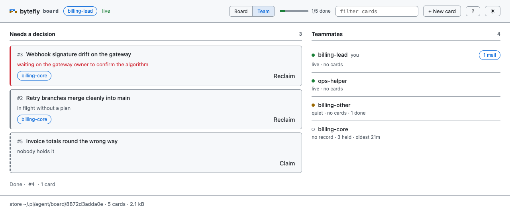

# team — the lead's round over the board

`board` owns the cards. `team` owns the lead's five actions: `assign` hands a card to a
session that is **already running**, `offer` hands one to whoever is free, and `reclaim`
takes one back when its owner is gone or has gone quiet. `assign` writes the card and puts
a handoff on the session bus, `offer` writes only the moment it was made — never an owner,
because the first peer to claim is what makes an offer into work — and `reclaim` writes the
card alone, so it needs no bus. `ask` writes no card at all: it sends one peer a question
as an `ask` message, and the answer comes back as ordinary mail.
The report says what the peer will actually do with it.

Nothing starts a process. A message lands in the peer's inbox and is reported at its next
turn, so `assign`, `offer`, and `ask` are messages, not launches — and `ask` is the one that
waits for nothing at all: a question nobody answers leaves the lead exactly where the
round already put it.

Both halves are **opt-in**, because the board is a workflow a session either runs or does
not. A lead names both — `PI_ENABLED_EXTENSIONS=board,team` — and a worker session that
only works cards names neither. They stay independent at runtime: naming one never loads
the other, and `team` is refused by `PI_DISABLED_EXTENSIONS` like every extension.

Naming `team` alone is legal and stays so — the factory needs no board to register — but
it is the crippled case: every card it moves is one no `board` tool can read. `doctor`
reports the board row as opt-in and names the switch that adds it, which is the one place
a reader who took that shortcut is told.



*The Team tab: the cards that need the lead, then who is on the team — including an
owner whose label nothing answers to, and a teammate that is not listening. A row is one
line; the owners a bus has no record of collapse to one row*

## Capabilities

| Capability | How | What you get |
|---|---|---|
| Join the team | `/board` as the lead, `/team join <label>` as a teammate, or the first card you claim | The session is on the team under a name peers address, listening, and `/team` and the Team tab list it |
| Hand a feature to a running session | `team` action `assign` | The card is `plan`, owned by that session, and a handoff is in its inbox |
| Tell the peer what to do first | `team` action `assign` with `note` | The handoff carries the card, its paths, its plan, and that line |
| Hand a feature to whoever is free | `team` action `offer` | Every other live session gets an event naming the card; the card stays unowned until one claims it, and it records when the offer was made, so a lead can tell an offer nobody took from a card nobody has looked at |
| Ask a peer how its work is going | `team` action `ask` | One peer's inbox gets an `ask` message — the question, and the one line back: `session send` to the lead. The result says which labels the message reached and which of them will read it at their next turn, and nothing waits on the reply |
| Know whether a message will be woken for | an `assign`, `offer`, or `ask` result, `/team`, and the Team tab | All three name the peers whose record says their next turn is when it lands: the result as `Not listening: <labels>`, `/team` as a lowercase `not listening:` inside its presence line, the Team tab as a chip |
| Take a card back | `team` action `reclaim` | The owner clears, the card returns to Backlog, and its notes stay |
| Keep the round to the team | `team` | Only `assign`, `offer`, `reclaim`, `claim`, and `ask`: no card is created, contracted, approved, or finished here — that is `board`'s surface, which is where a claimed card is planned and moved |
| See the round without a browser | `/team` | `buildRound`'s summary — the one the page's Team tab is served — laid out as text by `formatRound`: what needs a decision, who holds what, then one line naming the cards a dead owner left behind, and one presence line for who is live, who is not listening, who has gone quiet, and who is gone. Every session that line names carries what it is holding, from `lib/board/round-text.ts`'s one phrase — `live: helen — #162 plan · quiet: cara — idle · gone: dan — #1 execute +1` — so a session holding one card and one holding nothing are read apart; `not listening:` is the exception and names the peer only, because it is a flag on an entry already listed as live. The owners the bus has no record of and that hold nothing are one line, `18 owners with no record · 76 done`, in the Team tab's own words — the fold is the same rule and the same sentence on both surfaces, and it keeps a long history from spending the round's cap. The rollup itself is capped at ten lines, then `… N more`, and the gone and presence lines follow the cap rather than counting against it — the cap is a notify's limit, not a screen's. An empty board is one line |

## Quickstart

```
lead: /board                                            → on the team as lead, listening
peer: /team join billing-core                           → on the team as billing-core, listening
lead: team({action:"assign", card:"4", to:"billing-core", note:"start with the webhook"})
      → #4 handed off to billing-core.
peer: board({action:"contract", card:"4", path:"…", goal:"…", acceptance:"…", scopeOut:"…"})
      → the card records its plan and its contract
peer: board({action:"note", card:"4", text:"…"})        → a phase, as it happens
later: team({action:"reclaim", card:"4"})               → #4 reclaimed from billing-core
lead: team({action:"ask", to:"billing-core", question:"what is left on #4?"})
      → Asked billing-core. The answer arrives as mail; nothing is waiting on it.
```

Work nobody has taken instead of work you are routing:

```
lead: team({action:"offer", card:"5", note:"whoever is free"})
      → #5 offered to billing-core, billing-web.
peer: board({action:"claim", card:"5"})                 → the offer becomes work
```

Nobody free, so the lead takes it:

```
lead: team({action:"claim", card:"5"})                  → #5 is yours, in plan.
      → design it in plan mode, `plan` action `write`, then `board` action `contract`
```

## Joining the team

You do not configure a team; there are no members to add. The team is the session bus,
the local coordination channel between Pi sessions on this repository, and staying off
its surface is the point: `board` and `team` join this session for you.

| You are | Action | What happens |
|---|---|---|
| The lead | `/board` | The session joins as the board's lead (`board.lead`, `lead` by default) — the name the page serves as — and listens, so a handoff or an offer is reported at its next turn |
| A teammate | the first card it claims | The session joins under the name it already holds, or a preset teammate name (`tom`, `lily`, `ben`) when it has none, and listens; Pi's footer keeps the name it already had |
| A teammate who wants a name | `/team join billing-core` | The session joins as `billing-core`, and Pi's footer and `/resume` show that name — the one join that renames |
| A viewer | `/board` on a session that is not serving | The page is somebody else's to serve, so this session joins under its own name instead of the seat |

Joining is listening: mail is reported at that session's next turn, and **no turn is
raised** for it, so being on the team never spends a turn. `/team join` with no name draws
one when Pi has no name for the session — `lily` rather than the repository's basename — and
renames nothing; a session Pi already names keeps that name. `/team` says who is live and
who is live but not listening. `/board status` reports the team this session is on — which
label, and whether mail reaches it — whichever door put it there, and prints no team clause
only when this session never joined at all.

**The seat is not a session.** The page is a view: it has one name — the board's lead — and
an id of its own, `board:<lead>`, and it writes nothing, so it holds no card for a lead to
take back. Its cards come from the session that serves it, whose label is the same and whose id
is not: a card that session claimed is the session's, and `release` returns it.

## Tool

`team` is one action-shaped tool. `readOnlyHint: false`, `destructiveHint: true`,
`openWorldHint: false`, `executionMode: "sequential"`.

| Action | Parameters | Behaviour |
|---|---|---|
| `assign` | `card`, `to`, `note?` | Checks the card's preconditions, sends the handoff as a `handoff` message, then records the owner. `to` that names this session is refused — a card you will take yourself is `claim` |
| `offer` | `card`, `note?` | Checks the preconditions a claim would meet, broadcasts the card as an `event` to every other live session, then records the offer on the card — the moment, and nothing else: status and owner are untouched |
| `reclaim` | `card` | Clears the owner and returns the card to Backlog, keeping its notes, contract, and plan |
| `claim` | `card` | Takes a pool card for this session: it enters `plan`, owned by the round's session, and the claim asks to join the team once — the same operation and the same join `board`'s claim makes. A card somebody holds, one that waits on unfinished work, and a full `plan` lane are refused with the board's own sentence |
| `ask` | `to`, `question?` | Sends one peer a question and writes nothing else: no card is named, so no card is read or written. `question` defaults to asking how it is going. `to` that names this session is refused — the round already says what you hold |

`card` takes `4` or `#4`, and every action but `ask` needs one. `to` is a teammate's label or id, as `/team` lists them — a
label nobody answers to cannot be handed a card or asked anything, and the result says so.

The parameters are one flat object, so a field is published to every action at once.
An action reads only the fields in its row above, and a call carrying one that its
action does not read is **refused**, naming the action that takes it — not ignored.
`to` is the one that matters: an `offer` that named a peer was broadcast to every live
session while the lead believed it had named one, and a `reclaim` that named one took
the card back from its holder anyway.

```
offer does not act on to: `assign` takes it.
```

`ACTION_FIELDS` in `types.ts` is the table that answers this, `lib/stray-fields.ts` is
the sentence, and a test holds every published parameter to an action that acts on it. Two
verbs read `to` now — `assign` and `ask` — so the refusal names both.

### The order is the point

`assign` sends **before** it assigns, and each failure leaves a state the report names:

| What failed | What the card is | What the lead reads |
|---|---|---|
| the card is missing, `done`, held by a third session, or waiting on unfinished work | untouched | the refusal, with no message sent at all |
| the send | untouched — `backlog`, no owner | `#4 was not handed off to billing-core: …`, plus `The card is unchanged.` |
| the assignment, after a successful send | whatever the other writer left | `#4 was handed off to billing-core, but the card changed before it could be assigned: …`, and the peer is told to `board claim` it |

`offer` broadcasts **before** it records, for the same reason: an offer nobody received
must not leave a record claiming one happened. A refused broadcast leaves the card exactly
as the rules read it, and the write that follows changes one field — when the offer was
made. If the card changed in between, the peers already have the message, so the refusal
says the offer stands as a message and the board is what it now says. The first `board
claim` is what turns an offer into work, and the claim is what clears the record: every
answer to an offer — a claim, an assignment, a release — takes it with it, so a record
here means the offer is still open. Two peers claiming at once are settled by the store's
compare-and-set; one claim wins, and the other is refused with the owner named.

`delivered` in the details means a message file was written for that label — not that the
peer read it. `notListening` names the peers it reached whose record says they are not
listening, so the message waits for their next turn.

The owner `assign` records is the **session**, not just its name: before writing the card
it reads the team list and keeps the id of the session behind that label. Ownership is
compared by id first (`lib/board/rules.ts`), so a peer that renames itself still holds its
card; a card assigned by label alone — an older one, or one whose session the bus could
not name — goes back to `reclaim` if its holder renames.

### What the peer does on waking

A handoff is an instruction, not a notification: the peer's notice is headlined
`1 handoff`, carries enough of the body to be actionable, and says the work is theirs —
read it with `session inbox`, record the plan, and start it. The card is already theirs
(`assign` wrote the owner), so there is no claim step; the peer writes the contract, works,
and notes each phase. The message names what is left: `blocked` is the peer's own, while
`execute` waits on the lead's `approve` of the contract and `done` on the lead's `review`,
so a peer is never told to make a move only the lead can sign — it is told which name to
ask, with `session send`. `assign` and `offer` write that sentence from the store's
`board.lead`, so the lead a handoff names is the one whose signature the gate will take,
and they write it before the paths, so a message clipped to the bus's limit keeps its step
and loses its tail. The owner is recorded after the message is sent, though, so the block
closes with a condition the peer can act on: a card whose write lost the race is not theirs,
and it says to leave that card alone and ask the lead — `session send`, the same channel the
gates line names, from the same phrase.

An offer is advice: nothing is theirs until they claim it, and a card nobody claims stays
`backlog`, so it keeps showing up as unassigned in the round — with its age, which is the one
thing an event cannot carry. `board` prints it as `offered 1m ago, and nobody took it`, the
card face says `offered 1m ago · nobody took it`, and the Team tab's queue says
`offered 1m ago — nobody took it` in place of "nobody holds it". A lead reading that has a
decision the plain unassigned row never offered: re-offer, `assign` it, or take it with
`claim`, which is yours then — the card sits in `plan` waiting on you, and its contract,
moves, and finish are `board`'s in this same session.

## Security

- The tool writes the board store and calls one other extension's tool (`session`); it
  starts no process, opens no socket, and reads no credential.
- A handoff or an offer is a message to other local sessions, so it carries nothing the
  board would not show: the card's title, paths, plan, and the lead's note. An offer names
  every session on the repository as a recipient, so it says nothing it would not say to
  each of them.

## Limitations

- **Nothing here can start a peer's turn.** A message is reported at the recipient's next
  turn; a session that is not listening at all reads it only when it reads its inbox.
- **`to` must be on the team.** A session that never opened the board, joined, or claimed a
  card cannot be handed a card, and an offer to nobody says so.
- **A held card is not assignable.** `assign` moves a pool card; one somebody already holds
  is refused, because a handoff cannot take work away from its owner — `reclaim` it, then
  assign. The handoff is sent before the owner is written, so another session can take the
  card in between: the peer reads that a card whose write lost the race is not its to work,
  and the lead's refusal names the card the board now shows.
- **The lead's name is a label, not a person.** The seat is not a session, so its actor id
  `board:<lead>` answers no message; the label is the one the session serving the page joins
  under, so a handoff to it reaches whoever is serving the page just now —
  and is refused, like any other label, when nobody is. The seat's cards come back with
  `reclaim`. The name is reserved while the bus keeps that session's record — ten minutes
  past its last heartbeat — so a peer cannot take it by joining first; after that it is
  anyone's, and a sign under it is a name rather than an identity.
- **A label-only owner is fragile.** If the bus could not name the session behind `to`,
  the card records the label, and a rename would need a `reclaim` and a fresh handoff.
- **A preset name is drawn, not chosen.** An unnamed session that joins draws one of the
  preset teammate names and Pi's footer keeps whatever it had; type `/team join <label>` to
  pick the name and make it Pi's.
- **An offer is advice.** A card can sit offered indefinitely; the round keeps counting it
  as unassigned, which is the honest signal that nobody took it.
- **An offer arrives as an `event`.** A burst that mixes one with ordinary messages is
  headlined as new messages rather than named as an offer.
- **Liveness is a heartbeat; listening is a field.** A running session rewrites its record
  every ten seconds and the record is believed for ten minutes, so `quiet:` means the
  record went stale rather than that the peer died, while `not listening` is the separate
  `watching` field, written when the session joins or arms and disarms its watch.
- **Plan mode makes this unavailable.** Neither `team` nor `session` is a read-only tool, so
  plan mode refuses both by name and tells the model to exit and get approval; the board
  stays readable, since `list` is the one action it admits. Assign after the plan is
  approved by the lead — or the person, with `/board approve`.
- **Ownership is advisory.** `assign` does not create a path claim; the peer still claims
  the paths it edits through `session`.

## Pi integration

- **`board`**: the same store, the same cards, the same rules — `team` calls `lib/board/`
  directly, so a card it hands over is one `board` can see. Either extension works without
  the other: without `team` the page still reclaims, and without `board` there is nothing
  to assign — which is why the lead enables both, and why enabling one never loads the
  other.
- **`session-bus`**: the transport, and the one extension `team` talks to — through
  `lib/session-tool.ts`, whose `join` is an in-process request (a command context cannot
  call a tool) and whose `peers` and `send` are nested tool calls. The bus's actions and
  labels never appear on this extension's user surface — `team` and `board` are the
  surface — but its name does, in the sentence an unloaded bus produces: `team: not on the
  team — the session bus is not loaded`. Every call returns that sentence instead of
  throwing, which is the "card untouched" row above.
- **`plan`**: the handoff names the plan file when one is recorded, so the peer knows
  whether it is executing a plan or writing one.
- **`subagent`**: a child process is a different Pi session; hand a card to a peer
  session, not to a child you started for one question.

## Design notes

- **Two extensions, not one tool with a flag.** `board` is the work list any session uses
  and must work with the bus disabled; `team` is the lead's round and is the only thing
  that needs the bus. If the round ever stops needing it, `team` folds back in.
- **Joining is the bus's, wearing `board`'s clothes.** A lead should not have to learn a
  second tool to be on a team, so `/board` joins, the first claimed card joins, and
  `/team join` is the one naming action. `wake` stays a bus-level choice and is never
  armed on a user's behalf, because it spends turns.
- **Push and pull are two verbs.** `assign` writes the owner and sends one message;
  `offer` broadcasts and writes nothing. One verb with an optional `to` would have two
  outcomes and one details shape, and a reader could not tell which happened.
- **The offer's preconditions are a dry-run claim.** `applyOp` judges what a peer is about
  to do, so a card nobody may claim is refused before anything is sent, and the refusal is
  the rules' own sentence rather than a second copy.
- **Listening is a record field.** The bus writes it when a session joins or stops
  listening, so the report, `/team`, and the Team tab read one fact from disk instead of
  guessing from the send.
- **Send first.** A card assigned without a message is a card nobody knows about, while a
  message for a card that then changed is one the peer can still claim.
- **`reclaim` and `claim` are here, and in `board`.** Every one of them is one store
  operation, so the lane rules, the WIP limit, the refusal a waiting card gets, and the
  offer record cleared are the store's answer rather than a second one the round keeps in
  step by hand. `reclaim` belongs here because it is the compensation for a dispatch that
  did not land; `claim` belongs here because the round is where a lead sees work nobody
  took, and a lead told to "take it" should not have to leave the tool to do it. The
  card's *life* after a claim — plan, contract, moves, finish — stays `board`'s: the round
  hands work out and takes it, and the card is lived in one place.
- **Rejected: `assign` to yourself.** Handing a card to your own label records you as the
  owner and mails your own inbox, which is a claim with an extra message and no next step;
  it is refused, naming `claim`.
- **Rejected: `reclaim` messaging the previous owner.** A compensation path must not depend
  on a second delivery — the reclaim is what you do when the owner is gone, so its message
  would fail exactly when it is needed. The card is the record.
- **Rejected: a fifth message kind for an offer.** An offer is something that happened on
  the board, which is what `event` already means; a new kind would change the protocol, the
  notice, and every reader for one verb.

## Files

| File | Responsibility |
|---|---|
| `index.ts` | The factory: gate on the opt-in switch (`PI_ENABLED_EXTENSIONS`) and `PI_DISABLED_EXTENSIONS`, build the session, register the tool and the command |
| `schema.ts` | The tool's four actions and their parameters |
| `tools.ts` | The dispatch order, the refusals, and the report |
| `dispatch.ts` | The handoff and offer text, the bus behind a seam, and who is not listening |
| `commands.ts` | `/team` — the round, and `/team join [<label>]` |
| `format.ts` | The model-facing text for a handoff, an offer, a failure, a race, and a reclaim |
| `types.ts` | The tool's name, actions, and details |

The store, the rules, and the session identity are `lib/board/`; the join, the peer list,
and the message send are `lib/session-tool.ts` — see [`lib/README.md`](../../lib/README.md).

## Testing

`test/suite-manifest.ts` declares `team/{commands,dispatch,tools,extension}`: the handoff
and offer text, the bus's answers behind the seam, the assign/offer/reclaim ordering
against a recording dispatch, `/team` and `/team join`, and the factory.
