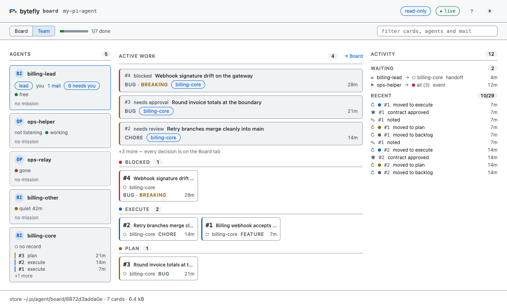

# team — the lead's round over the board

`board` owns the cards; `team` is how a lead moves them between sessions: hand one
to a peer that is already running, offer one to whoever is free, take one back
when its owner is gone, claim one for yourself, or ask a peer a question. Nothing
here starts a process — every action is a message, and a peer listening with `wake`
is woken for it ([`session-bus`](session-bus.md) owns that rule).



- **A message, not a launch.** `assign`, `offer`, and `ask` land in an inbox and
  start no process; a session listening with `wake` is woken by them exactly as by
  any other message.
- **Joining is automatic**: `/board`, a claim, an `assign`, or an `ask` puts the
  session on the team; `offer` and `reclaim` join nothing.
- **`/team join <label>`** is the one door that renames the session.
- **Nothing is spawned** — a peer that is not running stays not running.

## What you can do

| What you want | What to do |
|---|---|
| Hand a card to a running session | `team assign 4 to billing-core` |
| Offer one to whoever is free | `team offer 5 note "whoever is free"` |
| Take a card back from a quiet owner | `team reclaim 4` |
| Take a card yourself | `team claim 5` |
| Ask a peer a question | `team ask to billing-core question "what is left on #4?"` |
| See the round | `/team` in the terminal, or the board's Team tab |
| Join under your own name | `/team join billing-core` |

## Try it

Two sessions, one repository. In the first:

```text
/board
```

It joins as the lead. In the second, claim a card — that joins it under its own
name. Then, from the lead:

```text
team assign 4 to billing-core
```

The peer is told at its next turn; the card's owner is `billing-core`, and the
lead's round now shows it as held.

## Reference

**Actions.** `assign` (card, `to`, `note?`) joins, then sends a handoff, then records the
owner; `offer` (card, `note?`) broadcasts the card and records only the moment it
was offered, so the first peer to claim it wins; `reclaim` (card) clears the owner
and returns the card to Backlog with its notes and contract, and its result names the
paths the old holder still has (`2 paths stay held by api-core until it stops`) — a peer
only from an
owner whose record says it stopped, while the lead takes anybody's and keeps the
spot-check only its own signer withdraws; `claim` (card) takes a pool card into
`plan` for this session; `ask` (`to`, `question?`) sends one peer a question and
writes nothing else.

A flat parameter object means an action refuses a field it does not read, naming
the action that takes it — `offer` does not take `to`.

**Who is who.** `/team` lists who is live, who is live but not listening, who has
gone quiet (a heartbeat older than ten minutes), and who is not on the bus at all —
an owner a card names that no record answers. A label nobody answers to cannot be
handed a card; the result says so. A card a quiet owner holds is named as
reclaimable, because its record says it stopped; one held by a session the bus has
no record of is not, because a live session that never joined looks the same. A
handoff, offer, or ask that reaches a quiet peer says so, because a written message
is not a heard one, and a session that is not listening reads its mail at its next
turn.

**Joining.** `/board` joins you as the board's lead (`board.lead`, `lead` by
default). Another session joins under its own name — `/team join <label>` picks it,
or a preset name is drawn — and a claim, an assign, or an ask makes that join
once. Being on the team never spends a turn.

`assign` and `ask` join **before** they send, because the message names this session
as the way back, and send nothing when the join is refused. A claim writes the card
first and joins after it, so the card is yours either way and the result carries
`Not on the team: …`. The reason says what to do, and the door is not always
`/team join`: with no bus loaded it names the extension to turn on, and with the
label held by another record it says whose it is — joining under another name is
the other way, and it costs a lead its signature, because the gates compare
`board.lead` by label.

**Plan mode.** Neither `team` nor `session` is read-only, so plan mode refuses both
by name; `board list` still reads. Assign after the plan is approved.

## Limits

- Nothing here starts a peer's process: a peer that never joined cannot be handed a
  card, and one listening with `wake` is woken by its mail.
- A card somebody already holds is not assignable: `reclaim` it, then assign.
- An offer is advice — a card can stay offered indefinitely, counted as
  unassigned, which is the honest signal.
- Ownership does not claim paths: the peer still claims the files it edits through
  `session`.
- The lead's name is a label, not a person: it reaches whoever is serving the page
  just now, and nothing when nobody is.

## Settings

`team` has no keys of its own; the lead name it writes under is `board.lead` in
the `board` section of `bytefly.json`
([configuration](../configuration-reference.md#board--the-shared-feature-board)). To switch
the extension off, toggle `team` in `/bytefly`; a session that keeps `board` alone
can still move cards itself.

## Learn more

- [Several sessions](../multi-session.md) — the whole round, from the first claim
  to the second signature.
- [`board`](../extensions/board.md) — the cards this round moves.
- [`session-bus`](../extensions/session-bus.md) — the bus every message travels on.
- [Work a board](../tutorials/first-board.md) — one card through both signs.
