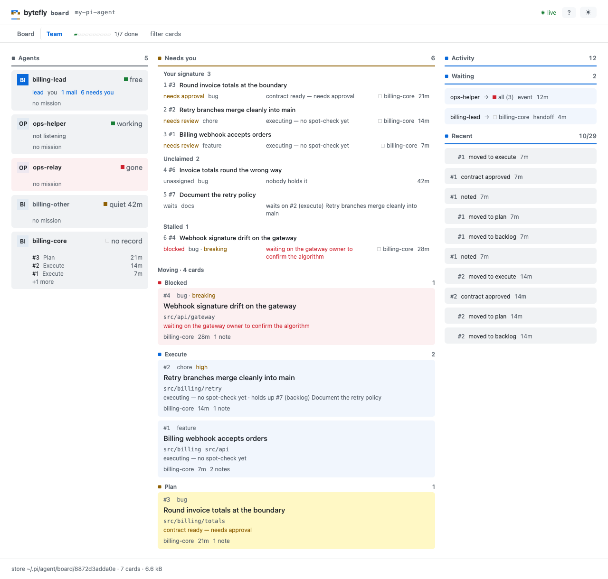

# team — the lead's round over the board

`board` owns the cards; `team` is how a lead moves them between sessions: hand one
to a peer that is already running, offer one to whoever is free, or ask a peer a
question. Nothing here starts a process — every action is a message, and a peer
listening with `wake` is woken for it ([`session-bus`](session-bus.md) owns that).
A card's own state — `claim`, `reclaim`, the moves, the contract, the two signs — is
[`board`](board.md)'s. What outlives the round is the project's [`memory`](memory.md) store.



The board's Team tab is the same round as a page: three columns that count themselves and scroll as
one. **AGENTS** gives each session a card, the lead pinned first — a monogram, its state and age at
the edge, `lead` and `you` chips with the mail and needs-you counts, and one mission line.
**NEEDS YOU** is the seat's queue over `blocked`, `execute`, `plan` and `backlog`, counting only what the
seat can finish: `approval`, `untold`, `gone`, `unwritten`; folded at five, with `The board · N open`
counting the lanes and a large pool reduced to one line and a door. **ACTIVITY** draws unread mail as a
block — a fill and an accent edge — above a flat recent history; reading consumes nothing, and
`WAITING` counts sends, one row each however many inboxes it reached, while a card's chip counts its
own inbox's files.

## What you can do

| What you want | What to do |
|---|---|
| Hand a card to a running session | `team assign 4 to billing-core` |
| Offer one to whoever is free | `team offer 5 note "whoever is free"` |
| Take a card back from a quiet owner | `board reclaim 4` |
| Take a card yourself | `board claim 5` |
| Ask a peer a question | `team ask to billing-core question "what is left on #4?"` |
| See the round | `/team` in the terminal, or the board's Team tab |
| See who is here, and what each holds | `/team who` — one row per session, `- none` for an empty group; `/team who billing-core` for one |
| Join the team | `/team join billing-core` names yourself, `/team join` for a `team.teammates` name, `/team help` for the words |
| Leave the team | `/team exit` — drops this session's bus record and its claims, refusing while a card or the page's seat is yours |

## Try it

Two sessions, one repository. In the first:

```text
/board
```

It joins as the lead; in the second, `board claim` joins it under its own name. From the lead:

```text
team assign 4 to billing-core
```

The peer is told at its next turn; the card's owner is `billing-core`, and the lead's round shows it held.

## Reference

**Actions.** Three, and every one of them reaches another session. `assign` (card, `to`, `note?`) joins, then
sends a handoff, then records the owner — read from the team *after* the message, so a stopped record cannot
become the owner — and whether the bus took it: `told` means written,
not read, because mail is pruned after a day; a handoff whose write lost the race names both outcomes in its own
body — leave a rival's card alone, or claim one the write left nobody's; a completed contract tells the lead,
and `approve` tells the holder; `offer` (card, `note?`) broadcasts the card and records only the moment it was
offered, so the first peer to claim it wins; `ask` (`to`, `question?`) sends one peer a question and writes
nothing else: its own ask id, and the answering session by id, so a reply sets `replyTo "<id>"` and the
bus prints it as `re: <id>`.

`/team`'s stalled line names the door: `board reclaim 1, 2 — api-core stopped`. A field an action does
not read is refused, naming the verb that takes it — `offer` takes no `to`, and `assign` and `ask` refuse
`*`, which is `offer`'s broadcast.

**Who is who.** `/team` lists who is live, who is live but not listening, who is quiet (a heartbeat past ten
minutes), and who is absent from the bus — an owner a card names that no record answers. A label nobody
answers to cannot be handed a card, and a rename is one row: a card is named by the record its owner's **id**
names. A handoff the bus could not name records the owner `unresolved`: mail reaches the label, but only the
lead moves the card. A quiet owner's card is reclaimable; one held by a session with no record is not — a
live session that never joined looks the same. A message to a quiet or not-listening peer says so: written
is not heard. `/team who` prints that answer as rows — `live (n)`, `quiet (n)`, `not on the bus (n)`,
`gone (n)`, nothing elided — and `/team who <label>` answers for one. The round closes with
`2 of 4 sessions live — /team who lists them`.
**Joining.** `/board` joins you as the lead (`team.lead`). Another session joins under its own name — `/team
join <label>`, or a bare one for the first free `team.teammates` name, the id-derived `team-agent-` name when
none is free. A recordless board session is named the same way, so card and join agree; a bare join writes
nothing and leaves Pi's name alone. A team join asks for `wake`, so a handoff, an ask, or a sign starts an
idle teammate's turn; `session join listen:false` is the opt-out.

**The tool arrives with the team.** `team` is offered only to a session the bus holds a record of: a turn
start reads the record, adds the tool the turn after a join lands, and takes it away the turn after a leave. A
session on no team is told where the door is instead, in the line the board would have drawn — `/team join
<label>`, or `/board` for the seat — so a missing tool reads as "not yet" rather than "this Pi has no team".
All three verbs ask the same question before they read a card or send anything, and with no bus loaded nothing
is offered at all: there is no team to be on. Nor is `/team join` always a door — with no bus loaded it names
the extension to turn on, a held label says whose it is, and with `team` toggled off `/board` is the one left.

**Leaving.** `/team exit` is the inverse: the record goes, the claims it holds are released, the watch
stops and the bar stops drawing the name. Two facts hold it back, each on its own line with the door that
frees it: a card this session holds (`board release 935`), which with no record a peer could never take
back, and the page's seat (`/board stop`), which the next sign would put back on the bus. Joining again —
`/team join`, `/board`, or `session join` — puts the session back under the same id, and the tool returns with
it at the next turn; delivered mail stays until `/sessions drop` clears it.

**Plan mode.** Neither `team` nor `session` is read-only, so plan mode refuses both by name; `board list` still reads, and assign waits for the approval.

## Limits

- A card somebody already holds is not assignable: `board reclaim` it, then assign.
- An offer is advice — a card can stay offered indefinitely, counted as unassigned.
- Ownership does not claim paths: the peer still claims the files it edits through `session`.
- The lead's name is a label, not a person: it reaches whoever is serving the page
  just now, and nothing when nobody is.

## Settings

The team is `bytefly.json`'s `team` section — `team.lead`, whose signature the two gates take, and
`team.teammates`, the names a session draws from, five by default ([configuration](../configuration-reference.md#team--the-projects-own-team)).
Toggle `team` in `/bytefly` to switch it off; `board` alone still moves cards.

## Learn more

- [Several sessions](../multi-session.md) — the whole round, from the first claim to the second signature.
- [`board`](../extensions/board.md) — the cards this round moves.
- [`session-bus`](../extensions/session-bus.md) — the bus every message travels on.
- [Work a board](../tutorials/first-board.md) — one card through both signs.
