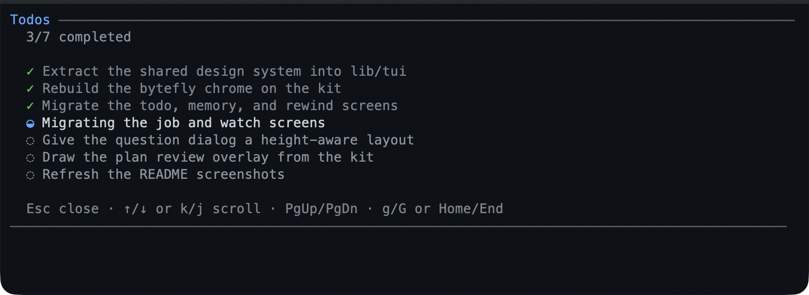

# todo — keep the task list in view

The model keeps a task list for whatever it is working on, and you can see it
above the editor at any moment:

```text
Todos · 1/3 · Writing the retry tests
```

- **Use it for** work longer than a couple of steps.
- **You don't drive it** — the model rewrites the list; ask for a change in words.
- **`/todos`** shows the whole list whenever you want to look.

## What you can do

| What you want | What to do |
|---|---|
| See how far the work has got | the line above the editor: how many items are done, then the active one |
| Read the plan the model is following | `/todos` |
| Change the plan | say so in your next message; the model rewrites the list in one step |
| See the list again after `/resume` or `/tree` | nothing — it belongs to the conversation, and an earlier point keeps its own list |
| Clear the rail once everything is done | nothing — it hides itself, unless you turned that off |

## Try it

Ask for a job with steps, then watch the rail:

```text
Refactor the uploader to retry three times, and add tests.
```

```text
/todos
```



Each row is one line: `✓` done, `◒` in progress, `◌` pending. The screen keeps the
order the model wrote it in, so it reads as the plan rather than as history.
[Track your first task](../tutorials/first-task.md) walks a whole job through it.

## Reference

The model resends the complete list on every call — an empty list clears it — so
a change you ask for lands in one step rather than as a series of edits. A call
that breaks a rule is refused with the previous list intact, so the model retries
instead of half-applying:

- one item in progress at a time, and the active row says what is happening;
- at most 50 items, at most 500 characters each;
- non-empty, unique text;
- each row is squeezed to one line, so a long task never breaks the rail.

The list is session state, not a file: a new session starts empty, and
`/resume` or `/tree` restores the list for that point in history.

On the `/todos` screen: `↑`/`↓` or `j`/`k` scroll one row, `PgUp`/`PgDn` page,
`g`/`G` jump to the ends, and `Esc` closes it. The rail and the screen need the
interactive terminal; a scripted run gets the tool result only.

## Limits

- No priorities, due dates, or dependencies — a flat checklist.
- There is no checkbox you can tick yourself: ask for the change in words.
- The list is per session: nothing is shared between sessions or machines.
- The list can lag by a turn. Say "update the todos" and the model rewrites it;
  the extension also sends one reminder when substantial work lands without an
  update.
- A finished list stays readable in `/todos` until the model changes it.

## Settings

| Key | Default | What it does |
|---|---|---|
| `hideWhenComplete` | `true` | Hide the rail once every item is completed. |

It is a `bytefly.json` edit — the settings screen does not list it; the
resolution rules are in
[configuration](../configuration-reference.md#todo--the-todo-widget). To switch the
extension off entirely, toggle `todo` in `/bytefly`.

## Learn more

- [Track your first task](../tutorials/first-task.md) — the walkthrough.
- [`goal`](../extensions/goal.md) — the other line above the editor.
- [`plan`](../extensions/plan.md) — a plan you approve before work starts.
