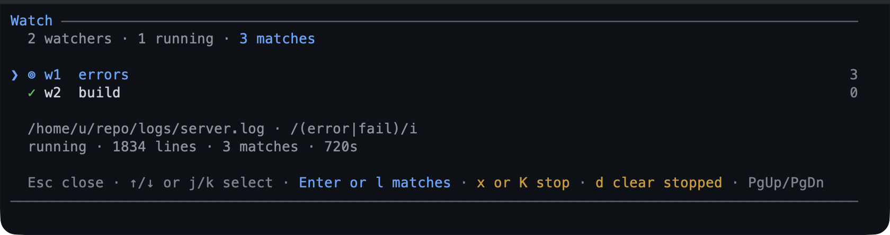

# watch — react to a line, not to a job

`watch` tails a file or a command's output, matches each new line against a
pattern, and keeps the matches. You can be told at the next turn, woken when a
match lands, or get an OS notification — instead of polling a log by hand.



- **Files or commands**: a file is followed from its end, a command's merged
  output is streamed.
- **Patterns, with an exclude list**, case-sensitive only if you ask.
- **A match can wake the agent** — once, when it is idle — or simply be reported
  at the next turn.
- **Everything is bounded**: matches per watcher, raw lines, long lines, and the
  number of watchers.

## What you can do

| What you want | What to do |
|---|---|
| Watch a log for errors | ask: "watch server.log for ERROR and tell me" |
| Watch a command's output | ask for a watcher on the command |
| Be woken by a match | ask for a wake, or set `wakeOnMatch` |
| Read the matches | `/watch matches <id>` |
| Read the raw tail | `/watch logs <id>` where a pattern matched nothing |
| See every watcher | `/watch` — the screen, or the list outside the TUI |
| Stop one | `/watch stop <id>`, or `x` on the screen |
| Remove stopped ones | `/watch clear` |

## Try it

```text
Watch the dev server's output for ERROR or Traceback.
```

Then, in a later turn, the matched lines are there. `/watch` lists each watcher
with its match count, and `Enter` opens its matches.
[Run long work in the background](../tutorials/first-background.md) walks a job
and the watcher that reads its log.

## Reference

**Actions.** `watch add` takes the source (`path` or a command), an include
pattern, optional `exclude`, `caseSensitive`, `fromStart`, and `wake`;
`list`, `status`, `matches`, `logs`, `stop`, and `clear` manage what exists.
A pattern written the way the tool prints it — `/ERROR/`, `/ERROR/i` — is read as
that expression, delimiters included.

**Commands.** `/watch` (screen or list), `/watch list`, `/watch matches <id>`,
`/watch logs <id>`, `/watch stop <id>`, `/watch clear [all]`. On the screen:
`j`/`k` move, `Enter`/`l` opens matches, `x`/`K` stops behind a `y`/`N` confirm,
`d` clears stopped ones, `Esc` closes.

**Delivery.** Matches are reported to the model at the start of the next turn. A
watcher with `wake` raises one triggered turn as soon as the agent is idle,
including right after a running turn settles; with `notify` on, that match also
leaves the terminal as a desktop notification.

**Bounds.** `maxMatches` per watcher, `maxLogLines` for the raw tail,
`matchChars` for what a pattern is run against, `maxWatchers` live at once, and
`maxRecords` in the table. A file watcher polls every `pollMs`.

## Limits

- A file watcher polls, so a line can take up to `pollMs` to surface; it is not
  an inotify watcher.
- Matching is per line: a pattern cannot span a newline, and a line longer than
  `matchChars` is matched on its first `matchChars` characters.
- A pattern's safety check is a shape check, not a proof: a pathological
  expression that gets past `add` is bounded by `matchChars` but not timed out.
- Watchers hold live state in memory and stop with the session; a resumed session
  starts with none.
- Only a **wake** match notifies the desktop, and only when `notify` is on.

## Settings

| Key | Default | What it does |
|---|---|---|
| `wakeOnMatch` | `false` | Default wake for a new watcher; a per-watcher `wake` overrides it. |
| `maxMatches` | `200` | Matches kept per watcher before the oldest are dropped. |
| `pollMs` | `500` | How often a file watcher checks. |
| `enabled` | `true` | Allow `add` at all. |
| `showStatus` | `true` | Show the `⊚ N` and `! N` chips. |

The rest — `maxWatchers`, `maxRecords`, `maxLogLines`, `matchLines`, and
`matchChars` — are in
[configuration](../configuration-reference.md#watch--file-and-command-watchers). To switch
the extension off, toggle `watch` in `/bytefly`.

## Learn more

- [Run long work in the background](../tutorials/first-background.md) — the
  walkthrough.
- [`job`](../extensions/job.md) — run the command the watcher is reading.
- [`notify`](../extensions/bytefly.md) — where the desktop alert comes from.
- [`question`](../extensions/question.md) — the other way a turn can wait for you.
