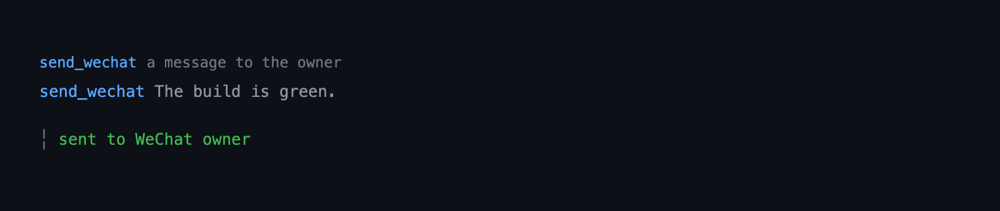
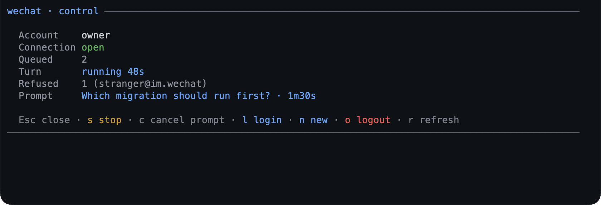

# wechat — a WeChat bridge with one conversation

Connect Pi to WeChat over Tencent's Weixin iLink bot API. The chat *is* this Pi
session: an inbound message starts a turn here, its answer streams back to the
phone, and the terminal and the chat share one transcript, one model context, and
one toolset. Only the account's owner is answered. The bridge runs in-process; no
session is fabricated.

## Capabilities

### Conversation

| Capability | How | What you get | Status |
|---|---|---|---|
| Per-message turn | automatic: the wait timers | Each message gets its own turn and answer; a wait is acknowledged once, and an empty or failed turn says so. | Shipped |
| Inbound media | automatic: an inbound image or file | Images arrive as model image content, files are saved and referenced by path, and voice uses the server's transcript. | Shipped |
| Inbound replay safety | automatic: the WeChat message id | A replayed message id is answered once, remembered for an hour across a reconnect or reload. A batch is acknowledged only once its messages reach the turn queue, so a kill or a close mid-download reads that message again instead of losing it. | Shipped |
| Inbound text cap | `maxInboundChars` | Text past the configured cap is truncated with a marker instead of becoming an unbounded prompt. | Shipped |
| Chat language | automatic: a message written in Chinese | Notices, `/help`, and `/history`'s `你` / `我` line labels answer in the chat's language, and a neutral reply does not switch it back. | Shipped |
| Slash commands | `/new`, `/stop`, `/cancel`, `/status`, `/history`, `/help` | The chat stops, withdraws the question it is waiting on, inspects, or asks for help without spending a turn. | Shipped |
| Fresh session | `/wechat new` (terminal) | A new terminal session starts unbound; the chat is whatever session runs the bridge. | Shipped |
| Typing indicator | `typingIndicator` | The phone can tell a long turn from a dead bridge. | Shipped |

### Remote control

| Capability | How | What you get |
|---|---|---|
| Plan review over chat | automatic: a `plan` action `exit` on a WeChat turn | The plan arrives as a file, then a digest, then one numbered question of four choices — approve, keep planning, exit, revise — and an editor only for revise. |
| Forwarded dialogs | automatic: a dialog in a chat turn | Any dialog a chat turn raises — a question, a plan review, a tool's `confirm` — is asked and answered in the chat. |
| Questions | `question` | The chat answers its question, numbered, and a reply is routed to that prompt alone. |
| Control screen | `/wechat` | Account, connection, queue, the running turn, refusals, and the waiting prompt on one live screen. |
| Prompt cancellation | `/cancel` in the chat, `/wechat cancel`, `c` on the control screen | The waiting question is withdrawn with a notice, without stopping the turn. |

### Security and admission

| Capability | How | What you get |
|---|---|---|
| Owner-only admission | automatic: the stored account | Only the account's owner is answered; anyone else is refused, counted, and named once on the terminal. |
| One poller per account | `poller.lock` | A second `pi` process is refused instead of stealing the account's messages, and a poller whose lock a takeover replaced stops rather than reading the account beside the new holder. The holder re-stamps the record every 30 s, so a poll attempt that outlasts the 120 s bar — a long-poll hold, then a batch still downloading — is not a takeover. |

### Delivery and reliability

| Capability | How | What you get | Status |
|---|---|---|---|
| Streamed replies | automatic: the reply pipeline | A long answer arrives as it is produced, not as one long silence. | Shipped |
| Proactive message | `send_wechat` | The model messages the owner one text or one local image, sent as a picture. | Partial |
| Abandoned-turn notice | automatic: shutdown, `/reload`, `/new`, logout | The chat gets one line saying the turn stopped, rather than silence. | Unreleased |
| Outbound files | the upload flow, `askHuman` | A remote prompt can deliver a local file before its question, and a failed upload falls back to text. | Shipped |
| Plain chat text | `maxReplyChars` | Markdown markers are flattened, and a long reply is split so each numbered part — `[1/3] ` included — fits the limit. | Shipped |

### Pairing and transport

| Capability | How | What you get |
|---|---|---|
| Hand start | `/wechat start` | The bridge is bound to this session and polls the stored account; nothing opens on its own, and a session that never bound an account runs no poller. |
| Bound to one session | `/wechat start` | The binding is a session-branch entry, so `/resume` and a tree jump open it again, `/new` starts unbound, and one account is polled by one session at a time. |
| QR login | `/wechat login` | One scan stores the account and nothing else; the bridge is started by hand afterwards. |
| Stop | `/wechat stop` | Polling stops, the running turn is cut off with its notice, and the poller lock is released. |
| Reconnect after expiry | `/wechat login`, then `/wechat start` | A fresh login stores the new token, and a start replaces the expired poller with a worker on it. |
| Status chip | `/wechat status` | The status bar names the state — `✆ wechat`, or a persistent `✆ wechat expired` — and a stopped bridge publishes nothing. |
| Logout | `/wechat logout` | One confirmation discards the account, stops polling, and unbinds the session. |

### Upkeep

| Capability | How | What you get |
|---|---|---|
| Health report | `/wechat doctor` | Connection, token age, last poll, lock holder, the turn's state, and recent failures in one read-only report. |
| Chat history | `/wechat history [n]` | The last messages of this session, ten by default and twenty at most. |
| Command help | `/wechat help` | Every subcommand with a line each, printed in the transcript. |

## Quickstart

```bash
pi --extension ./extensions/wechat   # load just this extension
pi -e .                              # load the whole @gavin-hu/my-pi-agent package
pi install ./                        # install the package for a user
```

```text
/wechat login    # scan the QR with the WeChat app; the account is stored
/wechat start    # bind this session to the account and start polling
/wechat          # the control screen: account, connection, turn, waiting prompt
```

One account is bound to one Pi session, and the bridge is started and stopped by
hand on that session: a stored account alone polls nothing. `/wechat start`
binds the session and opens the poller, `/wechat stop` closes it and releases the
lock. The binding is a session-branch entry, so a resume opens it again and a
fresh `/new` starts unbound.

## Tool



`send_wechat` — direct exposure (the default), `executionMode: "sequential"`,
read-write, open-world. It messages the account owner and nobody else: the
recipient is not a parameter, so untrusted generated text cannot be aimed at
another account. Give exactly one of `text` or `image`; neither or both is
refused with the reason. A text send is also refused while a turn with the owner
is in flight, because the bridge is already answering it, while an image is
allowed there — an image cannot duplicate the streamed answer.

| Parameter | Type | Meaning |
|---|---|---|
| `text` | string, optional | Plain text, 1–4000 characters. |
| `image` | string, optional | Path to a local image, up to 4096 characters; the bytes must sniff as an image. |

Result (`details` / `structuredContent`): `{ sent, error? }`. A failed send is an
error result carrying the same shape, so the model can report what went wrong.

```text
send_wechat({ text: "The build is green again." })
send_wechat({ image: "/tmp/plot.png" })
```

The call line carries the message text, or an image's file name rather than its
path; the result is one line — `sent to WeChat owner`, or the failure with a
reason. While the send is in flight the row reads `Sending…` with a live elapsed
count (`startToolProgress`, `elapsedSuffix`), and the settled line carries the
duration once it passes a second, so a slow network reads as slow rather than as
a hung call.

## Commands

`/wechat` is one command with a verb table: a bare `/wechat` opens the control
screen, and every subcommand is the same action one of the screen's keys runs.

| Command | Effect |
|---|---|
| `/wechat` | TUI: the control screen. Elsewhere: a one-line summary. |
| `/wechat start` | Bind this session to the stored account and start polling; a lock another session holds is a refused start, not a binding. |
| `/wechat login` | QR login; on scan, stores the account (one account per file) and points at `/wechat start`. |
| `/wechat new` | Start a fresh session, which carries no binding: run `/wechat start` there. The chat is whichever session runs the bridge, so an inbound `/new` is declined and this verb is the terminal's. |
| `/wechat status` | The same control screen as a bare `/wechat` (the one-line summary while a turn runs). |
| `/wechat stop` | Stop polling on this session and release the poller lock; a turn still running is cut off with its notice. |
| `/wechat doctor` | Print a read-only health report: connection and token age, last poll and hold, lock holder, the turn's state and queue, recent failures. |
| `/wechat cancel` | Withdraw the waiting prompt with its notice, without stopping the turn. |
| `/wechat history [n]` | Print this session's last messages (default 10, max 20); read-only. |
| `/wechat logout` | Confirm, then clear credentials, drop the bridge, and stop polling. |
| `/wechat help` | List the subcommands with a line each. |

`/wechat start` is the only thing that opens a poller. It writes a `wechat`
entry on the session branch — the account key it bound — and then opens the
bridge, so a lock another session holds refuses the start rather than binding a
session that is not running. `session_shutdown` closes the poller and leaves the
entry, which is what makes `/resume`, `/reload`, and a tree jump reopen it, while
a branch that was stopped, or never bound, opens nothing. `session_start` hands
the open back to the harness at once and keeps the work in one promise, so a
command or a tool that arrives mid-open joins the same start.

A confirmed `/wechat login` stores the scanned account and stops there. A poller
that is already running still holds the previous token, so `/wechat start` with a
different account closes it and opens a worker on the new credentials; a start
whose account is already polling reports that instead. `credentials.json` holds
one account, so a scan replaces the previous one. Stored state (`state.json`)
belongs to the account, so starting as a different account begins from an empty
cursor and owner instead of carrying the previous one's over.

A session that expires while running keeps the `✆ wechat expired` chip:
`/wechat status` reports it and points at the fix, and `/wechat login` followed
by `/wechat start` is the recovery.

### The control screen

In the TUI, `/wechat` opens a control screen with the account, connection state,
owner, the queue depth, what the running turn is doing and for how long, the
refused senders, and the waiting prompt (question and age).
`s` stops the running turn and `c` withdraws the waiting prompt, both in place;
`t` starts or stops the bridge on this session. `l` logs in or reconnects, `n`
starts a new session, `o` logs out, `r` refreshes, and Esc closes. The
subcommands above are shortcuts for the same actions and the only route outside
the TUI; an unknown subcommand reports the valid ones. One conversation means no
list to move through: there is no `j`/`k`, no per-sender row, and no `d`/`h`.



### Admission

Only the stored account's owner is answered: the owner id comes from the login
response, and a message whose `from_user_id` names anyone else is refused before
it reaches the state file, a pending prompt, or the queue. A refusal is counted
and shown in `/wechat status`/`/wechat doctor`, and the first one from a new
sender is named once on the terminal, so an operator can see who knocked. There
is no allowlist to widen — admitting a second person would put two people in one
transcript with no way to tell them apart.

### Starting and stopping

`/wechat start` binds this session and polls; `/wechat stop` closes the poller,
withdraws a waiting prompt with its notice, and releases the lock so another
session may take the account. A stop is recorded on the branch, so it outranks
the binding before it and a resume stays stopped; a shutdown records nothing, so
a resume opens what a shutdown closed. One runtime runs one poller: a tree jump
that lands on a branch bound to another account closes the current worker before
the new one opens.

### While a turn runs

A chat turn is a run in this session, so a `/wechat` command typed at the
terminal declines while one is running: `status` prints the one-line summary, and
`login`/`logout`/`new` reply that they are unavailable until the turn finishes.
(`login`/`logout` would drop the connection mid-turn and `new` would replace the
session that is answering.) `cancel` is the exception: a waiting prompt is what
keeps the turn running, so it is answered — or withdrawn — from here too. A
message that arrives mid-turn waits for its own turn and answer; it is never
merged into the running one, and `deliverAs: "steer"` is not used.

### Slash commands

The chat can type a slash command. The bridge intercepts it before it
becomes a turn, so a command never reaches the model unless it is unknown.

| Command | Effect |
|---|---|
| `/new` | Declined: the chat is this session, so replacing it would close the bridge. Run `/wechat new` in the terminal. |
| `/stop` | Stop the running turn; the turn itself answers `已停止。` / `Stopped.`. |
| `/cancel` | Withdraw the question waiting for your reply, without stopping the turn; the question itself answers `问题已撤回。` / `That question was withdrawn.`. |
| `/status` | `正在处理，已用 N 秒` / `Working — Ns so far`, with the queue depth, or `Idle.`. A question waiting on you is named instead of the turn, by its first line. |
| `/history [n]` | The last `n` messages of this conversation (default 8, max 20), one line each. |
| `/help` | Reply with the available commands, with the arguments each one takes. |

- Each command runs locally and answers on WeChat without starting a turn.
- Matching is exact on the first token and case-insensitive; an unknown `/foo`
  (or a path-like `/usr/...`) falls through to the model as ordinary text, and a
  message carrying media is never treated as a command.
- A command also answers to a longer spelling it declares: `/wechat cancel` — the
  terminal verb, and the form a session with no screen is told to type — reaches
  `/cancel`, and the words after it are that command's arguments.
- Commands are answered only for the account's owner; anyone else is refused
  before the command is parsed. They act on the one conversation, so there is no
  sender to scope them to.

## Behaviour by mode

| Mode | Behaviour |
|---|---|
| `tui` | Everything, including the QR login screen and the `/wechat` control screen (`ctx.ui.custom`). A chat turn runs in this session, so it shares the session's mode, tools, and model. |
| `rpc` | A session the branch already bound opens its bridge, and `status` prints the one-line summary; `login` needs the TUI (the QR screen is unavailable over RPC), while `logout`'s confirmation is forwarded through the RPC UI protocol like any other dialog. |
| `json`, `print` | Ephemeral; nothing binds a session (`/wechat start` declines) and no UI is available, so `logout` reports that it needs a confirmation dialog instead of failing silently. |

## Configuration

The `wechat` section of the shared `bytefly.json`, the global document overridden
by the project `<cwd>/.pi/bytefly.json` (project wins); resolution rules and every
default are in
[`../configuration.md`](../configuration.md#wechat--the-wechat-bridge).

```jsonc
// bytefly.json → "wechat"
{
  "maxTurnsPerHour": 0,     // turns per rolling hour; 0 = unlimited
  "maxReplyChars": 4000,     // replies longer than this are split into messages
  "botAgent": "pi-wechat",   // sent as base_info.bot_agent
  "channelVersion": "0.1.0", // sent as base_info.channel_version
  "cdnBaseUrl": "https://novac2c.cdn.weixin.qq.com/c2c", // CDN media base
  "maxMediaBytes": 20971520, // inbound media larger than this is skipped
  "maxInboundChars": 8000, // inbound text longer than this is truncated
  "typingIndicator": true,   // show typing while a turn is generated
  // "pollHoldMs": 3000      // experimental: request a shorter long-poll hold; unset by default
}
```

State lives under `<agent-dir>/wechat/`: `credentials.json` (mode `0600`, the one
stored account), `state.json` (cursor, owner, the reply token, and recently
handled message ids), `media/` (downloaded inbound files), and `poller.lock`
(stops two sessions polling one account). A `sessions/<peer>/` directory from an
older version is left on disk and never read again: those transcripts are the
user's data and are not merged into this session, so the reply token is
re-recorded from the next inbound message.

## Security

- WeChat text is **untrusted**, and it becomes a turn in your live session **with
  that session's tools** (including `bash`/`write`/`edit`). Admission is the only
  gate, and it is owner-only with no way to widen it: a message from anyone but
  the stored account's owner is refused before it is written down, counted, and
  named once on the terminal. Pairing a phone with a session that can run shell
  commands is the decision this card makes explicit.
- Inbound text is sanitized (control characters stripped) before it reaches the
  transcript.
- Inbound media is **untrusted**: images become model image content, and files
  are saved under `<agent-dir>/wechat/media/` with sanitized names and a size cap
  (`maxMediaBytes`). Inbound text is capped by `maxInboundChars` before it reaches
  the model, and a replayed message id is answered once. Nothing is executed.
- An inbound file name is reduced to one path segment before it is saved, so a
  separator, a leading dot, or `..` cannot climb out of `media/`.
- Credentials are written `0600` and redacted from diagnostics; egress is only to
  the Weixin endpoint.
- Automated or unofficial WeChat use can violate WeChat's terms and risk account
  restriction. Single-owner, low-volume use is recommended.

## What the chat experiences

The chat has only the phone window, so the bridge carries the signals a phone
needs. Per action:

| Chat action | What it sees |
|---|---|
| Sends a message | The native typing indicator starts as soon as the message is picked up; the answer is sent when the run settles. |
| Sends several messages quickly | Each message is its own turn; one acknowledgement per wait, then the answers in order. |
| Sends while a turn runs | One line after four seconds, then one more at a minute (`前面还有一条正在处理…` / “Your message is queued behind another conversation…”), and its own answer once the running turn settles. |
| Waits behind a long turn | The indicator keeps refreshing, and after four seconds one short `收到，正在排队，轮到就回你。` / “Got it — queued; I’ll answer when it’s my turn.”; a turn still running at 30 seconds adds one `还在处理这条，发送 /stop 可取消。` / “Still working — send /stop to cancel.”, so the way out is named when it is wanted. |
| Sends a photo or a file | The model reads it; an attachment that could not be read (too large, a failed download, no key) is named in the answer. |
| Is sent an image by the bot | A picture in the chat, from `send_wechat` with a local path, not a document attachment. |
| Sends a voice note or video | One line: voice without a transcript and video are not supported. |
| Reads a long answer | Streamed as it is produced — one part per paragraph, per two silent seconds, or per 400 characters — and a part longer than `maxReplyChars` is split and numbered (`[1/3] …`), the number counting against the limit. |
| Reads an answer | Plain chat text — Markdown fences, headings, and emphasis markers are flattened, code-block bodies survive. |
| Is asked a question | One prompt at a time: a reply answers the question the turn is blocked on. A numbered prompt; 确定/是/yes or 不是/否/no answers it, 取消 dismisses. Ignored, it is nudged at the halfway point of its window and then cancelled: three minutes for a dialog, ten for a plan review, where the plan has to be read first. |
| Types `/help`, `/stop`, `/cancel`, or `/status` | The command list, a stopped answer, a withdrawn question, or the current state — including the dialog a blocked turn is waiting on. `/new` is declined: the chat is this session. A command works while a dialog waits: it is never read as an answer to it. |
| Types `/history` | The last eight messages of this session (or the requested number, up to 20), one line each. |
| Floods the chat | Past eight queued messages, one line asking to wait rather than an unbounded queue. |
| Sends the same message twice (a server replay) | Answered once: the WeChat message id is remembered for an hour, across a reconnect or reload. |
| Is mid-download when the bridge closes | One terminal line: the message is read again on the next start, rather than vanishing with the connection. |
| Pastes a very long message | The first `maxInboundChars` characters reach the model, followed by a truncation marker, instead of an unbounded prompt. |
| Gets an aborted turn | `已停止。` / “Stopped.” |
| Exits, reloads, or forks mid-turn | One line: `会话已停止，这条还没答完。恢复后再发一次即可。` / “The session stopped before this answer finished — send it again when it's back.”, sent to the chat when it still had work before the connection closes. |
| Gets a turn that produced no text | `这条处理完了，但没有文字输出。` / “That turn finished without any text to send.” |
| Gets a turn that could not start | `处理失败，请稍后重试。` / “Something went wrong — please try again.”, and the terminal says why. |
| Keeps messaging an expired or logged-out bridge | Nothing — the bot goes quiet, and only the terminal chip says why. |

Notices are one line and in the chat's language (Chinese once their messages
contain Chinese; a bare `1` or `ok` does not switch it back). The bridge never
sends greetings, read receipts, or progress chatter: WeChat notifies per message,
so every bubble has to carry information.

### The reply contract

One message, one turn, one answer. A queued message is never merged into
another prompt; it waits for its own turn. One acknowledgement per wait episode.

| Situation | What the chat gets |
|---|---|
| 1st message, session idle | typing, then the answer (no acknowledgement: there is nothing to wait for) |
| 1st message, turn running | typing, `收到，排队中，轮到就回。` at 4 s, `还在处理前一条，轮到就回。` at 60 s, the answer when the slot frees |
| 2nd message while a turn runs | its own turn behind the first; the 4 s ack and 60 s busy line; then its own answer |
| 2nd message already queued | behind the first in FIFO; no merge |
| 3rd…Nth in a burst | each is its own turn; past eight queued, one line asking to wait |

Two consequences worth knowing: an answer can take up to one long-poll cycle
(the server holds each `getupdates`; measured ~18 s) before the turn even
starts, and a reply is delivered when the run settles, not token by token.

## Remote prompts

A dialog raised while a WeChat turn is in flight is forwarded to the sender:

- `select` — a numbered list; reply with a number or the option text. A label that
  is also a dismissal word picks its option, because the list is the vocabulary
  the prompt handed the peer. Free text becomes the “Other” answer only when the
  list carries that entry; the hint says so, so a plan review without it does not
  pretend free text is a choice.
- `confirm` — reply 是/否, 确定/不是, or yes/no.
- `input` / `editor` — reply with the text.
- Reply 取消 (or cancel, quit, exit, 退出) to dismiss, where the waiting list does
  not carry that word as one of its options. A dismissed plan review is
  a keep: plan mode stays on, write access stays off, and the model is told the
  plan was not approved, so it asks what to change instead of acting.
- A plan review is a numbered question of four choices — approve, keep planning,
  exit, revise — asked after the plan file and a digest of its title, first steps,
  and mode status. Pick exit by its number, `3`, or by the label the prompt showed
  — 退出, “Exit plan mode” — because a select's own labels are matched before the
  dismissal words; a bare `exit` or 取消 the list does not carry is still a
  dismissal, and a dismissed review keeps planning. Revise is the fourth: it opens
  one editor for the feedback, so a reply the options do not name re-asks instead
  of reaching the model as an instruction.
- Hints are rendered in the chat’s language, one language per prompt. A reply
  that cannot be read re-sends the prompt with a short “didn’t recognize that”
  notice instead of repeating it silently.
- A command is not an answer. While a dialog waits the model is blocked on it, so
  the slash commands are matched first: `/status` names the waiting question and
  `/stop` stops the turn, where before both were parsed as an attempt to answer
  and bounced back as “didn’t recognize that”. Any other text is still the answer,
  so a number, 是/否, or 取消 behaves as above.
- An unanswered prompt is bounded: a reminder goes out halfway and the question
  is cancelled at the end of its window with a one-line notice, so an ignored
  dialog cannot freeze the session. A dialog uses three minutes; the plan review
  uses ten, with the reminder at five. A timed-out plan review is read as a keep
  too: plan mode stays on, write access stays off, and the plan file remains. The
  notice names only the timeout — nothing on the phone reports the mode, so it is
  read off the next review's digest or the terminal.
- A prompt that goes away before it is answered says so: the chat's `/cancel`,
  the control screen's `c`, or `/wechat cancel` where there is no screen, withdraws
  it with `问题已撤回。` / “That question was withdrawn.”, a `/stop` ends its turn
  with `已停止。`, and a shutdown reports the abandoned turn — the chat was not slow,
  the question or the session left. A question never outlives the turn that asked
  it: the turn's end drops it, so `/status` stops naming it and the next message
  starts a turn of its own instead of arriving as its answer.

A chat turn takes the session's UI context over while it runs: `markRemoteTurn`
installs `select` / `confirm` / `input` / `editor` on `ctx.ui` and answers them
through the chat, so any tool that asks that way — `plan` `enter`, a plan review, a
`question`, a `worktree` confirm — is answered on the phone even though it knows
nothing about WeChat. The takeover lasts one turn, so a terminal turn keeps its
own dialogs, and `askHuman` reads the same marker for the file and text it posts
first. A full-screen `custom` component is not taken over: it still draws on the
terminal, so an extension that mounts one inside a chat turn waits for someone at
the keyboard — no shipped tool does. See [Design notes](#design-notes).

## Outbound files

A remote prompt can deliver a local file first. The plan review uses this: the
plan file is sent, then a digest of its title, first steps, and mode status, then
one numbered question of four choices — approve, keep planning, exit, revise. If
the upload fails, the plan text is sent instead, so the plan is above either way
and the digest says so. The plan file stays on disk. Revise opens one editor for
the feedback; a dismissal keeps plan mode on, as the reply contract above says.
After a Keep decision the user can say “exit plan mode”; the model calls `plan`
action `cancel`, which needs no plan path and records no todo or goal. The flow
mirrors the reference client: `getuploadurl` → AES-128-ECB encrypt → `POST` the
ciphertext (`Content-Type: application/octet-stream`) → read `x-encrypted-param`
→ send a `type: 4` file item. The plan review is the flow that uses it;
`send_wechat` uploads an image over the same path as a `type: 2` item, while video
and voice are not sent outbound.

## The long-poll hold

A WeChat message is only visible to Pi when a `getupdates` request returns, and
the server decides how long it holds one. Measured here: **~18 s**, which is the
floor on how fast the bot can react to anything.

`pollHoldMs` asks the server for a shorter hold. The response mirrors
`longpolling_timeout_ms`, but whether the server *honours* a request for a
different value is not documented, so it is opt-in and unset by default — and
nothing in this repository measures whether a request was honoured, so set it and
watch the bridge's own reaction rather than trusting the echo.

The protocol also carries a `group_id` and a `session_id` on a message, when it
carries them at all. Nothing in the bridge routes on either — a conversation is
keyed by sender — so a message posted in a group is the only way to learn whether
rooms are delivered, a question a group-chat design would have to answer first.

## Troubleshooting

- **First, run `/wechat doctor`.** It prints the connection, token age, last
  poll, poller lock, the turn's queue and session age, and the last failure, which
  answers most "why is the bot quiet?" questions in one screen.
- **`Another Pi session is already polling this WeChat account.`** — one runtime
  owns the account at a time, tracked by `<agent-dir>/wechat/poller.lock`.
  Quit the other `pi` process. The holder re-stamps the record every 30 s while
  it polls, so a lock left by a process that already exited — or by one that has
  missed four heartbeats, 120 s — is ignored on the next start, and a crash never
  needs the file removed by hand. A poller that loses the lock mid-run stops
  instead of keeping a second cursor, and drops the poll it was parked in rather
  than answering a batch the new holder is about to answer: it says `WeChat
  polling stopped: another Pi session took over the poller lock.`, the chip
  clears, and the next `session_start` — `/reload`, `/new`, or a restart — takes
  the lock back once the other session lets it go.
- **The chip says `✆ wechat`, while `/wechat status` reads `closed` and
  `send_wechat` reports the bridge is not started — and an
  inbound message is answered in the terminal but never reaches the phone.**
  Only the runtime holding `poller.lock` receives and answers; a poller started
  by another runtime keeps the account until that process exits. An extension is
  imported when the `pi` process starts, so `/reload` or a restart is what
  applies a code upgrade, and the next `session_start` builds the bridge in this
  runtime.

- **The phone gets no reaction, or an answer never arrives.** In order: (1) check
  `/wechat status` — a non-zero `queued` means the messages are waiting for the
  local session, and a `closed` connection means the poller is not running (see
  the lock entry above); (2) the phone waits up to one long-poll cycle (~20 s) for
  the server to hand over a message, so an answer within a few seconds is not
  promised; (3) the terminal now reports a poll that times out or is rejected,
  a turn that could not start, and a send the server refused with `ret N`, so a
  silent phone with a clean terminal means the message never reached this
  process. A poll loop that dies outright — a state file it cannot write, a bug in
  the inbound path — stops the connection (`WeChat bridge stopped: …`) instead of
  leaving an `open` status over a poller that is gone; a `/wechat start` opens a new
  one. A media download that hangs holds the next poll until it finishes, so a
  `queued` count that never moves beside a stale last-poll is a `/wechat stop` and
  `/wechat start`: the message is read again, because the interrupted batch was never
  acknowledged.
- **The terminal says a message arrived while the bridge was closing.** A media
  download that a close interrupted is not acknowledged: the message is read again
  when the bridge next starts, so nothing is lost and nothing is answered twice.
- **A WeChat message runs as a turn in the terminal but the phone never sees the
  answer.** The chat *is* this session, so its turn appears in the terminal
  transcript by design; a `/wechat new`, `/reload`, or process exit during that
  turn still drops its reply, because the shutdown aborts the send.

## Limitations

- An expired bridge or a `/wechat logout` is silence on the phone: the token that
  would carry a notice is the one that expired, so only the terminal chip and
  `/wechat status` say what happened.
- One turn at a time: a message that arrives while the turn runs waits for its
  own turn and answer — it is neither merged into the running turn nor answered in
  parallel — and is acknowledged and told why. `deliverAs` is not used at all: a
  `steer` would rewrite the running turn, and a `followUp` would stream the
  terminal's remaining answer to the phone.
- The chat shares this session's context, model, and tools.
  costs its own model tokens, and it loads the package's tools (minus this
  bridge) in the same workspace. The idle sweep tells that session's extensions it
  is over — so the socket, page server, or job children one of them opened close
  with it.
- Inbound delivery is bounded by the server's long-poll hold: the client sees a
  message only when a `getupdates` request returns, measured at ~18 s per cycle
  here. The bridge reports a wedged or rejected poll, but it cannot make the
  first reaction faster than one cycle.
- Parts are flushed at a paragraph boundary, after two silent seconds, or at 400
  characters, so an answer that stalls mid-paragraph still arrives in pieces. A
  part that is itself longer than `maxReplyChars` is split again and numbered,
  and the marker is part of the budget, so a delivered message stays inside the
  limit — wherever the limit can hold the marker its part count needs. Below
  that, one code point per part is the floor and the marker overflows it.
- An abandoned turn's notice is one attempt, not a queue. Any close — `/wechat
  new`, `/reload`, a fork, a logout, or a process exit — sends one short line per
  chat when it still had work, and a queued message shares that line rather
  than earning its own bubble. It needs a live connection: a notice the transport
  cannot deliver within five seconds is reported on the terminal and dropped, not
  retried. The one close that stays silent is the worker an expired connection
  replaces on reconnect, whose token is already dead.
- Inbound **video** is not handled, and there is no group-chat support. Voice is
  handled only through the server-provided transcript. Both are answered with a
  one-line notice rather than being dropped silently, and a voice note the
  server gave no transcript for is treated the same way.
- Outbound **files** are supported (used by the plan review), and so are
  **images**, which `send_wechat` sends as a picture when given a local path whose
  bytes sniff as one. Outbound video and voice are not supported.
- Remote prompts cover the standard dialogs (`select`/`confirm`/`input`/`editor`),
  taken over on the session's UI context for each chat turn. A full-screen
  `ctx.ui.custom` component is not forwarded: it still draws on the terminal, so an
  extension that mounts one inside a chat turn waits for someone at the keyboard.
- The chat can only be replied to after it has messaged first (the protocol
  supplies a `context_token` only then).
- Slash commands are fixed built-ins; there is no user-defined snippet or action
  list yet, and `/new`, `/stop`, `/cancel`, `/status`, `/history`, and `/help` are
  registered.
- The binding is local to the session branch that recorded it. A parent's
  binding does not follow a fork's own `/new`, and a session that was never
  bound runs no poller however many accounts are stored.

## Non-goals

Outbound video or voice, model-callable sends to arbitrary recipients, group
chats, a local quote cache, and a long-lived RPC child (chat turns are
in-process).

## Pi integration

| Integration point | Detail |
|---|---|
| Command | `pi.registerCommand("wechat", …)` — `start`, `login`, `new`, `status`, `stop`, `cancel`, `doctor`, `history [n]`, `logout`, `help`; bare `/wechat` opens the control screen. |
| Tools | `send_wechat` — one text or one local image, to the owner only; registered at factory time with direct exposure (the default), `executionMode: "sequential"`, `openWorldHint: true`. |
| Annotations | `readOnlyHint: false`, `destructiveHint: false`, `idempotentHint: false`, `openWorldHint: true` |
| Output | `outputSchema` — `{ sent, error? }` — also returned as `structuredContent`; a failed send is an `isError` result with the same shape. |
| Events | `session_start` (record the live context, then open the bridge when the branch bound an account); `session_tree` (reconcile the poller with the binding the landed branch carries); `session_shutdown` (await that start, then an idempotent stop, leaving the binding). The chat turn's own events — `message_update`, `turn_end`, `agent_settled`, `session_compact` — are relayed by `host/chat.ts`, and `before_agent_start` appends the channel contract while a chat turn is marked. |
| Sessions | `host/chat.ts` is the chat's session, and it is this Pi session: `sendUserMessage` starts the turn, `message_update` deltas feed the reply pipeline, `agent_settled` settles it, and `ctx.abort()` stops it. A prompt waits for the session to be idle, so a terminal run cannot swallow a message. No session is created, so there is no loader, no session directory, and no second poller to exclude. |
| Turn ownership | `conversation/turn.ts`: one queue, one turn at a time, `prompt`/`abort` on the chat session, the fallback line when a turn ends without text, an idle sweep, and the one notice an abandoning close sends. `dialog/interaction.ts` builds the single channel (`createChatChannel`) the bridge holds. |
| Slash commands | Admitted inbound text is matched against `SLASH_COMMANDS` in `handleMessage`; a command runs out-of-band and replies, and an unknown one falls through. Each acts on the one conversation through `SlashSessionControls` (`stop` → worker abort, `cancel` → the channel's withdraw, `status` → worker state, `history` → a read-only read of this session's entries); `/new` declines, because the chat is the session it would replace. |
| Chat dialogs | The chat turn takes this session's `ctx.ui` over (`markRemoteTurn`), so `select` / `confirm` / `input` / `editor` are answered in the chat for its length and `INTERACTION_TURN_KEY` marks it for `askHuman`'s file/text preface. A terminal turn keeps its own dialogs, and `custom` is never taken over. |
| Status | The bridge's connection state (`running` / `expired` / `stopped`) is published through `onStateChange` to `ctx.ui.setStatus(STATUS_KEYS.wechat, …)`; an expiry keeps a persistent error chip, a stop publishes nothing, and the status bar renders it on line 2. |
| State | Files under `<agent-dir>/wechat/`, plus the one `wechat` branch entry that binds an account to a session; the bridge is not authoritative UI, so nothing else is stored in the transcript. |
| Lifecycle | The factory only registers, and the bridge module loads on the first hand start: `session_start` keeps that start in one promise (a second start, a command, and a tool all join it) and `session_shutdown` awaits it before closing, so a bridge that lands after a shutdown is closed rather than left polling. The import is deferred behind the binding check, so a session that bound nothing never evaluates the bridge, the turn runner, the transport or the lock. `/wechat start` writes the branch entry after `open()` succeeds and `/wechat stop` writes the unbind, so the branch says what this runtime did. One bridge per extension runtime: it is built once, `open()` is a no-op while running (so the RPC double `session_start` on a session switch cannot start a second poller), and shutdown is idempotent, so the reload and replacement paths (`/reload`, `/new`, resume, fork — all of which re-run the factory and emit shutdown before the new start) each end with exactly one poller. `/wechat` screens use `ctx.ui.custom`, so they degrade (status) or decline (login, logout) while a turn runs. |

## Design notes

The first version made the live terminal session the agent. That choice forced a
long list of workarounds: a WeChat message could only start when the terminal was
idle, the reply had to be guessed from whatever run finished, and two audiences
shared one context. It also produced the worst bug so far — a prompt rejected
because the terminal went busy left the bridge deaf, with no acknowledgement and
no answer.

The chat session replaces all of it. An inbound message is a turn in this Pi
session, so a message starts immediately, the answer streams from the same run,
and there is no second transcript to reconcile. The bridge adds only what a phone
needs on top: the poll loop per account, the media pipeline, admission, the
typing indicator, and the notices.

A chat turn carries one extra piece of context: a short channel contract
(`channel.ts`) appended to the system prompt for that turn, telling the model the reader is on
a phone and cannot see this terminal, the tool output, or the filesystem; that a
command it does not run is a command nobody runs; and that a plan or attachment
has to be summarized in the message itself, because a file bubble may never be
opened. It is injected by `before_agent_start` while the turn is marked, so a
terminal turn is never told it is on a phone, and it deliberately says nothing
about individual tools (their own descriptions cover usage) or answer length (the
reply pipeline handles splitting). Project instructions still apply; the contract
changes how the answer is presented, not how carefully the work is done.

Media and typing stay at the boundary: downloads go to a fixed CDN with a size
cap, filenames are sanitized before use, and typing is best-effort. The send tool
is owner-only so untrusted generated text cannot be aimed at another account.

Chat dialogs need one seam: the turn takes this session's `ctx.ui` over for its
length (`markRemoteTurn`), which answers its four dialogs through the chat and
leaves `INTERACTION_TURN_KEY` for `askHuman`'s file/text preface. A terminal turn
takes nothing over, so its dialogs stay local — the takeover is per turn, not per
session, which is what keeps one session's two audiences apart.

Outbound files use the CDN upload flow (`getuploadurl`, AES-128-ECB ciphertext,
`x-encrypted-param`) and reuse the same AES-128-ECB and key decoders as inbound
media; a failed upload returns false so `askHuman` can fall back to text rather
than blocking the dialog.

The lifecycle is an explicit binding rather than a derived one: a session starts
the bridge by hand, the branch records which account it runs, and `session_start`
reopens only what a branch bound. The open is handed back to Pi at once — it is
a module graph plus a login over the network, and Pi awaits every `session_start`
handler — so the start is kept in one promise that a second start, a command, and
`send_wechat` all join, and shutdown awaits it before closing. The bridge handle
is one variable that the tool and the commands read, because a built-but-unstored bridge still polls: it would
answer the chat, never publish a chip, and never stop. Keeping the same variable
also makes the already-open guard real: every `session_start` reuses a running
bridge instead of building a second poller, which is what the RPC double bind
would otherwise do.

A turn runner belongs to one open connection: `/wechat login` after an expiry, or
a reconnect, creates a fresh runner, so a stale queue cannot leak into the new
connection. The chat's session is the host's, so nothing is disposed with it; the
run is aborted and the queue dropped.

The operator surface is one verb table: a bare `/wechat` (or `/wechat status`)
opens the control screen, whose keys return the same verbs the subcommands
accept, so each action has a single implementation and there is no subcommand to
memorize. Each row carries its own runner, and the help text, the usage line, the
tab completions, the command's description, and the dispatch all derive from it,
so a new verb cannot be listed in one place and missed in another. The screen's
keys are one table of their own, typed against that verb union, so a key cannot
name a verb the command does not register. The screen closes with an action the
command runs afterwards, so the QR login screen never opens while the control
screen still owns input focus. An unknown subcommand reports the valid verbs
instead of silently falling back to status, which is what the old start/stop
guidance used to do.

## Files

| File | Responsibility |
|---|---|
| `index.ts` | Factory: gate, register the command and tool, wire the lifecycle events, reconcile the branch's binding with the running bridge (one promise its readers join), bind and unbind on the commands, build the bridge, build the chat's session over the host context. |
| `bridge.ts` | The composition root: wires the poll loop, delivery, presence, admission, and inbound modules to the live client/account/cursor/state; owns the connection lifecycle — one `BridgeState` value, published as it moves — the status snapshot, and `sendToOwner`. Loaded on the first hand start, never at registration, so a session that bound nothing evaluates none of it. |
| `intake.ts` | The inbound path: who is refused, what is a replay, what is a command, what answers a pending prompt, and what is queued or turned away; the admission predicates live here too. A message is written down when it is concluded, and a queued one only when it is handed over. |
| `owner-send.ts` | The owner-bound proactive send behind `send_wechat`: the field names the shape (`text`, `image`, `file`), a text is refused while the chat's own turn runs because the bridge answers it, and the transport sanitizes the file name. |
| `tools.ts` | The `send_wechat` tool: owner-only proactive text or one image, with the neither-or-both refusal. |
| `config.ts` | The `wechat` section of `bytefly.json` loading and normalization. |
| `types.ts` | Wire and domain types. |
| `timer.ts` | The timer seam: the cancellable one-shot `ArmTimer`, `defaultTimer`, and the abortable `defaultSleep`. |
| `transport/client.ts` | iLink HTTP client (QR, getupdates, sendmessage, file and image sendmessage, getuploadurl, getconfig, sendtyping, CDN download/upload) with an injected runner. |
| `transport/poll.ts` | The long-poll loop: `getupdates`, the watchdog and retry, backoff, cursor persistence — after the hand-off, and only while the connection is still ours — and the expiry stop. |
| `transport/deliver.ts` | The one outbound text path (reply, dialog preface, `send_wechat`) plus file and image delivery: flatten, split, number, expiry, rejection, and the once-per-outage notice. |
| `transport/outbound.ts` | Upload and send local media: one hash/encrypt/`getUploadUrl`/upload body, then a file item or an image item, and an image must sniff as one. |
| `transport/inbound.ts` | Inbound media resolution (download, decrypt, save, attach) and the hand-off to the turn queue. |
| `transport/media.ts` | Media key/encrypt/decrypt, padded size, upload/download URL, image MIME sniff (undefined when the bytes are no image), the wire-value-to-one-path-segment rule (`sanitizePathSegment`, with `sanitizeFileName` as its file case), and save helpers. |
| `state/state.ts` | `state.json` (cursor, owner, the one conversation's reply token, recent message ids), written atomically. |
| `state/credentials.ts` | `<agent-dir>/wechat/` and its `credentials.json` (`0600`, the one stored account), written atomically so a torn write cannot read back as “not logged in”; a file an older version wrote as an account map is read as the account it was polling and rewritten down to one by `migrateCredentials`. |
| `state/binding.ts` | The session's binding: a `wechat` branch entry naming the account key, last one wins, `null` for a stop; pure over the replayed branch, so `/resume`, a fork, and a tree jump each read their own. |
| `state/lock.ts` | Poller lockfile. |
| `host/chat.ts` | The chat's session, which is this Pi session: `sendUserMessage` for the turn, `message_update` deltas and the settle relayed back, the turn marked on `ctx.ui` so its dialogs reach the phone, and a prompt held until the session is idle so a terminal run cannot swallow a message. |
| `conversation/turn.ts` | One queue, one turn at a time: prompt/abort on the chat session, streamed reply parts, the fallback line when a turn ends without text, the idle sweep, and the one notice an abandoning close sends. |
| `conversation/admission.ts` | The rolling-hour turn budget and the serial admission chain, with `settled()` — the promise the poll loop awaits before it acknowledges a batch. |
| `conversation/reply-pipeline.ts` | Where a streamed answer is split (paragraph, quiet period, size), sent in order, and finished without duplicating a part. |
| `conversation/presence.ts` | Typing, acknowledgement, and the slow/busy lines: one slot per signal, cleared when the turn settles. |
| `commands/commands.ts` | The one `/wechat` verb table: each row carries its runner, and the help text, the usage line, the completions, the command description, and the dispatch all derive from it; plus the panel, start/stop, login/logout, `cancel`, and `history`. `start`/`login`/`new`/`logout` decline and `status` degrades to the summary while a turn runs. |
| `commands/slash.ts` | Inbound slash commands: the built-in registry (`/new`, `/stop`, `/cancel`, `/status`, `/history`, `/help`), the session controls a command may invoke, and the pure parse and lookup helpers — `resolveSlash` matches a command's own name or a longer spelling it declares, so `/wechat cancel` reaches `/cancel` instead of the model. |
| `commands/doctor.ts` | The plain-text `/wechat doctor` report: it renders a `StatusView`, so the connection, turn, and refusal facts are the ones `text/status.ts` owns; the poll, lock, and config lines are its own, and so is the remedy each state asks for. |
| `commands/login.ts` | QR login state machine. |
| `commands/history.ts` | Read-only `/history`: formats the last user/assistant messages of this session's own entries, and never writes. |
| `text/format.ts` | Sanitize, chunk, and label helpers (text only). |
| `text/remedy.ts` | The remedy every notice names, in one place: a login stores an account and starts nothing, so the step that opens a bridge is a start, and a login only comes first when no account is stored. |
| `text/notices.ts` | The chat-facing notice catalog: one line per kind, in the chat's language. |
| `text/channel.ts` | The phone-chat contract appended to a chat turn's system prompt. |
| `dialog/interaction.ts` | The chat's `InteractionChannel` and its factory: pending-prompt state machine, the other-answer stash, reply routing, and the bound on an ignored question. |
| `dialog/prompt.ts` | Pure prompt formatting and reply parsing. |
| `view/login-screen.ts` | The `/wechat login` screen (`ctx.ui.custom`), drawn from the `lib/tui/` kit (`titleRule`, `clip`, `isCloseKey`). |
| `text/status.ts` | The status facts (`statusView`) and the one-line summary (`statusLine`) the text modes print. |
| `view/status-screen.ts` | The `/wechat` control screen (`ctx.ui.custom`): live facts for the one conversation, the body renderer, and one key table (typed against `WechatVerb`) that drives both the hints and the input, loaded on first use, drawn from the `lib/tui/` kit (`titleRule`, `keyValueRow`, `paint`). |

Modules are grouped by the role they play: `transport/` is the only place that talks to iLink, `state/` owns the three files a session leaves on disk plus the branch entry that binds an account, `conversation/` runs the chat's turn and its queue, `commands/` holds a slash verb, `text/` words everything the chat reads, `dialog/` asks a question over WeChat and builds the one channel, `host/` presents this session as the chat's, and `view/` draws a full-screen surface. `index.ts`, `bridge.ts`, `tools.ts`, `config.ts`, `types.ts`, and `timer.ts` stay at the root — the factory, the composition root, the public surface, and the seams the directories import.

## Testing

`bun test extensions/wechat`. Modules take injected seams (HTTP runner, clock,
sleep, `pi`/context fakes, and an `openSession` seam that stands in for the chat's
session); no test touches the network, a real session, or a model.
Inbound media is exercised with a locally encrypted fixture, so decryption is
tested without a CDN.
