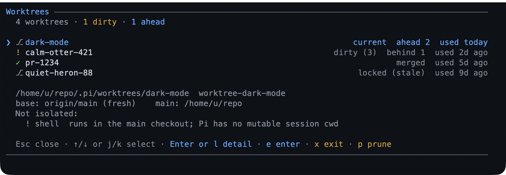

# worktree — an isolated checkout for one task

`worktree` moves a Pi session into its own `git worktree` — a second checkout on a
new branch — and manages the ones it creates. Every built-in tool keeps taking
relative paths; only the root they resolve against changes.



- **One task, one checkout.** `<repo>/.pi/worktrees/<name>` on `worktree-<name>`.
- **The built-ins follow.** `read`, `write`, `edit`, `bash`, `grep`, `find`, `ls`.
- **Writes may not leave the checkout**, through a symlink or a redirect; reads stay
  put only with `guard.blockReadEscapes` in
  [configuration](../configuration-reference.md#worktree--isolated-worktrees).
- **It never commits, merges, or pushes** — the exit handoff prints those commands.

## What you can do

| What you want | What to do |
|---|---|
| Start an isolated task | `/worktree enter feature-auth`, or launch with `--worktree feature-auth` |
| See what is open | `/worktree` — one row per worktree with its state |
| Enter one from the list | `e` on the focused row |
| Leave, keeping the work | `/worktree exit` — clean ones are removed, dirty ones ask |
| Finish the branch | follow the handoff's `git merge --no-ff` or `gh pr create` |
| Clean up old worktrees | `/worktree prune` |
| Seed gitignored files | list them in `.worktreeinclude` at the repository root |
| Check a PR's code | `/worktree enter pr-<n>` |
| Come back later | `/resume` or `--continue` restores the active worktree |

## Try it

```text
/worktree enter feature-auth
```

Run the tests, make the change, commit as usual — then:

```text
/worktree exit
```

The result names the branch, how far it is ahead, and the two commands that land
it. A worktree with changes asks before it goes; one with no work is removed.

[Work in a worktree](../tutorials/first-worktree.md) walks the whole cycle.

## Reference

One tool with four actions, one lifecycle:

| Action | What it does |
|---|---|
| `enter` | create a worktree by `name`, or enter an existing one by `path`, and re-root the session |
| `exit` | return to the main checkout; asks about work in progress and returns the handoff |
| `list` | read-only: active root, overrides, isolation gaps, every managed worktree |
| `prune` | remove clean, unused, old worktrees; reports each one kept and why |

`/worktree` opens the list screen; `/worktree enter <name>`, `/worktree exit`, and
`/worktree prune` are the same actions from the terminal, and `--worktree <name>`
enters at session start. On the screen: `j`/`k` or arrows move, `g`/`G` jump to
the ends, `Enter`/`l` opens the detail, `e` enters, `x` exits, `p` prunes,
`Esc`/`q` closes.

**Root-following.** Relative paths resolve inside the worktree for the built-in
tools. A write or edit outside it is refused, a symlinked escape is refused, and
`bash` refuses `git -C <main>`, `GIT_DIR=`, `GIT_WORK_TREE=`, and `cd` outside the
worktree.

**Locking.** A worktree in use is locked, so another session's prune cannot remove
it, and `enter` refuses one whose lock belongs to a live session — by `name` and by
`path` alike — rather than reopening or resetting it underneath that session. A lock
whose owner is gone is taken over. That lock is held by a worktree the session
created or took over; entering an unlocked checkout by path does not lock it. A
clean, unused worktree older than `pruneAfterDays` is eligible; everything else is
kept and named.

**Child sessions.** A `pi` started from inside a session binds to the same
worktree, read-only for the lifecycle, so a delegated run cannot exit or prune
it behind your back.

## Limits

- The guard is best-effort at the shell level: a shell you run yourself (`!`) is
  not re-rooted, and substitution, `eval`, and `sh -c` are covered only with
  `guard.blockUnparsableCommands` on.
- `powershell` is refused while isolated rather than parsed; with
  `guard.blockPowershell: false` it is allowed and unguarded, and `/worktree`
  reports that gap.
- The tool is unavailable while planning: plan mode hides the whole tool, and
  `/worktree` still reads the inventory.
- It is not a branch manager: no rename, rebase, merge, or push.
- If another extension owns `bash`, set `skipOverrides` and that tool runs in the
  main checkout, unguarded for relative paths.

## Settings

| Key | Default | What it does |
|---|---|---|
| `onExit` | `"ask"` | What `exit` does by default: ask, always keep, or always remove. |
| `dir` | `".pi/worktrees"` | Where managed worktrees live, under the repository root. |
| `baseRef` | `"fresh"` | Branch a new worktree starts from: the fetched default branch, or local HEAD. |
| `include` | `[]` | Gitignored files copied in, when `.worktreeinclude` is absent. |
| `pruneAfterDays` | `7` | Age after which `prune` may remove a clean, unused worktree. |

The rest — `branchPrefix`, `fetchRemote`, `fetchTimeoutMs`, `skipOverrides`, and
the six `guard.*` switches — are in
[configuration](../configuration-reference.md#worktree--isolated-worktrees). To switch the
extension off, toggle `worktree` in `/bytefly`; the session then works in the
main checkout.

## Learn more

- [Work in a worktree](../tutorials/first-worktree.md) — the whole cycle.
- [`rewind`](../extensions/rewind.md) — snapshot before each prompt's first change.
- [`session-bus`](../extensions/session-bus.md) — several sessions, one repository.
