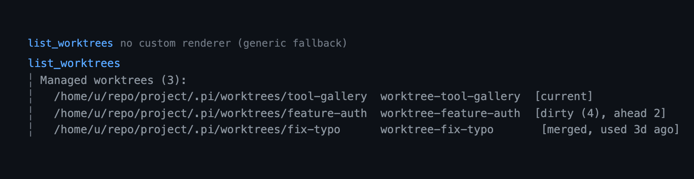

# worktree — isolated git worktrees for Pi

`worktree` lets one Pi session work inside an isolated `git worktree` — its own
branch and checkout — and manages the worktrees it creates: enter, switch, and
exit, with cleanup that refuses to throw work away. The model keeps calling
`read`/`write`/`edit`/`bash` with ordinary relative paths; only the effective
root changes. It is one of two sibling git extensions in this package
(`rewind` is the other).

## Capabilities

Status records what a reader can rely on: **Shipped** is in a tagged release, **Unreleased** is complete in the current tree but not yet tagged, and **Partial** has one released part and one unreleased part. Rows are ordered by user value, highest first.

### Isolating work

| Capability | How | What you get | Status |
|---|---|---|---|
| Isolated checkout | `enter_worktree`, `/worktree enter`, `--worktree` | A new checkout at `<repo>/.pi/worktrees/<name>` on branch `worktree-<name>`, cut from `origin/main`. | Shipped |
| Root-following built-ins | `read`, `write`, `edit`, `bash`, `grep`, `find`, `ls` | The built-in tools keep taking ordinary relative paths, resolved inside the worktree. | Shipped |
| Escape refusal | `guard.blockFileEscapes`, `guard.blockGitRedirects`, `guard.blockSymlinkEscapes` | Writes, `cd`, and `git` redirects that reach the main checkout are refused, symlink escapes included. | Shipped |
| Plan-mode refusal | `/worktree`, `enter_worktree` | In plan mode the screen opens read-only and every verb refuses until the plan is approved. | Shipped |
| PowerShell refusal | `powershell` while isolated | The unparseable shell is refused instead of becoming an unguarded escape. | Shipped |
| Seeded working copy | `.worktreeinclude`, `include` | Gitignored files such as `.env` are copied into each new worktree. | Shipped |
| Ignore bootstrap | `enter_worktree` | The first worktree offers to add `.pi/worktrees` to `.gitignore`, so the checkout does not pollute status. | Shipped |
| PR/MR checkout | `enter_worktree` `name`, `--worktree` | A pull or merge request's head is fetched and checked out as `pr-<n>`. | Shipped |
| Child sessions | `PI_WORKTREE_ROOT`, `PI_WORKTREE_BRANCH`, `PI_WORKTREE_MAIN` | A `pi` started from a tool binds to the same worktree, read-only for lifecycle. | Shipped |

### Returning and managing

| Capability | How | What you get | Status |
|---|---|---|---|
| Return with a handoff | `exit_worktree`, `/worktree exit` | Back in the main checkout, with the branch, its commits, and the merge or PR command that finishes them. | Shipped |
| Work that survives | `exit_worktree`, `worktree.onExit` | A worktree holding changes or commits is asked about or kept, never force-deleted. | Shipped |
| Status inventory | `list_worktrees`, `/worktree` | The active root, the gaps isolation does not cover, and every managed worktree with its state. | Shipped |
| Worktree screen | `/worktree` | One list screen with the focused worktree's path, base, and gaps, and the verbs to act on it. | Shipped |
| Cleanup | `prune_worktrees`, `/worktree prune` | Clean, unused, old worktrees are removed; every other one is kept with a reason. | Shipped |
| Concurrent-session safety | `enter_worktree`, `prune_worktrees` | A worktree in use is locked, so another session's sweep cannot remove it. | Shipped |
| Session restore | `/resume`, `--continue` | An active worktree is restored from the branch, or reported gone. | Shipped |
| Extension signal | `worktree:changed` | Another extension follows the active root without polling. | Shipped |
| Doctor finding | `run_doctor` | A degraded `guard.blockPowershell` setting is named in the health report instead of only at use. | Shipped |

## Quickstart

```bash
pi --extension ./extensions/worktree   # load just this extension
pi -e .                                # load the whole @gavin-hu/my-pi-agent package
pi install ./                          # install the package
```

```text
/worktree                              # the list screen, or the same facts as text
```

The model enters with `enter_worktree`; `pi -e . --worktree feature-auth` starts
the session already isolated.

## Tools



`enter_worktree` creates or enters a checkout, `exit_worktree` returns to the
main checkout, and `prune_worktrees` and `list_worktrees` manage and report. All
four are `executionMode: "sequential"`, and only `list_worktrees` is read-only.

| Tool | Usage |
|---|---|
| `enter_worktree` | `name` to create a worktree, or `path` to enter an existing one. Errors if already isolated. |
| `exit_worktree` | optional `remove` and `keepBranch`. Returns the clean/keep/remove decision and a `handoff` (`branch`, `base`, `ahead`, `merged`). |
| `prune_worktrees` | no parameters. Removes eligible managed worktrees and reports the rest. |
| `list_worktrees` | no parameters. Read-only status: active root, inactive overrides, isolation gaps, managed worktrees. |

`enter_worktree` creates `<repo>/.pi/worktrees/<name>` on branch
`worktree-<name>` cut from `origin/main` (which can lag the local `main`), or
enters an existing worktree by `path`, and rebinds the session's working root to
it.

`exit_worktree` returns to the main checkout. A clean worktree is removed
automatically; one with uncommitted changes or new commits prompts (or is kept
in non-interactive mode). Its result ends with a **handoff**: the branch, how
many commits it holds beyond the merge target, whether that target already
contains them, and the `git merge --no-ff` and `gh pr create` commands that
finish the task. The tool never commits, merges, pushes, or opens the PR. A
branch that still holds work (uncommitted changes, or commits not reachable from
the recorded base) is never force-deleted, even with `remove: true`.

While isolated, `read`/`write`/`edit`/`bash`/`grep`/`find`/`ls` all resolve
relative paths inside the worktree, and:

- writes/edits outside the worktree are refused, including through a symlink
  that points at the main checkout;
- `git -C <main>`, `GIT_DIR=`, `GIT_WORK_TREE=`, `--git-dir=`, `--work-tree=`,
  and `cd` outside the worktree are refused in `bash`;
- remote `git fetch` (the base ref and a PR/MR head) runs with terminal
  prompting disabled, so a credentials prompt fails fast instead of hanging.

### Status text

`list_worktrees` (and a headless `/worktree`) reports the active worktree, any
override that is not re-rooted, what isolation does not cover, and the managed
worktrees:

```text
Not isolated:
  ! shell       runs in the main checkout; Pi has no mutable session cwd
  powershell    allowed by worktree.guard.blockPowershell: false; not re-rooted or guarded
  unverifiable  $(...), backticks, eval, and sh -c pass through (blockUnparsableCommands is off); 2 ran this session
```

`powershell` appears only on Windows, with that tool active, and only when
`guard.blockPowershell` lets it through — by default the guard refuses the call
instead, so there is no gap to report. `unverifiable` appears only while
`guard.blockUnparsableCommands` is off; its trailing count is this session's,
reset at session start. `doctor` reports the `powershell` switch as `degraded`
when it is off and notes the two structural gaps, which no setting closes.

## Commands and flags

| Command / flag | What it does |
|---|---|
| `/worktree` | the list screen: managed worktrees, the active one, and its gaps |
| `/worktree enter [name]` | enter a worktree (a name may be a PR/MR reference) |
| `/worktree exit` | exit a worktree |
| `/worktree prune` | remove clean, unused, old managed worktrees |
| `--worktree <name>` | enter at session start |

Exit asks whether to keep or remove, and `worktree.onExit` answers without
asking: a clean worktree this session created is removed, one holding work or
entered by path asks, and only a worktree with no work loses its branch. There
are no flags to disagree with either. Declining a confirmation (entering an
outside path, exiting a worktree with work) is reported as normal feedback, not
an error. An argument a subcommand does not take prints the usage line instead of
being ignored.

### The /worktree screen


`/worktree` on its own opens a list screen: one row per managed worktree with its
state (current, dirty, ahead, behind, merged, locked, last used), the active
worktree's base and isolation gaps under the focused row, and a detail pane for
the selected one. Outside a terminal — print, RPC, JSON — the same facts print as
text instead, which is also what the model's `list_worktrees` reads.

| Key | What it does |
|---|---|
| `j` / `k`, arrows | move |
| `g` / `G` | first / last row |
| Enter, `l` | open the selected worktree's detail |
| `e` | enter the selected worktree |
| `x` | exit the active worktree |
| `p` | prune eligible worktrees in place |
| Esc, `q` | close |

`e` and `x` close the screen before they act, because an exit asks through the
normal prompt and a prompt cannot open inside a mounted screen. `p` never asks,
so it prunes without closing and reports the result in the footer. In plan mode
the screen still opens and every verb refuses with a notice.

## Configuration

The `worktree` section of the shared `bytefly.json`; the project document is read
from the repository root rather than the active working directory, and the
project wins. Resolution rules are in
[`../configuration.md#worktree--isolated-worktrees`](../configuration.md#worktree--isolated-worktrees),
which also lists every key with its default and accepted values.

```jsonc
// bytefly.json → "worktree"
{
  "dir": ".pi/worktrees",
  "baseRef": "fresh",        // "fresh" = remote default branch, "head" = local HEAD
  "branchPrefix": "worktree-",
  "fetchRemote": true,
  "fetchTimeoutMs": 5000,
  "onExit": "ask",           // "ask" | "keep" | "remove"
  "pruneAfterDays": 7,       // age before /worktree prune may remove a clean worktree
  "include": [],             // fallback when .worktreeinclude is absent
  "skipOverrides": [],       // tool names not to override (e.g. ["bash"])
  "guard": {
    "blockFileEscapes": true,
    "blockReadEscapes": false,
    "blockGitRedirects": true,
    "blockSymlinkEscapes": true,
    "blockUnparsableCommands": false,
    "blockPowershell": true
  }
}
```

`skipOverrides` matters when another extension owns one of the same built-in
tool names: Pi refuses to load two extensions that register the same tool, so
exclude the name here to load alongside it. It is read when the extension
loads, from the process working directory; reload after changing it. `/worktree`
and `list_worktrees` list any overridden tool that is not re-rooted.

`.gitignore` must cover the managed directory, or worktrees show up as untracked
files in the main checkout. `enter_worktree` offers once per session to append
`.pi/worktrees/`, and skips the offer when `git check-ignore` already reports the
directory as ignored, so a wider rule is enough and no literal line is needed:

```
# either, when the rest of `.pi/` is disposable
.pi/
# or, when other `.pi/` state must stay tracked
.pi/worktrees/
```

## Security

The extension enforces a best-effort boundary around the worktree; it is not an
OS sandbox.

In `bash`, file redirection targets (`>`, `>>`, `>|`, `<`, `<>`, and the
`>&file`/`&>file` forms), `git` redirect options (`-C`, `--git-dir`,
`--work-tree`, and `-c core.worktree=`), and `cd`/`pushd`/`popd` targets
(including `-P`/`-L`/`--` option forms) are checked; `~`, `$VAR`, and `${VAR}`
are expanded first, and a value that cannot be resolved statically (an unknown
variable, `~user`, a backtick) is treated as escaping. File-descriptor
duplications (`2>&1`, `>&-`), heredocs, and here-strings are not treated as
paths, and options are only recognized in real argument position, so
`git log --grep='--git-dir=/tmp/x'` and `git log -C` are not false positives.
The null device is exempt: `>/dev/null` and `< /dev/null` write and read nothing,
so they are allowed. `GIT_DIR=`/`GIT_WORK_TREE=` are refused both as a command prefix and when
exported (`export GIT_DIR=/main`), and a `sh -c`/`bash -c` sub-command is refused
when `blockUnparsableCommands` is enabled.

This guard covers the built-in file tools and these common shell forms. It
cannot contain a program that computes and writes an absolute path itself (for
example a script or an inlined interpreter).

Windows `powershell` is refused outright while the session is isolated rather
than parsed. It is not one of the tools this extension re-roots, and its language
is a second grammar — backtick escapes, `Set-Location`, `$env:GIT_DIR`, `--%` —
so the bash checks would be guessing about a shell that starts in the main
checkout. Refusing it is the same answer plan mode gives, and `bash` (re-rooted
and guarded) stays available. `guard.blockPowershell: false` allows the tool
again; that is a deliberate trade, so it is reported: `/worktree` lists the gap
and `doctor` reports the switch as `degraded`.

## Gitignored files

A worktree is a fresh checkout, so untracked, gitignored files such as `.env`
are missing. Add a `.worktreeinclude` file at the repository root (gitignore
syntax: `*`, `?`, `**`, `[...]` classes, `!` negation, and `\` escapes); only
files that match a pattern *and* are ignored by git are copied into each new
worktree. Without that file, the `include` config list is used.

```text
.env
.env.local
config/secrets.json
```

## Pull / merge requests

`enter_worktree` accepts a PR/MR reference in `name`, as does the startup flag:

```
pi --worktree '#1234'
pi --worktree 'https://github.com/owner/repo/pull/1234'
```

It fetches `pull/<n>/head` (GitHub) or `merge-requests/<n>/head` (GitLab) from
`origin` and creates the worktree at `.pi/worktrees/pr-<n>`.

## Subagents and parallel sessions

While isolated, the extension exports `PI_WORKTREE_ROOT`, `PI_WORKTREE_BRANCH`,
and `PI_WORKTREE_MAIN` (the main checkout) into the process environment. A child
`pi` process — a subagent spawned by an extension, or any `pi` you start from a
tool — inherits it and binds to the same worktree instead of the main checkout.
The child is read-only with respect to lifecycle: `enter_worktree` and
`exit_worktree` refuse, and the parent owns cleanup.

Extensions can also follow changes on the `pi.events` channel
`worktree:changed`, which receives `{ active, path, branch, borrowed }`.

## Locking and pruning

Entering a managed worktree takes a `git worktree lock` (reason
`pi:<pid>:<session>`), so a concurrent sweep cannot remove it; exiting and
shutdown release it. `/worktree prune` (or the `prune_worktrees` tool) removes
managed worktrees that are clean, have no new commits, are not the current or a
live-locked one, and are older than `pruneAfterDays`. It releases locks whose
owning process is gone first, and any failure keeps the worktree with a reason.

Managed worktrees are tracked in a disposable index at
`.pi/worktrees/index.json` (provenance plus a `lastUsedAt` timestamp), reconciled
against `git worktree list` on every status/prune read. Prune age follows last
use, falling back to directory mtime for a worktree with no record.

## Limitations

- Pi refuses to load two extensions that register the same tool name. If another
  extension owns `bash` (or another overridden name), set
  `skipOverrides: ["bash"]` so this extension does not register it; that tool
  then runs in the main checkout with **no re-rooting**, so only its absolute
  writes are guarded (relative paths are not isolated), and `list_worktrees`
  reports it. `skipOverrides` is read at load time, from the process working
  directory.
- `git branch --merged main` calls a worktree branch merged whenever it matches
  its base, so a worktree that never committed looks landed while its
  uncommitted work is still there. Read `git -C <path> status` before removing
  one; `list_worktrees` reports the same clean/merged flags.
- The guard is best-effort at the shell level: command substitution, `eval`, and
  `sh -c` are only covered when `blockUnparsableCommands` is enabled, and real
  isolation of arbitrary shell writes needs an OS sandbox. `/worktree` names the
  gap and counts the commands that passed through it this session.
- Only the model's `bash` tool is re-rooted and guarded. A shell command the
  user runs directly (`!` in the TUI / the `user_bash` event) is not re-rooted
  and still runs in the main checkout; Pi has no mutable session cwd to change
  that. `/worktree` and `list_worktrees` report the active root, and list the
  shell under `Not isolated:` on every status read.
- Windows `powershell` is refused while isolated, or — with
  `guard.blockPowershell: false` — allowed and unguarded. There is no third
  state: a parsed PowerShell command that keeps the tool.

## Non-goals

- **No OS-level sandbox.** Real isolation of arbitrary writes needs a sandbox.
- **Not a general branch manager.** It creates, enters, and removes checkouts it
  knows about. It does not rename, rebase, merge, or push branches.
- **No user-shell re-rooting.** A shell the user runs directly (`!` /
  `user_bash`) is not isolated.
- **No PowerShell guard.** `powershell` is refused while isolated, not parsed;
  teaching the guard a second grammar belongs with an OS sandbox, not here.

## Pi integration

| Contract | Detail |
|---|---|
| Registration | The default export calls `registerWorktree`: root-tool overrides, the `--worktree` flag, lifecycle listeners, model tools, and the `/worktree` command. Nothing long-lived starts at load. |
| Tools | `enter_worktree`, `exit_worktree`, `prune_worktrees`, `list_worktrees` via `registerTool`. All `executionMode: "sequential"`. Annotations: `enter_worktree` destructive + open-world; `exit_worktree`/`prune_worktrees` destructive; `list_worktrees` read-only. No `outputSchema`; structured state is returned in tool-result `details` — `exit_worktree` carries `{ state, removed, handoff }`, where `handoff` is `{ branch, base, ahead, merged }`. |
| Built-in overrides | `read`/`write`/`edit`/`bash`/`grep`/`find`/`ls` are re-registered under the same names with `defaultActive: false`; each spreads the built-in definition and replaces only `execute`. `skipOverrides` is applied at load time. `powershell` is deliberately not overridden: it cannot be re-rooted without a guard, so the `tool_call` handler refuses it (see `guard.blockPowershell`). |
| Commands | `/worktree` via `registerCommand`, with argument completions for `enter`, `exit`, and `prune`. The bare command mounts `screen.ts` in a terminal and prints the status text otherwise; `enter`/`exit`/`prune` refuse while plan mode is read-only. |
| Flags | `--worktree` via `registerFlag`. |
| Events | `session_start` (bind inherited env, restore or refuse recorded state, read the flag), `session_shutdown` (release the lock, clear status), `before_agent_start` (set the prompt cwd and worktree section), `tool_call` (guard file tools and `bash`, refuse `powershell`, and count a command it lets through unverified). |
| State | The binding is a custom session entry (`worktree`) written with `pi.appendEntry` and rebuilt from `ctx.sessionManager.getBranch()` on `session_start`. `.pi/worktrees/index.json` is a disposable managed-record cache, reconciled against `git worktree list`. Child processes inherit `PI_WORKTREE_*` env. |
| UI/events | Status chip via `ctx.ui.setStatus`; `worktree:changed` published on `pi.events`. |

## Design notes

- **Override at load, re-root at call.** Pi has no mutable session cwd and its
  built-ins capture cwd when the session is built, so a same-named wrapper is
  registered at load time and re-runs the real built-in definition with a Proxy
  context whose `cwd` is the active root. It spreads the built-in to keep
  renderers and `edit`'s `prepareArguments`; `defaultActive: false` leaves
  activation to the built-in registration.
- **Two layers: re-root and guard.** Re-rooting relative paths is not enough on
  its own — an absolute path, `cd`, or `git -C` still escapes. The guard runs
  centrally from the `tool_call` handler, so nested tool calls are covered too.
- **A gap the user cannot see is a gap they cannot weigh.** Re-rooting is not
  isolating: Pi has no mutable session cwd, so the user's own `!` shell stays in
  the main checkout, an unverifiable command passes by default, and `powershell`
  would run unguarded if it were allowed. Those rules live in `gaps.ts` as data,
  the status text renders them, and the `tool_call` handler counts the one gap the
  transcript cannot show: a command the guard let through without verifying it.
  The two gaps a setting can close are closed — `powershell` is refused, and an
  opt-out is reported by the status and by `doctor`.
- **Core model: Checkout / Managed record / Binding.** A *Checkout* is a real
  `git worktree` and git is authoritative about it. A *Managed record* is
  provenance and usage in a disposable index. A *Binding* is this session's
  active root, a session entry that drives `getRoot()` and is replayable on the
  branch.
- **One snapshot, two surfaces.** `worktreeSnapshot` reads the active binding, the
gaps, and every managed worktree once; `formatWorktreeStatus` renders it as text
and `screen.ts` renders the same rows as the list. A tool result and the screen
that disagree about a worktree would be a second source of truth, so there is
one read and two renderings.
- **Mutable root in one place.** Pi loads one extension factory per runtime, so
  `runtime.ts` owns the single active worktree, the config cache, and the
  process-environment hook; lifecycle, tools, and commands stay stateless
  functions over it.
- **Binding is a session entry; the registry is a cache.** `/resume` and
  `--continue` restore the binding or report accurately when the directory is
  gone; the registry is reconciled against `git worktree list` on every
  management read and is never the source of truth.
- **Never force out work.** `exit_worktree` never force-deletes a branch that
  still holds uncommitted changes or commits not reachable from the recorded
  base, even with `remove: true`.
- **A handoff is read, not performed.** The exit reports the branch's state and
  the command that finishes it, because a merge touches the main checkout and can
  conflict — the user should be the one in that state. The merge target is
  `origin/HEAD`'s branch, falling back to the main checkout's own branch when the
  repository has no remote; when neither resolves, the block names the branch and
  prints no command rather than guessing `main`.
- **Lock, then prune.** Entering a managed worktree takes a `git worktree lock`
  so a concurrent sweep cannot remove it; prune releases stale locks first and
  keeps any worktree it cannot safely remove, with a reason.
- **Children inherit through the environment.** A child process cannot read this
  process's memory, so the active root, branch, and main checkout are exported
  as `PI_WORKTREE_*`; a child is read-only with respect to lifecycle and the
  parent owns cleanup.

## Files

| File | Responsibility |
|---|---|
| `index.ts` | Registrar: flags, lifecycle events, prompt injection, wiring (`registerWorktree`) |
| `runtime.ts` | Shared state (active worktree, config cache, env, events) |
| `lifecycle.ts` | Barrel: `enterWorktree` / `exitWorktree` / `pruneWorktrees` / status |
| `errors.ts` | Cancellation error that distinguishes a user decline from a failure |
| `enter.ts` / `exit.ts` / `prune.ts` | The lifecycle phases |
| `handoff.ts` | The `Handoff:` block an exit leaves: the branch's lead, whether the base contains it, and the merge or PR command. |
| `tools.ts` / `commands.ts` | Model tools / slash commands |
| `screen.ts` | The `/worktree` list screen: rows, keys, detail pane, and verbs |
| `root-tools.ts` | Load-time built-in overrides bound to the active root |
| `git.ts` | Git plumbing (shared runner + read helpers) |
| `guard.ts` | Path, shell, and git-redirect isolation checks, plus the `powershell` refusal |
| `gaps.ts` | The isolation gaps a session carries, and how they read (pure) |
| `include.ts` | `.worktreeinclude` matcher and copy |
| `config.ts` / `state.ts` / `status.ts` | Config, session entry shape, status text and the shared snapshot |
| `registry.ts` | Disposable managed-worktree index + derived status |

## Testing

```bash
bun test          # unit + real-git tests
bun run check     # format:check + typecheck + tests
bun run test:watch
```

The suite covers the pure logic (`include.ts` gitignore matcher, `guard.ts` path
and command checks, `parsePrReference`), drives the `/worktree` screen against a
snapshot (`ui.test.ts`: rows, marks, verbs, and width bounds), and drives the
extension end-to-end against real temporary git repositories through a mocked
`pi` API: enter/exit, isolation guards, borrowed worktrees, prune, and
inactive-override reporting.
