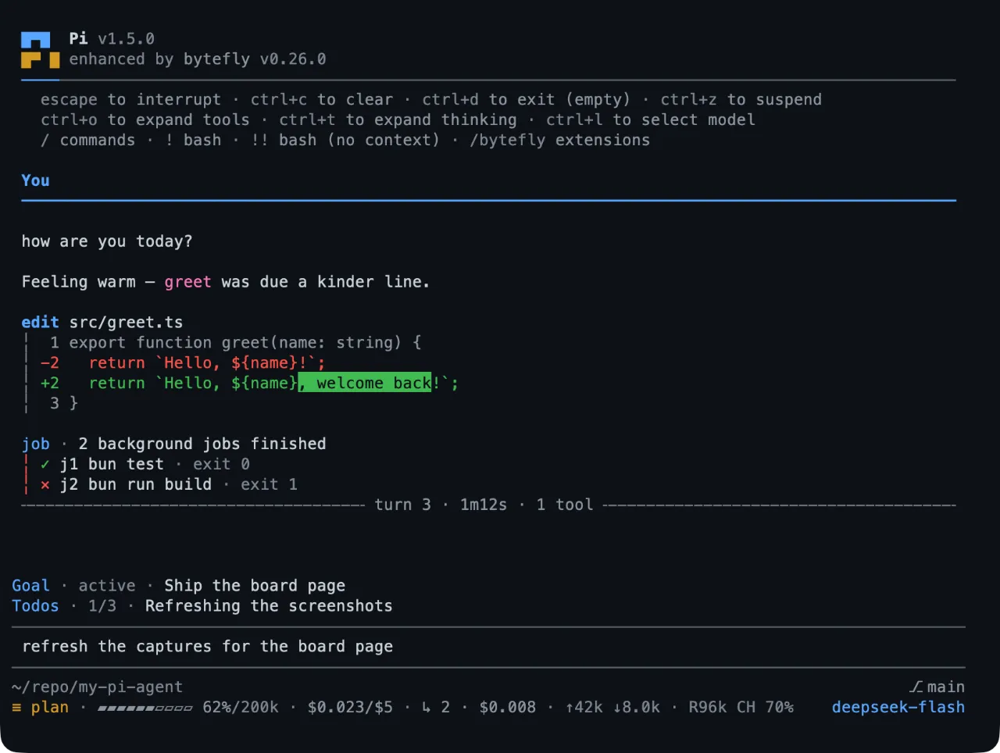

# my-pi-agent — a Pi package for working in a terminal

`@gavin-hu/my-pi-agent` is a set of extensions, skills, and themes for
[Pi](https://pi.dev): the coding agent you run from a terminal. It does not fork
Pi and writes no installed file — Pi discovers everything through the package's
own manifest, so the pack upgrades like any other package.

Everything in it is optional and independently switchable.



## Install

Requires a working Pi installation. `git` on `PATH` is needed by `worktree` and
`rewind`; everything else degrades or disables cleanly.

```bash
pi install npm:@gavin-hu/my-pi-agent
```

To pin a release, install from the tag instead:

```bash
pi install git:github.com/gavin-hu/my-pi-agent@v0.25.1
```

Then `/bytefly` opens the control center, where each extension can be switched on
or off, its settings changed, and `/bytefly doctor` names anything missing.
[Install](./install.md) has the upgrade, removal, and requirements in full.

## What you get

- **Plan before writing.** `plan` keeps a task in read-only planning mode, saves a
  plan under `~/.pi/agent/plans/<repo-key>`, and waits for your approval.
- **Never wreck the checkout.** `worktree` moves a task onto its own branch in a
  `git worktree`, and `rewind` snapshots each prompt's first change.
- **Delegate in parallel.** `subagent` runs a specialist agent in its own Pi
  process; `session-bus`, `board`, and `team` coordinate several sessions on one
  repository.
- **Long work in the background.** `job` runs a shell command and keeps its log,
  `watch` tails a file or command, and `todo` and `goal` keep the thread visible.
- **Reach the web and your files.** `web-access` searches and fetches, `file-browse`
  serves the working directory to a loopback page, `file-read` extracts PDF, DOCX,
  XLSX, and more, and `file-open` hands a file to the OS.
- **A terminal that explains itself.** `bytefly` gives Pi its header, footer,
  transcript blocks, settings screen, and notifications.

## Start here

- [Install](./install.md) — add the pack to Pi, pin a version, upgrade it.
- [Configuration](./configuration.md) — where a setting lives, how to change one,
  and every key with its default.
- [All extensions](./extensions/README.md) — one page per extension, opening with
  what it does and the tools and commands that deliver it.
- [Skills](./skills/README.md) — the three packaged workflows, and when to reach
  for one instead of asking in words.
- [Security](./security.md) — what the pack opens on your machine, and how each
  surface is gated.

## Where to get help

`/bytefly doctor` prints what each enabled extension needs at runtime and what is
missing. The [repository](https://github.com/gavin-hu/my-pi-agent) carries the
[changelog](https://github.com/gavin-hu/my-pi-agent/blob/main/CHANGELOG.md), the
[issue tracker](https://github.com/gavin-hu/my-pi-agent/issues), and the
[contributor guide](https://github.com/gavin-hu/my-pi-agent/blob/main/CONTRIBUTING.md).
