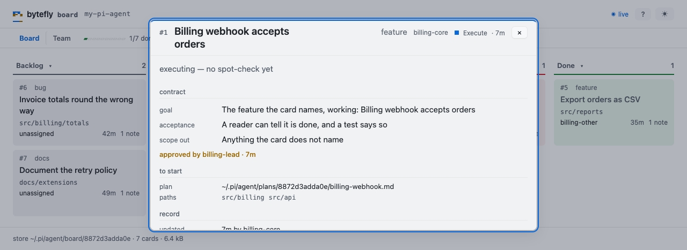

# Your first board

The board is a shared list of features for one repository. This walkthrough takes
one feature from an idea to `done`, through the two signatures it needs on the
way.

You need Pi and this package installed — see [Install](../install.md).

Two kinds of line appear below. What you **type** is a command — `/board`, or
`/plan` while a change is designed. What you **say** is a sentence, and the model
turns it into a `board` tool call: the board's actions are the tool's, so none of
this is a shell command.

## Open the board

```text
/board
```

The first session in a repository serves the page on `127.0.0.1`; every other
session opens the same page instead of a second one. The command prints the
address, so a machine with no default browser still has the way in, and `/board
status` prints it again. The page is a **view** — it reads the cards and cannot
change them, so the terminal and the browser cannot disagree.

Two tabs: **Board**, the five lanes, and **Team**, the queue of decisions and the
people holding cards. Opening a card shows its contract, the plan it is executed
against, and its notes, newest first.

## Put a feature on it

```text
Put a feature on the board: the billing webhook accepts orders, under src/billing.
```

The model calls the tool's `add` action with those three facts, and the card comes
back as one line:

```text
#1 backlog · Billing webhook accepts orders
```

A new card lands in `backlog` — the pool nobody holds. `paths` are hints about
where the work lives; `priority` is `high`, `normal`, or `low`; `type` is
`feature`, `bug`, `refactor`, `docs`, `test`, or `chore`; `breaking` marks a change
an existing user must act on. `edit` links one card to another with `dependsOn`.

## Take it and design it

```text
Claim card 1 and design the change before writing anything.
```

The card is yours, in `plan` — and "yours" means this session's. Ownership is a
session id, so a session that ends leaves a card another session can take back once
its record says it stopped, or that the lead reclaims at once; a reclaim keeps a
spot-check the reclaimer did not sign. A claim also names the next step: design the
change in plan mode, save the plan, then record what the card promises.

```text
/plan add the webhook endpoint and its signature check
```

Approving the plan seeds your todo list and leaves plan mode. Next, record what
the card promises — `goal`, `acceptance`, `scopeOut`, and the plan file itself:

```text
Record the contract for card 1 from the plan we just approved.
```

```text
board({ action: "contract", card: "1", path: "<the path plan returned>",
  goal: "A retried delivery is accepted once",
  acceptance: "A duplicate event id returns 200 and writes nothing",
  scopeOut: "No new event types" })
```

`path` is the file `plan` action `write` returned — not one retyped from another
repository's store. It must be in this repository's plan store, and it must still
be there when the card moves to `execute`: a plan deleted after it was recorded
refuses the move.

`plan` and `execute` hold a limited number of cards: three in `plan` and five in
`execute` by default. A claim past either is refused and says how many are already
there, and to finish, block, or release one first.

## Pass the two gates

A card cannot enter `execute` until its contract is approved, and cannot finish
until the work is spot-checked. Both signatures are the lead's — `board.lead`,
`lead` by default — and the person at the keyboard is the other way in:

```text
/board approve 1
```

```text
board: #1 approved by you · told gavin
```

The clause after the sign names the owner the bus reached, or says it could not.
Then the work itself starts:

```text
board({ action: "move", card: "1", lane: "execute" })
```

A card that is not ready to execute can be parked instead. `blocked` waits on a
person, and the card records the one line it waits on — a decision, a dependency,
or a contract that is not written yet. Resuming it goes back to `plan`, or
straight to `execute` when it was already approved before it was parked.

Notes are how the card explains itself while it is worked:

```text
Note on card 1 that the signature check covers the retry path, and that the fixture is in.
```

When the work is done, the lead — or you — looks at it once:

```text
/board review 1
```

```text
board: #1 reviewed by you
```

Then the card moves to `done`. A session never signs a card it holds: it releases
the card before signing. You can sign your own, because the slash commands above
write the person's signature, not the session's. Every sign tells the owner over
the session bus, so the person waiting knows the lane opened.

## Look at it from the page

`/board` stays live: a card a session claimed, moved, or noted shows up without a
reload. Filter the cards, fold `done` away, or open the **Team** tab to see who
is live, quiet, or gone — and which cards are waiting on a decision.



*One card opened: the contract it promises, the plan it is executed against, and
the notes that explain it.*

## Set finished work aside

```text
/board archive
```

`done` cards leave the board for an archive that keeps their notes and plan. It is
one way: nothing un-archives a card, so sweep when the history is ready to leave.
A finished card an open card still waits on stays where it is, and the command
says which.

## Where to go next

- [`board`](../extensions/board.md) — the lanes, the actions, and the limits.
- [`team`](../extensions/team.md) — handing a card to a peer, and the round.
- [`plan`](../extensions/plan.md) — the plan the contract points at.
- [`session-bus`](../extensions/session-bus.md) — the bus every sign travels on.
