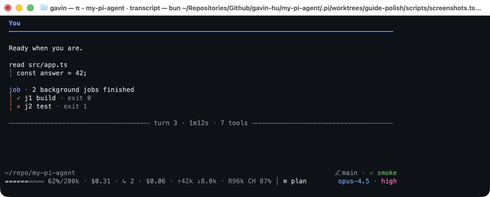
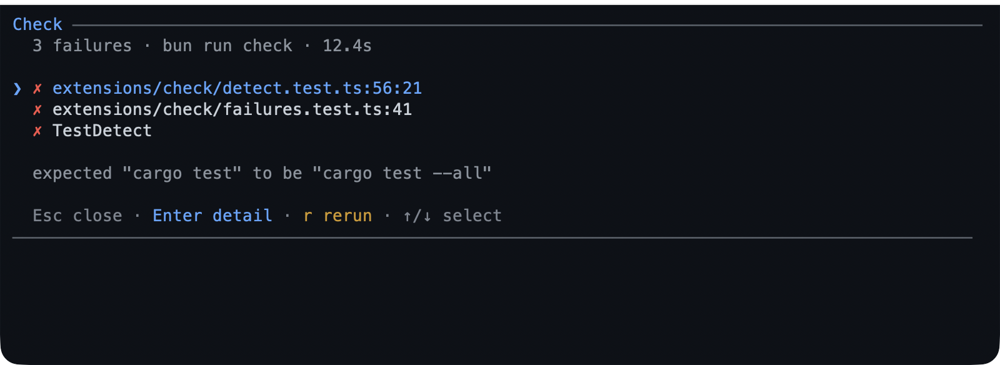
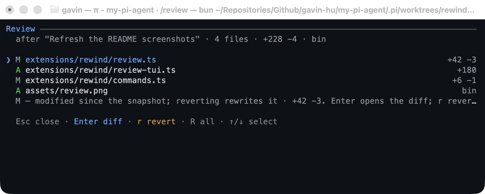
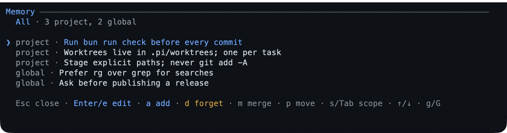
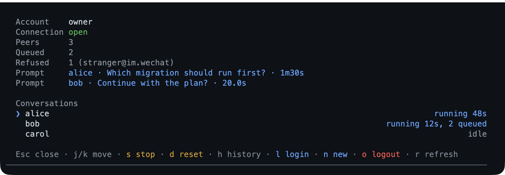
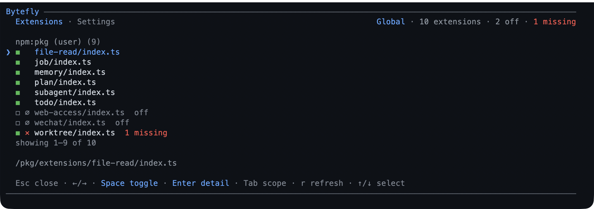

# User guide

`my-pi-agent` is an add-on for [Pi](https://pi.dev), the assistant you talk to in
a terminal window. It adds seventeen optional features and two colour themes to the
Pi you already have. This guide is written for people who *use* Pi rather than
work on its code: every feature is explained in plain language and then walked
through step by step.

You do not need to know how to program to follow it. A handful of features touch
your project's git history — a `worktree`, snapshots, the browser's change view —
and each of those says so where it comes up.

## Contents

- **Start here** — [the tour](#start-here), [words](#words-used-in-this-guide), [what this adds](#what-you-are-using), [install](#getting-it-installed), [cost and privacy](#what-it-costs-and-what-leaves-your-machine), [the screen](#the-screen-at-a-glance), [plain words](#asking-for-things-in-plain-words)
- **Plan and delegate** — [planning](#plan-first-then-write), [checking](#checking-your-work), [to-do and goal](#a-to-do-list-and-a-goal), [questions](#answering-the-assistants-questions), [background work](#background-jobs-and-watchers), [specialist helpers](#delegating-to-specialist-helpers)
- **Keep your work safe** — [worktrees](#working-on-a-branch-safely), [rewind](#undoing-a-turn), [memory](#remembering-between-sessions)
- **Reach the world** — [web](#searching-and-reading-the-web), [documents and files](#documents-and-files), [WeChat](#using-it-from-wechat)
- **Reference** — [settings](#settings-health-and-looks), [turning off](#turning-features-off-or-removing-the-pack), [troubleshooting](#when-something-looks-wrong), [quick reference](#quick-reference), [files](#what-this-package-writes-to-disk), [where to read more](#where-to-read-more)

## Start here

Every feature below gets the same shape: a short overview of what it is for,
then a numbered walkthrough. Anything you type appears in a box, and anything
you press is written as a key such as `a` or `Esc`.

### Five minutes

1. **Install the pack**, then start Pi in a project folder
   ([Getting it installed](#getting-it-installed)).
2. **Check it loaded** — type `/bytefly` and look for the pack's rows in the
   list ([Settings, health, and looks](#settings-health-and-looks)).
3. **Plan a task before it writes** — `/plan <task>`, review the plan, press `a`
   to approve ([Plan first, then write](#plan-first-then-write)).
4. **Know you can undo a turn** — `/rewind` lists the prompts you can return to
   ([Undoing a turn](#undoing-a-turn)).
5. **Review the last turn** — `/review` shows what changed; `Enter` opens a diff
   and `r` reverts a file ([Reviewing the last turn](#reviewing-the-last-turn)).
6. **Remember something for next time** — ask, or run `/memory`
   ([Remembering between sessions](#remembering-between-sessions)).

The rest of the guide is reference: read what you need, in any order, and switch
off any feature you do not want
([Turning features off](#turning-features-off-or-removing-the-pack)). If a word
is unfamiliar, it is defined in [Words used in this guide](#words-used-in-this-guide).

### Find a feature

**Plan and delegate**

| Feature | What it does | Walkthrough |
|---|---|---|
| `plan` | Plans read-only, then waits for your approval | [Plan first, then write](#plan-first-then-write) |
| `check` | Runs the project's tests, lint, or typecheck and lists failures | [Checking your work](#checking-your-work) |
| `subagent` | Hands work to a specialist helper in its own process | [Delegating to specialist helpers](#delegating-to-specialist-helpers) |
| `todo` | A checklist the assistant keeps updated | [A to-do list and a goal](#a-to-do-list-and-a-goal) |
| `goal` | One session objective, restated every turn | [A to-do list and a goal](#a-to-do-list-and-a-goal) |
| `question` | A dialog that asks you to choose between options | [Answering the assistant's questions](#answering-the-assistants-questions) |
| `job` | Runs a long command in the background | [Background jobs and watchers](#background-jobs-and-watchers) |
| `watch` | Tails a file or command and alerts on a match | [Background jobs and watchers](#background-jobs-and-watchers) |

**Keep your work safe**

| Feature | What it does | Walkthrough |
|---|---|---|
| `worktree` | Works on a branch in a separate folder | [Working on a branch safely](#working-on-a-branch-safely) |
| `rewind` | Snapshots each prompt, restores code or conversation, and reviews a turn's changes | [Undoing a turn](#undoing-a-turn) |
| `memory` | Notes that carry across sessions | [Remembering between sessions](#remembering-between-sessions) |

**Reach the world**

| Feature | What it does | Walkthrough |
|---|---|---|
| `web-access` | Web search and page reading | [Searching and reading the web](#searching-and-reading-the-web) |
| `file-browse` | A read-only browser for the project | [Documents and files](#documents-and-files) |
| `document` | Reads PDF, Word, and Excel files as text | [Documents and files](#documents-and-files) |
| `file-open` | Opens a file in its normal application | [Documents and files](#documents-and-files) |
| `wechat` | Answers WeChat messages from the live session | [Using it from WeChat](#using-it-from-wechat) |

**Chrome and settings**

| Feature | What it does | Walkthrough |
|---|---|---|
| `bytefly` | The settings screen, theme, and health checks | [Settings, health, and looks](#settings-health-and-looks) |

## Words used in this guide

| Word | What it means |
|---|---|
| Terminal | The text window Pi runs in. |
| Pi | The assistant program this pack adds to. |
| Extension | One add-on in the pack; there are seventeen, each switchable. |
| Slash command | A message that starts with `/` and acts immediately instead of starting a turn. |
| Prompt | What you type to the assistant, before it answers. |
| Turn | One prompt and the assistant's work in answer to it. |
| Tool | An action the assistant can take, such as reading a file or running a command. |
| Session | One conversation, with its own history. |
| Model | The AI your provider runs; the pack only adds tools and screens around it. |
| Repository (repo) | A project folder whose history `git` tracks. |
| Branch | A named line of work in a repository. |
| Commit | A saved point in a branch's history. |
| Snapshot | A saved copy of the project from before a prompt. |
| Worktree | A second folder holding a branch, so work stays separate. |

## What you are using

Pi is a chat window in your terminal. You type a request, and an AI assistant
replies. Unlike a web chat, this assistant can also *do* things in a project
folder on your computer: read files, write files, run commands. Its answers and
its actions appear in the same transcript, one turn at a time.

This package adds tools and screens on top of that, without replacing Pi:

- **17 extensions and 22 tools.** Some add abilities (planning, verification, background jobs,
  memory, web search, and so on) and some add convenience (the settings screen, a
  file browser, the themed transcript chrome). Every one can be switched off.
- **Two themes.** A dark and a light colour palette that match the package's
  transcript styling. Installing the pack does not change your current theme.

If a feature needs something extra — `git`, a PDF reader, a WeChat bot account —
it either degrades quietly or says what is missing in `/bytefly doctor`. Nothing
about your Pi installation is modified.

### Is this pack for you?

It fits if you want the assistant to:

- **plan before it writes** — plan mode takes the writing tools away until you
  approve a plan ([Plan first, then write](#plan-first-then-write));
- **delegate the work** — specialist helpers, background jobs, and watchers keep
  long tasks out of the conversation
  ([Background jobs and watchers](#background-jobs-and-watchers),
  [Delegating to specialist helpers](#delegating-to-specialist-helpers));
- **keep tasks isolated and turns undoable** — a task can run in its own copy of
  the project, and any prompt can be undone
  ([Working on a branch safely](#working-on-a-branch-safely),
  [Undoing a turn](#undoing-a-turn));
- **remember between sessions** — notes are plain text you can read and edit
  ([Remembering between sessions](#remembering-between-sessions));
- **reach the web and your own files** — search, page reading, PDFs and office
  documents, a file browser, and native file opening
  ([Searching and reading the web](#searching-and-reading-the-web),
  [Documents and files](#documents-and-files)).

It does not fit if you do not run Pi (nothing here is standalone), if you want
Pi's stock look and tool list (installing changes both), or if you need
isolation in a project that `git` does not track (the worktree and rewind
features need it; plan mode still works).

## Getting it installed

**What you need.** A current Pi on your `PATH` — `pi --version` should print a
version — on Windows, macOS, or Linux. That is the only requirement. If Pi is
not installed yet, start there: this pack is an add-on and does nothing on its
own ([pi.dev](https://pi.dev)). Some features add their own: `git` for worktrees
and rewind, a PDF reader for PDF text, and a WeChat bot account for the phone
bridge. Each one degrades or disables cleanly, and `/bytefly doctor` names what
is missing.

1. Install the package, from whichever source suits you:

   ```bash
   # Published release from npm
   pi install npm:@gavin-hu/my-pi-agent

   # Personal install from git, tracking the default branch
   pi install git:github.com/gavin-hu/my-pi-agent

   # Pin a release (npm versions and git tags name the same version)
   pi install git:github.com/gavin-hu/my-pi-agent@v0.15.0

   # Project-local install (.pi/settings.json in the current project)
   pi install ./ -l
   ```

   An install writes one entry to Pi's settings — global by default, the
   project's `.pi/settings.json` with `-l` — and fetches the package into Pi's
   cache rather than into your project. `pi list` confirms the entry, and
   `pi update --extensions` moves it to the newest release.

2. Start Pi in any project folder and type:

   ```text
   /bytefly
   ```

   The control centre opens with one row per extension and a health check. If a
   row says `missing`, the detail underneath names what is absent.

3. Optional: try the pack before installing anything, from a copy of its source:

   ```bash
   git clone https://github.com/gavin-hu/my-pi-agent
   cd my-pi-agent
   pi -e .
   ```

   `-e` loads the folder for that one run only. Nothing is added to your settings.

To remove the pack later, see
[Turning features off, or removing the pack](#turning-features-off-or-removing-the-pack).

**What install changes.** The pack's tools join the model's tool list (each with
a one-line description), the transcript chrome is redrawn — the `You` nameplate,
the turn rule, and the frame around each tool block — and at most one update
request per interactive session checks for a newer release. `PI_OFFLINE=1` skips
that request, and nothing about the session is sent. Your theme does not change,
and the startup header stays off until you turn it on. Two pages are served on
your own machine only (`127.0.0.1`): the file browser and the plan review;
[Security](./security.md) covers the boundaries.

## What it costs, and what leaves your machine

**Cost.** The pack is free and open source. What costs money is the AI model you
talk to: your provider bills for the tokens (the units it bills by) a session
uses, exactly as it does without this pack. The footer shows a running estimate,
but only DeepSeek's rates are built in; another model needs its rates configured
before the estimate means anything. **Pricing** in `/bytefly settings` sets the
currency and an optional budget, and reaching the budget warns you once without
stopping anything.

**What leaves your machine.** The pack sends nothing about your session
anywhere. Three things use the network, and only when they apply: a web search or
page fetch you asked for (the query goes to your chosen search provider, the page
to that site), the WeChat bridge once you log in (messages go through WeChat's own
service), and one check per session for a newer release of the package
(`PI_OFFLINE=1` skips it). Both web pages are served only on your own machine;
[Security](./security.md) covers those boundaries. Everything else — plans,
notes, snapshots, job logs — stays in the files listed under
[What this package writes to disk](#what-this-package-writes-to-disk) or in the
session itself.

## The screen at a glance

Most of the pack is visible in the transcript itself, so it helps to know the
parts of the screen before using a feature.



*One turn: your nameplate, a tool call with its result behind the rail, a notice,
the turn rule, and the footer.*

| Part | What it is |
|---|---|
| Startup header | A two-tone nameplate at the top. It is **off by default**; turn it on in `/bytefly settings` → **Bytefly startup TUI**. |
| Your message | A small `You` label sits above each request you type. |
| Tool block | When the assistant uses a tool, you see a headline naming it (for example `read src/app.ts`) with the result indented underneath, behind a thin vertical rail. That is one tool call. |
| Turn rule | A rule such as `╌╌╌ turn 3 ╌╌╌` closes a finished turn and summarises it, adding the duration, the tool count, and any failures where the width allows. |
| Footer | Two lines under the input box: the folder you are in, the session name, the git branch, the running cost, how full the model's context is, the mode, and the model name. |
| Widgets | Up to two one-line lines above the input box: your **to-do list** and your **goal**, when either exists. |
| Status chips | Small badges in the footer: `≡ plan` (plan mode on), `↺ 4` (rewind points), `▸ 2` (running jobs), `✗ 1` (a finished job you have not read), `⊚ 1` (running watchers), `! 2` (watcher matches you have not read), `◉ 41234` (the file browser's port). |

Three kinds of input are used throughout this guide:

- **Plain words.** Type what you want in the message box and press Enter. This is
  how you ask for anything the feature lists as a "tool".
- **Slash commands.** Type a command beginning with `/`, such as `/plan`, and
  press Enter. These act immediately instead of becoming a message to the model.
- **Single keys.** Full-screen panels and dialogs respond to single letters. `Esc`
  almost always closes the current screen or cancels, and footers list the keys
  that work there.

### While it works

Four keys worth knowing before the first long turn:

| Key | What it does |
|---|---|
| `Esc` | Interrupt the answer in progress |
| `Ctrl+C` | Clear what you have typed, without sending it |
| `Ctrl+O` | Expand or collapse a long tool block |
| `Ctrl+D` | Exit Pi, when the input box is empty |

## Asking for things in plain words

Most features are tools the assistant chooses for you; you do not have to know
their names. You ask for the outcome, and it picks the tool.

| You want | Say something like |
|---|---|
| A plan before any changes | `/plan reorganise the settings page` |
| A background build or test run | "start the test suite in the background" |
| To be told when a log line appears | "watch build.log and tell me when it says error" |
| A second opinion on a change | "have the reviewer agent check my last commit" |
| A web look-up | "search the web for the current npm version of typescript" |
| A document read aloud into the chat | "read docs/spec.pdf and summarise section 3" |
| Something remembered next time | "remember that this project uses tabs, not spaces" |
| A structured decision from you | "ask me which database to use" |

If you want the exact wording of what the assistant is doing, watch the tool
blocks: the headline names the tool, and the body shows the input and result.

## Plan first, then write

**What it is.** Plan mode flips the assistant into a read-only state. It can look
at your project and draft a plan, but it cannot change your files. When it has a
plan, it shows it to you; only your approval turns writing back on and starts the
work. A plan has a fixed outline — goal, context, approach, steps, risks,
verification — and its steps become your to-do list on approval.

**Walkthrough.**

1. In a project, type a task and start plan mode in one step:

   ```text
   /plan add a dark mode toggle to the settings page
   ```

   The footer shows `≡ plan`, and the assistant reads files without changing
   them. Its only write is the plan file itself, saved under `.pi/plans`.

2. When the plan is ready, a review screen opens in the terminal. Read it, then:

   | Key | What it does |
   |---|---|
   | `↑` / `↓`, `j` / `k` | Scroll |
   | `space` / `b`, `PgUp` / `PgDn` | Scroll a page |
   | `d` / `u`, `g` / `G` | Half-page, or jump to the start or end |
   | `n` / `p` | Jump to the next or previous heading |
   | `a` | **Approve and run** — ends plan mode and starts the work |
   | `r` | Ask for a refinement: type your feedback, then Enter to send it, `Esc` to go back |
   | `Esc` | Keep planning without approving |

   If the plan changed since you last looked at it, a line under the title says
   how many sections changed.

   

   *The terminal review: the plan's sections and step checkboxes, with the approve, refine, and keep keys at the bottom.*

3. Prefer the browser? Press `w` on the review screen, or run `/plan review` at
   any time. A page opens on your own machine with the plan laid out as a
   document, a live step-progress panel, and a comment rail. In the page, `j` /
   `k` move between blocks, `c` leaves a comment on the current block, `s` saves
   your comments back into the plan file as notes, and **Approve & run** does the
   same as pressing `a` in the terminal. **Back to Pi** returns you.

   

   *The same plan in the browser: step progress, a comment rail, and **Approve & run**.*

4. After approval, watch the to-do list widget tick off the plan's steps. The
   assistant updates the plan file as it goes; the plan file stays the source of
   truth.

5. To look back at earlier plans, run:

   ```text
   /plan list
   ```

   The list shows each plan's title, when it last changed, and its step progress,
   newest first. Enter opens one for review.

**Good to know.**

- `/plan` on its own switches plan mode on or off, and `Ctrl+Alt+P` is a
  keyboard shortcut for the same toggle (use `/plan` if your terminal does not
  send that shortcut). `--plan` starts Pi with plan mode already on.
- `/plan <anything else>` is treated as a planning task, so a task that begins
  with the word "review" still works.
- A plan with more than 50 steps is refused at write time, because approval could
  not track them all.
- Scroll and review keys need the terminal interface; in text-only modes the plan
  is printed instead.

## Checking your work

**What it is.** **check** runs the project's test, lint, or typecheck command
from inside Pi and turns the output into a list of failures you can open. It
uses the command the project already declares, so it works the same in a Node,
Rust, Go, Python, Make, or Just project.

**Walkthrough.**

1. After a change, type:

   ```text
   /check
   ```

   It runs every command it detected. Add `test`, `lint`, or `typecheck` to run
   just one:

   ```text
   /check test
   ```

   The output streams live. `Esc` cancels the run and stops the process.

   

   *A failed check; Enter opens the focused failure.*

2. On a failure, the list shows `file:line` locations. `Enter` opens the
   focused failure's detail: the message and a few lines of the source around
   the location, marked with `>`. If the file cannot be read, the detail shows
   the end of the command output and says why. `j` / `k` and the arrows scroll,
   and `Esc` goes back. `r` reruns; `Esc` from the list closes it.

3. A passing run is one line in the transcript, such as
   `Check passed: bun run check · 12.4s`.

**Good to know.**

- Detection looks for `package.json` scripts, `Cargo.toml`, `go.mod`, pytest
  configuration, a `justfile`, and a `Makefile`. For anything else, set
  `check.command` to the command the project uses; it overrides detection.
- The assistant can run the same check with the `run_check` tool and gets the
  failures as structured data. This is usually better than asking it to run a
  test command directly.
- In text-only modes `/check` runs and prints the report; there is no live
  screen.
- Plan mode refuses `/check`; approve the plan first.
- A run has a timeout (ten minutes by default) and keeps only the tail of a
  very large log. Both are configurable on the configuration page.

## A to-do list and a goal

**What it is.** Two small memory aids the assistant keeps for the session. The
**to-do list** is an ordered checklist: every item is pending, in progress, or
completed, and the whole list is rewritten each time the assistant updates it.
The **goal** is one sentence describing what the session is trying to achieve; it
is repeated to the assistant before every turn so it does not drift.

Both appear as one-line widgets just above the input box, and the to-do list
summarises progress.

**Walkthrough (to-do list).**

1. Ask for a plan of attack, in words:

   ```text
   break this migration into a checklist and keep it updated as you go
   ```

2. Type `/todos` to see the full list at any time. In the terminal it opens a
   scrollable screen; elsewhere it shows the list as a notification.

   

   */todos: the summary, then each item's status at a glance.*

3. When the assistant finishes the work, completed items are ticked and the
   widget hides once everything is done. To keep it visible even then, the
   [`todo` section](./configuration.md#todo--the-todo-widget) has the switch.

**Walkthrough (goal).**

1. Set a goal in one line:

   ```text
   /goal ship a working contact form by the end of this session
   ```

   The assistant restates the goal in its own words, asks any clarifying
   questions, and shows you the wording to confirm or edit. Confirm, and the
   first turn starts.

2. Check or change it later:

   | Command | What it does |
   |---|---|
   | `/goal` | Show the current goal |
   | `/goal done` | Mark it achieved |
   | `/goal clear` | Remove it |
   | `/goal set <text>` | Change the wording without starting a run |
   | `/goal raw <text>` | Record exactly your words, skipping the confirmation loop |

3. If the to-do list still has open items when you mark the goal done, the
   assistant is told how many. That way it finishes the work rather than
   declaring it finished, and closing the list is your decision.

**Good to know.**

- A goal survives `/resume` and `/tree`, so you can come back to it.
- Achieved goals are hidden from the widget by default; set **Achieved goal** to
  Show in `/bytefly settings` to keep one visible.
- The to-do list is a flat checklist on purpose: no priorities, due dates, or
  sub-items.

## Answering the assistant's questions

**What it is.** Sometimes the assistant needs a decision — which database, which
of two designs, whether to delete a file. Instead of guessing, it can open a
structured question with labelled options, including a free-form **Other** answer,
and wait for you.


*A question with labelled options; the tabs show how many questions are still open.*

**Walkthrough.**

1. When a question appears, read the options and choose one with the arrow keys,
   then Enter. If the option says it is free-form, choosing **Other** opens a text
   box.

2. With several questions, a tab bar runs across the top and each tab shows
   whether it is answered. The last tab, **Submit**, stays locked until every
   question is answered.

3. On a question that allows several answers, `Space` ticks an option and Enter
   confirms the set.

4. `Esc` cancels the whole question. The assistant is told you cancelled and can
   ask again in ordinary prose.

**Good to know.**

- Questions only appear in an interactive session. In a scripted or text-only
  run the assistant asks in prose instead, so nothing ever hangs waiting.
- A remote turn over [WeChat](#using-it-from-wechat) gets its questions in the
  chat and answers them there.

## Background jobs and watchers

**What it is.** Two ways to keep working while something slow runs.

A **job** is a command the assistant starts in the background — a build, a test
suite, a server. It keeps running while you continue the conversation, and you
can read its output, poke it, or stop it.

A **watcher** quietly tails a file or a command's output and looks for lines
that match a pattern. When one matches, you are told — or the assistant is woken
to act on it.

**Walkthrough (job).**

1. Ask for the slow thing in words:

   ```text
   run the full test suite in the background and tell me when it finishes
   ```

   A `▸ 1` chip appears in the footer while it runs.

2. Type `/jobs` to see every job this session started, plus any still running in
   another open Pi window (marked `peer`). On the screen:

   | Key | What it does |
   |---|---|
   | `↑` / `↓`, `j` / `k` | Choose a job |
   | `PgUp` / `PgDn`, `Home` / `End` | Move a page, or to the ends |
   | `Enter` or `l` | Open the job's log |
   | `d` (or `K`) | Stop the running job, after a yes/no confirmation |
   | `x` | Clear finished jobs from the list |
   | `Esc` or `q` | Close the screen |

   Inside the log, scroll as usual; the view follows the newest line until you
   scroll up, and `Esc` returns to the list. The header says whether the view is
   `following` the end or `paused` because you scrolled back.

   

   */jobs: running jobs first, and the focused job's last output line.*

3. If a job failed, the chip turns into `✗ 1` until you have read its result.

**Walkthrough (watcher).**

1. Ask for the trigger:

   ```text
   watch the dev server log and tell me when a request fails
   ```

   A `⊚ 1` chip appears while the watcher is live, and `! 1` when it has matches
   you have not read.

2. Type `/watch` to see every watcher and its most recent matches. `j` / `k`
   choose one, `Enter` or `l` opens its matches, `x` stops a running watcher and
   `d` clears stopped ones (both ask first), and `PgUp` / `PgDn` and `g` / `G`
   scroll.

3. The same information is available as commands, which also work in text-only
   modes:

   | Command | What it does |
   |---|---|
   | `/watch list` | List the watchers |
   | `/watch matches <id>` | Print one watcher's matching lines |
   | `/watch logs <id>` | Print the raw output tail |
   | `/watch stop <id>` | Stop one watcher |
   | `/watch clear [all]` | Remove stopped watchers, or all of them with `all` |

**Good to know.**

- Jobs keep their output in a log file that rotates at 8 MiB by default, so a
  chatty command cannot fill your disk; the tail that is shown is always
  sanitized, so stray terminal codes cannot garble your screen.
- A watcher keeps the most recent 200 matches and lives only for the session.
- Both can be set to **wake** the assistant when they finish or match: "and wake
  me when it's done" asks for exactly that. The same switches are **Wake when a
  job finishes** and **Wake on a match** in `/bytefly settings`.
- A job can be left running when the session closes: **Keep jobs after exit** in
  `/bytefly settings`.

## Delegating to specialist helpers

**What it is.** The `subagent` tool hands a self-contained task to another Pi
process with a narrower job: an **explorer** to map a codebase, a **reviewer** to
look for problems, a **tester** to write and run tests, and so on. The helper
works in its own context, so its reading does not fill up your conversation, and
returns only its conclusions.

The built-in helpers are:

| Helper | Best for |
|---|---|
| `explorer` | Quickly mapping where things are and how they fit together |
| `planner` | Drafting a plan away from the main conversation |
| `reviewer` | A second opinion on bugs, security, and maintainability |
| `worker` | Carrying out a defined piece of work and reporting what changed |
| `researcher` | Investigating an external question with sources and confidence |
| `tester` | Adding or updating tests and running them |
| `debugger` | Finding the root cause of a failure from evidence |
| `documenter` | Bringing READMEs, docs, and changelogs in line with the code |

**Walkthrough.**

1. Ask for the second opinion or the legwork:

   ```text
   use the explorer agent to find where the login flow is implemented
   ```

2. That is a single delegation. For independent pieces of work, ask for them in
   parallel ("review the API module and the UI module in parallel"); at most eight
   are queued and four run at once.

3. For a sequence where each step needs the previous answer, ask for a chain. You
   can describe it in words ("first explore, then have the planner propose
   options"); the assistant passes each result into the next step.

4. If you want a helper that cannot change anything, say "read-only": it gets only
   the reading tools.

**Good to know.**

- Every helper has a fixed set of tools, so a reviewer cannot edit your files and
  a worker cannot start more helpers.
- Each summary is shown in the transcript; when a run keeps a transcript, it is
  saved under `.pi/subagents`.
- A run has a time limit, so a stuck helper reports back instead of hanging.

## Working on a branch safely

**What it is.** A **worktree** is a second copy of your project on its own git
branch, in its own folder. The assistant works there instead of in your checkout,
so a half-finished experiment never sits in the files you are using. Every normal
tool — reading, editing, running commands — follows the worktree automatically.

This feature needs `git` installed and a project folder that git tracks.

**Walkthrough.**

1. Start a task in isolation:

   ```text
   /worktree enter dark-mode
   ```

   You are now in `.pi/worktrees/dark-mode` on a branch called
   `worktree-dark-mode`. The footer shows the new branch and folder.

2. Work as usual. Nothing you change touches your main checkout.

3. When you are done, leave:

   ```text
   /worktree exit
   ```

   A clean worktree is removed. One that still has uncommitted changes or new
   commits is never thrown away silently: you are asked what to do, and the
   worktree branch is kept.

4. See where things stand, or tidy up old ones:

   | Command | What it does |
   |---|---|
   | `/worktree` | Show the current status and list the worktrees this session manages |
   | `/worktree prune` | Remove clean, unused worktrees older than seven days |
   | `pi --worktree <name>` | Start Pi already inside a worktree |

**Good to know.**

- A name can be a pull-request reference; the worktree is then created from that
  branch, which makes reviewing someone else's change a one-liner.
- A `.worktreeinclude` file in your project lists extra files (such as a local
  `.env`) to copy into each new worktree. Without one, the configuration
  reference can list the same files.
- By default a worktree starts from the newest remote version of the main branch;
  a setting on the configuration page starts it from your current local commit
  instead.
- On Windows the PowerShell tool is refused while you are inside a worktree,
  because it cannot be pointed at the isolated folder.

## Undoing a turn

**What it is.** Before each prompt you send, **rewind** quietly records the state
of your project. If a turn makes a mess, `/rewind` restores the code, the
conversation, or both, back to the moment before that prompt.

This feature needs `git`. Snapshots are stored as git references under
`refs/pi/rewind`, outside your branches, and are never pushed.

**Walkthrough.**

1. Notice the `↺` chip in the footer — the number is how many prompts you can
   rewind to.

2. When something goes wrong, type:

   ```text
   /rewind
   ```

   A timeline opens, newest prompt first. A diamond marks prompts that have a
   code snapshot.

   

   *The timeline, newest first; diamonds mark prompts you can restore code from.*

3. Choose the prompt to return to: `↑` / `↓` or `j` / `k` move, `PgUp` / `PgDn`,
   `Home` / `End` jump, and Enter chooses. `Esc` closes without changing anything.

4. Choose what to restore: the code, the conversation, or both.

5. If you chose code, a checklist of the files that changed opens. `Space` ticks
   or unticks a path, `a` selects all, `n` selects none, Enter restores the ticked
   paths, and `Esc` cancels the whole rewind. Restoring every path is the usual
   choice; ticking a few lets you keep work you want.

6. Before it writes anything, the current state is snapshotted too, so an undo
   can itself be undone. A diff preview confirms what will change.

**Good to know.**

- Twenty snapshots are kept by default; the oldest are pruned, and a pruned ref is
  gone rather than hidden. **Snapshots kept** in `/bytefly settings` changes the
  number.
- The per-file checklist exists only in the terminal interface. In text-only
  modes `/rewind` restores the whole tree.
- Rewind only tracks your project; files outside it are untouched.

### Reviewing the last turn

**What it is.** `/review` shows what a turn changed without opening the rewind
timeline. It compares the working tree with the snapshot taken before the latest
prompt, so you can read the diff and keep or discard each file.

1. After a turn, type:

   ```text
   /review
   ```

   A file list opens; each file is marked `M` (modified), `A` (added), `D`
   (deleted), or `R` (renamed), with added and removed line counts.

   

   *The changed files from the latest prompt.*

2. Press `Space` to mark one or more files, or `a` / `n` to select all or none.
   `Enter` reads the focused file's diff. `j` / `k`, the arrows, `PgUp` / `PgDn`,
   and `g` / `G` move through it; `Esc` goes back to the list.

3. Press `r` to revert the marked files, or the focused file when none are
   marked. `R` reverts every changed file. Both ask first, and a marked batch
   takes one safety snapshot, so `/rewind` can undo the revert.

4. `Esc` closes the list without changing anything.

**Good to know.**

- Reverting is whole-file. There is no hunk selection. A renamed file is one `R`
  row; reverting it restores the old path and removes the new one.
- If the working tree is clean against your last commit, the list says the
  changes are already committed. Reverting then rewrites the working tree but
  leaves the commit in place; the confirm repeats this.
- Review actions exist only in the terminal interface. In text-only modes
  `/review` prints the changed-path list and says when the changes are committed.
- Plan mode refuses `/review`: approve the plan first.

## Remembering between sessions

**What it is.** **Memory** holds short notes that are carried from one session to
the next. Notes are ordinary markdown you can read and edit yourself. Two scopes
exist: **project** notes (for this repository) and **global** notes (for
everything you do).

**Walkthrough.**

1. Ask for something to be remembered:

   ```text
   remember that the API tests need the staging server to be up
   ```

   The note is saved and injected into every later run as a hidden reminder.

2. Look at and tidy your notes by typing:

   ```text
   /memory
   ```

   A picker lists the notes, grouped by scope. Keys:

   | Key | What it does |
   |---|---|
   | `a` | Add a note to the current scope |
   | `m` | Mark a note to merge; `m` on a second note joins the two in an editor |
   | `p` | Move a note to the other scope |
   | `d` | Delete the focused note, after a yes/no confirmation. A deleted note is gone; there is no undo |
   | `s` or `Tab` | Filter by scope |
   | `r` | Re-read the notes from disk |
   | `Esc` | Cancel the current action, or close the picker |

   

   *The picker: filter by scope, then add, merge, move, or delete.*

3. Manage the stores directly with these commands:

   | Command | What it does |
   |---|---|
   | `/memory list` | Show every stored note and the counts |
   | `/memory path` | Show the two file locations |
   | `/memory edit [project\|global]` | Open one store in an editor |
   | `/memory reload` | Re-read the files after you changed them by hand |
   | `/memory doctor` | Health report: counts, sizes, notes omitted by the size budget, near-duplicates |
   | `/memory clear [project\|global]` | Clear a whole scope after a confirmation |

**Good to know.**

- A note is a single line of at most 500 characters, which keeps the reminder
  short.
- Notes are only injected up to a size budget; the doctor names any note that does
  not fit.
- Project notes are only used when the project folder is trusted by Pi. A move
  into an untrusted project is refused.
- The files are plain markdown at `.pi/memory.md` in the project and `memory.md`
  in Pi's agent directory, so you can edit or version them with any text editor.

## Searching and reading the web

**What it is.** Two tools let the assistant look things up: `web_search` finds
pages, and `web_fetch` reads one as clean text. Search works out of the box with
no key and no account, and can be pointed at a different provider if you prefer.

**Walkthrough.**

1. Ask a question that needs current information:

   ```text
   search the web for the current Homebrew formula for postgres and tell me the version
   ```

2. The result lists titles, links, and short extracts, plus a direct answer when
   the provider offers one.

3. Ask it to read a specific page when you want detail:

   ```text
   fetch that page and find the part about upgrading from version 15
   ```

   Long pages are returned in pieces. The reply names where to continue, and a
   search inside the page ("find") jumps straight to the relevant passages
   instead of returning everything.

**Good to know.**

- Refreshing a redirect shows each hop before following it, and addresses on your
  own machine or a private network are refused, so a link cannot be used to reach
  something internal.
- PDF reading is optional; if the PDF reader is not installed the reply says so
  instead of failing silently.
- To use a self-hosted search service or a Brave API key, the
  [`web-access` section](./configuration.md#web-access--search-and-fetch) has
  the keys. The
  default stays keyless until a provider is both named and configured.

## Documents and files

**What it is.** Three ways to get at material on your computer: read a document's
text, browse a project in a web page, or open a file in its normal application.

### Reading a document

1. Ask for it:

   ```text
   read docs/requirements.docx and list the open questions
   ```

2. Supported formats are PDF, DOCX, DOC, ODT, RTF, and XLSX. The text is
   extracted inside the session — nothing is uploaded.

3. A long document comes back in parts. The reply says where to continue, and you
   can just say "continue" or ask for a later section.

Documents are read only from inside the project folder, and a link that points
outside it is refused.

### Browsing a project

1. Start the browser:

   ```text
   /browse
   ```

   A page opens at an address on your own machine, such as
   `http://127.0.0.1:41234`, and an `◉` chip in the footer shows the port for as
   long as the browser is running.

2. Use it like a small, read-only file explorer. A tree on the left, content on
   the right:

   | Key | What it does |
   |---|---|
   | `/` or `Ctrl`/`Cmd`+`K` | Quick open: fuzzy-search for a file by name and press Enter |
   | `-` | Fold every folder, or expand them all again |
   | `u` | Toggle line wrapping |
   | `r` | Switch a Markdown page between rendered and raw |
   | `n` / `p` | Step through the parts of a diff |
   | `?` | Show the shortcut sheet |

3. Markdown files (plain text with light formatting) render as documents, with
   working heading links, tables, and highlighted code. Prose keeps a readable
   column and the rest of a wide window is left to code and tables, so long
   lines stop scrolling early. Raw HTML such as `<details>`, `<summary>`, or
   `<kbd>` is sanitized and displayed; scripts, styles, and event handlers are
   dropped. Images show as thumbnails; other files show as text with syntax
   colouring or as a download card.

4. The header has a theme button that switches the page between light and dark
   and remembers your choice.

5. If the project is a git repository, a `● N changes` chip links to a change
   overview and a per-file diff, with the option to compare against the last
   commit, the staged changes, or the working folder.

**Good to know.**

- The browser is read-only: it cannot edit, save, or delete anything.
- It listens only on your own machine (`127.0.0.1`), never on your network.
  [Security](./security.md) explains the boundary in full.
- The port is chosen once per session; the configuration page can pin a specific
  one. A pinned port that is already in use is reported, not silently
  replaced.

### Opening a file in its usual application

1. Open a file, a folder, or the current project in the application your computer
   uses for it:

   ```text
   /open docs/requirements.pdf
   /open .
   ```

2. To show the file in your file manager instead of opening it:

   ```text
   /open -r src
   ```

That is all there is to it; the application opens detached, so it stays open
after Pi closes.

## Using it from WeChat

**What it is.** A bridge between the assistant and a WeChat bot account, so you
can send a message from your phone and get an answer from the same assistant,
with the same tools and memory. Each person you admit gets their own private
conversation, separate from your terminal session and from each other.

This feature needs a WeChat bot account; without one it stays quiet. The QR
login screen needs the interactive terminal interface, so a text-only session
cannot start the bridge.

**Walkthrough.**

1. Log in once:

   ```text
   /wechat login
   ```

   A QR code appears in the terminal. Scan it with WeChat. The account is stored,
   and the bridge starts polling. From then on it starts automatically with every
   session.

2. Send the bot a message from your phone. The reply arrives with a typing
   indicator. Text, photos, and files all work: a photo is passed to the model as
   an image, and a file is saved and referenced by its path.

3. Type `/wechat` to open the control screen. The top shows the account,
   connection, and any waiting senders; below it are the conversations. Keys:

   | Key | What it does |
   |---|---|
   | `j` / `k` | Choose a conversation |
   | `s` | Stop that conversation's running turn |
   | `d` | Start a fresh conversation with that person |
   | `h` | Close the screen and print that conversation's history |
   | `a` | Review senders who were refused, and allow them |
   | `c` | Withdraw a question that is waiting for an answer |
   | `p` | Pause or resume polling |
   | `l` / `n` / `o` | Log in or reconnect, start a new terminal session, log out |
   | `r` | Refresh |
   | `Esc` | Close the screen |

   

   *The control screen while a peer turn runs; the footer names each key.*

4. The same actions are available as subcommands: `/wechat status`, `pause`,
   `resume`, `stop <peer>`, `reset <peer>`, `history <peer> [n]`, `allow [peer]`,
   `doctor`, `logout`, and `help`.

5. In the chat itself, the other person can type `/new`, `/stop`, `/status`,
   `/history`, and `/help`. These are answered on WeChat without starting a turn.

**Good to know.**

- Only senders you have admitted are answered; everyone else is listed as
  *refused* so you can review them with `a`.
- While one of their turns is running, the terminal cannot log out or start a new
  session, because that would drop the connection mid-answer. Pausing is the way
  to stop new messages.
- The assistant can also message you proactively with the `send_wechat` tool, for
  example to report a long job; it only ever sends to you, the account owner.
- Login details are stored with owner-only file permissions. Conversations and
  downloaded media live in a `wechat` folder in Pi's agent directory; see
  [Configuration](./configuration.md#state).

## Settings, health, and looks

**What it is.** One screen holds the pack's switches: which extensions are on,
what the interface looks like, how costs are displayed, and whether you get
desktop notifications. The same screen checks that each feature has what it needs
to run and tells you how to update the pack.

**Walkthrough.**

1. Open the control centre:

   ```text
   /bytefly
   ```

   You land on **Extensions**: one row per installed extension, a tick box for
   whether it is on, and a health verdict. Under the focused row is that
   extension's report.

   

   *The control centre: switch an extension off with `Space`, and read its health underneath.*

2. Keys on this screen:

   | Key | What it does |
   |---|---|
   | `←` / `→` | Switch between Extensions and Settings |
   | `↑` / `↓`, `j` / `k` | Move the selection |
   | `PgUp` / `PgDn`, `Home` / `End`, `g` / `G` | Move a page, or to the ends |
   | `Space` | Turn the focused extension on or off (Extensions); change a setting (Settings) |
   | `Enter` | Expand the focused extension's findings, or change a setting |
   | `Tab` | Switch between Global and Project scope |
   | `x` | Clear a project-level override for the focused extension |
   | `u` | Reset the focused setting to its default |
   | `J` | Show or hide the focused row's whole config section |
   | `r` | Re-run the health checks |
   | `Esc` or `Ctrl+C` | Close |

3. Press `→` for **Settings**, or open it directly with `/bytefly settings`. The
   groups are startup, notifications, diagnostics, pricing, transcript, terminal,
   worktree, snapshots, jobs and watchers, and memory. `Space` changes a value: a
   switch toggles, a choice cycles to the next option, and a text field opens an
   editor whose value you save with Enter or discard with `Esc`.

4. Ask for the health report at any time:

   ```text
   /bytefly doctor
   ```

   Each enabled extension gets one verdict. `✓` means ready, `!` means it works
   with less than it could, and `✕` means something is missing — the text names
   what, and usually how to add it. `/bytefly doctor <extension>` narrows the
   report, and adding `refresh` re-checks from scratch.

5. Check for a newer version of the pack, and of other installed packages:

   ```text
   /bytefly update
   ```

   A normal session already checks once in the background and posts a notice when
   something is behind; `PI_OFFLINE=1` turns that off.

**Good to know.**

- **Notifications** are off until you enable them. Four triggers can each be
  switched on: a turn finished, the assistant needs input, a job finished, and a
  watcher matched. The delivery method can be left on automatic or set to a
  specific terminal or desktop mechanism, and the title can be customised.
- **Themes.** Pick `bytefly-dark` or `bytefly-light` on the Theme row, or use Pi's
  own `/settings` → **Theme**. `bytefly-light/bytefly-dark` switches with your
  system's light and dark setting. Your terminal's own background colour always
  shows through; the dark theme is designed for a near-black background.
- **Startup header** is opt-in: **Bytefly startup TUI** replaces Pi's compact
  startup detail with the package's nameplate.
- **Cost** is shown in the footer. Currency, decimal places, and an optional
  session budget live under **Pricing**; reaching the budget warns you once and
  changes nothing else.
- **The rail glyph** — the thin vertical mark beside tool results — can be changed
  to any single character under **Transcript**.
- A setting written at project scope applies to that project only; the Global
  scope applies everywhere. App-level settings such as the theme are global only,
  and the screen says so.

## Turning features off, or removing the pack

**For this project, or everywhere.** Open `/bytefly`, focus the extension, and
press `Space`. The verdict changes to `off`, and the screen offers to reload so
the change takes effect. Use `Tab` to choose whether the switch applies to the
project or to everything.

**For one run only.** Start Pi with a list of extension names to leave out:

```bash
PI_DISABLED_EXTENSIONS=todo,job pi
```

Names are the extension names from the [catalog](../README.md#what-you-get) (the
folder names under `extensions/`), compared case-insensitively. Unknown names are
ignored.

**Removing everything.** Run `pi remove npm:@gavin-hu/my-pi-agent` (add `-l` if
it was installed for one project). Your files, plans, notes, and snapshots are
left alone; [What this package writes to disk](#what-this-package-writes-to-disk)
lists them so you can delete what you no longer want.

## When something looks wrong

- **A feature is missing.** Run `/bytefly doctor`. `✕` means something the
  feature needs is absent, `!` means it runs with less, `✓` means it is fine. The
  report names the missing piece.
- **A screen will not open.** Full-screen panels need the interactive terminal
  interface. In scripted or text-only runs, the same information is printed as
  text — for example `/jobs` prints the list instead of opening it.
- **A setting had no effect.** Some changes need a reload; the control centre
  offers it after a change. A project-scope value overrides a global one, so check
  the scope shown in the detail pane.
- **A configuration file is broken.** A malformed `bytefly.json` is ignored rather
  than breaking the session, and the doctor reports the file that failed to
  parse.
- **WeChat stopped answering.** The login can expire; run `/wechat login` to scan
  again, and `/wechat doctor` to see the connection and any recent failures.
- **The browser page will not open.** `/browse` serves the page on your own
  machine at `http://127.0.0.1:<port>`, where the `◉` chip names the port. A
  pinned port that is already taken is reported rather than moved.
- **The update check is noisy, or blocked.** Set `PI_OFFLINE=1` to stop all
  automatic network activity for a session.
- **A file the assistant wrote is gone.** It may have been written inside a
  worktree, which is a separate folder. `/worktree` shows the active one; leaving
  a worktree with work in it prompts before anything is removed.

## Quick reference

### Commands

| Command | What it does |
|---|---|
| `/plan` | Turn plan mode on or off |
| `/plan <task>` | Turn plan mode on and send the task |
| `/plan list` | List saved plans, newest first |
| `/plan review [path]` | Review a plan in the browser |
| `Ctrl+Alt+P` | Toggle plan mode (where the terminal sends it) |
| `/todos` | Show the to-do list |
| `/goal` | Show the goal, or the usage when there is none |
| `/goal <text>` | Set a goal through the confirmation loop and start |
| `/goal raw <text>` | Set a goal verbatim and start |
| `/goal set <text>` / `/goal edit <text>` | Change the goal without starting a run |
| `/goal done` | Mark the goal achieved |
| `/goal clear` | Clear the goal |
| `/check [test|lint|typecheck|all]` | Run the project's checks and show failures |
| `/jobs` | Open the job list |
| `/watch` | Open the watcher list |
| `/watch list`, `matches <id>`, `logs <id>`, `stop <id>`, `clear [all]` | Watcher subcommands |
| `/worktree` | Show status and managed worktrees |
| `/worktree enter [name]` | Enter a worktree, optionally named |
| `/worktree exit [--keep\|--remove]` | Leave the worktree |
| `/worktree prune` | Remove clean worktrees older than seven days |
| `/rewind` | Open the rewind timeline |
| `/review` | Review the latest turn's changes and revert a file or all of them |
| `/memory` | Open the note picker |
| `/memory list`, `path`, `edit`, `reload`, `doctor`, `clear` | Memory subcommands |
| `/browse` | Start the read-only file browser |
| `/open <path>` | Open a file or folder in its usual application |
| `/open -r <path>` | Reveal a path in the file manager |
| `/wechat` | Open the WeChat control screen |
| `/wechat login`, `new`, `status`, `pause`, `resume`, `doctor`, `stop`, `reset`, `history`, `allow`, `logout`, `help` | WeChat subcommands |
| `/bytefly` | Open the control centre on Extensions |
| `/bytefly settings` | Open it on Settings |
| `/bytefly doctor [extension] [refresh]` | Print the health report |
| `/bytefly update` | Re-run the package update check |

### Keys that work in most screens

| Key | What it does |
|---|---|
| `↑` / `↓` or `j` / `k` | Move the selection |
| `PgUp` / `PgDn`, `Home` / `End`, `g` / `G` | Move a page, or to the ends |
| `Enter` | Choose, open, or confirm |
| `Space` | Tick, toggle, or select |
| `Esc` | Go back, cancel, or close |
| `y` / `N` | Answer a yes/no confirmation |

## What this package writes to disk

Nothing here is hidden or hard to remove; every item is safe to delete when you
no longer need it.

| Where | What it is |
|---|---|
| `.pi/plans/` in the project | Plan files, as markdown |
| `.pi/worktrees/` in the project | Isolated copies created by `/worktree` |
| `.pi/subagents/` in the project | Saved helper transcripts, when kept |
| `.pi/memory.md` in the project | Project notes |
| `.pi/bytefly.json` in the project | Project-level settings |
| `memory.md`, `bytefly.json` in Pi's agent directory | Global notes and settings |
| `wechat/` in Pi's agent directory | Login details, conversations, downloaded media |
| `refs/pi/rewind` in the project's git | Rewind snapshots, visible with `git for-each-ref refs/pi/rewind` |
| `<agent-dir>/jobs/<project>/` | Background job records and their log files |

## Where to read more

- [The catalog in the entry README](../README.md#what-you-get) — every extension
  and theme, grouped, with the exact tool and command names.
- Each extension's own README, linked from that catalog, has the exhaustive
  detail: its full tool surface, how it integrates with Pi, and its design notes.
- [Configuration](./configuration.md) — where settings live, every section, and
  every key with its type, default, and limits.
- [Security](./security.md) — what the local web pages, the shell, and the WeChat
  bridge can and cannot reach.
