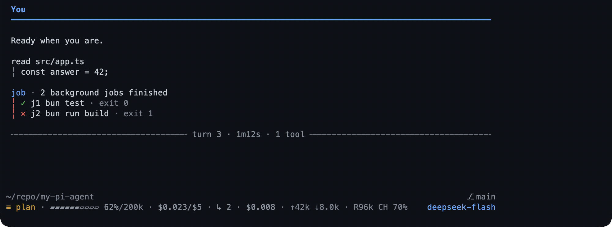

# my-pi-agent user guide

`my-pi-agent` is an add-on for [Pi](https://pi.dev), the assistant you talk to in
a terminal. It adds 21 extensions, 4 packaged skills, and 2 colour themes to the
Pi you already use: planning, verification, background work, isolation, memory,
web access, a WeChat bridge, and a themed control centre. Nothing in Pi is
forked or modified, and every extension can be switched off.

This manual is for people who *use* Pi rather than work on its code. It explains
each feature in plain language, walks through the keys and commands, and names
the limits where they matter. You do not need to program to follow it. A few
features touch your project's git history — worktrees, snapshots, the browser's
change view — and each one says so.

This edition was checked against my-pi-agent 0.20.0 and Pi 1.4.0. Run
`pi --version` and `pi list` if a key or screen differs; the
[changelog](../../CHANGELOG.md) lists what changed since this edition.

*A turn with the pack loaded: your nameplate, a tool call with its result indented
behind the rail, a notice, the turn rule, and the footer.*

## How this guide is organised

Nine chapters follow the work you do, in the order you meet it, and two lookup
pages answer a question once you have the name. A chapter is meant to be read in
one sitting; the chapters do not depend on each other, so open the one that
matches what you are doing.

**Chapters**

| Page | What it covers | Read it when |
|---|---|---|
| [Getting started](./getting-started.md) | Requirements, installing, updating, removing, cost and privacy, the screen, the glossary | You have just installed the pack |
| [Plan and verify](./plan-and-verify.md) | Plan mode, checks, the assistant's questions | You want the assistant to work in a more controlled way |
| [Track and remember](./track-and-remember.md) | To-dos and goals, the context report, memory | A task has more steps than one reply |
| [Delegate and background](./delegate-and-background.md) | Background jobs and watchers, specialist helpers, parallel sessions | A command takes minutes, or the work can be split |
| [Packaged workflows](./packaged-workflows.md) | The four skills: `init`, `next`, `refactor`, `project-docs` | You want a known method rather than an improvised one |
| [Keep your work safe](./keep-work-safe.md) | Worktrees, rewind, review | A task could change files |
| [Web and files](./web-and-files.md) | Web search and fetch, documents, the file browser, native file opening | You need material from outside the conversation |
| [Using it from WeChat](./wechat.md) | Login, conversations, the control screen, files, limits | You want to reach the session from your phone |
| [Settings and customization](./settings-and-customization.md) | The control centre, the settings shortlist, themes, notifications, disabling and removal | You want to change how the pack behaves |

**Lookup**

| Page | What it covers | Read it when |
|---|---|---|
| [Troubleshooting](./troubleshooting.md) | Triage, symptoms and causes, FAQ, how to get help | Something looks wrong |
| [Reference](./reference.md) | Every command with where it is explained, shared keys, platform notes, files on disk, actions that discard work, extension and tool matrix | You know what you want and need the exact name |

A feature section opens with what it is and when to use it, walks through it in
numbered steps with an observable result, and ends with what to know. A chapter
adds the concepts you need and a key or command table wherever a screen has one.
Anything you type appears in a code block. Anything you press is written as a key
such as `a` or `Esc`.

## Start in five minutes

1. **Install the pack and start Pi in a project folder.**
   `pi install npm:@gavin-hu/my-pi-agent`, then run `pi` in the project.
   [Installation](./getting-started.md#install) has the other routes.

2. **Confirm it loaded.** Type `/bytefly`. The control centre lists every
   extension with an enable checkbox and a health verdict. A missing runtime
   piece is named underneath. See
   [The control centre](./settings-and-customization.md#the-control-centre).

3. **Plan a change before it is written.** Type `/plan add a dark mode toggle`,
   read the plan, and press `a` to approve it. Nothing in the project is modified
   before approval. See [Plan first, then write](./plan-and-verify.md#plan-first-then-write).

4. **Know how to undo a turn.** `/rewind` lists every prompt on this branch and
   marks the ones with a code snapshot. See
   [Undoing a turn](./keep-work-safe.md#undoing-a-turn).

5. **Review the last turn.** `/review` shows the files it changed; `Enter` opens
   a diff, and `r` reverts a file or the selection. See
   [Reviewing the last turn](./keep-work-safe.md#reviewing-the-last-turn).

6. **Keep one fact for next time.** Ask the assistant to remember it, or run
   `/memory` to add a note yourself. See
   [Remembering between sessions](./track-and-remember.md#remembering-between-sessions).

If a word is unfamiliar, the [glossary](./getting-started.md#glossary) defines it.

## Conventions

| Convention | Meaning |
|---|---|
| Plain words | Type a request in the message box and press Enter. The assistant chooses the tools. |
| Slash command | A message beginning with `/`, such as `/plan`. It acts immediately instead of starting a model turn. |
| Key | A single keyboard key in a full-screen panel or dialog, such as `a`, `Space`, or `Esc`. Footers list the keys that work there. |
| `code` | A command, key, path, setting label, or literal value. |
| `<angle brackets>` | A placeholder you replace, as in `/worktree enter <name>`. |
| Project folder | The directory Pi was started in. Paths in examples are relative to it. |
| TUI | Pi's interactive terminal interface. Full-screen panels, widgets, and status chips need it. |
| Text-only mode | RPC, JSON, or print output. Commands still work, but screens print a report instead. |

Three keys are worth learning before the first long turn: `Esc` interrupts the
answer in progress, `Ctrl+C` clears what you have typed without sending it, and
`Ctrl+O` expands or collapses a long tool block. `Ctrl+D` exits Pi when the
input box is empty.

> **A note on modes.** Whenever a feature behaves differently outside the
> terminal interface, the chapter says so. If a screen will not open, the same
> command usually prints its result; see
> [Troubleshooting](./troubleshooting.md#symptom-and-cause).

## Find a feature

Every row names the page that owns it.

**Plan and verify**

| Feature | What it does | Walkthrough |
|---|---|---|
| `plan` | Plans read-only, then waits for your approval | [Plan first, then write](./plan-and-verify.md#plan-first-then-write) |
| `check` | Runs the project's tests, lint, or typecheck and lists failures | [Checking your work](./plan-and-verify.md#checking-your-work) |
| `question` | A dialog that asks you to choose between options | [Answering the assistant's questions](./plan-and-verify.md#answering-the-assistants-questions) |

**Track and remember**

| Feature | What it does | Walkthrough |
|---|---|---|
| `todo` | A checklist the assistant keeps updated | [A to-do list and a goal](./track-and-remember.md#a-to-do-list-and-a-goal) |
| `goal` | One session objective, restated every turn | [A to-do list and a goal](./track-and-remember.md#a-to-do-list-and-a-goal) |
| `context` | Shows where the context window goes, and compacts from the report | [Seeing where the context goes](./track-and-remember.md#seeing-where-the-context-goes) |
| `memory` | Notes that carry across sessions | [Remembering between sessions](./track-and-remember.md#remembering-between-sessions) |

**Delegate and background**

| Feature | What it does | Walkthrough |
|---|---|---|
| `job` | Runs a long command in the background | [Background jobs and watchers](./delegate-and-background.md#background-jobs-and-watchers) |
| `watch` | Tails a file or command and alerts on a match | [Background jobs and watchers](./delegate-and-background.md#background-jobs-and-watchers) |
| `subagent` | Hands work to a specialist helper in its own process | [Delegating to specialist helpers](./delegate-and-background.md#delegating-to-specialist-helpers) |
| `session-bus` | Lets independent sessions on one repository act as a team | [Coordinating parallel sessions](./delegate-and-background.md#coordinating-parallel-sessions) |
| `board` | The shared feature list for one repository, and its live page | [Sharing a board](./delegate-and-background.md#sharing-a-board) |
| `team` | Hands a card to a running session, and takes one back | [Running a round](./delegate-and-background.md#running-a-round) |

**Packaged skills**

| Skill | What it does | Walkthrough |
|---|---|---|
| `init` | Creates or updates the instruction file the project already reads | [Initializing AGENTS.md with /skill:init](./packaged-workflows.md#initializing-agentsmd-with-skillinit) |
| `next` | Suggests what to do next, with the evidence for each item | [Choosing what to do next](./packaged-workflows.md#choosing-what-to-do-next) |
| `refactor` | Audits a scope for refactoring opportunities, and edits nothing | [Finding refactoring opportunities](./packaged-workflows.md#finding-refactoring-opportunities) |
| `project-docs` | Keeps a project's documents true to its tree | [Keeping the docs honest](./packaged-workflows.md#keeping-the-docs-honest) |

**Keep your work safe**

| Feature | What it does | Walkthrough |
|---|---|---|
| `worktree` | Works on a branch in a separate folder | [Working on a branch safely](./keep-work-safe.md#working-on-a-branch-safely) |
| `rewind` | Snapshots each prompt, restores code or conversation, and reviews a turn's changes | [Undoing a turn](./keep-work-safe.md#undoing-a-turn) |

**Web and files**

| Feature | What it does | Walkthrough |
|---|---|---|
| `web-access` | Web search and page reading | [Searching and reading the web](./web-and-files.md#searching-and-reading-the-web) |
| `file-read` | Reads PDF, Word, and Excel files as text | [Reading a document](./web-and-files.md#reading-a-document) |
| `file-browse` | A read-only browser for the project | [Browsing a project](./web-and-files.md#browsing-a-project) |
| `file-open` | Opens a file in its normal application | [Opening a file in its usual application](./web-and-files.md#opening-a-file-in-its-usual-application) |

**WeChat**

| Feature | What it does | Walkthrough |
|---|---|---|
| `wechat` | Answers WeChat messages from the live session | [Using it from WeChat](./wechat.md) |

**Settings and customization**

| Feature | What it does | Walkthrough |
|---|---|---|
| `bytefly` | The control centre, settings, theme, health checks, and transcript chrome | [The control centre](./settings-and-customization.md#the-control-centre) |

## Other documentation

| Guide | What it covers |
|---|---|
| [The catalog in the entry README](../../README.md#what-you-get) | Every extension and theme, grouped, with its exact tools and commands |
| [`docs/extensions/<name>.md`](../../docs/extensions/) | One page per extension: its capabilities table, full tool surface, Pi integration, design notes |
| [Changelog](../../CHANGELOG.md) | What changed in each release |

The [entry README's Documentation table](../../README.md#documentation) covers the
guides this list leaves out: configuration, architecture, development, security,
and the roadmap.

## Getting help

Start with [Troubleshooting](./troubleshooting.md), then run `/bytefly doctor` and
include its report when you ask for help. Bugs and feature requests belong at
[github.com/gavin-hu/my-pi-agent/issues](https://github.com/gavin-hu/my-pi-agent/issues).
[Getting help](./troubleshooting.md#getting-help) lists what to include and what
not to paste.

---

[Next: Getting started →](./getting-started.md)
