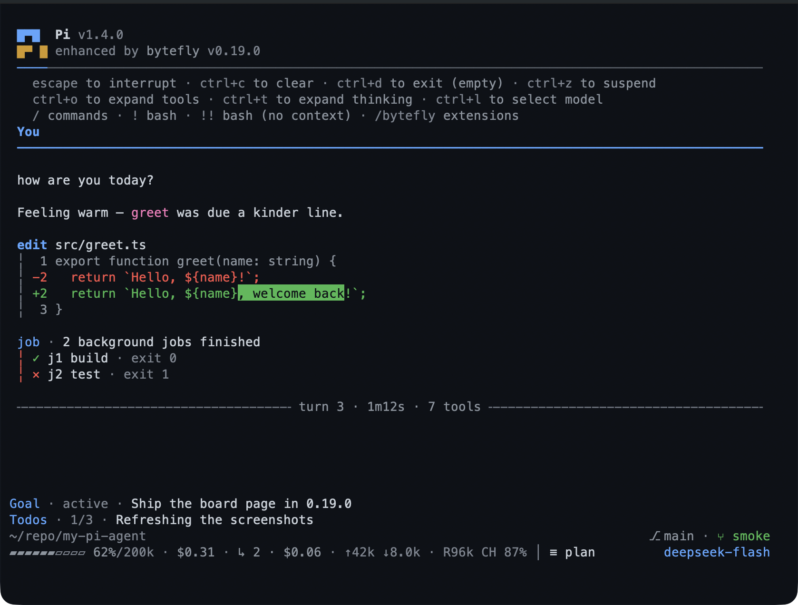

# Getting started

This chapter takes you from a working Pi installation to a loaded pack you can
trust: what the pack adds, how to install it from the source that suits you, how
to confirm it is healthy, and how to remove it cleanly. It also explains what an
install changes, what it costs, which network requests it makes, and the parts of
the screen you will see in every later chapter.

**Read this first if** you have not installed the pack, or you inherited a
machine that has it and want to know what is running.

## Prerequisites

You need a current [Pi](https://pi.dev) on your `PATH`; `pi --version` should
print a version. Pi runs on Windows, macOS, and Linux, and the pack is tested on
all three.

The pack itself needs nothing else to load. Individual features add their own
requirements, and each one degrades or disables cleanly rather than breaking the
session.

### What each feature needs

| Feature | Needs | Without it | Beyond plain text |
|---|---|---|---|
| `plan` | A terminal or a dialog-capable mode for approval | The plan tools fail with an actionable message; nothing is approved for you | The review screen; RPC offers the same choices as a menu |
| `check` | A detectable project check command, or `check.command` | The run reports that no command was found | The failure detail |
| `todo`, `goal` | Nothing | Nothing; the tools still work | The widgets and the `/todos` screen |
| `question` | An interactive terminal | The tool is inactive; the model asks in prose | The whole dialog |
| `job`, `watch` | Nothing | Nothing | The `/jobs` and `/watch` screens; their subcommands print |
| `subagent` | A runnable `pi` on `PATH` | Delegation reports that no child process could start | The `/agents` board; the tool itself works everywhere |
| `worktree`, `rewind` | `git` on `PATH` and a project git tracks | Both report what is missing; the rest of the pack works | The path and hunk checklists, and the rewind timeline |
| `memory` | A trusted project for project-scope notes | Global notes still work; the project store is refused | The picker; text mode lists the notes |
| `web-access` | Network access; the optional `unpdf` package for PDF URLs | HTML works; a PDF URL comes back as a binary-content note rather than text | None |
| `file-read` | Nothing | Nothing; extraction is local | None |
| `file-browse` | A browser | The page cannot be opened | A page in your browser |
| `file-open` | A desktop handler for the file type | A launch failure is reported | The command itself |
| `wechat` | A WeChat bot account, network access, and a terminal for the QR login | The bridge stays quiet | The QR login and the control screen |
| `bytefly` | Nothing | Nothing | The Extensions, Skills, and Settings screens; `doctor` prints |

`/bytefly doctor` checks the enabled extensions and names anything missing. See
[Settings and customization](./settings-and-customization.md#health-checks).

## Install

Choose one source. Each route writes a package entry to Pi's settings — global
by default, or the project's `.pi/settings.json` with `-l` — and Pi manages the
package outside your source tree.

1. **Published release from npm** — the normal choice:

   ```bash
   pi install npm:@gavin-hu/my-pi-agent
   ```

2. **Personal install from git**, tracking the default branch:

   ```bash
   pi install git:github.com/gavin-hu/my-pi-agent
   ```

   This follows `main`, so it picks up new commits. Use npm or a pinned tag when
   you want a stable version.

3. **Pin a release** when you need reproducible behaviour across machines or
   teammates:

   ```bash
   pi install git:github.com/gavin-hu/my-pi-agent@v0.19.0
   ```

   npm versions and git tags name the same release. The pin above matches the
   current package version; bump it when you upgrade.

4. **Project-local install**, recorded in the current project's
   `.pi/settings.json` rather than your personal settings:

   ```bash
   pi install ./ -l
   ```

   Use this when a team wants the pack only for one repository. A project-local
   entry is visible to anyone who opens that project with Pi.

`pi list` confirms the entry. `pi update --extensions` moves an installed package
to the newest release; `/bytefly update` checks without leaving the session.

> **Before you start.** Install the pack once per machine or per project, not
> both. Two entries give you two copies of the extension factories and two
> competing versions of the same screen.

### Try it without installing

To evaluate the pack from a checkout, without writing to your settings:

```bash
git clone https://github.com/gavin-hu/my-pi-agent
cd my-pi-agent
pi -e .
```

`-e` loads a directory or package for that one run. Nothing is installed, and
your normal Pi configuration is unchanged when you quit.

## Verify the installation

1. Start Pi in any project folder:

   ```bash
   pi
   ```

2. Open the control centre:

   ```text
   /bytefly
   ```

   You should see the **Extensions** section with one row per installed
   extension, an enable checkbox, and a health verdict. Rows from this pack carry
   their extension names; Pi's built-in extensions may appear too.

3. Read the verdicts. A glyph appears only when something needs attention: `!`
   means the feature works with less than it could, and `✕` means something is
   missing. A row with no glyph is fine; a clean report says `ok` in words.
   Focus a row and press `Enter` to expand its findings.

4. If you want the same report as text:

   ```text
   /bytefly doctor
   ```

   The report names each enabled extension, what it needs, and how to add a
   missing piece.

5. Try one harmless command to confirm registration:

   ```text
   /todos
   ```

   An empty list opens in the terminal interface; outside it, the command prints
   a notification instead.

If `/bytefly` is not a command at all, the package did not load. Check `pi list`,
then restart Pi. [Troubleshooting](./troubleshooting.md#symptom-and-cause) covers
the next steps.

## Update and remove

**Update.** `pi update --extensions` updates every installed package. The pack
also checks once per interactive session and posts one notice when a newer
release exists; `/bytefly update` runs that check immediately. Set
`PI_OFFLINE=1` to skip all automatic network activity for a session.

**Remove.** Use the source you installed from:

```bash
pi remove npm:@gavin-hu/my-pi-agent        # personal install
pi remove npm:@gavin-hu/my-pi-agent -l     # project-local install
```

The tools and screens disappear on the next start. Your plans, notes, snapshots,
conversations, and settings are left on disk; the
[files reference](./reference.md#files-on-disk) lists them so you can delete what
you no longer want. Nothing is deleted by removal; [Actions that discard
something](./reference.md#actions-that-discard-something) lists the commands that
do lose work. To disable one feature rather than remove the whole pack, see
[Turning features off or removing the pack](./settings-and-customization.md#turning-features-off-or-removing-the-pack).

## What an install changes

- **The model's tool list.** Each extension adds its tools with a one-line
  description, so the assistant can choose them. The pack adds 26 tools that were
  not in Pi before; `worktree` also re-registers Pi's path tools so they follow
  the active root instead of replacing them with new names.
- **The transcript.** The pack draws a `You` nameplate above your messages, a
  rule after each completed turn, and a frame around each tool call and result.
  The startup header is **off by default**; enable **Bytefly startup TUI** in
  `/bytefly settings` if you want the nameplate at the top.
- **One update check per interactive session.** It asks Pi's package manager
  which configured packages are behind, suppresses Pi's own startup block, and
  posts one notice. Pi's own newer release gets the same treatment: Pi resolves
  it and bytefly draws it, so the `Update Available` box becomes a notice naming
  `pi update` and the changelog. No session content is sent.
- **No theme change.** Installing the pack makes the `bytefly-dark` and
  `bytefly-light` themes available but does not select one. Pick one through
  `/settings` → **Theme** or `/bytefly settings` → **Theme**; see
  [Themes](./settings-and-customization.md#themes).
- **Three loopback web pages, on demand.** The plan review, the file browser, and the
  board page listen on `127.0.0.1` only, and only while you have them open.
  [Security](../security.md) covers the boundary.

## Cost and network

**What costs money.** The pack is free and open source. Your AI provider bills
for the model tokens a session uses, exactly as it does without the pack. The
footer shows a running estimate. `USD` prices DeepSeek from its published dollar
table, peak schedule included, and takes every other model's number from Pi's own
per-model cost; `CNY` prices DeepSeek from its published yuan rates and needs
`price.rates` entries for anything else — a CNY session names the records it
could not price rather than leaving them silently out of the total. **Pricing**
in `/bytefly settings` sets the currency and a decimal precision, and an optional
session budget warns you once when the total reaches it. It does not stop the
turn.

**What leaves your machine.** The pack sends nothing about your session on its
own. Only three things use the network, and only when they apply:

| Request | When it happens | What is sent |
|---|---|---|
| Web search or page fetch | You ask for one | The query goes to your chosen search provider; the page request goes to that site |
| WeChat bridge | After you log in | Messages pass through WeChat's service |
| Update check | Once per interactive session | The configured package list, through Pi's package manager |

`pi` also checks `pi.dev` for a newer version once per start, exactly as it always
has: bytefly only re-renders that answer, so the pack adds no request of its own.

`PI_OFFLINE=1` skips the automatic update check. Everything else — plans, notes,
snapshots, job logs, subagent transcripts — stays on your machine in the files
listed under [Files on disk](./reference.md#files-on-disk) or in the session
itself.

## The screen

Most of the pack is visible in the transcript, so the parts of the screen have
names this manual uses throughout.



*The full frame with the optional startup header enabled. The header is off
until you turn it on; the transcript and footer are always drawn.*

| Part | What it is |
|---|---|
| Startup header | A two-tone nameplate with the Pi version, the pack version, and a help block. Off by default; enable **Bytefly startup TUI**. |
| Your message | A `You` label and rule above each request you type. |
| Tool block | A headline naming the tool and its call (for example `read src/app.ts`), with the result indented underneath behind a thin vertical rail. |
| Turn rule | A rule such as `╌╌╌ turn 3 ╌╌╌` after a completed turn. Where width allows, it adds the duration, the tool count, and any failures. |
| Footer | Two lines below the input: the folder and session name, git branch and worktree, the file-browser port, the context gauge and cost, plan mode, subagent cost, and the model name. |
| Widgets | Up to two one-line rows above the input: your **to-do list** and your **goal**, when either exists. |
| Status chips | Small badges in the footer that report background state. |

The chips you will meet:

| Chip | Meaning |
|---|---|
| `≡ plan` | Plan mode is on |
| `↺ 4` | Four prompts are on this branch's rewind timeline |
| `▸ 2` | Two jobs are running |
| `✗ 1` | A job finished and you have not read its result |
| `↳ 1` | One background helper is running |
| `⊚ 1` | One watcher is live |
| `! 2` | A watcher has two matches you have not read |
| `◉ 4820` | The file browser is serving on port 4820 |
| `✆ wechat expired` | A WeChat login has expired |

### While a turn runs

| Key | What it does |
|---|---|
| `Esc` | Interrupt the answer in progress |
| `Ctrl+C` | Clear what you have typed, without sending it |
| `Ctrl+O` | Expand or collapse a long tool block |
| `Ctrl+D` | Exit Pi, when the input box is empty |

The working row above the input shows a live line while the assistant works —
first a timer, then the current tool, the tool count, and elapsed time. It is
bytefly chrome, not a separate command.

## Glossary

| Word | Meaning |
|---|---|
| Terminal | The text window Pi runs in. |
| Pi | The assistant program this pack adds to. |
| Extension | One add-on in the pack; there are 21, each switchable. |
| Slash command | A message that starts with `/` and acts immediately instead of starting a turn. |
| Prompt | What you type to the assistant, before it answers. |
| Turn | One prompt and the assistant's work in answer to it. |
| Tool | An action the assistant can take, such as reading a file or running a command. |
| Session | One conversation, with its own history. |
| Model | The AI your provider runs; the pack only adds tools and screens around it. |
| Repository (repo) | A project folder whose history `git` tracks. |
| Branch | A named line of work in a repository. |
| Commit | A saved point in a branch's history. |
| Snapshot | A saved copy of the project from before a prompt. |
| Worktree | A second folder holding a branch, so work stays separate. |
| TUI | Pi's interactive terminal interface, as opposed to RPC, JSON, or print output. |

## Related

- [Plan and delegate](./plan-and-verify.md) — the first workflow most people adopt.
- [Settings and customization](./settings-and-customization.md#health-checks) — the doctor report in detail.
- [Security](../security.md) — the trust boundaries behind the network table.

---

[← Guide home](./README.md) · [Next: Plan and verify →](./plan-and-verify.md)
