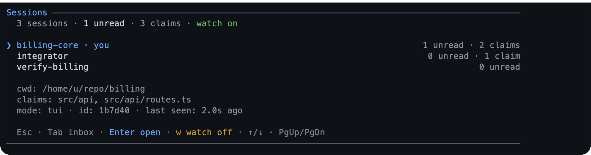

# 2. Plan and delegate

This chapter is about control: making the assistant explain its approach before
it changes anything, verify its work, keep its place, ask when a decision is
yours, and hand long or specialist work to something that can run beside the
conversation instead of inside it.

**Use this chapter when** a task spans several files, you are unfamiliar with the
codebase, a command takes minutes rather than seconds, or you want a second
opinion before you accept a change. None of these features is required for a
one-line fix; reach for them when the cost of a wrong turn is higher than the
cost of a little ceremony.

## Plan first, then write

### What it is

Plan mode puts the assistant into a read-only state. It can read files, search,
and reason, but it cannot edit your project. Its one write is a plan file under
`~/.pi/agent/plans/<repo-key>`. When the plan is ready, you review it; only your approval restores
writing and starts the work.

The plan file is the source of truth, not a chat summary. Refinements rewrite the
same file, and the assistant keeps the file's checkboxes current as it executes,
so the artifact you approved stays the artifact it follows.

### When to use it

- A change crosses more than one file, or you cannot predict its blast radius.
- You want to see the approach, the risks, and the verification step before any
  code moves.
- You are onboarding to a codebase and want the assistant to investigate first.

Plan mode is a poor fit for a typo, a question, or a task you already know how to
describe precisely.

### Walkthrough

1. In a project, start plan mode and give it the task in one step:

   ```text
   /plan add a dark mode toggle to the settings page
   ```

   The footer shows `≡ plan`. The assistant reads and reasons without modifying
   the project. It writes only the plan file.

2. When the plan is ready, the review screen opens in the terminal. The plan is
   laid out as Markdown, with its goal, context, approach, visual, steps, risks,
   and verification. Read it, then choose an action:

   | Key | What it does |
   |---|---|
   | `↑` / `↓`, `j` / `k` | Scroll one line |
   | `Space` / `b`, `PgUp` / `PgDn` | Scroll one page |
   | `d` / `u` | Scroll half a page |
   | `g` / `G` | Jump to the start or end |
   | `n` / `p` | Jump to the next or previous heading |
   | `a` | **Approve and run**: asks `y`/`N`, then leaves plan mode and starts the work |
   | `r` | Refine: type feedback, `Enter` to send it, `Esc` to go back |
   | `w` | Open the plan in the browser for review |
   | `x` | Exit plan mode without approving; the plan file stays |
   | `Esc` | Keep planning without approving |

   On a phone or RPC, the plan file is sent first, then one prompt: reply `1` to
   approve and run, `2` to keep planning, or `3` to exit without approving. Any
   other text is a refinement: the model rewrites the plan and asks again, with
   no second “choose Refine” step. If the file cannot be sent, the plan text is
   posted first. Dismissing the prompt, or replying `取消`, `退出`, or
   `exit plan mode`, also exits without approving.

   If the plan changed since your last review, a line under the title says how
   many sections changed. A scroll gauge names the section and line range you are
   looking at.

   

   *The terminal review: the plan's sections and step checkboxes, with the
   approve, refine, and keep keys at the bottom.*

3. Prefer a browser? Press `w` on the review screen. The page opens on your own
   machine with the plan as one measured column, a live step-progress panel, a
   section outline, and a comment rail. Select text or use **+ Comment** to
   annotate a block; **Save feedback** writes the comments into the plan file and
   returns them to the assistant as a refinement. A save with no comments asks for
   nothing, so the review screen comes back instead.

   When the page was opened from the review screen, it also carries **Approve &
   run**: the
   confirmation names what happens, starts on **Cancel**, and only its own
   button approves. A page opened later with `/plan review` is comment-only and
   has no approve action.

   

   *The browser review: step progress, a comment rail holding a teammate's
   comment, and the approval action when the page was opened from the terminal
   review.*

   In the page, `j` / `k` move between blocks, `c` comments on the current block,
   `a` opens the approval confirmation, `s` saves feedback, `Esc` closes the
   composer or the page, and `?` opens a shortcut sheet. Nothing typed is lost:
   saving, approving, or closing refuses while a comment is half-written and puts
   the cursor back in it, and a deleted comment can be undone from the header.

   **Review with someone else.** **Share** in the page header mints a link (and a
   QR a phone can scan) that a teammate on the same network opens to read the plan
   and comment under their own name. Their comments arrive in the same file as
   `> [!REVIEW] @alice: …`, appear under the block they refer to on your page as
   they post them, and stay when you revise the plan. They cannot approve, save the
   review, or close it: **Approve & run**, **Save feedback**, and **Back to Pi**
   are yours alone, and the reviewer's page renders only **Post comments**. Her
   posting never ends your review — only your own decision, or your page going
   away, does that. **Stop sharing** — or closing the review — revokes the link,
   and her page is told so rather than left guessing. From a phone-owned
   or remote session, `/plan share` prints the link and QR and `/plan share stop`
   revokes it, because there is no page to click.

4. After approval, the plan's steps become your to-do list. Watch the widget tick
   them off. The assistant updates the plan file as it goes; you can reopen the
   plan at any time.

5. To find an earlier plan:

   ```text
   /plan list
   ```

   The list shows each plan's title, when it last changed, and its step progress,
   newest first. `Enter` opens one for review. `Esc` closes the list.

### Good to know

- `/plan` on its own toggles plan mode without sending a task. `Ctrl+Alt+P` is a
  shortcut for the same toggle where your terminal sends it. `--plan` starts Pi
  with plan mode already on.
- `/plan review [path]` opens the browser page for the newest plan, or for the
  path you give it. It is for comments only; approve from the terminal review or
  from the page opened with `w`.
- A shared link is a credential: anyone who has it can read the plan and comment
  under any name. The page says so, the link is generated per review, and it is
  revoked by **Stop sharing**. The server binds one address on this network, never
  a wildcard, and a machine with no reachable address says so instead of printing
  a link that cannot work. Nothing leaves the machine.
- `/plan cancel` leaves plan mode without approving. The plan file stays, no todo
  items or goal are recorded, and write access returns immediately. The phone
  review reaches the same outcome through **Exit plan mode** or a cancel phrase;
  outside a review, the model can call `cancel_plan_mode`.
- The model is asked to follow a short outline — goal, context, approach, visual,
  steps, risks, verification — with a one-sentence goal, the end state in an
  untagged fence, before and after when the surface already exists, and
  verification named as commands you could run. It is a guide, not a form:
  `Context`, `Approach`, `Visual`, and `Risks` are dropped when they have nothing
  to say, while `Steps` and `Verification` stay, because the steps are read from
  that section and its check becomes the last todo item; any Markdown is accepted.
  Steps are the top-level `- [ ]` items in the `## Steps` section; nested bullets
  are notes. A plan with more than 50 top-level steps is refused at write time,
  because approval could not track them all. A refinement keeps its section
  headings, so the review marks only the sections that changed.
- While plan mode is on, mutating tools are hidden or refused: file writes,
  edits, most shell commands, worktree mutations, and MCP tools that do not
  declare themselves read-only. `/check` and `/review` refuse until the plan is
  approved, because both can write caches or the working tree. `todo` and `goal`
  stay available, and a subagent is forced read-only.
- The review screen needs the terminal interface. A dialog-capable mode such as
  RPC offers the same choices as a select menu; a run with no UI at all fails
  with an actionable message instead of approving for you.

### Splitting a plan into slices

Off by default. Turn on **Split plans into slices** in `/bytefly settings`, or set
`"plan": { "split": true }` in the project's `.pi/bytefly.json` so a repository
opts its own team in while the global default stays off.

With it on, the assistant may approve a plan **with a split**: units, each with a
name, the path prefixes it owns, the command that proves it done, and the units it
depends on. The split is validated before the review screen opens, so a bad one
costs no review at all, and the screen shows it as a read-only `Split` section —
the same table the plan file will carry. On approval the table is written into the
plan as `## Team` and the result prints a roster card:

```text
Split: 2 units · ~/.pi/agent/plans/a1f9c02/2026-11-04-1802-billing.md
  You start and switch every session; nothing here can.
  core: enter_worktree core · /sessions name core · /sessions watch wake
    session({action:"join", team:"2026-11-04-1802-billing", unit:"core"})
  merge order: contract → core · your unit: contract
```

Then you open one session per owner and paste its line. Each owner joins its unit
once — `session({action:"join"})` claims every path the unit owns — works one
increment per turn, and leaves when it merges. `status` reports `units 1/2 joined`
with each unit's holder, so you can see who has started without asking.

What the approval refuses, by name: fewer than two units (one path is not a split;
build the thinnest end-to-end path first), overlapping prefixes, a dependency
cycle, more than two owners plus the lead, a unit without a test, and an owner unit
that claims a shared file such as `package.json` or the changelog. A plan with no
split is approved exactly as before, so the switch costs nothing until you use it.

The browser page cannot approve a split plan: a section written at approval has no
source lines for its comments to anchor to, so a split is approved in the terminal
review.

### Initializing AGENTS.md with /skill:init

`/skill:init` creates or updates the project's effective instruction file
(`AGENTS.md`, or `AGENTS.override.md` when it shadows `AGENTS.md`) through a short
built-in interview and the same plan review. The skill enters plan mode,
reconnoiters the repository, asks up to four questions, and prepares a proposal.
Nothing is written until you approve the plan.

```text
/skill:init
  └─> plan mode (read-only)
        └─> recon: effective instruction file, sourced evidence, existing instructions
        └─> interview: built-in bank, one call of at most 4 questions, minus resolved facts
              ├─ answered ───────────────> reconcile with evidence
              └─ unavailable/cancelled ──> evidence + assumptions
        └─> draft: new file, exact edits, or an honest no-op
        └─> quality gate
        └─> write_plan ──> exit_plan_mode
                             ├─ not approved ──> refine the same plan
                             └─ approved ──────> write/edit the target
                                                 └─ read back + quality checklist
```

The skill uses a packaged question bank, so the whole workflow is explicit rather
than an improvised prompt. The built-in bank covers purpose, verification commands,
non-obvious rules, isolation, completion, sensitive paths, and dependency or
network limits, with state-specific questions for an existing instruction file, an
empty repository, related instruction files, and a shadowing override. Recon
builds a sourced evidence sheet — commands with their definer, generated and
vendored paths from `.gitignore`, workspace packages, and purpose from the README
or manifest — and the first call uses the bank's deterministic set for the state
minus every field it resolved; a second call is allowed only for a material
ambiguity. If the question tool is inactive, there is no UI, or you cancel, the
skill records the unanswered gaps as assumptions and continues from evidence
instead of stalling.

The target is the instruction file Pi actually reads: a root `AGENTS.override.md`
replaces `AGENTS.md` and is edited in place, or the plan consolidates it into
`AGENTS.md` and removes the override. The plan uses the canonical outline,
including `## Steps` and `## Verification`, so approval seeds the apply actions.

The skill's quality checklist requires every command and path to come from a file
that defines it, keeps the file short and specific, and preserves correct
instructions in an existing instruction file. An accurate file can produce a no-op
plan instead of rewriting it. Both an existing repository and an empty one are
supported; an empty repository gets only known facts, with no invented commands.
`/skill:init` needs plan mode, so it is unavailable when the `plan` extension is
disabled. It ships with the full package; loading only `extensions/plan` makes
`/skill:init` unavailable rather than sending a bare skill name.

### Finding refactoring opportunities

The packaged `refactor` skill audits a project or path for refactoring work before
any code moves. It is model-invoked: a request such as "what should I refactor
here?" can load it automatically, and `/skill:refactor` forces it. Discovery is
read-only and returns a ranked shortlist instead of editing files.

Give it a scope with a path, or let it use the current project:

```text
/skill:refactor @extensions
/skill:refactor @extensions/plan
/skill:refactor @extensions/plan/plans.ts
```

A directory is an audit scope, a file is the starting point, and several paths
can be audited together. The skill reads the project's own instructions and CI
thresholds first, then looks for duplication, oversized modules, coupling,
structural drift, high-churn code with weak tests, test friction, and boundary
erosion. It checks callers and tests before keeping a candidate, so intentional
duplication and public API are not reported as opportunities.

The report names the scope and method, then three to five candidates ranked as
**Do next**, **Worth planning**, or **Leave it**. Each candidate includes
`path:line` evidence, the proposed structural change, expected benefit, risk and
blast radius, effort, and the commands that would verify it. Rejected signals are
listed with their reasons. Nothing is edited during the audit.

After you choose a candidate, the handoff keeps the refactor safe: state the
behavior contract, run the project's check for a baseline, add characterization
tests if the behavior is untested, enter plan mode when the change spans files or
a public surface, make one structural change per step, and run the full check at
the end. The skill is advisory rather than an enforcement layer; it can miss a
request or be ignored, but the plan review and the check command still gate
the work once a refactor starts.

### Choosing what to do next

The packaged `next` skill answers "what now?" from the work already in front of
it, not from the conversation's enthusiasm. It is model-invoked: a request such
as "what should I do next?" or "where do I pick up?" can load it automatically,
and `/skill:next` forces it. It only reads; nothing is edited, committed, or
started by the triage itself.

```text
/skill:next                     # the source the conversation picks
/skill:next @extensions/plan    # the same, narrowed to one path
/skill:next what is left?       # keep the sources that answer the question
/skill:next plan file outline @extensions/plan/   # both: the topic and where to look
```

The source is not a mode you name. A conversation that has already done work — a
todo list, a goal, an approved plan, a subagent or job result, a claimed path, an
edited file — is asked what it left open, and only an empty conversation is
triaged from the project, so one command reads the tree at the start of a session
and the session's own loose ends afterwards. Whatever follows the command still
chooses the topic and the scope: the words say what to ask, a path says where to
look, and the usual form is both, so `plan file outline @extensions/plan/` asks
what to do next about that outline with the plan extension as the only evidence.
The report opens by naming the source and how the prompt was read, so a
misreading is visible instead of silently swapping one source for the other.

A project triage reads the working tree, the commits since the last tag, the
changelog's unreleased section, the roadmap or issue list, and the plans
directory — whichever of those the project has — and quotes the project's own
check command without running it. A conversation read takes that command's last
result, the session's diff, the todo list, the goal, the approved plan and its
ticked steps, and what subagents and jobs returned, then lists what it left open.
Either way the tree is evidence, so a candidate is checked against the code
before it is suggested, and a conversation that ended cleanly returns an empty
list rather than the project's backlog. An imperative — `/skill:next fix the
failing test` — is treated as one item: the skill answers with its evidence and
starting command, and asks before starting. A request already scoped to a
refactor audit or a changelog entry goes to the `refactor` or `changelog` skill
instead of being answered twice.

The report is a numbered list of suggested next todos in priority order, so the
first item is the one to start. Priority is what it would cost to lose: loose
work first — a dirty tree, an unapproved plan, a check that was never run, an
unmerged branch — then a broken promise, such as a README claim the code no
longer meets, then an unfinished one, such as the remaining steps of an approved
plan. New capability comes last. Each item also carries a label for the ceremony
it needs — **Do next**, **Worth planning**, or **Later** — which says how much
work it takes, not where it sits in the order. The list is capped at three to
five items, each with `path:line` evidence, the command that starts it, and an
effort estimate, plus the candidates that were rejected and why.

An empty list is a valid result: when nothing is worth doing, the skill says so
with what it checked instead of inventing work. It is advisory, so it can miss a
promise or misjudge a priority; the tree it cites and the evidence it quotes are
the parts you can verify. Once you pick an item, the handoff is the same as a
refactor's: plan mode for a multi-file change, a todo list for a small one, and
the project's check as both baseline and finish line.

### Recording changes in the changelog

The packaged `changelog` skill keeps the changelog honest. It is model-invoked: a
request such as "add a changelog entry for this" can load it automatically, and
`/skill:changelog` forces it. It has three modes, and the words after the command
pick one:

```text
/skill:changelog                  # record: one bullet for this change
/skill:changelog audit            # compare commits since the last tag with [Unreleased]
/skill:changelog release 0.18.0   # curate a release section from the project's rules
```

A recorded change is one bullet for one user-visible change, under `[Unreleased]`,
scoped by the extension or area it touches, and written in the same commit as the
change itself — a changelog that trails the work is a changelog nobody trusts. The
skill reads the project's own preamble, scope prefixes, and release document first
and follows those rather than a generic template.

`audit` is read-only: it lists the commits since the last tag and names the ones
with no entry or a weak one, so a change that shipped without a bullet is visible
before a release rather than after it. `release` runs only when you ask for a
specific version, and the steps it follows are this package's, in
[Development](../development.md#release) — the version bump, the link references,
and the tag-and-`main` push order. Never treat an audit as a release.

## Checking your work

### What it is

`check` runs the project's test, lint, or typecheck command from inside Pi,
streams the output live, and turns failures into a list you can open at the
failing line. It uses the project's own declared command, so the same feature
works in a Node, Rust, Go, Python, Make, or Just project.

### When to use it

Use it after a change, before you ask for a review, or when the assistant claims
something works. It is the fastest way to turn "should be fine" into evidence.

### Walkthrough

1. Run every detected check:

   ```text
   /check
   ```

   Or narrow it to one target:

   ```text
   /check test
   /check lint
   /check typecheck
   ```

   The output streams live. `Esc` cancels the run and stops the process tree.

   

   *A failed check; `Enter` opens the focused failure.*

2. On a failure, the list shows `file:line` locations. `Enter` opens the focused
   failure: its message and a five-line source excerpt around the location,
   marked with `>`. If the file cannot be read, the detail shows the bounded end
   of the command output and says why. `j` / `k` and the arrows scroll; `Esc`
   goes back. `r` reruns. `Esc` from the list closes it.

   " width="100%">

   *The failure detail: the excerpt marks the failing line, and the header keeps the run's counts.*

3. A passing run is one line in the transcript:

   ```text
   Check passed: bun run check · 12.4s
   ```

### Good to know

- Detection looks for `package.json` scripts, `Cargo.toml`, `go.mod`, pytest
  configuration or a `tests/` folder, a `justfile`, and a `Makefile`. For any
  other stack, set `check.command`; it overrides detection for every target.
- A parser that cannot find a location falls back to one honest failure entry
  naming the exit status, with the bounded log tail in its detail. It never
  invents a file or line.
- The run has a ten-minute timeout and keeps a bounded log tail by default. Both
  are configurable; see
  [Configuration](../configuration.md#check--verification-runs).
- The assistant can call the same run as `run_check` and receives structured
  failures. Asking it to check its work is usually better than asking it to run a
  test command directly.
- `/check` refuses in plan mode. The run can write caches, snapshots, or generated
  files, so it belongs after approval.
- In text-only modes `/check` runs and prints the report; there is no live
  screen.

## A to-do list and a goal

### What it is

Two small memory aids for the session:

- The **to-do list** is an ordered checklist. Every item is pending, in progress,
  or completed. The assistant rewrites the whole list when it updates it, and an
  approved plan seeds its steps into it.
- The **goal** is one sentence describing what the session is trying to achieve.
  It is restated to the assistant before every turn, so a long session does not
  drift.

Both appear as one-line widgets above the input box. The to-do widget shows
progress and the current item; the goal widget shows the objective. The to-do
list sits below the goal when both exist.

### When to use them

Use a to-do list for work with several visible steps. Use a goal when the session
has one outcome that must survive many turns — a migration, a release, a
debugging hunt. Neither is a project-management tool; they are session memory.

### Walkthrough: the to-do list

1. Ask for a checklist, or approve a plan:

   ```text
   break this migration into a checklist and keep it updated as you go
   ```

   The assistant creates the list and updates it as it works.

2. Type `/todos` to see the full list:

   ```text
   /todos
   ```

   In the terminal it opens a scrollable screen; elsewhere it posts the list as a
   notification.

   

   */todos: the summary, then each item's status at a glance.*

3. On the `/todos` screen, `↑` / `↓` or `j` / `k` scroll, `PgUp` / `PgDn` page,
   `g` / `G` or `Home` / `End` jump to the ends, and `Esc` or `Ctrl+C` closes.

4. When everything is complete, the widget hides. To keep it visible, change the
   [`todo` setting](../configuration.md#todo--the-todo-widget).

### Walkthrough: the goal

1. Set a goal in one line:

   ```text
   /goal ship a working contact form by the end of this session
   ```

   The assistant restates the goal in its own words, asks any clarifying
   questions, and shows you the wording to confirm or edit. Confirm, and the first
   turn starts.

2. Check or change it later:

   | Command | What it does |
   |---|---|
   | `/goal` | Show the current goal, or the usage when none is set |
   | `/goal <text>` | Run the understanding and confirmation loop, then start |
   | `/goal raw <text>` | Record exactly your words and start, skipping the loop |
   | `/goal set <text>` / `/goal edit <text>` | Change the goal without starting a run |
   | `/goal set` / `/goal edit` | Open the editor prefilled with the current goal |
   | `/goal done` / `/goal achieved` | Mark the goal achieved |
   | `/goal clear` | Remove the goal |
   | `/goal help` | Show the command usage |

3. If the to-do list still has open items when you mark the goal done, the
   assistant is told how many remain. That way it finishes the work rather than
   declaring it finished, and closing the list remains your decision.

### Good to know

- A goal and a to-do list survive `/resume` and `/tree`. Abandoned branches do
  not leak into the current session.
- Achieved goals are hidden from the widget by default. Set **Achieved goal** to
  Show in `/bytefly settings` to keep one visible.
- The to-do list is deliberately flat: no priorities, due dates, or sub-items. It
  accepts at most 50 items, and only one item can be in progress.
- The list and the goal are written by tools the assistant calls, so you do not
  have to manage them by hand. Use the commands to inspect, not to micro-edit.

## Seeing where the context goes

### What it is

Every model has a context window, and a long session eventually fills it. Pi
compacts the conversation before it overflows: an older stretch is replaced by a
summary and the newest messages are kept. `/context` shows what is in the window
now, how much room is left, and when Pi would compact, so a surprise compaction
is something you can see coming.

The report separates the parts that are easy to confuse:

- the **system prompt** — Pi's instructions, `AGENTS.md`, and project context;
- the **tool definitions** declared to the model;
- the **conversation** by role: your messages, the assistant's, and tool results;
- **injected context** from this pack (`memory`, `goal`, `plan`, and the like);
- **summaries** left by an earlier compaction;
- and the **drift** between Pi's total and the estimate, when the two differ.

### When to use it

- A turn was compacted and you want to know what survived.
- The window feels full but the conversation looks short, which usually means a
  few large tool results.
- You are about to read a big file or run a long build and want to know how much
  room is left.

### Walkthrough

1. Run `/context`. The screen opens with Pi's own number:

   ```text
   Context ──────────────────────────────────────────────
    124k / 200k  ▰▰▰▰▰▰▱▱▱▱  62%
    76k free · auto-compact at 184k · 60k headroom · keeps newest 20k

    Composition · 121k estimate
    System prompt          4.2k   3.5%  ▰▱▱▱▱▱▱▱
    Tool results         108k  89.3%  ▰▰▰▰▰▰▰▱  6 messages
   ```

2. Read the rows. The **Composition** header names the estimate they are shares
   of, so `3.5%` is 3.5% of those rows, not of the 200k window; a bar rounds to
   the nearest cell, so it sits within half a cell of the number beside it.
   **Largest messages** names the single messages taking the most room.

3. Press `c` to compact from here. The screen asks first, then reports the
   before and after numbers. Right after a compaction the token count is unknown
   until the model's next reply; the screen says so instead of showing a guess.

| Key | What it does |
|---|---|
| `↑` / `↓`, `j` / `k`, `PgUp` / `PgDn`, `Home` / `End`, `g` / `G` | Scroll the report |
| `c` | Compact the conversation, after a confirmation |
| `r` | Re-read the session and repaint |
| `Esc` / `q` | Close the screen |

Outside the terminal — `rpc`, `json`, and `print` — `/context` prints the same
report as text, and `/context compact [instructions]` is still available.

### Good to know

- The headline is Pi's estimate, built from the last provider reply plus the
  messages after it. The rows use a characters/4 estimate, so they can differ by
  a little; the report names the difference instead of hiding it.
- The threshold is the one Pi uses: the model's `reserveTokens` override, then
  the shared setting, then Pi's default. The footer's gauge shows the same
  pressure in one glyph.
- Before the session's first reply, Pi's total counts the projected messages only
  and leaves out the system prompt and tool definitions, so the rows can sit
  above it. The drift row says which way the difference runs.
- `/context compact` refuses while the agent is busy — a streaming turn or a
  running compaction — because compaction starts by aborting the turn. Pi's own
  `/compact` does abort it when that is what you want.

## Answering the assistant's questions

### What it is

Sometimes the assistant needs a decision — which database, which of two designs,
whether to delete a file. Instead of guessing, it can open a structured question
with labelled options and a free-form **Other** answer, then wait for you.

A question holds one to four sub-questions. Each can offer two to four labelled
options, or none for a free-form answer, and can allow several selections.

### When to use it

This is the assistant's choice, not a command you run. Ask for it when you want
to be consulted:

```text
ask me which database to use before you start
```

### Walkthrough

1. When a question appears, read the options and choose one with the arrow keys,
   then `Enter`. Choosing **Other** opens a text box for an answer that is not
   listed.

2. With several questions, a tab bar runs across the top and each tab shows
   whether it is answered. The last tab, **Submit**, stays locked until every
   question is answered.

3. On a question that allows several answers, `Space` ticks an option and `Enter`
   confirms the set. On the **Other** row, `Space` opens the editor as well.

4. `Esc` cancels the whole question. The assistant is told you cancelled, and can
   continue or ask again in ordinary prose.

   

   *A question with labelled options; the tabs show how many questions are still
   open.*

### Good to know

- Questions only appear in an interactive session. In a text-only run the tool is
  inactive and the assistant asks in prose instead, so nothing ever hangs.
- A remote turn over [WeChat](./wechat.md) gets its questions in the chat and
  answers them there.
- There is no timeout: the question waits until you answer, cancel, or abort the
  turn. `Esc` during the turn is the cancel path.
- A subagent has no UI, so it cannot ask you anything. It reports the open
  question back to the assistant that dispatched it.

## Background jobs and watchers

### What it is

Two ways to keep working while something slow runs.

A **job** is a command the assistant starts in the background — a build, a test
suite, a server. It keeps running while you continue the conversation, and you
can read its output, send it input, wait for it, or stop it.

A **watcher** tails a file or a command's output and looks for lines that match a
pattern. When one matches, you are told, or the assistant is woken to act on it.

### When to use them

Use a job for anything that takes longer than a normal tool call. Use a watcher
when you need to know about an event rather than poll for it: a build log, a dev
server, a test run in another window.

### Walkthrough: a job

1. Ask for the slow thing in words:

   ```text
   run the full test suite in the background and tell me when it finishes
   ```

   A `▸ 1` chip appears in the footer while it runs.

2. Type `/jobs` to open the job list:

   ```text
   /jobs
   ```

   The list includes jobs this session started and any still running in another
   open Pi window, marked `peer`.

   | Key | What it does |
   |---|---|
   | `↑` / `↓`, `j` / `k` | Choose a job |
   | `PgUp` / `PgDn`, `Home` / `End` | Move a page, or to the ends |
   | `Enter` or `l` | Open the job's log |
   | `d` or `K` | Stop the running job, after a yes/no confirmation |
   | `x` | Clear finished jobs from the list |
   | `Esc` or `q` | Close the screen |

   Inside the log, `↑` / `↓`, `PgUp` / `PgDn`, `Home` / `End`, and `g` / `G`
   scroll. The view follows the newest line until you scroll up; the header says
   `following` or `paused`. `Esc`, `Backspace`, or `q` returns to the list.

   

   */jobs: running jobs first, and the focused job's last output line.*

3. A finished job that you have not read turns the chip into `✗ 1`. Open its log
   to clear the mark. A failed job keeps its result until you do.

### Walkthrough: a watcher

1. Ask for the trigger:

   ```text
   watch the dev server log and tell me when a request fails
   ```

   A `⊚ 1` chip appears while the watcher is live, and `! 1` appears when it has
   matches you have not read.

2. Type `/watch` to open the watcher list:

   ```text
   /watch
   ```

   `j` / `k` choose a watcher, `Enter` or `l` opens its matches, `x` or `K` stops a
   running watcher, `d` clears stopped ones, and `Esc` closes. Both destructive
   keys ask for confirmation. `g` / `G` and `PgUp` / `PgDn` scroll the matches
   pane.

   

   */watch: the watcher's source, pattern, and recent matches.*

3. The same actions are available as commands, which also work in text-only
   modes:

   | Command | What it does |
   |---|---|
   | `/watch list` | List the watchers |
   | `/watch matches <id>` | Print one watcher's matching lines |
   | `/watch logs <id>` | Print the raw output tail |
   | `/watch stop <id>` | Stop one watcher |
   | `/watch clear [all]` | Remove stopped watchers, or every watcher with `all` |

### Good to know

- A job keeps its output in a log file that rotates at 8 MiB by default, so a
  chatty command cannot fill your disk. The tail shown in the transcript is
  sanitized, so stray terminal codes cannot garble the screen.
- A watcher keeps the most recent 200 matches and lives only for the session. A
  match while the assistant is busy is raised once that turn settles; a match
  while it is idle wakes it at once.
- Both can wake the assistant: say "and wake me when it's done" or "wake me when
  it matches". The same switches are **Wake when a job finishes** and **Wake on a
  match** in `/bytefly settings`.
- A job can outlive the session: **Keep jobs after exit** leaves it running. This
  is POSIX-only; Windows refuses a detached job.
- Another session's job can be read but not killed from this one. The list says
  which session owns it.

## Delegating to specialist helpers

### What it is

`subagent` hands a self-contained task to another Pi process with a narrower job:
an **explorer** to map a codebase, a **reviewer** for a second opinion, a
**tester** to write and run tests. The helper works in its own context, so its
reading does not fill your conversation, and returns only its conclusions.

### When to use it

- A question requires reading many files, and you want the conclusion rather than
  the transcript.
- Two independent investigations can run at once.
- A change deserves a reviewer that did not write it.
- A job is long enough that you want to keep talking while it runs.

Delegation is not free: a helper starts a new Pi process and uses the same model
and provider, so it spends tokens. Use it for work that benefits from isolation.

### The built-in helpers

| Helper | Best for |
|---|---|
| `explorer` | Mapping where things are and how they fit together |
| `planner` | Drafting a plan away from the main conversation; writes nothing |
| `reviewer` | A second opinion on bugs, security, and maintainability |
| `worker` | Carrying out a defined piece of work and reporting what changed |
| `researcher` | Investigating an external question with sources and confidence |
| `tester` | Adding or updating tests and running them |
| `debugger` | Finding the root cause of a failure from evidence |
| `documenter` | Bringing READMEs, docs, and changelogs in line with the code |

Each helper has an explicit tool allowlist. A reviewer cannot edit files, a
planner writes nothing, and a worker cannot start more helpers.

### Walkthrough: one helper

1. Ask for the legwork:

   ```text
   use the explorer agent to find where the login flow is implemented
   ```

2. The helper runs in its own process. Its summary appears in the transcript;
   when a run keeps a transcript, it is saved under `.pi/subagents`.

3. For a helper that must not change anything, add "read-only". It receives only
   reading tools. Plan mode forces the same restriction automatically.

### Walkthrough: several helpers

- **Parallel** for independent work: "review the API module and the UI module in
  parallel". Up to eight tasks are queued, and four run at once.
- **Chain** when each step needs the previous answer: "first explore, then have
  the planner propose options". The assistant passes each result into the next
  step, and the chain stops at the first failure.

### Walkthrough: background helpers

1. Ask for a helper in the background:

   ```text
   start an explorer on the auth module in the background
   ```

   Pi replies with a run id such as `a2` and returns to the prompt. A `↳ 1` chip
   appears in the footer while it runs, and a finish notice points at `/agents`.

2. Type `/agents` to open the board:

   ```text
   /agents
   ```

   | Key | What it does |
   |---|---|
   | `j` / `k` | Choose a run |
   | `Enter` | Open its detail |
   | `c` | Collect a finished result into the conversation |
   | `x` | Cancel a running run |
   | `Esc` | Go back or close |

   The detail pane follows the latest output while the run is live, keeping only
   a bounded preview. A finished run is collected later from the same board.

   

   */agents: background helpers, newest first; `c` collects, `x` cancels.*

3. A run still going when Pi exits is shown as interrupted next time. Its start
   and finish are recorded on the session branch, so `/resume` shows what
   happened.

### Bring your own helper

The built-ins are not the limit. Add a Markdown file to `~/.pi/agents` for every
project, or to a project's `.pi/agents` for one repository. The file is YAML
frontmatter plus a system prompt:

```markdown
---
name: auditor
description: Reviews changes for privacy issues
tools: read, grep, find, ls
---
You are a privacy auditor. Report findings as file:line references.
```

`name` and `description` are required; `tools` accepts a comma-separated list;
`model` is optional and inherits the session's model by default. A project agent
is used only when Pi trusts the project. Project-local agents load when the
assistant asks for the `project` or `both` scope.

### Good to know

- The `subagent` tool takes exactly one mode per call: one agent, a parallel
  `tasks` list, or a `chain`. It cannot combine them.
- A run has a ten-minute deadline by default, so a stuck helper reports back
  instead of hanging the session.
- Parallel and chain calls wait for their results. Only a single run can start in
  the background.
- Each parallel task's model-facing output is capped, with the full text kept in
  the tool details.
- The helper inherits the session model and thinking level unless its agent file
  names a model. It does not inherit `-e` flags from your Pi invocation, so an
  extension tool such as `web_search` must come from an installed package.

## Coordinating parallel sessions

The `session-bus` extension lets independent Pi sessions on the same machine and
repository act as a team without sharing a conversation.

- `/sessions` opens the board. `Tab` cycles **Sessions**, **Inbox**, and
  **Claims**: sessions with their unread counts, this session's unread mail, and
  every path a session holds. `Enter` opens the focused row, `w` arms or disarms
  the inbox watch, and in Claims `x` releases a claim you hold after a y/N
  confirmation. A non-TUI session prints the same listing and joins the first
  time it asks.
- `/sessions name billing-core` gives **this** session a stable target, so every
  session is named from inside it, by you — one session cannot name another. Labels
  are unique among active sessions; name the outcome a session owns, not a layer.
  It also sets Pi's session name, so the footer shows `[billing-core]` and
  `/resume` lists it; the label comes back after a resume because it is derived
  from that name.
- `session` with `action: "send"` posts a short message or event; `action:
  "inbox"` consumes messages at the start of the next turn. Delivery is pull-based
  by default, so nothing interrupts a running turn and no turn starts by itself.
- `/sessions watch` arms this session's inbox watch: new mail is reported at its
  next turn, and `/sessions watch wake` raises that turn as soon as the session is
  idle, including right after a running turn settles. It is per session and
  session-only, so arming it in the owner
  you are waiting on is how a lead gets an answer without asking you to switch.
- `claim` paths before editing. A claim on `src/api` conflicts with `src/api` or
  any file below it; `release` gives it back. A crash releases it when the
  session expires.



*/sessions: the sessions on this repository, their unread counts and claims, and the focused session's identity.*

The intended shape is contract-first: one lead accountable for the contract, the shared
files, the merge order and a green baseline — and working a workstream of its own, so
it is never a queue between owners — with one owner per disjoint outcome slice. Claim
slices rather than frontend/backend/test layers, exchange contract and build/test
events, then merge and run the full check. The bus moves no work by itself: a lead
cannot start a peer's turn unless that peer armed its inbox watch, so each round
otherwise costs you one switch to every owner holding an increment. The bus is not the
source of truth — the plan, todo list, contract, and
git branch are. The `parallel-dev` skill carries the full protocol — the team table,
the roles, the shared-file rule, the turn boundary, and integration — and is
model-invoked: a request such as "split this across two sessions" can load it, and
`/skill:parallel-dev` forces it.

## Related

- [Keep your work safe](./keep-work-safe.md) — isolation and undo for the work these helpers do.
- [Reference](./reference.md#commands) — every command on one page.
- [Configuration](../configuration.md#subagent--delegated-runs) — subagent timeouts, transcripts, and background limits.

---

[← Previous: 1. Getting started](./getting-started.md) · [Guide home](./README.md) · [Next: 3. Keep your work safe →](./keep-work-safe.md)
