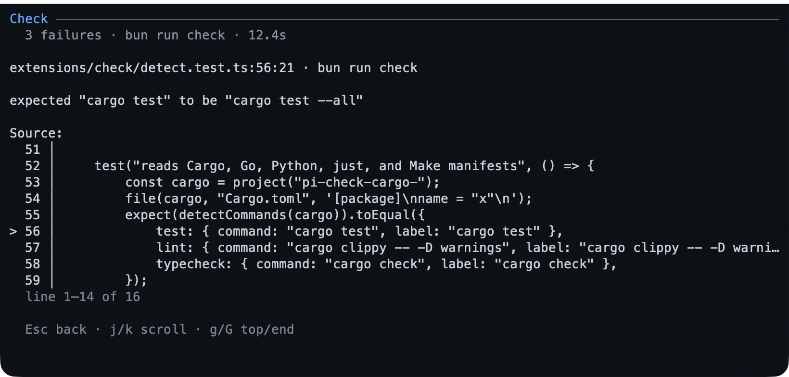
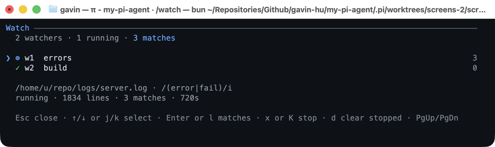
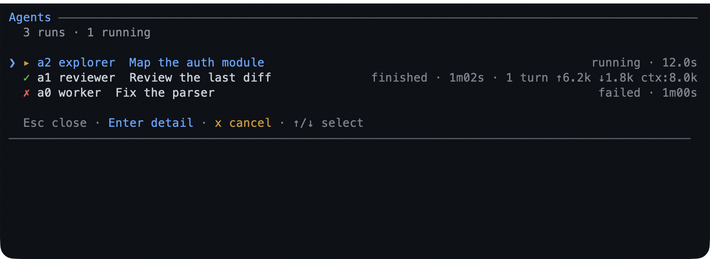

# 2. Plan and delegate

This chapter is about control: making the assistant explain its approach before
it changes anything, verify its work, keep its place, ask when a decision is
yours, and hand long or specialist work to something that can run beside the
conversation instead of inside it.

**Use this chapter when** a task spans several files, you are unfamiliar with the
codebase, a command takes minutes rather than seconds, or you want a second
opinion before you accept a change. None of these features is required for a
one-line fix; reach for them when the cost of a wrong turn is higher than the
cost of a little ceremony.

## Plan first, then write

### What it is

Plan mode puts the assistant into a read-only state. It can read files, search,
and reason, but it cannot edit your project. Its one write is a plan file under
`.pi/plans`. When the plan is ready, you review it; only your approval restores
writing and starts the work.

The plan file is the source of truth, not a chat summary. Refinements rewrite the
same file, and the assistant keeps the file's checkboxes current as it executes,
so the artifact you approved stays the artifact it follows.

### When to use it

- A change crosses more than one file, or you cannot predict its blast radius.
- You want to see the approach, the risks, and the verification step before any
  code moves.
- You are onboarding to a codebase and want the assistant to investigate first.

Plan mode is a poor fit for a typo, a question, or a task you already know how to
describe precisely.

### Walkthrough

1. In a project, start plan mode and give it the task in one step:

   ```text
   /plan add a dark mode toggle to the settings page
   ```

   The footer shows `≡ plan`. The assistant reads and reasons without modifying
   the project. It writes only the plan file.

2. When the plan is ready, the review screen opens in the terminal. The plan is
   laid out as Markdown, with its goal, context, approach, steps, risks, and
   verification. Read it, then choose an action:

   | Key | What it does |
   |---|---|
   | `↑` / `↓`, `j` / `k` | Scroll one line |
   | `Space` / `b`, `PgUp` / `PgDn` | Scroll one page |
   | `d` / `u` | Scroll half a page |
   | `g` / `G` | Jump to the start or end |
   | `n` / `p` | Jump to the next or previous heading |
   | `a` | **Approve and run**: leave plan mode and start the work |
   | `r` | Refine: type feedback, `Enter` to send it, `Esc` to go back |
   | `w` | Open the plan in the browser for review |
   | `Esc` | Keep planning without approving |

   If the plan changed since your last review, a line under the title says how
   many sections changed. A scroll gauge names the section and line range you are
   looking at.

   

   *The terminal review: the plan's sections and step checkboxes, with the
   approve, refine, and keep keys at the bottom.*

3. Prefer a browser? Press `w` on the review screen. The page opens on your own
   machine with the plan as one measured column, a live step-progress panel, a
   section outline, and a comment rail. Select text or use **+ Comment** to
   annotate a block; **Save feedback** writes the comments into the plan file and
   returns them to the assistant as a refinement.

   When the page was opened from the review screen, it also carries **Approve &
   run**, which does the same thing as pressing `a`. A page opened later with
   `/plan review` is comment-only and has no approve action.

   

   *The browser review: step progress, a comment rail, and the approval action
   when the page was opened from the terminal review.*

   In the page, `j` / `k` move between blocks, `c` comments on the current block,
   `a` approves during an approval review, `s` saves feedback, `Esc` closes the
   composer or the page, and `?` opens a shortcut sheet.

4. After approval, the plan's steps become your to-do list. Watch the widget tick
   them off. The assistant updates the plan file as it goes; you can reopen the
   plan at any time.

5. To find an earlier plan:

   ```text
   /plan list
   ```

   The list shows each plan's title, when it last changed, and its step progress,
   newest first. `Enter` opens one for review. `Esc` closes the list.

### Good to know

- `/plan` on its own toggles plan mode without sending a task. `Ctrl+Alt+P` is a
  shortcut for the same toggle where your terminal sends it. `--plan` starts Pi
  with plan mode already on.
- `/plan review [path]` opens the browser page for the newest plan, or for the
  path you give it. It is for comments only; approve from the terminal review or
  from the page opened with `w`.
- The model is asked to follow a fixed outline — goal, context, approach, steps,
  risks, verification — but any Markdown is accepted. Steps are the `- [ ]` items
  in the `## Steps` section. A plan with more than 50 top-level steps is refused
  at write time, because approval could not track them all.
- While plan mode is on, mutating tools are hidden or refused: file writes,
  edits, most shell commands, worktree mutations, and MCP tools that do not
  declare themselves read-only. `/check` and `/review` refuse until the plan is
  approved, because both can write caches or the working tree. `todo` and `goal`
  stay available, and a subagent is forced read-only.
- The review screen needs the terminal interface. A dialog-capable mode such as
  RPC offers the same choices as a select menu; a run with no UI at all fails
  with an actionable message instead of approving for you.

### Initializing AGENTS.md with /init

`/init` creates or updates the project's `AGENTS.md` through a short built-in
interview and the same plan review. It enters plan mode, reconnoiters the
repository, asks up to four questions, and prepares a proposal. Nothing is written
until you approve the plan.

```text
/init
  └─> plan mode (read-only)
        └─> recon: manifests, docs, CI, tests, existing instructions
        └─> interview: built-in bank, one call of at most 4 questions
              ├─ answered ───────────────> reconcile with evidence
              └─ unavailable/cancelled ──> evidence + assumptions
        └─> draft: new file, exact edits, or an honest no-op
        └─> quality gate
        └─> write_plan ──> exit_plan_mode
                             ├─ not approved ──> refine the same plan
                             └─ approved ──────> write/edit AGENTS.md
                                                 └─ read back + quality checklist
```

The command uses a packaged skill, so the whole workflow is explicit rather than
an improvised prompt. The built-in bank covers purpose, verification commands,
non-obvious rules, isolation, completion, sensitive paths, and dependency or
network limits, with state-specific questions for an existing `AGENTS.md`, an
empty repository, and related instruction files. The first call uses a
deterministic four-question set for the repository state; a second call is allowed
only for a material ambiguity. If the question tool is inactive, there is no UI,
or you cancel, the skill records the unanswered gaps as assumptions and continues
from evidence instead of stalling.

The skill's quality checklist requires every command and path to come from a file
that defines it, keeps the file short and specific, and preserves correct
instructions in an existing `AGENTS.md`. An accurate file can produce a no-op plan
instead of rewriting it. Both an existing repository and an empty one are
supported; an empty repository gets only known facts, with no invented commands.
`/init` needs plan mode, so it is unavailable when the `plan` extension is
disabled. It also needs the packaged skill, which ships with the full package;
loading only `extensions/plan` makes the command refuse rather than send a bare
skill name.

### Finding refactoring opportunities

The packaged `refactor` skill audits a project or path for refactoring work before
any code moves. It is model-invoked: a request such as "what should I refactor
here?" can load it automatically, and `/skill:refactor` forces it. Discovery is
read-only and returns a ranked shortlist instead of editing files.

Give it a scope with a path, or let it use the current project:

```text
/skill:refactor @extensions
/skill:refactor @extensions/plan
/skill:refactor @extensions/plan/plans.ts
```

A directory is an audit scope, a file is the starting point, and several paths
can be audited together. The skill reads the project's own instructions and CI
thresholds first, then looks for duplication, oversized modules, coupling,
structural drift, high-churn code with weak tests, test friction, and boundary
erosion. It checks callers and tests before keeping a candidate, so intentional
duplication and public API are not reported as opportunities.

The report names the scope and method, then three to five candidates ranked as
**Do next**, **Worth planning**, or **Leave it**. Each candidate includes
`path:line` evidence, the proposed structural change, expected benefit, risk and
blast radius, effort, and the commands that would verify it. Rejected signals are
listed with their reasons. Nothing is edited during the audit.

After you choose a candidate, the handoff keeps the refactor safe: state the
behavior contract, run the project's check for a baseline, add characterization
tests if the behavior is untested, enter plan mode when the change spans files or
a public surface, make one structural change per step, and run the full check at
the end. The skill is advisory rather than an enforcement layer; it can miss a
request or be ignored, but `.pi/plans` review and the check command still gate
the work once a refactor starts.

## Checking your work

### What it is

`check` runs the project's test, lint, or typecheck command from inside Pi,
streams the output live, and turns failures into a list you can open at the
failing line. It uses the project's own declared command, so the same feature
works in a Node, Rust, Go, Python, Make, or Just project.

### When to use it

Use it after a change, before you ask for a review, or when the assistant claims
something works. It is the fastest way to turn "should be fine" into evidence.

### Walkthrough

1. Run every detected check:

   ```text
   /check
   ```

   Or narrow it to one target:

   ```text
   /check test
   /check lint
   /check typecheck
   ```

   The output streams live. `Esc` cancels the run and stops the process tree.

   

   *A failed check; `Enter` opens the focused failure.*

2. On a failure, the list shows `file:line` locations. `Enter` opens the focused
   failure: its message and a five-line source excerpt around the location,
   marked with `>`. If the file cannot be read, the detail shows the bounded end
   of the command output and says why. `j` / `k` and the arrows scroll; `Esc`
   goes back. `r` reruns. `Esc` from the list closes it.

   " width="100%">

   *The failure detail: the excerpt marks the failing line, and the header keeps the run's counts.*

3. A passing run is one line in the transcript:

   ```text
   Check passed: bun run check · 12.4s
   ```

### Good to know

- Detection looks for `package.json` scripts, `Cargo.toml`, `go.mod`, pytest
  configuration or a `tests/` folder, a `justfile`, and a `Makefile`. For any
  other stack, set `check.command`; it overrides detection for every target.
- A parser that cannot find a location falls back to one honest failure entry
  naming the exit status, with the bounded log tail in its detail. It never
  invents a file or line.
- The run has a ten-minute timeout and keeps a bounded log tail by default. Both
  are configurable; see
  [Configuration](../configuration.md#check--verification-runs).
- The assistant can call the same run as `run_check` and receives structured
  failures. Asking it to check its work is usually better than asking it to run a
  test command directly.
- `/check` refuses in plan mode. The run can write caches, snapshots, or generated
  files, so it belongs after approval.
- In text-only modes `/check` runs and prints the report; there is no live
  screen.

## A to-do list and a goal

### What it is

Two small memory aids for the session:

- The **to-do list** is an ordered checklist. Every item is pending, in progress,
  or completed. The assistant rewrites the whole list when it updates it, and an
  approved plan seeds its steps into it.
- The **goal** is one sentence describing what the session is trying to achieve.
  It is restated to the assistant before every turn, so a long session does not
  drift.

Both appear as one-line widgets above the input box. The to-do widget shows
progress and the current item; the goal widget shows the objective. The to-do
list sits below the goal when both exist.

### When to use them

Use a to-do list for work with several visible steps. Use a goal when the session
has one outcome that must survive many turns — a migration, a release, a
debugging hunt. Neither is a project-management tool; they are session memory.

### Walkthrough: the to-do list

1. Ask for a checklist, or approve a plan:

   ```text
   break this migration into a checklist and keep it updated as you go
   ```

   The assistant creates the list and updates it as it works.

2. Type `/todos` to see the full list:

   ```text
   /todos
   ```

   In the terminal it opens a scrollable screen; elsewhere it posts the list as a
   notification.

   

   */todos: the summary, then each item's status at a glance.*

3. On the `/todos` screen, `↑` / `↓` or `j` / `k` scroll, `PgUp` / `PgDn` page,
   `g` / `G` or `Home` / `End` jump to the ends, and `Esc` or `Ctrl+C` closes.

4. When everything is complete, the widget hides. To keep it visible, change the
   [`todo` setting](../configuration.md#todo--the-todo-widget).

### Walkthrough: the goal

1. Set a goal in one line:

   ```text
   /goal ship a working contact form by the end of this session
   ```

   The assistant restates the goal in its own words, asks any clarifying
   questions, and shows you the wording to confirm or edit. Confirm, and the first
   turn starts.

2. Check or change it later:

   | Command | What it does |
   |---|---|
   | `/goal` | Show the current goal, or the usage when none is set |
   | `/goal <text>` | Run the understanding and confirmation loop, then start |
   | `/goal raw <text>` | Record exactly your words and start, skipping the loop |
   | `/goal set <text>` / `/goal edit <text>` | Change the goal without starting a run |
   | `/goal set` / `/goal edit` | Open the editor prefilled with the current goal |
   | `/goal done` / `/goal achieved` | Mark the goal achieved |
   | `/goal clear` | Remove the goal |
   | `/goal help` | Show the command usage |

3. If the to-do list still has open items when you mark the goal done, the
   assistant is told how many remain. That way it finishes the work rather than
   declaring it finished, and closing the list remains your decision.

### Good to know

- A goal and a to-do list survive `/resume` and `/tree`. Abandoned branches do
  not leak into the current session.
- Achieved goals are hidden from the widget by default. Set **Achieved goal** to
  Show in `/bytefly settings` to keep one visible.
- The to-do list is deliberately flat: no priorities, due dates, or sub-items. It
  accepts at most 50 items, and only one item can be in progress.
- The list and the goal are written by tools the assistant calls, so you do not
  have to manage them by hand. Use the commands to inspect, not to micro-edit.

## Answering the assistant's questions

### What it is

Sometimes the assistant needs a decision — which database, which of two designs,
whether to delete a file. Instead of guessing, it can open a structured question
with labelled options and a free-form **Other** answer, then wait for you.

A question holds one to four sub-questions. Each can offer two to four labelled
options, or none for a free-form answer, and can allow several selections.

### When to use it

This is the assistant's choice, not a command you run. Ask for it when you want
to be consulted:

```text
ask me which database to use before you start
```

### Walkthrough

1. When a question appears, read the options and choose one with the arrow keys,
   then `Enter`. Choosing **Other** opens a text box for an answer that is not
   listed.

2. With several questions, a tab bar runs across the top and each tab shows
   whether it is answered. The last tab, **Submit**, stays locked until every
   question is answered.

3. On a question that allows several answers, `Space` ticks an option and `Enter`
   confirms the set. On the **Other** row, `Space` opens the editor as well.

4. `Esc` cancels the whole question. The assistant is told you cancelled, and can
   continue or ask again in ordinary prose.

   

   *A question with labelled options; the tabs show how many questions are still
   open.*

### Good to know

- Questions only appear in an interactive session. In a text-only run the tool is
  inactive and the assistant asks in prose instead, so nothing ever hangs.
- A remote turn over [WeChat](./wechat.md) gets its questions in the chat and
  answers them there.
- There is no timeout: the question waits until you answer, cancel, or abort the
  turn. `Esc` during the turn is the cancel path.
- A subagent has no UI, so it cannot ask you anything. It reports the open
  question back to the assistant that dispatched it.

## Background jobs and watchers

### What it is

Two ways to keep working while something slow runs.

A **job** is a command the assistant starts in the background — a build, a test
suite, a server. It keeps running while you continue the conversation, and you
can read its output, send it input, wait for it, or stop it.

A **watcher** tails a file or a command's output and looks for lines that match a
pattern. When one matches, you are told, or the assistant is woken to act on it.

### When to use them

Use a job for anything that takes longer than a normal tool call. Use a watcher
when you need to know about an event rather than poll for it: a build log, a dev
server, a test run in another window.

### Walkthrough: a job

1. Ask for the slow thing in words:

   ```text
   run the full test suite in the background and tell me when it finishes
   ```

   A `▸ 1` chip appears in the footer while it runs.

2. Type `/jobs` to open the job list:

   ```text
   /jobs
   ```

   The list includes jobs this session started and any still running in another
   open Pi window, marked `peer`.

   | Key | What it does |
   |---|---|
   | `↑` / `↓`, `j` / `k` | Choose a job |
   | `PgUp` / `PgDn`, `Home` / `End` | Move a page, or to the ends |
   | `Enter` or `l` | Open the job's log |
   | `d` or `K` | Stop the running job, after a yes/no confirmation |
   | `x` | Clear finished jobs from the list |
   | `Esc` or `q` | Close the screen |

   Inside the log, `↑` / `↓`, `PgUp` / `PgDn`, `Home` / `End`, and `g` / `G`
   scroll. The view follows the newest line until you scroll up; the header says
   `following` or `paused`. `Esc`, `Backspace`, or `q` returns to the list.

   

   */jobs: running jobs first, and the focused job's last output line.*

3. A finished job that you have not read turns the chip into `✗ 1`. Open its log
   to clear the mark. A failed job keeps its result until you do.

### Walkthrough: a watcher

1. Ask for the trigger:

   ```text
   watch the dev server log and tell me when a request fails
   ```

   A `⊚ 1` chip appears while the watcher is live, and `! 1` appears when it has
   matches you have not read.

2. Type `/watch` to open the watcher list:

   ```text
   /watch
   ```

   `j` / `k` choose a watcher, `Enter` or `l` opens its matches, `x` or `K` stops a
   running watcher, `d` clears stopped ones, and `Esc` closes. Both destructive
   keys ask for confirmation. `g` / `G` and `PgUp` / `PgDn` scroll the matches
   pane.

   

   */watch: the watcher's source, pattern, and recent matches.*

3. The same actions are available as commands, which also work in text-only
   modes:

   | Command | What it does |
   |---|---|
   | `/watch list` | List the watchers |
   | `/watch matches <id>` | Print one watcher's matching lines |
   | `/watch logs <id>` | Print the raw output tail |
   | `/watch stop <id>` | Stop one watcher |
   | `/watch clear [all]` | Remove stopped watchers, or every watcher with `all` |

### Good to know

- A job keeps its output in a log file that rotates at 8 MiB by default, so a
  chatty command cannot fill your disk. The tail shown in the transcript is
  sanitized, so stray terminal codes cannot garble the screen.
- A watcher keeps the most recent 200 matches and lives only for the session. A
  match while the assistant is busy is collected for the next turn; a match while
  it is idle can wake it.
- Both can wake the assistant: say "and wake me when it's done" or "wake me when
  it matches". The same switches are **Wake when a job finishes** and **Wake on a
  match** in `/bytefly settings`.
- A job can outlive the session: **Keep jobs after exit** leaves it running. This
  is POSIX-only; Windows refuses a detached job.
- Another session's job can be read but not killed from this one. The list says
  which session owns it.

## Delegating to specialist helpers

### What it is

`subagent` hands a self-contained task to another Pi process with a narrower job:
an **explorer** to map a codebase, a **reviewer** for a second opinion, a
**tester** to write and run tests. The helper works in its own context, so its
reading does not fill your conversation, and returns only its conclusions.

### When to use it

- A question requires reading many files, and you want the conclusion rather than
  the transcript.
- Two independent investigations can run at once.
- A change deserves a reviewer that did not write it.
- A job is long enough that you want to keep talking while it runs.

Delegation is not free: a helper starts a new Pi process and uses the same model
and provider, so it spends tokens. Use it for work that benefits from isolation.

### The built-in helpers

| Helper | Best for |
|---|---|
| `explorer` | Mapping where things are and how they fit together |
| `planner` | Drafting a plan away from the main conversation; writes nothing |
| `reviewer` | A second opinion on bugs, security, and maintainability |
| `worker` | Carrying out a defined piece of work and reporting what changed |
| `researcher` | Investigating an external question with sources and confidence |
| `tester` | Adding or updating tests and running them |
| `debugger` | Finding the root cause of a failure from evidence |
| `documenter` | Bringing READMEs, docs, and changelogs in line with the code |

Each helper has an explicit tool allowlist. A reviewer cannot edit files, a
planner writes nothing, and a worker cannot start more helpers.

### Walkthrough: one helper

1. Ask for the legwork:

   ```text
   use the explorer agent to find where the login flow is implemented
   ```

2. The helper runs in its own process. Its summary appears in the transcript;
   when a run keeps a transcript, it is saved under `.pi/subagents`.

3. For a helper that must not change anything, add "read-only". It receives only
   reading tools. Plan mode forces the same restriction automatically.

### Walkthrough: several helpers

- **Parallel** for independent work: "review the API module and the UI module in
  parallel". Up to eight tasks are queued, and four run at once.
- **Chain** when each step needs the previous answer: "first explore, then have
  the planner propose options". The assistant passes each result into the next
  step, and the chain stops at the first failure.

### Walkthrough: background helpers

1. Ask for a helper in the background:

   ```text
   start an explorer on the auth module in the background
   ```

   Pi replies with a run id such as `a2` and returns to the prompt. A `↳ 1` chip
   appears in the footer while it runs, and a finish notice points at `/agents`.

2. Type `/agents` to open the board:

   ```text
   /agents
   ```

   | Key | What it does |
   |---|---|
   | `j` / `k` | Choose a run |
   | `Enter` | Open its detail |
   | `c` | Collect a finished result into the conversation |
   | `x` | Cancel a running run |
   | `Esc` | Go back or close |

   The detail pane follows the latest output while the run is live, keeping only
   a bounded preview. A finished run is collected later from the same board.

   

   */agents: background helpers, newest first; `c` collects, `x` cancels.*

3. A run still going when Pi exits is shown as interrupted next time. Its start
   and finish are recorded on the session branch, so `/resume` shows what
   happened.

### Bring your own helper

The built-ins are not the limit. Add a Markdown file to `~/.pi/agents` for every
project, or to a project's `.pi/agents` for one repository. The file is YAML
frontmatter plus a system prompt:

```markdown
---
name: auditor
description: Reviews changes for privacy issues
tools: read, grep, find, ls
---
You are a privacy auditor. Report findings as file:line references.
```

`name` and `description` are required; `tools` accepts a comma-separated list;
`model` is optional and inherits the session's model by default. A project agent
is used only when Pi trusts the project. Project-local agents load when the
assistant asks for the `project` or `both` scope.

### Good to know

- The `subagent` tool takes exactly one mode per call: one agent, a parallel
  `tasks` list, or a `chain`. It cannot combine them.
- A run has a ten-minute deadline by default, so a stuck helper reports back
  instead of hanging the session.
- Parallel and chain calls wait for their results. Only a single run can start in
  the background.
- Each parallel task's model-facing output is capped, with the full text kept in
  the tool details.
- The helper inherits the session model and thinking level unless its agent file
  names a model. It does not inherit `-e` flags from your Pi invocation, so an
  extension tool such as `web_search` must come from an installed package.

## Related

- [Keep your work safe](./keep-work-safe.md) — isolation and undo for the work these helpers do.
- [Reference](./reference.md#commands) — every command on one page.
- [Configuration](../configuration.md#subagent--delegated-runs) — subagent timeouts, transcripts, and background limits.

---

[← Previous: 1. Getting started](./getting-started.md) · [Guide home](./README.md) · [Next: 3. Keep your work safe →](./keep-work-safe.md)
