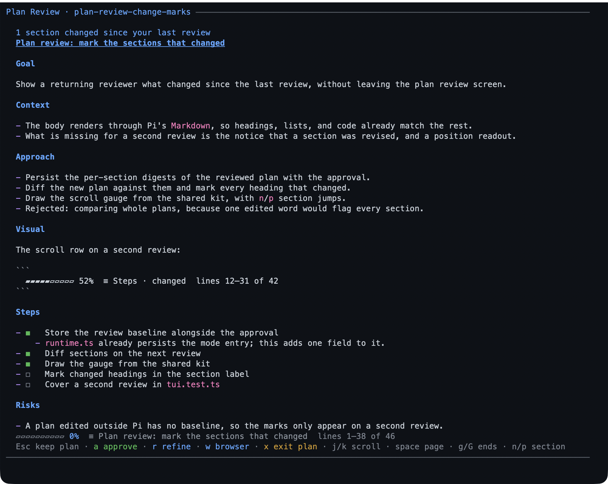
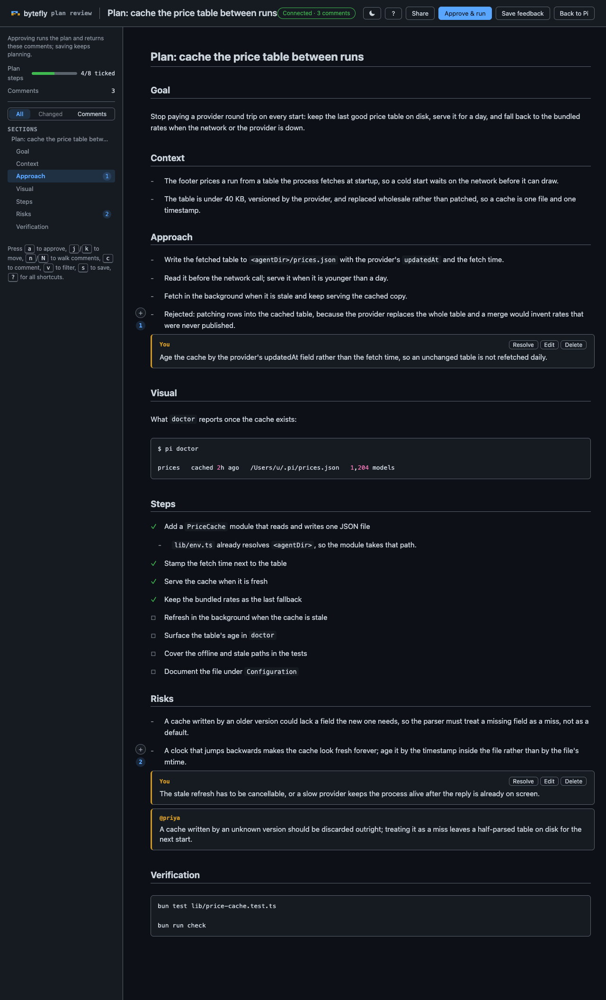
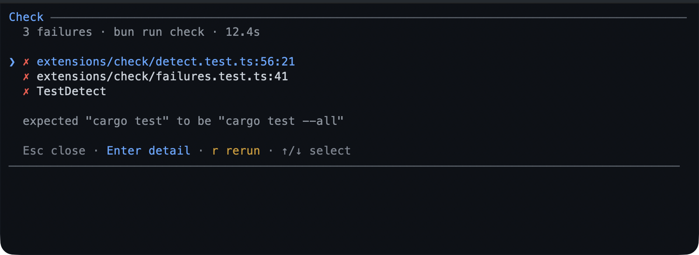
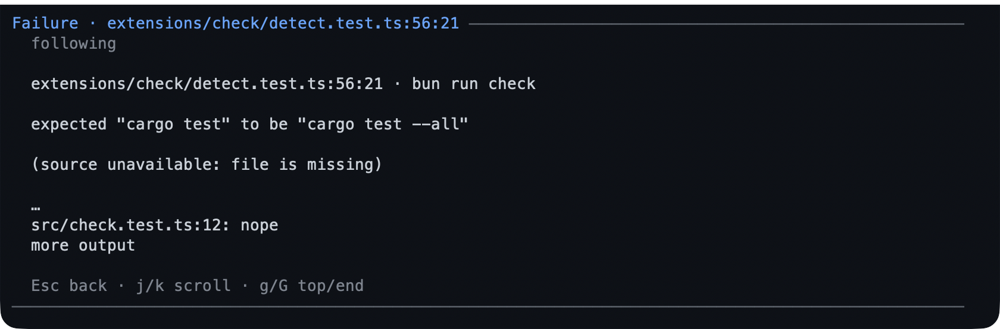

# Plan and verify

This chapter is about control: the assistant explains its approach before it
changes anything, proves the change with the project's own check, and asks you
when a decision is yours.

**Use this chapter when** a task spans several files, you are unfamiliar with the
codebase, or you want a second opinion before you accept a change. None of these
is required for a one-line fix; reach for them when the cost of a wrong turn is
higher than the cost of a little ceremony.

## Plan first, then write

### What it is

Plan mode puts the assistant into a read-only state. It can read files, search,
and reason, but it cannot edit your project. Its one write is a plan file under
`~/.pi/agent/plans/<repo-key>`. When the plan is ready, you review it; only your approval restores
writing and starts the work.

The plan file is the source of truth, not a chat summary. Refinements rewrite the
same file, and the assistant keeps the file's checkboxes current as it executes,
so the artifact you approved stays the artifact it follows.

### When to use it

- A change crosses more than one file, or you cannot predict its blast radius.
- You want to see the approach, the risks, and the verification step before any
  code moves.
- You are onboarding to a codebase and want the assistant to investigate first.

Plan mode is a poor fit for a typo, a question, or a task you already know how to
describe precisely.

### Walkthrough

1. In a project, start plan mode and give it the task in one step:

   ```text
   /plan add a dark mode toggle to the settings page
   ```

   The footer shows `≡ plan`. The assistant reads and reasons without modifying
   the project. It writes only the plan file.

2. When the plan is ready, the review screen opens in the terminal. The plan is
   laid out as Markdown, with its goal, context, approach, visual, steps, risks,
   and verification. Read it, then choose an action:

   | Key | What it does |
   |---|---|
   | `↑` / `↓`, `j` / `k` | Scroll one line |
   | `Space` / `b`, `PgUp` / `PgDn` | Scroll one page |
   | `d` / `u` | Scroll half a page |
   | `g` / `G` | Jump to the start or end |
   | `n` / `p` | Jump to the next or previous heading |
   | `a` | **Approve and run**: asks `y`/`N`, then leaves plan mode and starts the work |
   | `r` | Refine: type feedback, `Enter` to send it, `Esc` to go back |
   | `w` | Open the plan in the browser for review |
   | `x` | Exit plan mode without approving; the plan file stays |
   | `Esc` | Keep planning without approving |

   On a phone or RPC, the plan file is sent first, then one prompt: reply `1` to
   approve and run, `2` to keep planning, or `3` to exit without approving. Any
   other text is a refinement: the model rewrites the plan and asks again, with
   no second “choose Refine” step. If the file cannot be sent, the plan text is
   posted first. Dismissing the prompt, or replying `取消`, `退出`, or
   `exit plan mode`, also exits without approving.

   If the plan changed since your last review, a line under the title says how
   many sections changed. A scroll gauge names the section and line range you are
   looking at.

   

   *The terminal review: the plan's sections and step checkboxes, with the
   approve, refine, and keep keys at the bottom.*

3. Prefer a browser? Press `w` on the review screen. The page opens on your own
   machine with the plan as one measured column, a live step-progress panel, a
   section outline, and a comment rail. Select text or use **+ Comment** to
   annotate a block; **Save feedback** writes the comments into the plan file and
   returns them to the assistant as a refinement. A save with no comments asks for
   nothing, so the review screen comes back instead.

   When the page was opened from the review screen, it also carries **Approve &
   run**: the
   confirmation names what happens, starts on **Cancel**, and only its own
   button approves. A page opened later with `/plan review` is comment-only and
   has no approve action.

   

   *The browser review: step progress, a comment rail holding a teammate's
   comment, and the approval action when the page was opened from the terminal
   review.*

   In the page, `j` / `k` move between blocks, `c` comments on the current block,
   `a` opens the approval confirmation, `s` saves feedback, `Esc` closes the
   composer or the page, and `?` opens a shortcut sheet. Nothing typed is lost:
   saving, approving, or closing refuses while a comment is half-written and puts
   the cursor back in it, and a deleted comment can be undone from the header.

   **Review with someone else.** **Share** in the page header mints a link (and a
   QR a phone can scan) that a teammate on the same network opens to read the plan
   and comment under their own name. **New link** in the same dialog mints one more,
   so each reviewer holds their own: the dialog lists every link with the name it
   has bound, and **Revoke** takes one back without touching the others. Their
   comments arrive in the same file as `> [!REVIEW] @alice: …`, appear under the
   block they refer to on your page as they post them, and stay when you revise the
   plan. They cannot approve, save the review, or close it: **Approve & run**,
   **Save feedback**, and **Back to Pi** are yours alone, and the reviewer's page
   renders only **Post comments**. Her posting never ends your review — only your
   own decision, or your page going away, does that. **Revoking a link** (or
   **Stop sharing**, or closing the review) tells that reviewer's page so rather
   than leaving it guessing. From a phone-owned or remote session, `/plan share`
   prints the newest link and QR and `/plan share stop` revokes them all, because
   there is no page to click.

   The page also follows the plan file: a revision that reaches the file while the
   page is open is repainted within about a second, so nobody reviews stale text.

4. After approval, the plan's steps become your to-do list. Watch the widget tick
   them off. The assistant updates the plan file as it goes; you can reopen the
   plan at any time.

5. To find an earlier plan:

   ```text
   /plan list
   ```

   The list shows each plan's title, when it last changed, and its step progress,
   newest first. `Enter` opens one for review. `Esc` closes the list.

### Good to know

- `/plan` on its own toggles plan mode without sending a task. `Ctrl+Alt+P` is a
  shortcut for the same toggle where your terminal sends it. `--plan` starts Pi
  with plan mode already on.
- `/plan review [path]` opens the browser page for the newest plan, or for the
  path you give it. It is for comments only; approve from the terminal review or
  from the page opened with `w`.
- A shared link is a credential: anyone who holds it can read the plan, and a
  comment made through it is signed with the one name that link binds on its first
  post, so a second person on the same link is the same writer. Each teammate
  therefore gets a link of her own — **New link** in the Share dialog — and a link
  is revoked alone, or all at once with **Stop sharing**. The server binds one
  address on this network, never a wildcard, and a machine with no reachable
  address says so instead of printing a link that cannot work. Nothing leaves the
  machine.
- `/plan cancel` leaves plan mode without approving. The plan file stays, no todo
  items or goal are recorded, and write access returns immediately. The phone
  review reaches the same outcome through **Exit plan mode** or a cancel phrase;
  outside a review, the model can call `cancel_plan_mode`.
- The model is asked to follow a short outline — goal, context, approach, visual,
  steps, risks, verification — with a one-sentence goal, the end state in an
  untagged fence, before and after when the surface already exists, and
  verification named as commands you could run. It is a guide, not a form:
  `Context`, `Approach`, `Visual`, and `Risks` are dropped when they have nothing
  to say, while `Steps` and `Verification` stay, because the steps are read from
  that section and its check becomes the last todo item; any Markdown is accepted.
  Steps are the top-level `- [ ]` items in the `## Steps` section; nested bullets
  are notes, and a line indented under a step continues its text. A plan with
  more than 50 top-level steps is refused at write time, because approval could
  not track them all. A refinement keeps its section headings, so the review
  marks only the sections that changed.
- While plan mode is on, mutating tools are hidden or refused: file writes,
  edits, most shell commands, worktree mutations, and MCP tools that do not
  declare themselves read-only. `/check` and `/review` refuse until the plan is
  approved, because both can write caches or the working tree. `todo` and `goal`
  stay available, and a subagent is forced read-only.
- The review screen needs the terminal interface. A dialog-capable mode such as
  RPC offers the same choices as a select menu; a run with no UI at all fails
  with an actionable message instead of approving for you.

## Checking your work

### What it is

`check` runs the project's test, lint, or typecheck command from inside Pi,
streams the output live, and turns failures into a list you can open at the
failing line. It uses the project's own declared command, so the same feature
works in a Node, Rust, Go, Python, Make, or Just project.

### When to use it

Use it after a change, before you ask for a review, or when the assistant claims
something works. It is the fastest way to turn "should be fine" into evidence.

### Walkthrough

1. Run every detected check:

   ```text
   /check
   ```

   Or narrow it to one target:

   ```text
   /check test
   /check lint
   /check typecheck
   ```

   The output streams live. `Esc` cancels the run and stops the process tree.

   

   *A failed check; `Enter` opens the focused failure.*

2. On a failure, the list shows `file:line` locations. `Enter` opens the focused
   failure: its message and a five-line source excerpt around the location,
   marked with `>`. If the file cannot be read, the detail shows the bounded end
   of the command output and says why. `j` / `k` and the arrows scroll; `Esc`
   goes back. `r` reruns. `Esc` from the list closes it.

   " width="100%">

   *The failure detail: the excerpt marks the failing line, and the header keeps the run's counts.*

3. A passing run is one line in the transcript:

   ```text
   Check passed: bun run check · 12.4s
   ```

### Good to know

- Detection looks for `package.json` scripts, `Cargo.toml`, `go.mod`, pytest
  configuration or a `tests/` folder, a `justfile`, and a `Makefile`. For any
  other stack, set `check.command`; it overrides detection for every target.
- A parser that cannot find a location falls back to one honest failure entry
  naming the exit status, with the bounded log tail in its detail. It never
  invents a file or line.
- The run has a ten-minute timeout and keeps a bounded log tail by default. Both
  are configurable; see
  [Configuration](../configuration.md#check--verification-runs).
- The assistant can call the same run as `run_check` and receives structured
  failures. Asking it to check its work is usually better than asking it to run a
  test command directly.
- `/check` refuses in plan mode. The run can write caches, snapshots, or generated
  files, so it belongs after approval.
- In text-only modes `/check` runs and prints the report; there is no live
  screen.

## Answering the assistant's questions

### What it is

Sometimes the assistant needs a decision — which database, which of two designs,
whether to delete a file. Instead of guessing, it can open a structured question
with labelled options and a free-form **Other** answer, then wait for you.

A question holds one to four sub-questions. Each can offer two to four labelled
options, or none for a free-form answer, and can allow several selections.

### When to use it

This is the assistant's choice, not a command you run. Ask for it when you want
to be consulted:

```text
ask me which database to use before you start
```

### Walkthrough

1. When a question appears, read the options and choose one with the arrow keys,
   then `Enter`. Choosing **Other** opens a text box for an answer that is not
   listed.

2. With several questions, a tab bar runs across the top and each tab shows
   whether it is answered. The last tab, **Submit**, stays locked until every
   question is answered.

3. On a question that allows several answers, `Space` ticks an option and `Enter`
   confirms the set. On the **Other** row, `Space` opens the editor as well.

4. `Esc` cancels the whole question. The assistant is told you cancelled, and can
   continue or ask again in ordinary prose.

   

   *A question with labelled options; the tabs show how many questions are still
   open.*

### Good to know

- Questions only appear in an interactive session. In a text-only run the tool is
  inactive and the assistant asks in prose instead, so nothing ever hangs.
- A remote turn over [WeChat](./wechat.md) gets its questions in the chat and
  answers them there.
- There is no timeout: the question waits until you answer, cancel, or abort the
  turn. `Esc` during the turn is the cancel path.
- A subagent has no UI, so it cannot ask you anything. It reports the open
  question back to the assistant that dispatched it.

## Related

- [Track and remember](./track-and-remember.md) — the list and the goal that hold a plan's place.
- [Packaged workflows](./packaged-workflows.md) — the skills that end in this chapter's review.
- [Reference](./reference.md#commands) — every command on one page.

---

[← Previous: Getting started](./getting-started.md) · [Guide home](./README.md) · [Next: Track and remember →](./track-and-remember.md)
