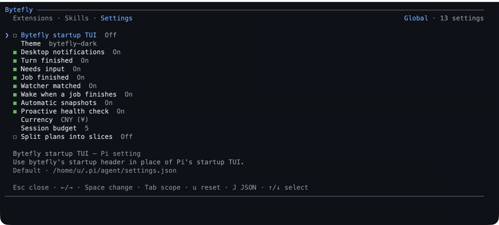

# Settings and customization

The pack's visible layer — the control centre, the settings screen, the footer,
the theme, notifications, and the health report — is one extension called
`bytefly`. This chapter shows how to change its behaviour, how to switch any
extension off, and how to remove the pack without losing your work.

**Use this chapter when** you want the pack to look or behave differently, an
extension is not doing what you expect, or you need to take the pack off a
machine.

## The control centre

Open it with:

```text
/bytefly
```

You land on **Extensions**: one row per installed extension, an enable checkbox,
and a health verdict. Under the focused row is that extension's report. Press
`→` for **Skills** — one row per Pi skill, its checkbox, and its declared
description — and `→` again for **Settings**, or open either directly with
`/bytefly skills` and `/bytefly settings`.

| Key | What it does |
|---|---|
| `←` / `→` | Switch between Extensions, Skills, and Settings |
| `↑` / `↓`, `j` / `k` | Move the selection |
| `PgUp` / `PgDn` | Move a page |
| `Home` / `End`, `g` / `G` | Jump to the first or last row |
| `Space` | Turn the focused extension or skill on or off; change a setting (Settings) |
| `Enter` | Expand the focused extension's findings or the skill's description, or change a setting |
| `Tab` | Switch between Global and Project scope |
| `x` | Clear a project-level override for the focused extension or skill |
| `u` | Reset the focused setting to its default |
| `J` | Show or hide the focused row's whole config section |
| `[` / `]` | Jump to the previous or next group (Extensions and Skills) |
| `r` | Re-run the health checks |
| `Esc` or `Ctrl+C` | Close |

Mouse scrolling works, and clicking a row focuses it. Every action also has a
keyboard path.


*The control centre: switch an extension off with `Space`, and read the selected
row's report underneath when it has one.*

### Commands

| Command | What it does |
|---|---|
| `/bytefly` | Open the control centre on Extensions |
| `/bytefly <extension>` | Open it filtered to one extension |
| `/bytefly settings` | Open it on Settings |
| `/bytefly skills` | Open it on Skills |
| `/bytefly doctor [extension] [refresh]` | Print the health report |
| `/bytefly update` | Re-run the package update check |
| `/bytefly [extension] refresh` | Open the Extensions section and re-probe health instead of using the session cache |

`/bytefly settings` and `/bytefly skills` reject an extension name; the
Extensions section accepts one. `doctor` accepts an extension name too. In
text-only modes, the command prints the grouped listing or report instead of
mounting the screen.

## Settings



`/bytefly settings` is a shortlist: thirteen preferences on one flat list, each
with its value beside the label. Choose a row and press `Space` or `Enter`: a
switch toggles, a choice cycles to the next option, and **Session budget** opens
an editor whose value you save with `Enter` or discard with `Esc`.

| Row | What it controls |
|---|---|
| **Bytefly startup TUI** | Whether the bytefly startup header replaces Pi's compact startup detail |
| **Theme** | One of this pack's two palettes, or `system` to follow Pi's |
| **Desktop notifications** | The master switch for OS notifications |
| **Turn finished** | Announce a run that has settled |
| **Needs input** | Announce a prompt the assistant opens during a run |
| **Job finished** | Announce a finished background job or watcher |
| **Watcher matched** | Announce a match that wakes the assistant |
| **Wake when a job finishes** | Start one turn when any background job ends |
| **Automatic snapshots** | Take one rewind snapshot per prompt |
| **Proactive health check** | Probe at session start and warn about a missing requirement |
| **Currency** | CNY or USD pricing for the footer's cost total |
| **Session budget** | One warning when the session's cost reaches an amount; `0` is off |

Everything else — the probe timeout, the rail glyph, the worktree numbers, the
snapshot limits, and the notification title — is a `bytefly.json` edit.
[Configuration](../configuration.md) lists every key with its default and bounds.
The list stays short on purpose so the screen fits a normal terminal.

The screen shows the effective value and where it comes from: project, global,
or default. A project value overrides a global one. The two app-level rows — the
theme and the startup header — are global only; the screen says so when you try
to set them at project scope. Two scopes write different files:

| Scope | File | Applies to |
|---|---|---|
| Global | `<agent-dir>/bytefly.json`, or Pi's personal settings for app preferences | Every project |
| Project | `<repo>/.pi/bytefly.json` | This project only, and only while Pi trusts it |

`u` removes the focused key so its default applies again. `J` reveals the whole
section as stored, which is useful when a value came from a hand-edited file.
Every key and its bounds are listed in
[Configuration](../configuration.md); the screen is a shortlist of that document,
not a separate configuration system.

## Themes

The pack ships two palettes:

- `bytefly-dark`, a GitHub-inspired dark theme designed for a near-black
  terminal background.
- `bytefly-light`, its light companion.

Installing the pack does **not** change your theme. Pick one through `/settings`
→ **Theme**, or through the **Theme** row in `/bytefly settings`. The choice is
global. To follow the system's light and dark preference, set the theme to
`bytefly-light/bytefly-dark` in Pi's settings; the combined value switches
automatically.

The terminal's own background colour shows through, so a theme cannot fix a
background it was not designed for. If the contrast looks wrong, check the
terminal profile before changing the pack.

## Notifications

Notifications are off until you enable **Desktop notifications**. Once on, four
triggers can be switched independently:

| Trigger | Fires when |
|---|---|
| **Turn finished** | A full run settles and Pi waits for your next message |
| **Needs input** | The assistant opens a prompt during a run and waits for an answer |
| **Job finished** | A background job reaches a terminal state |
| **Watcher matched** | A watcher whose wake setting is on matches and raises a turn once the assistant is idle |

`notify.method` in `bytefly.json` can stay `auto`, which prefers the terminal and
then the platform, or name a mechanism: OSC 777, OSC 99, Windows toast, macOS, or
Linux `notify-send`. `notify.title` is the title of every OS notification. An
explicit method your host cannot deliver is reported by the doctor as degraded,
not silently ignored.

An aborted run is not announced: pressing `Esc` means you are already at the
keyboard. A prompt opened while the assistant is idle is a command you just
typed, so it does not notify either; only a prompt opened during a run counts as
the assistant asking.

## Health checks

`/bytefly doctor` prints a report for every enabled extension. Each gets one
verdict:

| Verdict | Meaning |
|---|---|
| `✓` | Ready |
| `!` | Works with less than it could; the text names what is missing |
| `✕` | A hard requirement is missing |

`/bytefly doctor <extension>` narrows the report. Add `refresh` to re-probe from
scratch; otherwise the report reuses the findings cached for the session.

The doctor checks hard requirements (such as `git` for worktrees, or a runnable
`pi` for subagents) and optional pieces (such as `unpdf` for PDF fetching, or a
stored WeChat login). It also reports a malformed `bytefly.json` by file and
parse error, and the age of the built-in price table when it is old enough to
warn.

The same checks run proactively at session start when **Proactive health check**
is on and the bytefly startup surface is active. A missing requirement produces a
warning instead of a failed command. `doctor.timeoutMs` bounds each check; raise
it in `bytefly.json` on a slow machine if a probe reports a timeout.

## Update checks

Once per interactive session, the pack asks Pi's package manager which configured
packages are behind, suppresses Pi's own startup update block, and posts one
notice naming `pi update --extensions`. Pi's own newer release is drawn the same
way: Pi resolves it, and bytefly replaces the `Update Available` box with a
notice naming `pi update` and the changelog. Either new version also marks the
startup header. The package answer is cached for 24 hours, so a second session in
the same window does not repeat the request.

- `/bytefly update` re-runs the check immediately and reports the updateable
  packages, this package's version and release URL, or a skip.
- `PI_OFFLINE=1` skips the check and paints only a cached marker. It is the
  switch for the automatic update check, and Pi's release check follows it too.
- The check sends the configured package list, not your conversation. No session
  content is sent, and bytefly's release notice adds no request of its own.

## Turning features off or removing the pack

### One extension, one scope

Open `/bytefly`, focus the extension, and press `Space`. The verdict changes to
off. Use `Tab` to choose whether the switch applies to the project or to
everything, then accept the reload offer so the change takes effect. A reload is
needed because extension factories run at load time.

`x` clears a project-level override, returning the extension to the global
setting. A project that is not trusted cannot be changed at project scope.

### One run only

Start Pi with a list of extension names to leave out:

```bash
PI_DISABLED_EXTENSIONS=todo,job pi
```

Names are the directory names under `extensions/`, compared
case-insensitively. Unknown names are ignored. This stops the factories from
registering for that run; it does not change your saved settings.

### Remove the pack

```bash
pi remove npm:@gavin-hu/my-pi-agent        # personal install
pi remove npm:@gavin-hu/my-pi-agent -l     # project-local install
```

Your plans, notes, snapshots, conversations, and settings are left on disk. The
[files reference](./reference.md#files-on-disk) lists them so you can delete what
you no longer want. To drop every extension for one run without removing the
package, use Pi's `--no-extensions`.

## Related

- [Configuration](../configuration.md) — every `bytefly.json` section and key, with defaults and bounds.
- [Troubleshooting](./troubleshooting.md) — what to do when a setting has no effect.
- [Reference](./reference.md#files-on-disk) — the files these settings write.

---

[← Previous: Using it from WeChat](./wechat.md) · [Guide home](./README.md) · [Next: Troubleshooting →](./troubleshooting.md)
