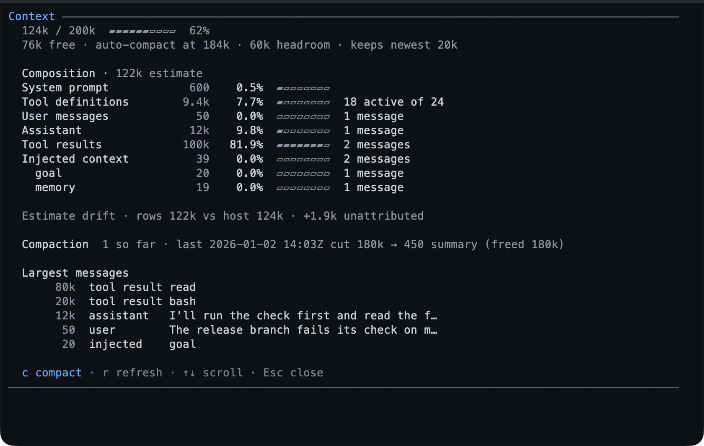
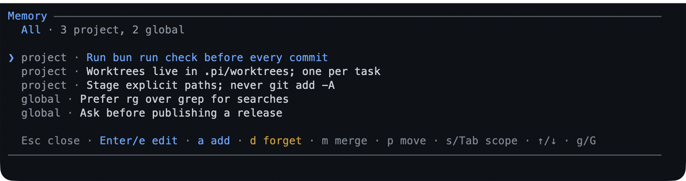

# Track and remember

Long work needs somewhere to keep its place: a checklist the assistant keeps
updated, one objective restated every turn, a report on how much context room is
left, and notes that outlive the session.

**Use this chapter when** a task has more steps than one reply, when the window
starts to feel full, or when you keep repeating the same project fact in every
new session.

## A to-do list and a goal

### What it is

Two small memory aids for the session:

- The **to-do list** is an ordered checklist. Every item is pending, in progress,
  or completed. The assistant rewrites the whole list when it updates it, and an
  approved plan seeds its steps into it.
- The **goal** is one sentence describing what the session is trying to achieve.
  It is restated to the assistant before every turn, so a long session does not
  drift.

Both appear as one-line widgets above the input box. The to-do widget shows
progress and the current item; the goal widget shows the objective. The to-do
list sits below the goal when both exist.

### When to use them

Use a to-do list for work with several visible steps. Use a goal when the session
has one outcome that must survive many turns — a migration, a release, a
debugging hunt. Neither is a project-management tool; they are session memory.

### Walkthrough: the to-do list

1. Ask for a checklist, or approve a plan:

   ```text
   break this migration into a checklist and keep it updated as you go
   ```

   The assistant creates the list and updates it as it works.

2. Type `/todos` to see the full list:

   ```text
   /todos
   ```

   In the terminal it opens a scrollable screen; elsewhere it posts the list as a
   notification.

   

   */todos: the summary, then each item's status at a glance.*

3. On the `/todos` screen, `↑` / `↓` or `j` / `k` scroll, `PgUp` / `PgDn` page,
   `g` / `G` or `Home` / `End` jump to the ends, and `Esc` or `Ctrl+C` closes.

4. When everything is complete, the widget hides. To keep it visible, change the
   [`todo` setting](../configuration.md#todo--the-todo-widget).

### Walkthrough: the goal

1. Set a goal in one line:

   ```text
   /goal ship a working contact form by the end of this session
   ```

   The assistant restates the goal in its own words, asks any clarifying
   questions, and shows you the wording to confirm or edit. Confirm, and the first
   turn starts.

2. Check or change it later:

   | Command | What it does |
   |---|---|
   | `/goal` | Show the current goal, or the usage when none is set |
   | `/goal <text>` | Run the understanding and confirmation loop, then start |
   | `/goal raw <text>` | Record exactly your words and start, skipping the loop |
   | `/goal set <text>` / `/goal edit <text>` | Change the goal without starting a run |
   | `/goal set` / `/goal edit` | Open the editor prefilled with the current goal |
   | `/goal done` / `/goal achieved` | Mark the goal achieved |
   | `/goal clear` | Remove the goal |
   | `/goal help` | Show the command usage |

3. If the to-do list still has open items when you mark the goal done, the
   assistant is told how many remain. That way it finishes the work rather than
   declaring it finished, and closing the list remains your decision.

### Good to know

- A goal and a to-do list survive `/resume` and `/tree`. Abandoned branches do
  not leak into the current session.
- Achieved goals are hidden from the widget by default. Set **Achieved goal** to
  Show in `/bytefly settings` to keep one visible.
- The to-do list is deliberately flat: no priorities, due dates, or sub-items. It
  accepts at most 50 items, and only one item can be in progress.
- The list and the goal are written by tools the assistant calls, so you do not
  have to manage them by hand. Use the commands to inspect, not to micro-edit.

## Seeing where the context goes

### What it is

Every model has a context window, and a long session eventually fills it. Pi
compacts the conversation before it overflows: an older stretch is replaced by a
summary and the newest messages are kept. `/context` shows what is in the window
now, how much room is left, and when Pi would compact, so a surprise compaction
is something you can see coming.

The report separates the parts that are easy to confuse:

- the **system prompt** — Pi's instructions, `AGENTS.md`, and project context;
- the **tool definitions** declared to the model;
- the **conversation** by role: your messages, the assistant's, and tool results;
- **injected context** from this pack (`memory`, `goal`, `plan`, and the like);
- **summaries** left by an earlier compaction;
- and the **drift** between Pi's total and the estimate, when the two differ.

### When to use it

- A turn was compacted and you want to know what survived.
- The window feels full but the conversation looks short, which usually means a
  few large tool results.
- You are about to read a big file or run a long build and want to know how much
  room is left.

### Walkthrough

1. Run `/context`. The screen opens with Pi's own number, then the composition it
   adds up to, the history, and the messages taking the most room:

   

   *The report after one compaction: tool results take four fifths of the
   estimate, and the largest single message is named.*

2. Read the rows. The **Composition** header names the estimate they are shares
   of, so the `0.5%` beside the system prompt is 0.5% of those rows, not of the
   200k window; a bar rounds to the nearest cell, so it sits within half a cell of
   the number beside it.
   **Largest messages** names the single messages taking the most room.

3. Press `c` to compact from here. The screen asks first, then reports the
   before and after numbers. Right after a compaction the token count is unknown
   until the model's next reply; the screen says so instead of showing a guess.

| Key | What it does |
|---|---|
| `↑` / `↓`, `j` / `k`, `PgUp` / `PgDn`, `Home` / `End`, `g` / `G` | Scroll the report |
| `c` | Compact the conversation, after a confirmation |
| `r` | Re-read the session and repaint |
| `Esc` / `q` | Close the screen |

Outside the terminal — `rpc`, `json`, and `print` — `/context` prints the same
report as text, and `/context compact [instructions]` is still available.

### Good to know

- The headline is Pi's estimate, built from the last provider reply plus the
  messages after it. The rows use a characters/4 estimate, so they can differ by
  a little; the report names the difference instead of hiding it.
- The threshold is the one Pi uses: the model's `reserveTokens` override, then
  the shared setting, then Pi's default. The footer's gauge shows the same
  pressure in one glyph.
- Before the session's first reply, Pi's total counts the projected messages only
  and leaves out the system prompt and tool definitions, so the rows can sit
  above it. The drift row says which way the difference runs.
- `/context compact` refuses while the agent is busy — a streaming turn or a
  running compaction — because compaction starts by aborting the turn. Pi's own
  `/compact` does abort it when that is what you want.

## Remembering between sessions

### What it is

**Memory** holds short notes that carry from one session to the next. Notes are
ordinary Markdown with one bullet per note, so you can read and edit them
yourself. Two scopes exist: **project** notes for this repository and **global**
notes for everything you do. Stored notes are injected into each run as a hidden
reminder, up to a size budget.

### When to use it

Use memory for durable facts that are not obvious from the code: a staging server
that must be running, a naming convention, a command that is not in the README.
Do not use it as a scratchpad or a substitute for project documentation.

### Walkthrough: let the assistant remember

1. Ask for something to be remembered:

   ```text
   remember that the API tests need the staging server to be up
   ```

   The note is saved and injected into every later run.

2. Review and tidy the notes:

   ```text
   /memory
   ```

   A picker lists the notes, grouped by scope.

   | Key | What it does |
   |---|---|
   | `Enter` or `e` | Edit the focused note |
   | `a` | Add a note to the active scope |
   | `m` | Mark a note to merge; `m` on a second note in the same scope opens an editor prefilled with both |
   | `p` | Move the note to the other scope |
   | `d` | Delete the focused note, after a yes/no confirmation |
   | `s` or `Tab` | Cycle the scope filter |
   | `r` | Re-read the notes from disk |
   | `Esc` | Cancel the current action, or close the picker |

   

   *The picker: filter by scope, then add, edit, merge, move, or delete.*

3. A deleted note is gone; the picker has no undo. Use `d` deliberately.

### Commands

| Command | What it does |
|---|---|
| `/memory list` | Show every stored note and the counts |
| `/memory path` | Show the two file locations and whether the project store is trusted |
| `/memory edit [project\|global]` | Open one store in an editor |
| `/memory reload` | Re-read the files after you change them by hand |
| `/memory doctor` | Report counts, sizes, notes omitted by the size budget, and near-duplicates |
| `/memory clear [project\|global]` | Clear a whole scope after a confirmation |

### Good to know

- A note is a single line of at most 500 characters. That keeps the reminder
  short and the file readable.
- Notes are injected only up to a byte budget (8 KiB by default). `/memory doctor`
  names any note that does not fit.
- The stores are `<repo-root>/.pi/memory.md` for the project and
  `<agent-dir>/memory.md` for global notes. The project store is anchored at the
  repository root, so it is the same when Pi runs from a subdirectory and across
  worktrees.
- Project notes are read and written only when Pi trusts the project. A move into
  an untrusted project is refused rather than silently dropping the note.
- `add` will not store a near-duplicate of an existing note under a conservative
  comparison (case, whitespace, and trailing punctuation do not matter). The
  result names the existing note so the assistant can update it instead.
- A merge is one write, and a move writes the destination before removing the
  source. A failed move can leave the note in both scopes; `/memory doctor`
  reports it, and merging removes the duplicate.

## Related

- [Plan and verify](./plan-and-verify.md) — the review a list and a goal serve.
- [Keep your work safe](./keep-work-safe.md) — isolation and undo for the work in flight.
- [Reference](./reference.md#commands) — every command on one page.

---

[← Previous: Plan and verify](./plan-and-verify.md) · [Guide home](./README.md) · [Next: Delegate and background →](./delegate-and-background.md)
